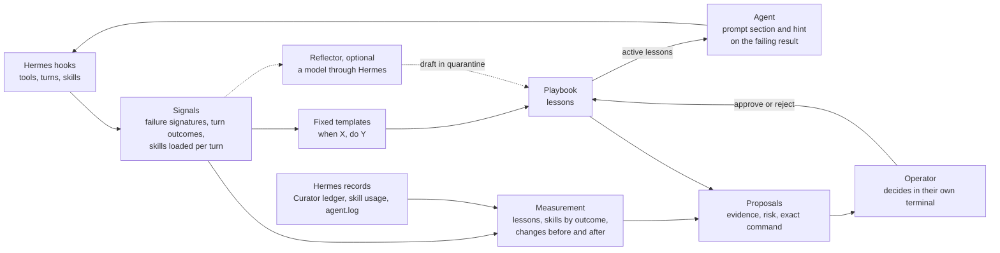

# Atlas Evolution

A measured self-improvement loop for Hermes Agent: recurring tool failures become short lessons, every lesson, skill and setting change is judged by what happened before and after it, and nothing reaches the agent or changes in Hermes without the operator.

[](https://github.com/sesantanajr/hermes-atlas-evolution/actions/workflows/tests.yml)
[](LICENSE)
[](https://github.com/NousResearch/hermes-agent/releases/tag/v0.23.1)
[](https://www.python.org/downloads/)

**English** | [Português (Brasil)](README.pt-BR.md)

Atlas Evolution is an independent, MIT-licensed community plugin for Hermes Agent (ID `hermes-evolution`, version 0.4.0). Anyone can install it in any Hermes profile; it depends on no other system. It uses the public Hermes plugin API and the Python standard library, and opens no network connection of its own. By default no model is called. An optional reflector, off by default, asks a model through Hermes to draft lessons, and every draft waits for your approval.

## Why

Hermes Agent already learns on its own: a background review rewrites skills and memory, and the Curator maintains the skill library. Four questions stay open.

- **Did the rewrite help?** Nothing compares the profile before and after it.
- **Why does the same tool call keep failing?** A missing argument is worked around in one conversation and repeated in the next.
- **Which skills make turns go worse?** Nothing links a loaded skill to a failed or corrected turn.
- **What does learning cost?** Background reviews spend tokens, and some produce nothing.

Atlas Evolution answers with measurements from Hermes hooks and Hermes' own records. It replaces nothing: memory, the Curator, skills and the model router work as before.

## What it does



1. **Signals.** A failed tool call becomes a signature: tool, one of 20 failure classes and a short detail such as the missing argument. Turns are timed per surface; owner corrections and thanks are counted.
2. **Lessons.** A recurring failure with a template becomes one sentence, "when X, do Y". An approval the user refused never becomes a lesson.
3. **Reflector (optional).** For recurring failures without a template, a model drafts a lesson through Hermes, held in quarantine.
4. **Delivery.** Active lessons reach the agent in a per-session prompt section and as a hint on the failing result.
5. **Measurement.** A lesson is measured against its own failure, a skill rewrite by the turns that loaded the skill, a setting change by the week before and after.
6. **Skills by outcome.** Each skill loaded in a turn inherits how the turn ended; a skill clearly worse than the profile becomes a proposal.
7. **Proposals and digest.** One queue with evidence, risk and the exact command, and a digest that includes the cost of background reviews.

The operations supervisor of 0.2.0 and 0.3.0 remains: Linux pressure, usage and cost, Cron and Kanban ([Operations](docs/operations.md)). The bundled skill `hermes-evolution:evolution-review` walks the owner through the digest. Thresholds are in [The evolution loop](docs/evolution-loop.md).

## Quick start

```sh
# 1. Install and enable in the current profile (hermes -p NAME selects another one)
hermes plugins install sesantanajr/hermes-atlas-evolution --enable

# 2. Check that it loads
hermes plugins doctor --ci hermes-evolution

# 3. Restart a running gateway, use Hermes for a while, then run one pass and read the digest
hermes evolution learn
hermes evolution report --days 7
```

Signals start when the plugin loads, so the first digest is nearly empty.

**Choose the lessons mode.** In the default mode, `suggest`, nothing reaches the agent until you approve it:

```sh
hermes evolution lessons list --status candidate
hermes evolution lessons approve <id>      # shows the exact text and asks
```

`auto` activates derived lessons at once and retires those measured as ineffective; reflector drafts and agent proposals still wait for you. `off` only measures. Set it in Hermes Desktop under Settings → Plugins, or see [Configuration](#configuration).

**Get the digest every week.** Lessons are derived and measured only when a pass runs. This prints a no-agent cron recipe that runs a pass and delivers the digest:

```sh
hermes evolution report --schedule-spec --weekday 1 --hour 8 --deliver local
```

Save its `script_content` at `script_path`, read it, then run `posix_command` (a `hermes cron create` call). The plugin itself writes and schedules nothing. `ops schedule-spec` does the same for the operations tick, which also runs a pass at most once an hour.

## Example digest

Illustrative output with made-up numbers: an excerpt rendered by the current code from a throwaway profile seeded with fictitious data. It is not a measurement of any real deployment.

```text
# Atlas Evolution · 7-day digest (2026-11-09 to 2026-11-15, UTC)

## Summary

- **Interactive turns:** 42 · 0 failed · 0 interrupted · 2 slow
- **Tool calls:** 168 · 3 errors (1.8%)

### Versus the previous 7 days

- `turn_failed_pct`: 16.7 → 0.0 ▼
- `tool_error_pct`: 6.5 → 1.8 ▼
- `owner_corrections_per_100_turns`: 0.0 → 7.1 ▲
- **verdict:** mixed

## Failures that repeat

- `example_search` · missing_argument (`query`): 3 times, 3 days · lesson: active
- `terminal` · approval_refused: 2 times, 2 days · never a lesson: the user's approval decides

## Self-improvement loop

- 12 background reviews · 66.7% produced nothing
- 9 skill rewrites (9 by the automatic review) · 1 skills

### Skills by outcome

- whole profile: 42 turns · 0.0% failed · 7.1% corrected
- `example-notes`: 12 turns · 0.0% failed · 25.0% corrected · 16.7% with tool errors · **worse than the profile**

## Playbook

- #1 When calling `example_search`, always pass the required argument `query`. · measured effect: effective (before 0.333 → after 0.071)

## Proposals awaiting a decision

- #1 [risk: medium] Lock a skill that keeps being rewritten · `example-notes` · apply with: `hermes curator lock example-notes`
- #2 [risk: low] Review a skill whose turns go worse than the profile · `example-notes` · next step: `hermes curator ledger --skill example-notes`
```

## Commands

Subcommands of `hermes evolution`. Output is JSON, except `report` (Markdown by default). `--lang en|pt` works before or after any subcommand.

| Command | What it does |
|---|---|
| `learn [--notify-only]` | One pass: derive lessons, ask the reflector if on, measure, refresh proposals. |
| `report [--days 1..35] [--format md\|json]` | The digest, compared with the previous period. |
| `report --schedule-spec [--weekday 0..6] [--hour 0..23] [--deliver TARGET]` | Prints the weekly cron recipe. Creates nothing. |
| `lessons list [--status STATUS]` | The playbook with origin, evidence and measured effect. |
| `lessons approve <id> [--yes]`, `lessons retire <id>` | Activates (after showing the text) or retires a lesson. Operator only. |
| `lessons add "<text>" [--tool NAME] [--activate] [--yes]` | Adds your lesson, quarantined unless `--activate`. Operator only. |
| `proposals list [--all]` | Open proposals, highest risk first. |
| `proposals approve <id> [--note TEXT] [--yes]`, `proposals reject <id> [--note TEXT]` | Decides a proposal. Operator only. A lesson takes effect; anything else returns the command for you to run. |
| `skills [--days 1..35]` | Rewrites, flip-flops and unused rewrites per skill, plus skills by outcome. |
| `experiments` | Tracked changes and their verdicts. |
| `usage [--days 1..35]` | Calls and tokens seen by the hooks, next to Hermes' accounting. |
| `ops ...` | Operations supervisor ([Operations](docs/operations.md)). |

`health`, `tick`, `feedback`, `history` and `memory` remain from earlier versions.

## Configuration

The main options are in the manifest's `config_schema`, so Hermes Desktop shows them under Settings → Plugins and stores them under `plugins.entries.hermes-evolution.settings`.

| Option | Type | Default | Effect |
|---|---|---|---|
| `lessons` | `off`, `suggest`, `auto` | `suggest` | `off` measures only; `suggest` waits for approval; `auto` activates derived lessons and retires ineffective ones after 14 days. |
| `language` | `auto`, `en`, `pt` | `auto` | `auto` follows `HERMES_LANGUAGE`, `display.language`, the locale, then English. |
| `tool_hints` | boolean | `true` | Adds the matching lesson to a failing result. |
| `feedback_signals` | boolean | `true` | Counts owner corrections, repeated questions and thanks. |
| `agent_tools` | boolean | `false` | Offers `atlas_evolution_plan` and `atlas_evolution_lessons` to the agent. |
| `slow_turn_seconds` | integer, 5 to 3600 | `60` | A turn at least this long counts as slow. |
| `owner_sender_ids` | up to 20 strings | `[]` | Gateway senders counted as the owner. Local sessions always count. |
| `reflector` | boolean | `false` | Drafts lessons for untemplated failures through the auxiliary task `evolution_reflector`. |
| `reflector_daily_limit` | integer, 1 to 50 | `6` | Reflector model calls per UTC day. |

Without the Desktop, write them in the profile's `config.yaml`, quoting `"off"`:

```yaml
plugins:
  entries:
    hermes-evolution:
      settings:
        lessons: auto
```

`<HERMES_HOME>/evolution/settings.json` (optional, up to 64 KiB) accepts the same options in an `evolution` block (`agent_tools` is the top-level `agent_advice`); values set through Hermes win key by key. It also holds the advanced options of the supervisor, cost rates, Kanban and the 0.1 notes, listed in [Operations](docs/operations.md#configuration-keys).

Settings are read when the plugin loads, so restart the gateway after a change. In the gateway an invalid value falls back to its default, and an invalid `lessons` means `off`; the commands stop with an error.

## How a lesson reaches the agent

Two paths, neither of which rewrites a cached prompt.

- **Session prompt section.** Hermes renders `atlas-evolution.playbook` when a session starts and freezes it into that session: active lessons, effective ones first, at most 8 and 1,200 characters. A lesson activated mid-session appears in the next session. A pass running in another process does not leave a new session without its lessons.
- **Hint on the failing result.** When a call fails with a signature that has an active lesson, `transform_tool_result` appends the sentence to that result, as new content at the end of the conversation. Once per failure per session, at most 6 per session, never on success.

Nothing is injected per turn. With `lessons` set to `off`, neither surface is registered.

## Who decides

The operator. The agent can only propose.

- `lessons approve`, `retire` and `add` and `proposals approve` and `reject` refuse to run in an agent's shell. Hermes marks it with `HERMES_SESSION_ID`, `HERMES_KANBAN_TASK` or `HERMES_DELEGATED_CHILD_CONTEXT`, and the plugin adds `ATLAS_EVOLUTION_AGENT` to every subprocess of an agent session.
- Activating shows the exact text and asks. Without an interactive terminal it requires `--yes`.
- A lesson proposal's risk follows its author: template or operator low, reflector medium, agent high.
- With `agent_tools` on, the agent can propose up to 5 lessons per hour, all quarantined.
- Skill and setting changes in Hermes are printed as native commands. The plugin runs none of them.
- The bundled skill informs and recommends; the owner runs the decisions.

## Safety and privacy

- **Stored:** daily counters, allowlisted names, failure classes with a filtered detail, hashed session IDs, lesson sentences and proposal notes, all under `<HERMES_HOME>/evolution/`. No telemetry.
- **Not stored:** conversation text, prompts, responses, tool arguments or output, memory content, raw log lines.
- **Lesson text** is normalized (NFKC); control, bidirectional and zero-width characters and secret-shaped values are refused.
- **Approval refusals** (denied, timed out, no approver, non-interactive) form the class `approval_refused`, which never becomes a lesson. The `blocked_by_policy` lesson says not to look for another way and to tell the user.
- **Reflector.** While on, it keeps one scrubbed error excerpt of up to 300 characters per untemplated failure. Hermes makes the call under the auxiliary task `evolution_reflector` (model chosen in `auxiliary.evolution_reflector`), with caps per pass and per day. Excerpts are deleted once a draft exists, after 14 days, or at the next pass with the reflector off.
- **Hooks fail open** and queue writes (512 entries) while the database is busy; overflow is reported as `dropped_events`.

Details are in [SECURITY.md](SECURITY.md).

## Compatibility and limits

Requires Hermes Agent 0.23.1 or later and Python 3.11 or later.

**Verified on the development machine** (measurements, not guarantees):

- 206 tests, unit and end-to-end against a simulated Hermes, also under Hermes' Python with its native redactor; CI runs Python 3.11 to 3.13.
- `hermes plugins validate` and `doctor` of Hermes 0.23.1: no warnings (2 tools, 14 hooks), also with the reflector on and under `plugins.isolation: host`.
- About 0.1 ms per hook event (about 6 ms before, with events lost under concurrency). With a `state.db` of about 170 MB: `learn` about 0.3 s and 25 MB, `report` about 0.35 s, `ops tick` about 0.5 s.
- The reflector ran against a simulated model; its call was checked against the Hermes 0.23.1 source.

**Not verified:** a production gateway (there are no field results), a real reflector model call, Linux trials on a real systemd, other Hermes versions, Windows and macOS.

**Limits**

- Verdicts compare two periods; they are correlations, not controlled experiments.
- Only lessons bound to a failure (derived and reflector) get a measured effect.
- First use migrates the database to schema 7, which earlier versions cannot open. To go back, restore a backup or delete `evolution.sqlite3`.
- Under `plugins.isolation: host` there is no `hermes evolution`: use `python -m hermes_evolution --home <profile> ...` (it reads `config.yaml` only with PyYAML). The reflector and the cron recipes need the Hermes CLI; a standalone pass drafts nothing and discards waiting excerpts.
- Review counts depend on a line Hermes 0.23.1 writes to `agent.log`. Owner signals are heuristics over the first words of a message.

Hooks, surfaces and reads are in [Hermes integration](docs/hermes-integration.md).

## Development

```sh
git clone https://github.com/sesantanajr/hermes-atlas-evolution
cd hermes-atlas-evolution
python -m unittest discover -s tests -v     # standard library only
hermes plugins validate .                   # needs Hermes Agent 0.23.1
python -m hermes_evolution --home /path/to/profile --hermes-version 0.23.1 report
```

See [CONTRIBUTING.md](CONTRIBUTING.md) for the privacy and translation rules and [CHANGELOG.md](CHANGELOG.md) for the history.

## Roadmap

None of this exists yet.

- A panel in Hermes Desktop and the Dashboard for the digest and the proposals.
- A bank of regression evaluations, to test a change against fixed tasks and not only the following week.
- Sending the skills that fail most, by outcome, to an optimizer such as GEPA through NousResearch's `hermes-agent-self-evolution`, with results going through the same proposal queue.

## Author

Created by **Sérgio Sant'Ana Júnior**. [LinkedIn](https://www.linkedin.com/in/sergiosantanacloud/)

## License

[MIT](LICENSE)
