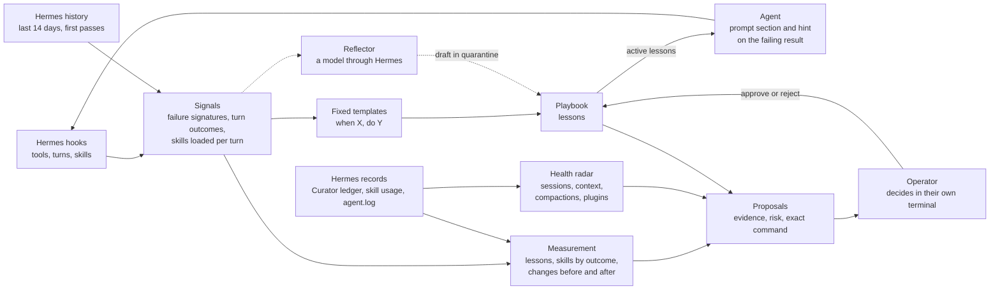

# Atlas Evolution

A measured self-improvement loop for Hermes Agent: it learns from the profile's own history on the first pass and then runs by itself, recurring tool failures become short lessons, every lesson, skill and setting change is judged by what happened before and after it, and a runtime guard vetoes agent commands that would restart the gateway or delete what Hermes runs on. No lesson reaches the agent and nothing changes in Hermes without the operator.

[](https://github.com/sesantanajr/hermes-atlas-evolution/actions/workflows/tests.yml)
[](LICENSE)
[](https://github.com/NousResearch/hermes-agent/releases/tag/v0.23.1)
[](https://www.python.org/downloads/)

**English** | [Português (Brasil)](README.pt-BR.md)

Atlas Evolution is an independent, MIT-licensed community plugin for Hermes Agent (ID `hermes-atlas-evolution`, version 0.5.0). Anyone can install it in any Hermes profile; it depends on no other system. It uses the public Hermes plugin API and the Python standard library, and opens no network connection of its own. The reflector is on by default: when a failure that has no template keeps recurring, it asks a model through Hermes to draft a lesson, at most 3 times per pass and 6 times a day by default, and every draft waits for your approval. With `reflector: false` no model is called.

## Why

Hermes Agent already learns on its own: a background review rewrites skills and memory, and the Curator maintains the skill library. Five questions stay open.

- **Did the rewrite help?** Nothing compares the profile before and after it.
- **Why does the same tool call keep failing?** A missing argument is worked around in one conversation and repeated in the next.
- **Which skills make turns go worse?** Nothing links a loaded skill to a failed or corrected turn.
- **What does learning cost?** Background reviews spend tokens, and some produce nothing.
- **Is Hermes itself healthy?** Sessions that end as orphans, heavy prompts and plugins that compete for one hook go unnoticed, and an agent with a terminal can restart or delete the Hermes it runs on.

Atlas Evolution answers with measurements from Hermes hooks and Hermes' own records. It replaces nothing: memory, the Curator, skills and the model router work as before.

## What it does



1. **Signals.** A failed tool call becomes a signature: tool, one of 20 failure classes and a short detail such as the missing argument. Turns are timed per surface; owner corrections and thanks are counted. The first passes replay the last 14 days of the profile's own history through the same code, so a failure that recurred last week can become a lesson on the first day.
2. **Lessons.** A recurring failure with a template becomes one sentence, "when X, do Y". An approval the user refused never becomes a lesson.
3. **Reflector (on by default).** For recurring failures without a template, a model drafts a lesson through Hermes, held in quarantine.
4. **Delivery.** Active lessons reach the agent in a per-session prompt section and as a hint on the failing result.
5. **Measurement.** A lesson is measured against its own failure, a skill rewrite by the turns that loaded the skill, a setting change by the week before and after.
6. **Skills by outcome.** Each skill loaded in a turn inherits how the turn ended; a skill clearly worse than the profile becomes a proposal.
7. **Health radar.** Sessions that end as orphans, a heavy context per agent call, compactions that keep most of the context, and plugins that fail to load or compete for one hook become advisory proposals with the command to inspect them.
8. **Proposals and digest.** One queue with evidence, risk and the exact command, and a digest that includes the cost of background reviews and a "Hermes health" section.

All of this runs by itself: the autopilot runs a pass in the background at most once an hour by default, and `hermes evolution status` shows whether the plugin is observing, learning and protecting the profile. The runtime guard, also on by default, vetoes agent terminal commands that would restart or kill the gateway the agent runs on, or delete what the running Hermes needs (see [Runtime guard](#runtime-guard)).

The operations supervisor of 0.2.0 and 0.3.0 remains: Linux pressure, usage and cost, Cron and Kanban ([Operations](docs/operations.md)). The bundled skill `hermes-atlas-evolution:evolution-review` walks the owner through the digest. Thresholds are in [The evolution loop](docs/evolution-loop.md).

## Quick start

```sh
# 1. Install and enable in the current profile (hermes -p NAME selects another one)
hermes plugins install sesantanajr/hermes-atlas-evolution --enable

# 2. Check that it loads
hermes plugins doctor --ci hermes-atlas-evolution

# 3. Restart a running gateway, use Hermes, then check that the plugin observes, learns and protects
hermes evolution status

# 4. Read the digest
hermes evolution report --days 7
```

After the first turn, the autopilot runs a pass in the background. The first passes replay the last 14 days of the profile's history (turns, tool calls and their failures, owner feedback and skill loads) and the background reviews logged in `agent.log`, so the first digest already has data. Model calls and tokens are counted only from the moment the plugin loads. `hermes evolution learn` runs a pass at once and gives the history 120 seconds per pass instead of 20.

**Install it in every profile you use.** Hermes loads plugins per profile, even when one gateway serves several profiles. For each profile:

```sh
hermes -p <profile> plugins install sesantanajr/hermes-atlas-evolution --enable
```

`hermes evolution status` lists the other profiles of the same Hermes root that had sessions in the last 7 days and do not have the plugin, with this command.

**Update.** `hermes plugins update` fetches the new code but does not reload a gateway that is already running (Hermes reloads plugins on install, enable and disable). Update every profile that has the plugin, then restart the gateway once; the restart waits for the turns in progress:

```sh
hermes -p <profile> plugins update hermes-atlas-evolution   # once per profile; without -p for the default profile
hermes gateway restart
hermes evolution status                               # flags any Hermes process still running older code
```

**Cover image.** Hermes shows a plugin's cover only for entries of its curated [plugin catalog](https://hermes-agent.nousresearch.com/docs/developer-guide/plugins/catalog-submission), which Nous Research reviews. Installed from GitHub, Atlas Evolution shows a generic card until its catalog entry is accepted; its cover is [docs/banner.jpg](docs/banner.jpg) (1280×640, the 2:1 size the catalog asks for).

**Choose the lessons mode.** In the default mode, `suggest`, nothing reaches the agent until you approve it:

```sh
hermes evolution lessons list --status candidate
hermes evolution lessons approve <id>      # shows the exact text and asks
```

`auto` activates derived lessons at once and retires those measured as ineffective; reflector drafts and agent proposals still wait for you. `off` only measures. Set it in Hermes Desktop under Settings → Plugins, or see [Configuration](#configuration).

**Get the digest every week.** The autopilot derives and measures. This prints a no-agent cron recipe that runs a pass and delivers the digest:

```sh
hermes evolution report --schedule-spec --weekday 1 --hour 8 --deliver local
```

Save its `script_content` at `script_path`, read it, then run `posix_command` (a `hermes cron create` call). The plugin itself writes and schedules nothing. `ops schedule-spec` does the same for the operations tick, which also runs a pass at most once an hour. The autopilot, `learn` and the tick claim the same pass, so two passes of one profile never run at the same time. To run passes only when you ask, set `autopilot_minutes` to 0.

## Example digest

Illustrative output with made-up numbers: an excerpt rendered by the current code from fictitious data. It is not a measurement of any real deployment.

```text
# Atlas Evolution · 7-day digest (2026-11-09 to 2026-11-15, UTC)

## Summary

- **Interactive turns:** 42 · 0 failed · 0 interrupted · 2 slow
- **Tool calls:** 168 · 3 errors (1.8%)

### Versus the previous 7 days

- `turn_failed_pct`: 16.7 → 0.0 ▼
- `tool_error_pct`: 6.5 → 1.8 ▼
- `owner_corrections_per_100_turns`: 0.0 → 7.1 ▲
- **verdict:** mixed

## Failures that repeat

- `example_search` · missing_argument (`query`): 3 times, 3 days · lesson: active
- `terminal` · approval_refused: 2 times, 2 days · never a lesson: the user's approval decides

## Self-improvement loop

- 12 background reviews · 66.7% produced nothing
- 9 skill rewrites (9 by the automatic review) · 1 skills

### Skills by outcome

- whole profile: 42 turns · 0.0% failed · 7.1% corrected
- `example-notes`: 12 turns · 0.0% failed · 25.0% corrected · 16.7% with tool errors · **worse than the profile**

## Playbook

- #1 When calling `example_search`, always pass the required argument `query`. · measured effect: effective (before 0.333 → after 0.071)

## Hermes health

- **Sessions:** 31 ended · 12 ended as orphans (38.7%) · _reaped after a disconnect or restart, so Hermes' end-of-session work did not run_
- **Context per agent call:** average of 41,200 tokens · 62.5% served from cache · 318 calls
- **Plugins of this process:** 6 enabled · compete for `transform_tool_result` (only the first result counts): `example-filter` → `hermes-atlas-evolution`
- **Runtime guard:** 2 commands vetoed (gateway restart or kill 2)

## Proposals awaiting a decision

- 2 lessons await approval (read them with `hermes evolution lessons list`, approve with `hermes evolution lessons approve <lesson id>`): #2 `example_fetch`, #3 `example_upload`
- #1 [risk: medium] Lock a skill that keeps being rewritten · `example-notes` · apply with: `hermes curator lock example-notes`
- #4 [risk: medium] Plugins compete for a hook where only the first counts · `transform_tool_result` · next step: `hermes plugins list`
- #2 [risk: low] Review a skill whose turns go worse than the profile · `example-notes` · next step: `hermes curator ledger --skill example-notes`
- #5 [risk: low] Many sessions end as orphans · `sessions` · next step: `hermes sessions list`
```

## Commands

Subcommands of `hermes evolution`. Output is JSON, except `report` and `status` (Markdown by default). `--lang en|pt` works before or after any subcommand.

| Command | What it does |
|---|---|
| `status [--format md\|json]` | Whether the plugin is observing, learning and protecting this profile: events seen by the hooks today, the last autopilot pass, the history backfill, the reflector, lessons, open proposals, guard vetoes in 7 days, and busy profiles of the same Hermes root that lack the plugin. |
| `learn [--notify-only]` | One pass now: replay history while the backfill is not done, derive lessons, ask the reflector if on, measure, read the radar, refresh proposals. Waits up to 30 seconds for a pass that is already running. |
| `report [--days 1..35] [--format md\|json]` | The digest, compared with the previous period. |
| `report --schedule-spec [--weekday 0..6] [--hour 0..23] [--deliver TARGET]` | Prints the weekly cron recipe. Creates nothing. |
| `lessons list [--status STATUS]` | The playbook with origin, evidence and measured effect. |
| `lessons approve <id> [--yes]`, `lessons retire <id>` | Activates (after showing the text) or retires a lesson. Operator only. |
| `lessons add "<text>" [--tool NAME] [--activate] [--yes]` | Adds your lesson, quarantined unless `--activate`. Operator only. |
| `proposals list [--all]` | Open proposals, highest risk first. |
| `proposals approve <id> [--note TEXT] [--yes]`, `proposals reject <id> [--note TEXT]` | Decides a proposal. Operator only. A lesson takes effect; anything else returns the command for you to run. |
| `skills [--days 1..35]` | Rewrites, flip-flops and unused rewrites per skill, plus skills by outcome. |
| `experiments` | Tracked changes and their verdicts. |
| `usage [--days 1..35]` | Calls and tokens seen by the hooks, next to Hermes' accounting. |
| `ops ...` | Operations supervisor ([Operations](docs/operations.md)). |

`health`, `tick`, `feedback`, `history` and `memory` remain from earlier versions.

## Configuration

The main options are in the manifest's `config_schema`, so Hermes Desktop shows them under Settings → Plugins and stores them under `plugins.entries.hermes-atlas-evolution.settings`.

| Option | Type | Default | Effect |
|---|---|---|---|
| `lessons` | `off`, `suggest`, `auto` | `suggest` | `off` measures only; `suggest` waits for approval; `auto` activates derived lessons and retires ineffective ones after 14 days. |
| `language` | `auto`, `en`, `pt` | `auto` | `auto` follows `HERMES_LANGUAGE`, `display.language`, the locale, then English. |
| `tool_hints` | boolean | `true` | Adds the matching lesson to a failing result. |
| `feedback_signals` | boolean | `true` | Counts owner corrections, repeated questions and thanks. |
| `agent_tools` | boolean | `false` | Offers `hermes_atlas_evolution_plan` and `hermes_atlas_evolution_lessons` to the agent. |
| `slow_turn_seconds` | integer, 5 to 3600 | `60` | A turn at least this long counts as slow. |
| `owner_sender_ids` | up to 20 strings | `[]` | Gateway senders counted as the owner. Local sessions always count. |
| `reflector` | boolean | `true` | Drafts lessons for untemplated failures through the auxiliary task `evolution_reflector`. Drafts always wait for approval. |
| `reflector_daily_limit` | integer, 1 to 50 | `6` | Reflector model calls per UTC day. |
| `autopilot_minutes` | `0`, or an integer from 15 to 1440 | `60` | Runs the pass in the background at most once per interval. `0` runs it only when you call `hermes evolution learn`. |
| `runtime_guard` | boolean | `true` | Vetoes agent terminal commands that would restart or kill the gateway, or delete what the running Hermes needs. |

Without the Desktop, write them in the profile's `config.yaml`, quoting `"off"`:

```yaml
plugins:
  entries:
    hermes-atlas-evolution:
      settings:
        lessons: auto
```

`<HERMES_HOME>/evolution/settings.json` (optional, up to 64 KiB) accepts the same options in an `evolution` block (`agent_tools` is the top-level `agent_advice`); values set through Hermes win key by key. It also holds the advanced options of the supervisor, cost rates, Kanban and the 0.1 notes, listed in [Operations](docs/operations.md#configuration-keys).

The hooks, the prompt section, the runtime guard, the autopilot interval and the reflector's model access are set when the plugin loads, so restart the gateway after changing them. Each autopilot pass reads the settings again, so a new `lessons` mode or reflector limit applies to the passes from the next one on. In the gateway each invalid value falls back on its own: an invalid `lessons` means `off`, an invalid `reflector` switches the reflector off, an invalid `autopilot_minutes` means 0, an invalid `runtime_guard` keeps the guard on, and the others take their defaults. The commands stop with an error.

## How a lesson reaches the agent

Two paths, neither of which rewrites a cached prompt.

- **Session prompt section.** Hermes renders `hermes-atlas-evolution.playbook` when a session starts and freezes it into that session: active lessons, effective ones first, at most 8 and 1,200 characters. A lesson activated mid-session appears in the next session. A pass running in another process does not leave a new session without its lessons.
- **Hint on the failing result.** When a call fails with a signature that has an active lesson, `transform_tool_result` appends the sentence to that result, as new content at the end of the conversation. Once per failure per session, at most 6 per session, never on success, and not when the result already carries a `hint` from Hermes' own tools.

Nothing is injected per turn. With `lessons` set to `off`, neither surface is registered.

## Runtime guard

With `runtime_guard` on (the default), a `pre_tool_call` hook vetoes two kinds of terminal commands from the agent:

- **Stopping the gateway it runs on.** `systemctl` with `restart`, `stop`, `kill` or a similar action on a `hermes-gateway` unit, `service` with `restart` or `stop` on it, and `pkill` or `killall` with an argument that contains hermes. The agent is told to run `hermes gateway restart`, which waits for the running turns to finish.
- **Removing what the running Hermes needs.** `rm`, `rmdir`, `unlink`, `shred`, `mv` or `find` with `-delete` aimed at the running Python and its environment, the Hermes source, the Hermes root, this profile, a folder that contains one of them, or a glob that matches one of them.

Only the command word counts, after variable assignments and wrappers such as `sudo` or `timeout`. Here-document bodies are ignored, and any doubt lets the command through: a relative path, an unbalanced quote, a command over 20,000 characters. The check is a pure function that never raises, because Hermes blocks a tool whose `pre_tool_call` fails. Vetoes are counted by kind only; the command is not stored. Your own terminal is not affected.

Why: on a real server the agent restarted its own gateway with `systemctl` 13 times in a week, 12 of them from one chat on one day, cutting the turns in progress, and once deleted the Python runtime the gateway unit used, which kept Hermes down for about an hour.

## Who decides

The operator. The agent can only propose.

- `lessons approve`, `retire` and `add` and `proposals approve` and `reject` refuse to run in an agent's shell. Hermes marks it with `HERMES_SESSION_ID`, `HERMES_KANBAN_TASK` or `HERMES_DELEGATED_CHILD_CONTEXT`, and the plugin adds `ATLAS_EVOLUTION_AGENT` to every subprocess of an agent session.
- Activating shows the exact text and asks. Without an interactive terminal it requires `--yes`.
- A lesson proposal's risk follows its author: template or operator low, reflector medium, agent high.
- With `agent_tools` on, the agent can propose up to 5 lessons per hour, all quarantined.
- Skill and setting changes in Hermes are printed as native commands. The plugin runs none of them.
- The bundled skill informs and recommends; the owner runs the decisions.

## Safety and privacy

- **Stored:** daily counters, allowlisted names, failure classes with a filtered detail, hashed session IDs, lesson sentences and proposal notes, counts of vetoed commands by kind, and the radar's list of plugins with problems (plugin keys and exception names), all under `<HERMES_HOME>/evolution/`. No telemetry.
- **Not stored:** conversation text, prompts, responses, tool arguments or output, memory content, raw log lines, the commands the guard vetoes.
- **History.** The backfill opens Hermes' `state.db` read-only and classifies messages and tool results in memory, exactly as the hooks do, then discards them.
- **Lesson text** is normalized (NFKC); control, bidirectional and zero-width characters and secret-shaped values are refused.
- **Approval refusals** (denied, timed out, no approver, non-interactive) form the class `approval_refused`, which never becomes a lesson. The `blocked_by_policy` lesson says not to look for another way and to tell the user.
- **Reflector** (on by default). While `lessons` is not `off`, it keeps one scrubbed error excerpt of up to 300 characters per untemplated failure. Hermes makes the call under the auxiliary task `evolution_reflector` (model chosen in `auxiliary.evolution_reflector`, otherwise the compression model), with caps per pass and per day. Drafts stay in quarantine in every mode, `auto` included, because a crafted error message could otherwise reach the agent's prompt. Excerpts are deleted once the failure has a lesson, when a draft is declined, after 14 days, or at the next pass with the reflector off.
- **Owner notice.** At most one short notice per UTC day about decisions waiting, only on the owner's local surfaces (CLI, TUI, Desktop), never in a gateway chat, where the other side may be someone else.
- **Hooks fail open** and queue writes (512 entries) while the database is busy; overflow is reported as `dropped_events`. The autopilot runs in a background thread and keeps no transaction open across a model call or a log read.

Details are in [SECURITY.md](SECURITY.md).

## Compatibility and limits

Requires Hermes Agent 0.23.1 or later and Python 3.11 or later.

**Verified on the development machine** (measurements, not guarantees):

- 257 tests, unit and end-to-end against a simulated Hermes, also under Hermes' Python with its native redactor; CI runs Python 3.11 to 3.13.
- `hermes plugins validate` of Hermes 0.23.1: no warnings (2 tools, 17 hooks), security scan safe, ready for `plugins.isolation: host`.
- The backfill, on a copy of a real profile: 275 sessions, 436 turns and 6,731 tool calls replayed in 1.2 s and 29 MB, producing 7 lessons on the first pass.
- The autopilot (one claim per profile, expiring lease, retry, profile pinning, a manual `learn` waiting for a running pass): verified in tests and in the CLI.
- Measured for 0.4.0 and not repeated for 0.5.0, whose passes also replay history and read the radar: about 0.1 ms per hook event (about 6 ms before, with events lost under concurrency); with a `state.db` of about 170 MB, `learn` about 0.3 s and 25 MB, `report` about 0.35 s, `ops tick` about 0.5 s.

**Verified in production:** three real reflector calls through Hermes (provider DeepSeek, about 600 tokens and about 2 seconds each) produced three drafts in Portuguese.

**Not verified:** lesson verdicts and skill outcomes over weeks of real use (there are no field results yet), the Kanban nudge of the autopilot, which needs the dispatcher inside the gateway (`kanban.dispatch_in_gateway`), the autopilot and the reflector under `plugins.isolation: host`, Linux trials on a real systemd, other Hermes versions, macOS, and Windows, which was only simulated in tests.

**Limits**

- Verdicts compare two periods; they are correlations, not controlled experiments.
- Only lessons bound to a failure (derived and reflector) get a measured effect.
- First use migrates the database to schema 8, which earlier versions cannot open. To go back, restore a backup or delete `evolution.sqlite3`.
- The autopilot needs a nudge: a pass that is due waits for the next turn, or for the next Kanban dispatcher tick when the dispatcher runs inside the gateway.
- The backfill reads Hermes' history only before the plugin started observing the profile, at most 14 days back. It does not replay model calls and tokens.
- Under `plugins.isolation: host` there is no `hermes evolution`: use `python -m hermes_atlas_evolution --home <profile> ...` (it reads `config.yaml` only with PyYAML). The cron recipes need the Hermes CLI; a standalone pass drafts nothing and keeps waiting excerpts for a pass run inside Hermes.
- Review counts depend on a line Hermes 0.23.1 writes to `agent.log`. Owner signals are heuristics over the first words of a message.
- The runtime guard looks only at the command word of each part of a terminal command. It looks one level into `bash -c` and `sh -c`; a command nested deeper, one run over `ssh` or from a script, a command it cannot parse, and a path relative to the working folder all pass. It is a safety net, not a sandbox.

Hooks, surfaces and reads are in [Hermes integration](docs/hermes-integration.md).

## Development

```sh
git clone https://github.com/sesantanajr/hermes-atlas-evolution
cd hermes-atlas-evolution
python -m unittest discover -s tests -v     # standard library only
hermes plugins validate .                   # needs Hermes Agent 0.23.1
python -m hermes_atlas_evolution --home /path/to/profile --hermes-version 0.23.1 report
```

See [CONTRIBUTING.md](CONTRIBUTING.md) for the privacy and translation rules and [CHANGELOG.md](CHANGELOG.md) for the history.

## Roadmap

None of this exists yet.

- A panel in Hermes Desktop and the Dashboard for the digest and the proposals.
- A bank of regression evaluations, to test a change against fixed tasks and not only the following week.
- Sending the skills that fail most, by outcome, to an optimizer such as GEPA through NousResearch's `hermes-agent-self-evolution`, with results going through the same proposal queue.

## Author

Created by **Sérgio Sant'Ana Júnior**. [LinkedIn](https://www.linkedin.com/in/sergiosantanacloud/)

## License

Atlas Evolution is free and open-source software, released under the [MIT License](LICENSE) (SPDX identifier `MIT`). You may use, copy, modify, merge, publish, distribute, sublicense and sell copies, including for commercial use, provided the copyright notice and the license text are kept in every copy. The software is provided as is, without warranty of any kind.

Contributions are welcome under the same license; see [CONTRIBUTING.md](CONTRIBUTING.md).
