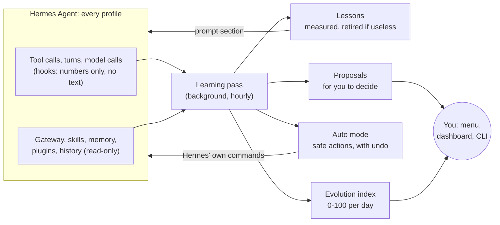
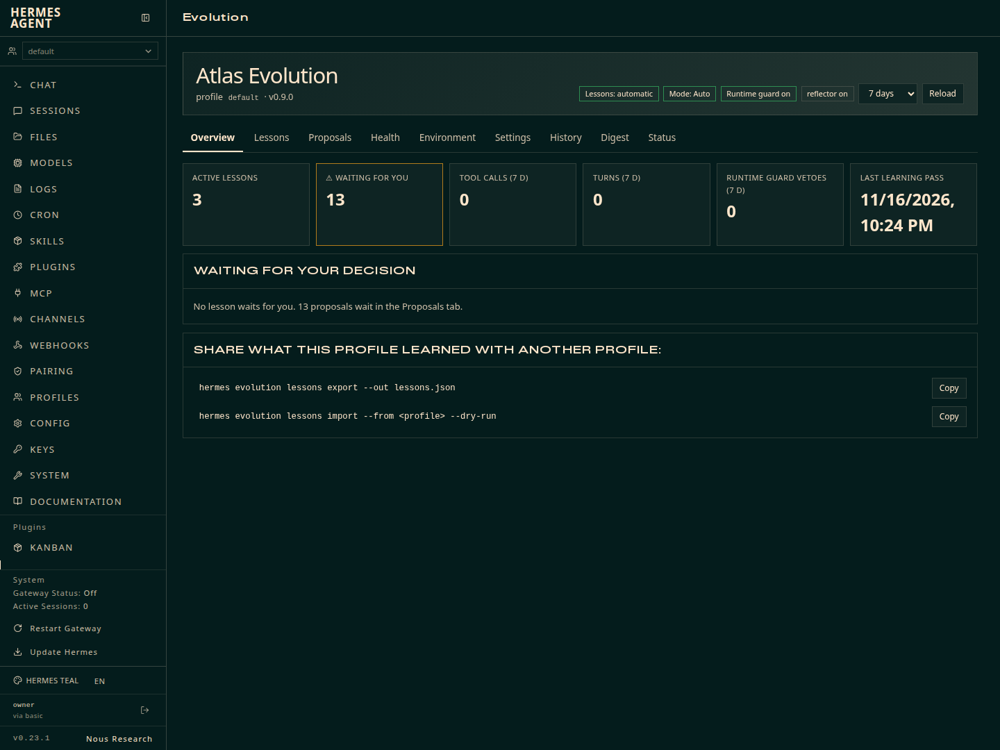
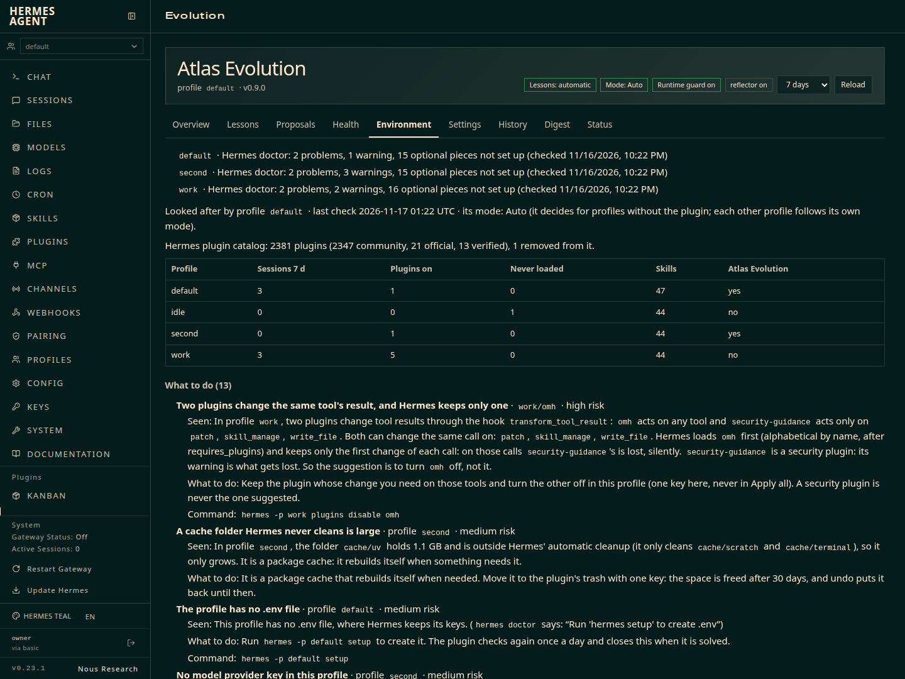

<p align="center">
  
</p>

<h1 align="center">Atlas Evolution</h1>

<p align="center">
  <b>The self-improvement and care layer for Hermes Agent.</b><br>
  It learns from the agent's mistakes, measures whether it is getting better, keeps every profile healthy and repairs itself, without spending tokens.
</p>

<p align="center">
  🌐 <b>English</b> · <a href="README.pt-BR.md">Português (Brasil)</a>
</p>

<p align="center">
  <a href="https://github.com/sesantanajr/hermes-atlas-evolution/actions/workflows/checks.yml"></a>
  <a href="CHANGELOG.md"></a>
  <a href="https://github.com/NousResearch/hermes-agent"></a>
  
  
  <a href="LICENSE"></a>
</p>

---

## Why

A Hermes that runs for weeks piles up problems nobody sees: the agent repeats the same mistake, two plugins fight over one job, plugins are installed and never load, skills sit unused or duplicated, memory fills with repeats that go into every prompt, the gateway stops after an update, the disk fills, the server misses its updates.

**Atlas Evolution** (`hermes-atlas-evolution`) watches all of it from inside Hermes, fixes by itself what is safe and can be undone, and turns the rest into short proposals in plain words, with the numbers, a recommendation and one key to apply. It is written for Hermes, with Hermes' own plugin API and commands, in English and Brazilian Portuguese.

## Highlights

| | |
|---|---|
| 🧠 **Learns from mistakes** | A tool error that keeps coming back becomes a one-sentence lesson the agent reads. Each lesson is measured, and the ones that do not help are retired. |
| 📈 **Shows whether the agent evolves** | The **Evolution index**: one 0–100 score per profile and day, from tool failures, failed or slow turns, your corrections, lessons that worked and Hermes' health, with its 7-day trend. |
| 🩺 **Keeps Hermes healthy** | Runs Hermes' own `hermes doctor` checks on every profile once a day (offline), watches the gateway, the session database, disk, memory and old tool versions, and explains each problem with the command that fixes it. |
| 🧹 **Tidies every profile** | Plugins that conflict, duplicate or never load; skills unused, duplicated or near twins; leftovers of failed installs; repeats in Hermes' memory. |
| 🔁 **Repairs itself, everywhere** | A damaged database is set aside and started again; every profile's copy of the plugin is kept on the same code; a gateway that cannot start because Hermes replaced its Python is pointed at the new one, with undo. |
| 🛡️ **Protects Hermes from its own agent** | The runtime guard vetoes agent commands that would restart or kill the gateway, delete what Hermes runs on, or switch this plugin off. |
| 🐧 **Keeps the server up to date** | Ubuntu and Debian updates with checks before and after, a safety copy and a repair if the power goes in the middle. |
| ⚡ **Costs nothing you can feel** | Every hook is timed where it runs and shown in `status`: typically well under a millisecond per tool call, with a warning if that ever grows. |

## How it works



- **Observe**: hooks count what happens (outcome, duration, failure class), never message text, tool arguments or output.
- **Learn**: a background pass turns recurring failures into lessons, measures their effect, reads every profile and Hermes' own health checks.
- **Act**: in Auto mode it applies what is safe and reversible with Hermes' own commands; the rest becomes a proposal with its undo.
- **Show**: `status`, the weekly digest, the terminal menu and the **Evolution** tab of the dashboard, with the Evolution index on top.

## Quick start

Requires **Hermes Agent 0.23.1 or later**. Hermes loads plugins per profile.

```bash
# One profile (the default one), then open the menu
hermes plugins install sesantanajr/hermes-atlas-evolution --enable
hermes evolution

# Every profile at once (asks which; --all --yes for no questions)
git clone https://github.com/sesantanajr/hermes-atlas-evolution.git && sh hermes-atlas-evolution/install.sh
```

Installing loads it into a running gateway, with no restart. The first pass replays up to 14 days of the profile's history, so it does not start from zero; in Auto mode it then installs itself in the other profiles you use. Next steps: **[Getting started](docs/en-US/getting-started.md)**.

## Modes

| Mode | By itself | Waits for you |
|---|---|---|
| **Auto** (default) | Removes duplicate memory entries, locks skills the curator keeps rewriting, frees old tool versions, keeps the plugin on the same code in every profile, installs it where a profile in use never had it, repairs the gateway's service, moves failed installs to its trash. All with undo. | Anything that could break something: turning a plugin off, removing plugins, archiving skills. |
| **Assist** | Only removes identical duplicate memory entries. | Everything else. |
| **Manual** | Nothing. It measures and proposes. | Everything. |

Every action goes to the history with its undo, and an action you undo is never repeated. Change the mode in the menu (screen 5), the dashboard or `hermes config set plugins.entries.hermes-atlas-evolution.settings.mode manual`.

## See it

**The Evolution tab of the Hermes dashboard** (and of Hermes Desktop): decide there, for every profile, with a dashboard login.



**The terminal menu**, `hermes evolution`, in your own terminal: what needs attention, lettered suggestions that act at once, and 14 screens.


<details>
<summary><b>More screens</b></summary>





</details>

## Commands

`hermes evolution <command>`; `--lang en|pt` and `--format md|json` work with all of them.

| Command | What it does |
|---|---|
| *(none)*, `menu` | The interactive menu (in an agent's shell or a pipe, it prints `status`). |
| `status` | What needs attention, the Evolution index, what the plugin costs, Hermes' and the system's health, every profile. |
| `report [--days N]` | The digest of the last N days (7 by default), against the period before. |
| `learn` | A learning pass now. |
| `lessons list \| review \| approve <id> \| export \| import` | The lessons, your decisions, and sharing them with another profile. |
| `proposals list \| approve <id> \| reject <id>` | The proposals; approving one the plugin can apply runs Hermes' own command. |
| `decisions`, `decisions undo <id>` | Every decision and automatic action, and the undo of one. |
| `care [check \| doctor \| fix \| gc \| fix-gateway \| undo-gateway]` | Hermes' health and repairs, including a gateway service that still starts a removed Python. |
| `environment [show \| scan \| catalog]` | Every profile: plugins, skills, conflicts and what to do. |
| `update [--all \| --profiles a,b] [--list]` | This plugin updated in every profile (a pinned profile moves to the latest commit). |
| `system [check \| plan \| upgrade \| repair \| report]` | The operating system's update (Linux with apt). |
| `schedule-digest [--deliver <channel>]` | The weekly digest as a Hermes cron job with no agent and no tokens. |
| `owner` | Which chat senders and channels count as you. |

Full reference: [Commands](docs/en-US/evolution-loop.md#commands). The commands `health`, `history`, `tick`, `feedback`, `memory`, `ops` and the `/evolution` chat command are deprecated and go away in 0.11.0 (each says what replaces it).

## Settings

In the dashboard's **Evolution** tab, the menu (screen 6), Hermes Desktop (Settings → Plugins) or `config.yaml` under `plugins.entries.hermes-atlas-evolution.settings`. Changes apply within a minute; `runtime_guard`, `tool_hints` and turning `agent_tools` on apply after `hermes gateway restart`.

| Option | Default | What it does |
|---|---|---|
| `mode` | `auto` | What the plugin does by itself: `auto`, `assist` or `manual` (see [Modes](#modes)). |
| `lessons` | `auto` | `auto`: template lessons apply once your own turns hit the failure; text written by a model waits for you. `suggest`: every lesson waits. `off`: measure only. |
| `owner_sender_ids`, `owner_platforms` | `[]` | Who is you in chats: your sender ids, and channels where every chat is yours. |
| `language` | `auto` | `en` or `pt`; `auto` follows the profile. |
| `reflector`, `reflector_daily_limit` | `true`, `6` | Drafts lessons with a model, through Hermes, for failures with no template; drafts wait for you. |
| `autopilot_minutes` | `60` | The background learning pass (15 to 1440; `0` = by hand only). |
| `runtime_guard` | `true` | Vetoes agent commands that would take Hermes down. |
| `agent_tools`, `tool_hints`, `feedback_signals`, `slow_turn_seconds` | | See [Settings and language](docs/en-US/evolution-loop.md#settings-and-language). |

Settings that widen whom the plugin trusts count only from Hermes' configuration, never from the plugin's own `settings.json`, which the agent's file tools can write.

## Compatibility

| | |
|---|---|
| **Hermes Agent** | 0.23.1 or later; one plugin copy per profile; works with `plugins.isolation: host` (the runtime guard then stays off). |
| **Python** | 3.11 to 3.14, standard library only. CI: Linux 3.11–3.14, macOS and Windows 3.13. |
| **Systems** | Linux: everything. macOS and Windows: everything except the operating system's update (apt) and systemd repairs. |
| **Dashboard** | The **Evolution** tab of the Hermes dashboard and Hermes Desktop. |
| **Languages** | English and Brazilian Portuguese, end to end. |

## Privacy and safety

- **Keeps** counters, failure classes, hashed session ids, lessons and proposals in `<HERMES_HOME>/evolution/`; no conversation text, prompt, tool argument or output.
- **Reads**, read-only, Hermes' history, logs, skills, plugins (parsed, never run) and health files of every profile ([full list](docs/en-US/hermes-integration.md#what-the-plugin-reads)).
- **No network of its own, no telemetry.** Only the optional reflector calls a model, through Hermes.
- **Only you decide**, in your own terminal or a dashboard with a login; the agent can never approve or widen anything. Each change has its undo or its copy.

Details: [SECURITY.md](SECURITY.md).

## Documentation

📚 **[Documentation home](docs/en-US/README.md)**: [Getting started](docs/en-US/getting-started.md) · [The evolution loop](docs/en-US/evolution-loop.md) · [Maintenance](docs/en-US/maintenance.md) · [Hermes integration](docs/en-US/hermes-integration.md) · [Updating](docs/en-US/upgrading.md) · [Troubleshooting](docs/en-US/troubleshooting.md) · [CHANGELOG](CHANGELOG.md)

## What's new in 0.10.1

- A lighter install: the images moved off the plugin's branch, so Hermes no longer copies about 3 MB of screenshots into every profile.
- Documentation reorganized in **en-US** and **pt-BR**, with a getting-started guide and a troubleshooting guide in both languages.
- CI on the current GitHub Actions runtime.

Every change: [CHANGELOG](CHANGELOG.md).

## Contributing

Issues and pull requests are welcome; read [CONTRIBUTING.md](CONTRIBUTING.md) first. Security problems go through [SECURITY.md](SECURITY.md).

## License

[MIT](LICENSE): free and open source, including commercial use, with the copyright notice kept.

## Author

Created by **Sérgio Sant'Ana Júnior** · [LinkedIn](https://www.linkedin.com/in/sergiosantanacloud/)
