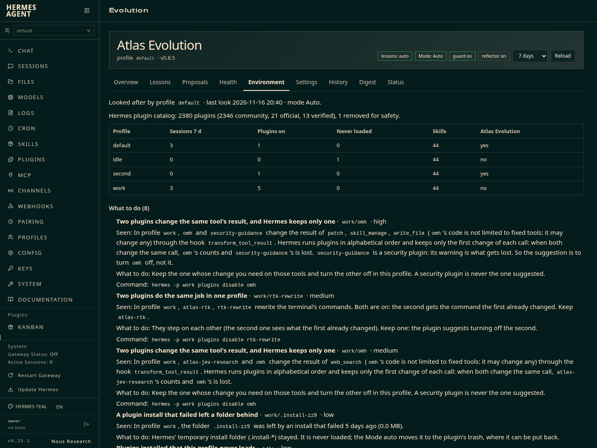
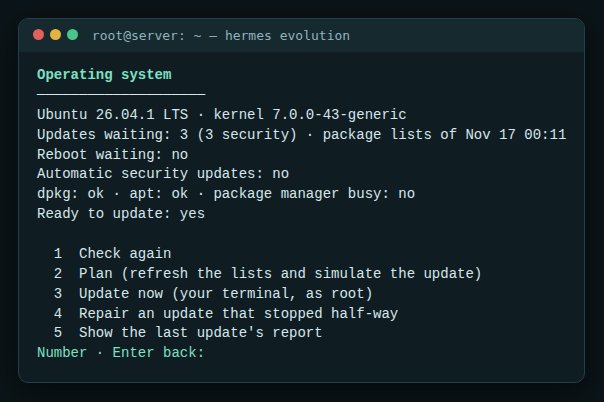

# Atlas Evolution

🌐 **English** · [Português (Brasil)](README.pt-BR.md)

**Atlas Evolution looks after your Hermes Agent for you.** It looks at every profile of your Hermes (the agent's errors, skills, memory, plugins, the gateway and the server), fixes by itself what is safe to fix, without the agent and without spending tokens, and turns the rest into short suggestions in plain words, with the numbers, a clear recommendation and one key to apply. Everything it changes can be undone.

[](LICENSE)
[](https://github.com/NousResearch/hermes-agent/releases/tag/v0.23.1)
[](docs/maintenance.md)

## What it does, in practice

A Hermes that has run for weeks piles up problems nobody sees: the agent repeats the same mistake, two plugins fight over the same job, installed plugins never load, skills sit unused or duplicated, memory fills with repeats (and it goes into every prompt), the disk fills, the server misses updates. Atlas Evolution (`hermes-atlas-evolution` in Hermes) finds these and fixes them:

| | In practice |
|---|---|
| **Stops repeated mistakes** | A tool error that keeps coming back becomes a one-sentence lesson the agent reads. The plugin measures whether it helped and drops the ones that did not. |
| **Tidies the whole environment** | Looks at every profile at once and points out plugins that change the same tool's result (and which one gets lost), two plugins doing one job, plugins removed from the Hermes catalog, archived or unmaintained, plugins installed that never load, skills unused, duplicated, alike or copied into many profiles, and leftovers of failed installs. It knows Hermes' official plugin catalog (over 2,300 plugins) and which plugins are archived or unmaintained. |
| **Saves tokens** | Takes repeats out of Hermes' memory, locks skills the curator keeps rewriting, and shows what makes each call heavy. |
| **Keeps Hermes healthy** | Runs Hermes' own `hermes doctor` checks on every profile in use once a day, without network, and turns what they find into plain steps: tools on without a key, a cache folder Hermes never cleans, rollback snapshots above the cap, a config to migrate, a security advisory. Also watches the gateway (alive or stuck), the session database, the disk (and the day it fills), memory, swap, CPU and old tool versions. Repairs with Hermes' own `doctor --fix` after a backup. |
| **Keeps the server up to date** | Updates Ubuntu or Debian with checks before and after, a safety copy, your configuration files kept, and a repair if the power goes in the middle. |
| **Protects Hermes from its own agent** | Blocks agent commands that would take down or delete what Hermes runs on. |

### Auto mode (default)

In **Auto mode** Atlas Evolution thinks and acts for you. One profile looks after the whole Hermes and sees every profile, without the plugin having to be installed in each one. By itself it only does what is safe and can be undone.

In each profile where it runs (with that profile's own mode):

- removes duplicate memory entries (a copy of the file is kept);
- locks skills the curator keeps rewriting;
- frees old tool versions, at most once a week.

In the other profiles, from the profile that looks after the whole Hermes:

- installs itself, at the same version, in profiles in use that never had it (never where you turned it off or removed it); Hermes downloads it from GitHub;
- moves folders left by failed installs to its trash (kept 30 days);
- runs Hermes' own check (`hermes doctor`) once a day and lists what it finds, with what to do and the command (a large package cache goes to the trash with one key; folders with conversation data stay yours).

What could break something (turning off one of two plugins, removing plugins, archiving skills) waits for you, with its reason and the key or command to apply. Before it changes anything in a profile, the plugin reads that profile again from disk: a stored suggestion is never trusted. Every action goes to the history with its undo, and an action you undo is never repeated. Rather decide everything yourself? Switch to **Assisted** or **Manual** in the menu (screen 5) or the dashboard.

**The first pass after you install or update, with the default settings, already acts.** It looks at every profile and may, by itself: remove duplicate memory entries, lock skills the curator keeps rewriting, run `hermes pm gc` if old tool versions take 300 MB or more, install the plugin in profiles used in the last 7 days that never had it, and move failed install folders to its trash. For nothing to change by itself, run `hermes config set plugins.entries.hermes-atlas-evolution.settings.mode manual` before updating and decide everything on screen 14.

Its data stays on your machine, it opens no network connection of its own, and the agent never decides anything.

## See it

### In the Hermes dashboard

The **Evolution** tab of the Hermes dashboard (and of Hermes Desktop). With a dashboard login you decide there, for every profile.




### In the terminal

`hermes evolution` opens the same, as a numbered menu, in your own terminal (never in an agent's shell): what needs attention, lettered suggestions that act at once, and 14 screens.




## Quick start

Requires Hermes Agent 0.23.1 or later. Hermes loads plugins per profile, so install it in each profile you use.

```bash
hermes plugins install sesantanajr/hermes-atlas-evolution --enable              # the default profile
hermes -p <profile> plugins install sesantanajr/hermes-atlas-evolution --enable # each named profile
hermes evolution                                                                # the menu
```

Installing loads the plugin into a running gateway; no restart is needed. The first look reads up to 14 days of the profile's history, so it does not start from zero. In Auto mode the plugin then installs itself in the other profiles you use. To update it: [Updating](docs/upgrading.md).

### Install or update in every profile at once

```bash
git clone https://github.com/sesantanajr/hermes-atlas-evolution.git && sh hermes-atlas-evolution/install.sh
```

It lists your profiles and asks which ones (Enter = all). Without questions: `sh install.sh --all --yes --install-missing --restart`. Once installed, `hermes evolution update` does the same from Hermes (`--all`, `--profiles a,b`, `--list`). If the gateway does not come back after Hermes updated itself: `hermes evolution care fix-gateway`.

## What's new in 0.9.0

- **Hermes' own check, every day, on every profile.** The plugin runs the `hermes doctor` checks on each profile in use once a day, without network and without changing anything, and turns each problem into plain words, with what to do and the command: tools on without a key, a missing `.env`, a large cache Hermes never cleans, rollback snapshots above the cap, a config to migrate, a memory provider turned off, a security advisory (always first). Optional pieces you never set up are only counted. A problem of the whole machine is listed once.
- **`hermes doctor` without a false warning.** The plugin's agent tools are registered only when you turn them on, so `hermes doctor` reports nothing about the plugin.
- **The full `hermes doctor`, explained.** From the menu it shows its own list of what to do ("problems found" is an answer, not a failure), and `--fix` says first what it may change and what the backup restores.
- **Safer actions.** The trash keeps each folder 30 days from the day it enters and empties itself after that; Auto mode respects a profile you removed the plugin from, linked installs, forks and Hermes' rule for profile names; `hermes pm gc` runs once for the whole Hermes; the runtime guard stops attempts to take the gateway down by looking up its process, without blocking ordinary commands.
- **Bilingual end to end.** Panel, menu, every command's output and the settings form in English and Brazilian Portuguese, in the profile's language. Every change: [CHANGELOG](CHANGELOG.md).

## Commands

Subcommands of `hermes evolution`. `--lang en|pt` works with any of them.

| Command | What it does |
|---|---|
| *(none)*, `menu` | The interactive menu, in your own terminal. Without one (a script, a pipe, an agent's shell), the bare command prints `status`. |
| `status` | Whether the plugin observes, learns and protects this profile, what needs attention, Hermes' health and the system's, and every profile of this Hermes. |
| `report [--days N]` | The digest of the last N days (7 by default), compared with the period before. |
| `lessons list`, `lessons review`, `lessons approve <id>`, `lessons approve --all` | The lessons, and your decision on the ones that wait. |
| `proposals list`, `proposals approve <id>`, `proposals reject <id>` | The proposals; approving a change the plugin can make applies it with Hermes' own command. |
| `decisions`, `decisions undo <id>` | Your decisions and the automatic actions, from the terminal, the dashboard and the autopilot, and the undo of one. |
| `care [check \| pm-doctor \| doctor \| fix \| gc]` | Hermes' health, read from its own files; and Hermes' own checks and repairs. |
| `system [check \| plan \| upgrade \| repair \| report] [--full] [--skip PKG...]` | The operating system's update (Linux with apt). |
| `environment [show \| scan \| catalog]` | Every profile of this Hermes: plugins, skills, conflicts and what to do; `scan` looks again now; `catalog` the Hermes plugin catalog kept in the plugin's database. |
| `schedule-digest [--deliver local\|<channel>]` | The weekly digest as a Hermes cron job with no agent. |
| `lessons export`, `lessons import` | Lessons shared with another profile or machine, after showing each one. |
| `learn` | A learning pass now. |
| `owner` | Each chat channel with its senders, and the command that marks one as you. |

Every command and option: [Commands](docs/evolution-loop.md#commands).

## Settings

Set them in the **Evolution** tab of the dashboard, in the menu (screen 6), in Hermes Desktop under Settings → Plugins, or in the profile's `config.yaml` under `plugins.entries.hermes-atlas-evolution.settings`. A change applies within a minute, without restarting the gateway. Three apply after `hermes gateway restart` (in the terminal, at the next session): `runtime_guard`, `tool_hints` and turning `agent_tools` on.

| Option | Default | What it does |
|---|---|---|
| `lessons` | `auto` | `auto`: template lessons apply once your own turns hit the failure, are measured and are retired when they do not help; text written by a model or by the agent waits for you. `suggest`: every lesson waits for you. `off`: measure only. |
| `mode` | `auto` | What the plugin does by itself. `auto`: thinks and acts for you in every profile, only what is safe and can be undone (see [Auto mode](#auto-mode-default)). `assist`: on its own it only removes duplicate memory entries; everything else waits for one key. `manual`: measures and proposes; nothing changes by itself. |
| `owner_sender_ids`, `owner_platforms` | `[]` | Who is you in chats: your sender ids, and platforms where every chat is yours (a private bot, your own interface). |
| `language` | `auto` | `en` or `pt`. `auto` follows the profile language. |
| `reflector` | `true` | Drafts lessons with an AI model, through Hermes, for failures with no template (at most 6 calls a day); the drafts wait for you. |
| `autopilot_minutes` | `60` | The background learning pass, at most once per interval (15 to 1440 minutes; `0` = only by hand). |
| `runtime_guard` | `true` | Vetoes agent commands that would stop the gateway or delete what Hermes runs on. |
| `agent_tools`, `tool_hints`, `feedback_signals`, `slow_turn_seconds` | | See [Settings and language](docs/evolution-loop.md#settings-and-language). |

`owner_sender_ids`, `owner_platforms`, `agent_tools: true`, `runtime_guard: false` and any `mode` other than `manual` count only from Hermes' configuration, never from the plugin's own `settings.json`, which the agent's file tools can write.

## Privacy and safety

- **What it keeps.** Counters, failure classes, hashed session ids, lessons and proposals, under `<HERMES_HOME>/evolution/`; no conversation text, prompt, tool argument or output. A copy of a memory file when an entry is taken out, owner-only; before a system update, the package list and a copy of `/etc` in a root-only folder outside every profile (`/var/lib/hermes-atlas-evolution/system/`).
- **What it reads**, read-only: Hermes' history, logs, skill records, its gateway and database files; every profile's `config.yaml`, plugins (their manifest, git checkout and Python source, parsed and never run) and skills; Hermes' cached plugin catalog; for the system, the package manager's state ([full list](docs/hermes-integration.md#what-the-plugin-reads)).
- **Network and model.** No connection of its own and no telemetry. When Auto mode installs the plugin in another profile, Hermes downloads it from GitHub. Only the reflector calls a model, through Hermes. The daily doctor checks run offline (the provider probes, npm audit and the Skills Hub check are left out); the full `hermes doctor`, run only on your click, calls the providers' APIs, npm's registry and GitHub. Everything else here spends nothing.
- **Decisions.** Only you decide, in your own terminal or in a dashboard with a login. The plugin changes its own data; its settings with `hermes config set`; Hermes' memory only to take out a repeat; skills only with `hermes curator lock`; plugins of any profile only with Hermes' own `hermes -p <profile> plugins disable|enable|install`; failed install folders by moving them to its trash; the system only when you run its update. Each change has its undo or its copy.

Details: [SECURITY.md](SECURITY.md).

## Documentation

- [The evolution loop](docs/evolution-loop.md): lessons, the reflector, automatic actions, Hermes' memory, the menu, every command and setting.
- [Maintenance](docs/maintenance.md): Hermes' health and the operating system's update, step by step.
- [Hermes integration](docs/hermes-integration.md): hooks, the dashboard panel, the runtime guard, what the plugin reads.
- [Updating](docs/upgrading.md): updating the plugin.
- [Operations](docs/operations.md), [CONTRIBUTING.md](CONTRIBUTING.md), [SECURITY.md](SECURITY.md), [CHANGELOG.md](CHANGELOG.md).

## License

Atlas Evolution is free and open-source software, released under the [MIT License](LICENSE). You may use, copy, modify, merge, publish, distribute, sublicense and sell copies, including for commercial use, provided the copyright notice and the license text are kept in every copy. The software is provided as is, without warranty of any kind. Contributions are welcome under the same license; see [CONTRIBUTING.md](CONTRIBUTING.md).

## Author

Created by **Sérgio Sant'Ana Júnior**. [LinkedIn](https://www.linkedin.com/in/sergiosantanacloud/)
