<p align="center">
  
</p>

<h1 align="center">Atlas Evolution</h1>

<p align="center">
  <b>A camada de automelhoria e cuidado do Hermes Agent.</b><br>
  Aprende com os erros do agente, mede se ele está melhorando, diz por quê e o que fazer primeiro, mantém todos os perfis saudáveis e se repara sozinho, sem gastar tokens.
</p>

<p align="center">
  <b>The self-improvement and care layer for Hermes Agent.</b><br>
  It learns from the agent's mistakes, measures whether it is getting better, says why and what to do first, keeps every profile healthy and repairs itself, without spending tokens.
</p>

<p align="center">
  <a href="#pt-br"></a>
  &nbsp;
  <a href="#en-us"></a>
</p>

<p align="center">
  <a href="https://github.com/sesantanajr/hermes-atlas-evolution/actions/workflows/checks.yml"></a>
  <a href="CHANGELOG.md"></a>
  <a href="https://github.com/NousResearch/hermes-agent"></a>
  
  
  
  <a href="LICENSE"></a>
</p>

---

<a id="pt-br"></a>

## 🇧🇷 Português (Brasil)

*[Read in English](#en-us) · [Documentação](docs/pt-BR/README.md) · [Mudanças](CHANGELOG.pt-BR.md)*

### Por quê

Um Hermes que roda há semanas acumula problemas que ninguém vê: o agente repete o mesmo erro, dois plugins brigam pelo mesmo trabalho, plugins instalados nunca carregam, skills ficam paradas ou duplicadas, a memória enche de repetições que vão em todo prompt, o gateway para depois de uma atualização, o disco enche, o servidor fica sem atualização.

O **Atlas Evolution** (`hermes-atlas-evolution`) acompanha tudo isso de dentro do Hermes, resolve sozinho o que é seguro e pode ser desfeito, e transforma o resto em propostas curtas, em português, com os números, uma recomendação e uma tecla para aplicar. Ele é feito para o Hermes, com a API de plugins e os comandos do próprio Hermes, em português e inglês.

### Destaques

| | |
|---|---|
| 🧠 **Aprende com os erros** | Um erro de ferramenta que volta vira uma lição de uma frase que o agente passa a ler. A falha é lida como uma pessoa leria (num traceback, só a exceção; numa saída longa, só o fim), cada lição é medida a partir da primeira vez que o agente a viu, e as que não ajudam são aposentadas. |
| 📈 **Mostra se o agente evolui, e por quê** | O **Índice de evolução**: uma nota de 0 a 100 por perfil e por dia, a partir das falhas de ferramentas, dos turnos que falharam ou foram lentos, das suas correções, das lições que funcionaram e da saúde do Hermes, com a tendência de 7 dias. Quando ele muda, diz qual parte e o que a moveu (`ferramentas 92 → 62 · terminal +147 erros`). |
| 🎯 **Diz o que fazer primeiro** | Até 3 passos em ordem dos pontos que cada um pode somar ao índice, cada um com o seu comando. Uma falha que dispara hoje (uma dependência, uma chave, um serviço ou uma cota que mudou) é avisada no mesmo dia. |
| 🩺 **Mantém o Hermes saudável** | Roda as checagens do próprio `hermes doctor` em cada perfil uma vez por dia (sem rede), acompanha o gateway, o banco de sessões, o disco, a memória e versões antigas de ferramentas, e explica cada problema com o comando que resolve. |
| 🧹 **Arruma todos os perfis** | Plugins em conflito, duplicados ou que nunca carregam; skills sem uso, duplicadas ou quase iguais; restos de instalações que falharam; entradas repetidas entre a memória e o perfil do usuário do Hermes. |
| 🔁 **Se repara, com cuidado** | Um banco danificado é posto de lado e recomeçado; a cópia do plugin em cada perfil fica no código que o perfil que cuida de todos já roda; um gateway que não sobe porque o Hermes trocou o Python é apontado para o novo, só quando nenhum gateway deste Hermes está vivo e com desfazer passo a passo. |
| 🛡️ **Protege o Hermes do próprio agente** | A Proteção do Hermes barra comandos do agente que reiniciariam ou matariam o gateway, apagariam, truncariam ou mudariam a permissão daquilo em que o Hermes roda, ou desligariam este plugin, mesmo escondidos em `bash -c`, variáveis, `watch`, here-docs ou `busybox`. |
| 🐧 **Mantém o servidor atualizado** | Atualizações do Ubuntu e do Debian com checagens antes e depois, cópia de segurança e reparo se a energia cair no meio. |
| ⚡ **Não pesa** | Cada gancho é cronometrado onde roda e aparece no `status`: em geral bem menos de um milissegundo por chamada de ferramenta, com aviso se isso crescer. |

### O que ele não faz

- **Não chama modelo**, a não ser o refletor (opcional, ligado por padrão), e só pelo próprio Hermes; os rascunhos dele sempre esperam você.
- **Não guarda o que se fala**: nenhum texto de conversa, prompt, argumento ou saída de ferramenta vai para o banco.
- **Não envia telemetria.** O único acesso à rede é um `git ls-remote` deste repositório, para manter a cópia de cada perfil em dia (Modo Auto e `update`).
- **Não atualiza o próprio Hermes** nem troca modelo, chave ou provedor: aponta o problema e o comando.
- **Não desliga nem remove plugins e não arquiva skills sozinho**: isso sempre espera você.
- **Não é uma caixa de areia.** A Proteção do Hermes é uma rede de segurança contra acidentes do agente, não contra alguém decidido a contorná-la, e fica desligada com `plugins.isolation: host`.
- **Não substitui o seu backup**: as cópias que ele guarda servem para desfazer as próprias ações.

### Como funciona

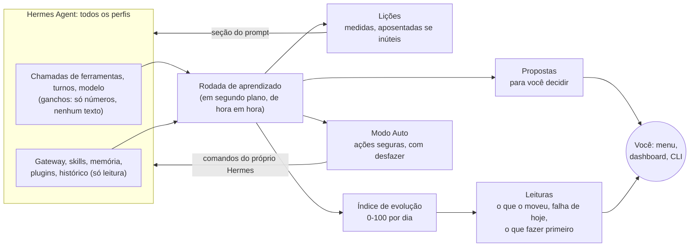

- **Observa**: os ganchos contam o que acontece (resultado, duração, classe da falha), nunca texto de mensagem, argumentos ou saída de ferramentas.
- **Aprende**: uma rodada em segundo plano transforma falhas repetidas em lições, mede o efeito delas, lê todos os perfis e as checagens de saúde do próprio Hermes.
- **Explica**: o índice diz o que o moveu, uma falha que disparou hoje e o que fazer primeiro, com poucas consultas aos números que o plugin já guarda, sem chamar modelo.
- **Age**: no Modo Auto aplica o que é seguro e reversível, conferindo de novo o disco e os serviços logo antes de agir; o resto vira proposta com o seu desfazer.
- **Mostra**: o `status`, o resumo semanal, o menu do terminal e a aba **Evolution** do dashboard, com o Índice de evolução no topo.

### Começo rápido

Requer **Hermes Agent 0.23.1 ou superior**. O Hermes carrega plugins por perfil.

```bash
# Um perfil (o padrão), depois abra o menu
hermes plugins install sesantanajr/hermes-atlas-evolution --enable
hermes evolution
```

```bash
# Todos os perfis de uma vez: pergunta quais (Enter = todos) e instala onde ainda não há
git clone https://github.com/sesantanajr/hermes-atlas-evolution.git
sh hermes-atlas-evolution/install.sh --install-missing
```

Sem perguntas: `sh hermes-atlas-evolution/install.sh --all --yes --install-missing`. Instalar carrega o plugin num gateway em execução, sem reiniciar. A primeira rodada repassa até 14 dias do histórico do perfil, então não começa do zero; no Modo Auto, ele depois se instala nos outros perfis que você usa. Próximos passos: **[Primeiros passos](docs/pt-BR/getting-started.md)**. Já usa uma versão anterior? Veja **[Atualizar para a 0.12.0](docs/pt-BR/upgrading.md#atualizar-para-a-0120)**.

### Modos

| Modo | Sozinho | Espera você |
|---|---|---|
| **Auto** (padrão) | Remove uma entrada que se repete entre a memória (`MEMORY.md`) e o perfil do usuário (`USER.md`), trava skills que o curador reescreve sem parar, libera versões antigas de ferramentas que nada usa, mantém o plugin no código que o perfil que cuida de todos roda, instala-o onde um perfil em uso nunca o teve, repara o serviço do gateway quando nenhum gateway está vivo, move instalações que falharam para a lixeira. Tudo com desfazer, menos liberar versões antigas de ferramentas, que não tem volta. | O que poderia quebrar algo: desligar um plugin, remover plugins, arquivar skills. |
| **Assistido** | Só remove uma entrada idêntica que se repete entre `MEMORY.md` e `USER.md`. | Todo o resto. |
| **Manual** | Nada. Ele mede e propõe. | Tudo. |

Cada ação vai para o histórico com o seu desfazer, e uma ação que você desfaz nunca se repete. Troque o modo no menu (tela 5), no dashboard ou com `hermes -p <perfil> config set plugins.entries.hermes-atlas-evolution.settings.mode manual`. Se o `config.yaml` não puder ser lido (um Python sem PyYAML, por exemplo), o plugin age como Manual e diz isso primeiro no `status`. Para que o perfil que cuida de todos não mexa num perfil, desligue `fleet_managed` nesse perfil.

### Veja como é

**A aba Evolution do dashboard do Hermes** (e do Hermes Desktop): decida ali, por qualquer perfil, com login no dashboard. Sem login, ela só mostra, e esconde o texto das lições escritas por você, pelo refletor ou pelo agente.

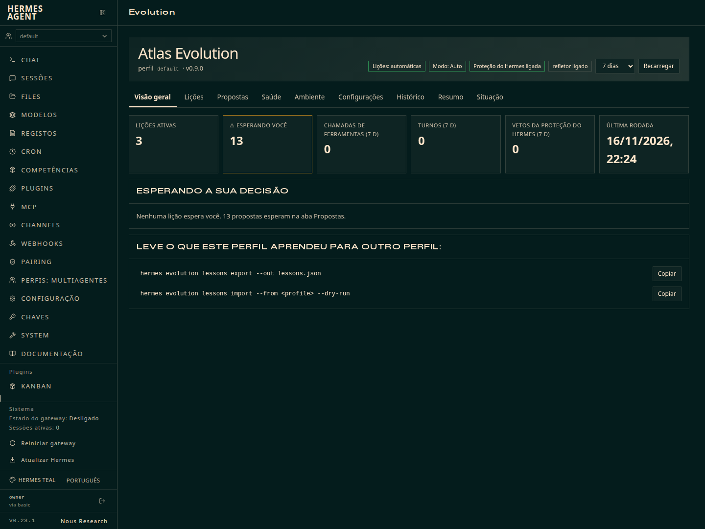

**O menu do terminal**, `hermes evolution`, no seu próprio terminal: o que pede atenção, sugestões com letras que agem na hora, e 14 telas.

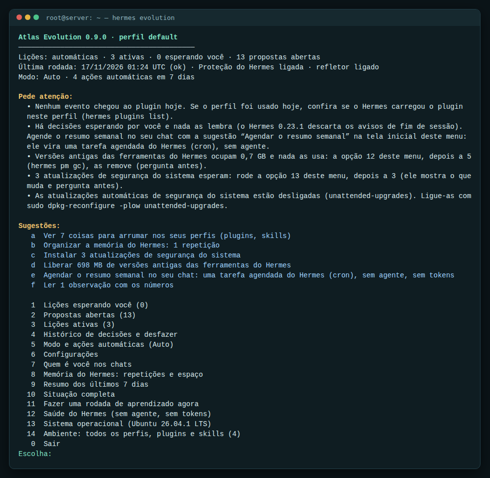

<details>
<summary><b>Mais telas</b></summary>


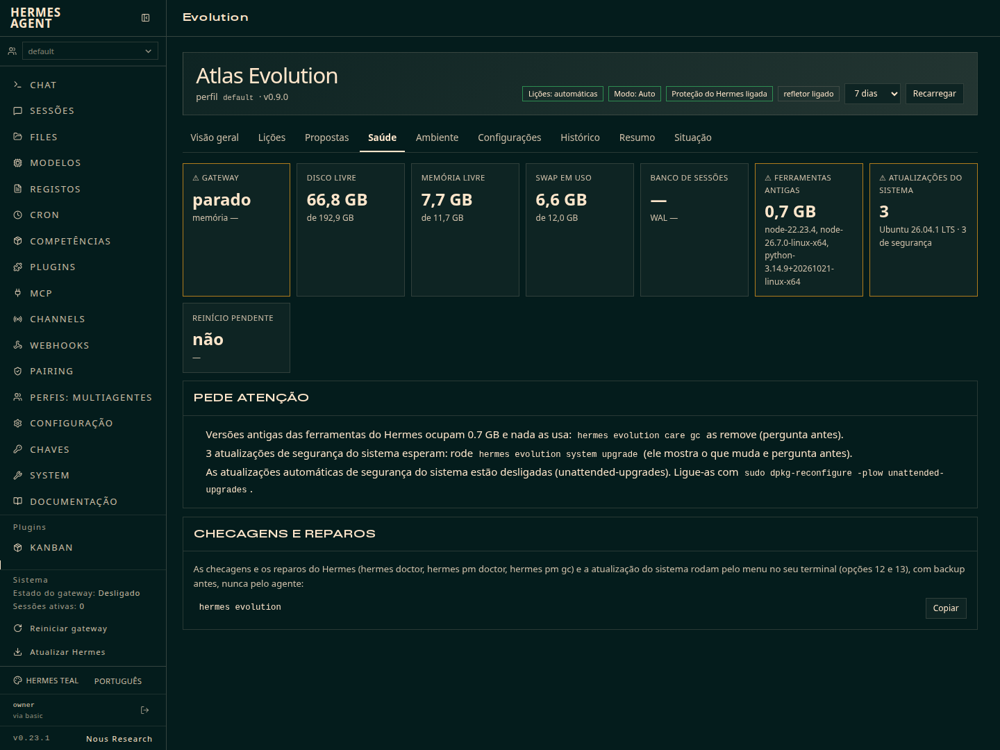

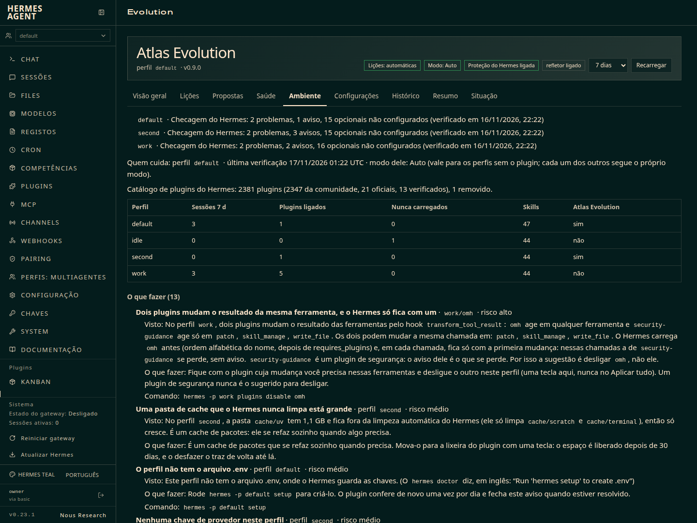

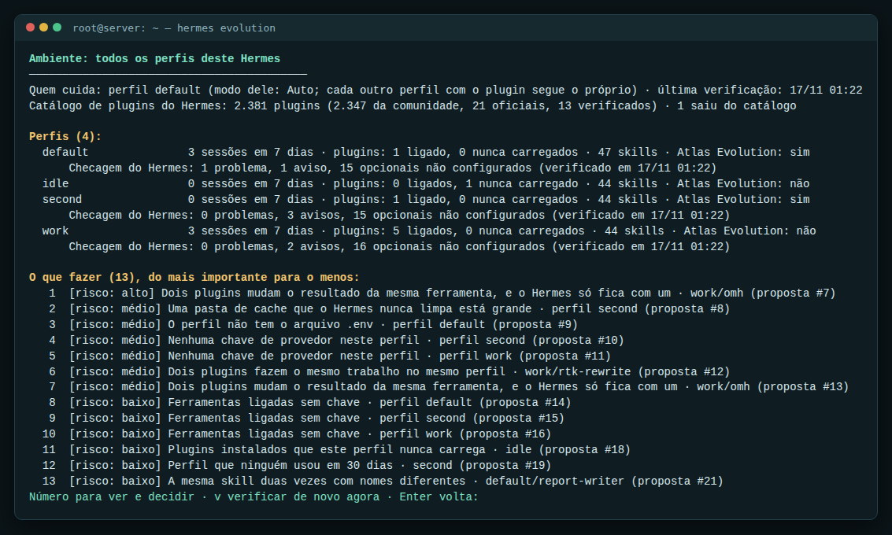

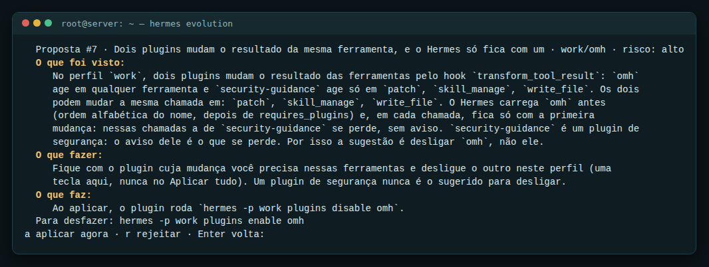


</details>

### Comandos

`hermes -p <perfil> evolution <comando>`; `--lang en|pt` funciona com todos, e `--format md|json` com todos, menos `menu`.

| Comando | O que faz |
|---|---|
| *(nenhum)*, `menu` | O menu interativo (no shell de um agente ou num pipe, imprime o `status`). |
| `status` | O que pede atenção, o Índice de evolução e o que o moveu, o que fazer primeiro, quanto o plugin custa, a saúde do Hermes e do sistema, todos os perfis. |
| `report [--days N]` | O resumo dos últimos N dias (7 por padrão), contra o período anterior, com o que fazer primeiro. |
| `learn` | Uma rodada de aprendizado agora. |
| `lessons list \| review \| approve <id> \| retire <id> \| add \| export \| import` | As lições, as suas decisões, uma lição escrita por você, e levá-las para outro perfil. |
| `proposals list \| approve <id> \| reject <id>` | As propostas; aprovar uma que o plugin sabe aplicar roda o comando do próprio Hermes. |
| `decisions list \| undo <id>` | Cada decisão e ação automática, e o desfazer de uma. |
| `care [check \| doctor \| pm-doctor \| fix \| gc \| fix-gateway \| undo-gateway]` | Saúde e reparos do Hermes, inclusive um serviço do gateway que ainda chama um Python removido. |
| `environment [show \| scan \| catalog]` | Todos os perfis: plugins, skills, conflitos e o que fazer. |
| `update [--all \| --profiles a,b] [--install-missing] [--list] [--yes]` | Este plugin atualizado em todos os perfis (um perfil fixado passa para o último commit). |
| `system [check \| plan \| upgrade \| repair \| report]` | A atualização do sistema operacional (Linux com apt). |
| `schedule-digest [--deliver <canal>]` | O resumo semanal como tarefa agendada do Hermes, sem agente e sem tokens. |
| `usage` | As chamadas de modelos e ferramentas medidas e o seu custo estimado. |
| `owner list \| add \| remove \| add-platform \| remove-platform` | Quais remetentes e canais de chat contam como você. |
| `skills` | Skills reescritas sem parar, que vão e voltam, ou reescritas e nunca usadas. |
| `experiments` | As mudanças acompanhadas, com o veredito de antes e depois. |

Referência completa: [Comandos](docs/pt-BR/evolution-loop.md#comandos).

### Configurações

Na aba **Evolution** do dashboard, no menu (tela 6), no Hermes Desktop (Configurações → Plugins) ou no `config.yaml` em `plugins.entries.hermes-atlas-evolution.settings`. As mudanças valem em até um minuto; `runtime_guard`, `tool_hints` e ligar `agent_tools` ou o `reflector` valem depois de `hermes gateway restart`.

| Opção | Padrão | O que faz |
|---|---|---|
| `mode` | `auto` | O que o plugin faz sozinho: `auto`, `assist` ou `manual` (veja [Modos](#modos)). |
| `lessons` | `auto` | `auto`: lições de padrão fixo valem quando os seus próprios turnos encontram a falha; texto escrito por um modelo espera você. `suggest`: toda lição espera. `off`: só mede. |
| `owner_sender_ids`, `owner_platforms` | `[]` | Quem é você nos chats: os seus ids de remetente e os canais em que todo chat é seu. Nas suas conversas diretas, você recebe todas as lições desde a primeira mensagem. |
| `fleet_managed` | `true` | Desligado neste perfil: o perfil que cuida de todos não instala, não atualiza e não move nada para a lixeira aqui sozinho. |
| `language` | `auto` | `en` ou `pt`; `auto` segue o perfil. |
| `reflector`, `reflector_daily_limit` | `true`, `6` | Rascunha lições com um modelo, pelo Hermes, para falhas sem padrão fixo; os rascunhos esperam você. |
| `autopilot_minutes` | `60` | A rodada de aprendizado em segundo plano (15 a 1440; `0` = só à mão). |
| `runtime_guard` | `true` | Barra comandos do agente que derrubariam o Hermes. |
| `agent_tools`, `tool_hints`, `feedback_signals`, `slow_turn_seconds` | | Veja [Configurações e idioma](docs/pt-BR/evolution-loop.md#configuração-e-idioma). |

O que amplia o que o plugin faz ou em quem ele confia só vale pela configuração do Hermes, nunca pelo `settings.json` do próprio plugin, que as ferramentas de arquivo do agente podem gravar: quem é você nos chats, as ferramentas do agente, desligar a Proteção do Hermes, um modo diferente de Manual, juntar lições aos resultados das ferramentas (`tool_hints`) e um limite do refletor acima de 6 por dia. O `settings.json` só pode restringir.

### Compatibilidade

| | |
|---|---|
| **Hermes Agent** | 0.23.1 ou superior, conferido com o código da 0.23.1 e da 0.23.2; uma cópia do plugin por perfil; funciona com `plugins.isolation: host` (a Proteção do Hermes fica desligada nesse caso). A varredura de instalação do próprio Hermes diz `safe` (`plugin-guard-v12` da 0.23.1 e `plugin-guard-v15` da 0.23.2). |
| **Python** | 3.11 a 3.14, só a biblioteca padrão. A suíte de testes roda no CI: Linux 3.11–3.14, macOS e Windows 3.13. |
| **Sistemas** | Linux: tudo. macOS e Windows: tudo, menos a atualização do sistema operacional (apt) e os reparos do systemd; ainda não testado dentro de um gateway nesses sistemas. |
| **Dashboard** | A aba **Evolution** do dashboard do Hermes e do Hermes Desktop. |
| **Idiomas** | Português do Brasil e inglês, de ponta a ponta. |

### Privacidade e segurança

- **Guarda** contadores, classes de falha, ids de sessão com hash, lições e propostas em `<HERMES_HOME>/evolution/`; nenhum texto de conversa, prompt, argumento ou saída de ferramenta.
- **Lê**, só para ler e com limite de tamanho, o histórico, os logs, as skills, os plugins (analisados, nunca executados) e os arquivos de saúde do Hermes de cada perfil ([lista completa](docs/pt-BR/hermes-integration.md#o-que-o-plugin-lê)).
- **Rede**: nenhuma telemetria; só o `git ls-remote` deste repositório. Só o refletor, opcional, chama um modelo, pelo Hermes.
- **Só você decide**, no seu próprio terminal ou num dashboard com login; o agente nunca aprova nem amplia nada. Cada mudança tem o seu desfazer ou a sua cópia.

Detalhes: [SECURITY.md](SECURITY.md).

### Documentação

📚 **[Início da documentação](docs/pt-BR/README.md)**: [Primeiros passos](docs/pt-BR/getting-started.md) · [O ciclo de evolução](docs/pt-BR/evolution-loop.md) · [Manutenção](docs/pt-BR/maintenance.md) · [Integração com o Hermes](docs/pt-BR/hermes-integration.md) · [Atualização](docs/pt-BR/upgrading.md) · [Solução de problemas](docs/pt-BR/troubleshooting.md) · [Mudanças](CHANGELOG.pt-BR.md)

### Novidades da 0.12.0

Uma auditoria completa da 0.11.0, em cinco frentes, e as correções, conferidas num Hermes 0.23.2 de verdade.

- **Pronto para o Hermes 0.23.2.** O lançador novo do Hermes fazia o plugin achar que estava no shell de um agente e recusar os seus comandos de dono no seu próprio terminal (`owner`, `care doctor`, aprovar lições). Agora ele reconhece o lançador, e um agente continua recusado.
- **Modo Auto mais seguro.** Um gateway "degradado" ou "subindo" conta como vivo, então o plugin nunca sobe um segundo gateway ao lado dele. O reparo olha os serviços dos dois escopos e só mexe no serviço que o Hermes dá a esta pasta. O `hermes pm gc` não apaga mais pasta em uso. Remover uma repetição da memória nunca apaga a última cópia. E o plugin só se instala num perfil novo com o código que o perfil que cuida de todos já roda.
- **Proteção do Hermes mais forte e mais rápida.** Barra também truncar, sobrescrever ou mudar a permissão daquilo em que o Hermes roda, e enxerga comandos escondidos em variáveis, `watch`, here-docs, `busybox` e até 8 níveis de `bash -c`. O pior caso caiu de até 41 s para menos de 0,7 s (o Hermes bloqueia a ferramenta depois de 30 s).
- **Lições mais certas.** A falha é lida como uma pessoa leria, e não vira mais "limite de taxa" porque a saída tinha `429 passed`. Cada lição é medida a partir da primeira vez que o agente a viu. E, nas conversas diretas em que o remetente é você, as lições chegam com a sua primeira mensagem (nunca em grupos ou tópicos).
- **Mais confiança.** O `settings.json` não amplia mais nada. Um `config.yaml` ilegível faz o plugin agir como Manual. O painel sem login esconde o texto das lições. A opção nova `fleet_managed` tira um perfil dos cuidados do perfil que cuida de todos.
- **Testes de volta ao CI.** Mais de 700 testes rodam em Linux, macOS e Windows; a suíte fica no ramo `tests`, então a cópia em cada perfil continua enxuta.

Cada mudança: [Mudanças](CHANGELOG.pt-BR.md).

### Contribuir

Issues e pull requests são bem-vindos; leia antes o [CONTRIBUTING.md](CONTRIBUTING.md). A suíte de testes fica no ramo `tests`. Problemas de segurança vão pelo [SECURITY.md](SECURITY.md).

### Licença

[MIT](LICENSE): livre e de código aberto, inclusive para uso comercial, mantendo o aviso de copyright.

### Autor

Criado por **Sérgio Sant'Ana Júnior** · [LinkedIn](https://www.linkedin.com/in/sergiosantanacloud/)

<p align="right"><a href="#pt-br">↑ Topo</a> · <a href="#en-us">English ↓</a></p>

---

<a id="en-us"></a>

## 🇺🇸 English

*[Leia em português](#pt-br) · [Documentation](docs/en-US/README.md) · [Changelog](CHANGELOG.md)*

### Why

A Hermes that runs for weeks piles up problems nobody sees: the agent repeats the same mistake, two plugins fight over one job, plugins are installed and never load, skills sit unused or duplicated, memory fills with repeats that go into every prompt, the gateway stops after an update, the disk fills, the server misses its updates.

**Atlas Evolution** (`hermes-atlas-evolution`) watches all of it from inside Hermes, fixes by itself what is safe and can be undone, and turns the rest into short proposals in plain words, with the numbers, a recommendation and one key to apply. It is written for Hermes, with Hermes' own plugin API and commands, in English and Brazilian Portuguese.

### Highlights

| | |
|---|---|
| 🧠 **Learns from mistakes** | A tool error that keeps coming back becomes a one-sentence lesson the agent reads. The failure is read the way a person would (in a traceback, only the exception; in long output, only its end), each lesson is measured from the first time the agent saw it, and the ones that do not help are retired. |
| 📈 **Shows whether the agent evolves, and why** | The **Evolution index**: one 0–100 score per profile and day, from tool failures, failed or slow turns, your corrections, lessons that worked and Hermes' health, with its 7-day trend. When it moves, it says which part and what moved it (`tools 92 → 62 · terminal +147 errors`). |
| 🎯 **Says what to do first** | Up to 3 steps ranked by the points each could add to the index, each with its command. A failure that jumps today (a dependency, a key, a service or a quota that changed) is flagged the same day. |
| 🩺 **Keeps Hermes healthy** | Runs Hermes' own `hermes doctor` checks on every profile once a day (offline), watches the gateway, the session database, disk, memory and old tool versions, and explains each problem with the command that fixes it. |
| 🧹 **Tidies every profile** | Plugins that conflict, duplicate or never load; skills unused, duplicated or near twins; leftovers of failed installs; entries repeated between Hermes' memory and user profile. |
| 🔁 **Repairs itself, carefully** | A damaged database is set aside and started again; every profile's copy of the plugin is kept on the code the lead profile already runs; a gateway that cannot start because Hermes replaced its Python is pointed at the new one, only when no gateway of this Hermes is alive, with step-by-step undo. |
| 🛡️ **Protects Hermes from its own agent** | The runtime guard vetoes agent commands that would restart or kill the gateway, delete, truncate or change the permissions of what Hermes runs on, or switch this plugin off, even when hidden in `bash -c`, variables, `watch`, here-documents or `busybox`. |
| 🐧 **Keeps the server up to date** | Ubuntu and Debian updates with checks before and after, a safety copy and a repair if the power goes in the middle. |
| ⚡ **Costs nothing you can feel** | Every hook is timed where it runs and shown in `status`: typically well under a millisecond per tool call, with a warning if that ever grows. |

### What it does not do

- **It calls no model** except the reflector (optional, on by default), and only through Hermes itself; its drafts always wait for you.
- **It keeps nothing anyone said**: no conversation text, prompt, tool argument or output goes into its database.
- **No telemetry.** Its only network access is a `git ls-remote` of this repository, to keep every profile's copy current (Auto mode and `update`).
- **It does not update Hermes itself** or change a model, key or provider: it points out the problem and the command.
- **It never turns off or removes plugins, nor archives skills, by itself**: that always waits for you.
- **It is not a sandbox.** The runtime guard is a safety net against the agent's accidents, not against someone set on getting around it, and it is off with `plugins.isolation: host`.
- **It does not replace your backups**: the copies it keeps are there to undo its own actions.

### How it works

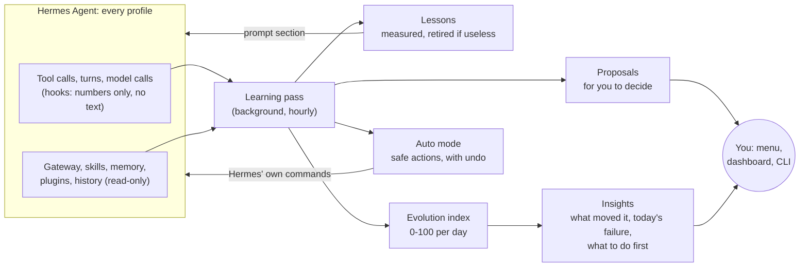

- **Observe**: hooks count what happens (outcome, duration, failure class), never message text, tool arguments or output.
- **Learn**: a background pass turns recurring failures into lessons, measures their effect, reads every profile and Hermes' own health checks.
- **Explain**: the index says what moved it, a failure that jumped today and what to do first, from a few queries over the numbers the plugin already keeps, with no model call.
- **Act**: in Auto mode it applies what is safe and reversible, checking the disk and the services again right before it acts; the rest becomes a proposal with its undo.
- **Show**: `status`, the weekly digest, the terminal menu and the **Evolution** tab of the dashboard, with the Evolution index on top.

### Quick start

Requires **Hermes Agent 0.23.1 or later**. Hermes loads plugins per profile.

```bash
# One profile (the default one), then open the menu
hermes plugins install sesantanajr/hermes-atlas-evolution --enable
hermes evolution
```

```bash
# Every profile at once: asks which (Enter = all) and installs where it is missing
git clone https://github.com/sesantanajr/hermes-atlas-evolution.git
sh hermes-atlas-evolution/install.sh --install-missing
```

With no questions: `sh hermes-atlas-evolution/install.sh --all --yes --install-missing`. Installing loads it into a running gateway, with no restart. The first pass replays up to 14 days of the profile's history, so it does not start from zero; in Auto mode it then installs itself in the other profiles you use. Next steps: **[Getting started](docs/en-US/getting-started.md)**. Already on an earlier version? See **[Updating to 0.12.0](docs/en-US/upgrading.md#updating-to-0120)**.

### Modes

| Mode | By itself | Waits for you |
|---|---|---|
| **Auto** (default) | Removes an entry repeated between memory (`MEMORY.md`) and the user profile (`USER.md`), locks skills the curator keeps rewriting, frees old tool versions nothing uses, keeps the plugin on the code the lead profile runs, installs it where a profile in use never had it, repairs the gateway's service when no gateway is alive, moves failed installs to its trash. All with undo, except freeing old tool versions, which cannot be taken back. | Anything that could break something: turning a plugin off, removing plugins, archiving skills. |
| **Assist** | Only removes an identical entry repeated between `MEMORY.md` and `USER.md`. | Everything else. |
| **Manual** | Nothing. It measures and proposes. | Everything. |

Every action goes to the history with its undo, and an action you undo is never repeated. Change the mode in the menu (screen 5), the dashboard or `hermes -p <profile> config set plugins.entries.hermes-atlas-evolution.settings.mode manual`. When `config.yaml` cannot be read (a Python without PyYAML, for example), the plugin acts as Manual and says so first in `status`. To keep the lead profile's hands off a profile, turn `fleet_managed` off in that profile.

### See it

**The Evolution tab of the Hermes dashboard** (and of Hermes Desktop): decide there, for every profile, with a dashboard login. Without a login it only shows, and hides the text of lessons written by you, the reflector or the agent.


**The terminal menu**, `hermes evolution`, in your own terminal: what needs attention, lettered suggestions that act at once, and 14 screens.

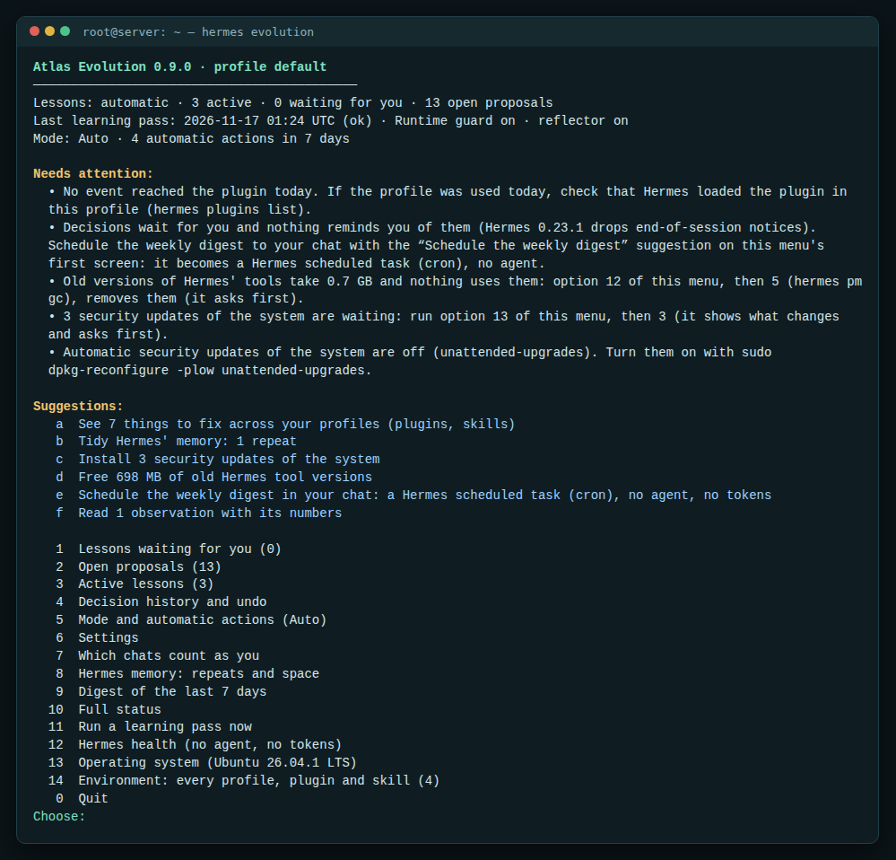

<details>
<summary><b>More screens</b></summary>


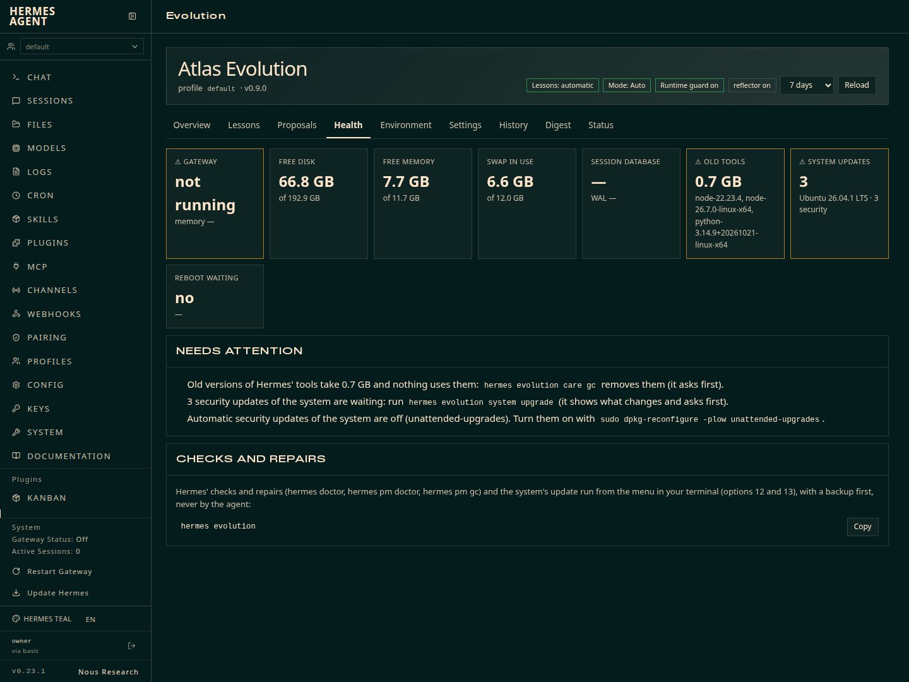


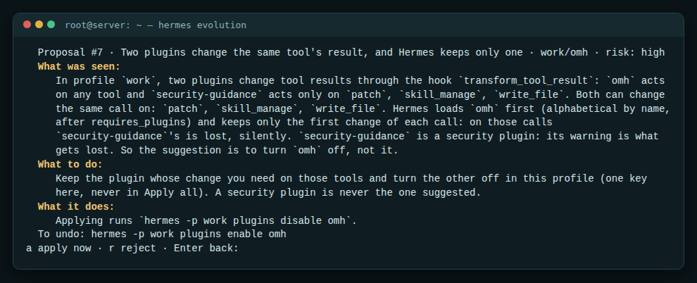


</details>

### Commands

`hermes -p <profile> evolution <command>`; `--lang en|pt` works with all of them, and `--format md|json` with all but `menu`.

| Command | What it does |
|---|---|
| *(none)*, `menu` | The interactive menu (in an agent's shell or a pipe, it prints `status`). |
| `status` | What needs attention, the Evolution index and what moved it, what to do first, what the plugin costs, Hermes' and the system's health, every profile. |
| `report [--days N]` | The digest of the last N days (7 by default), against the period before, with what to do first. |
| `learn` | A learning pass now. |
| `lessons list \| review \| approve <id> \| retire <id> \| add \| export \| import` | The lessons, your decisions, a lesson you write yourself, and sharing them with another profile. |
| `proposals list \| approve <id> \| reject <id>` | The proposals; approving one the plugin can apply runs Hermes' own command. |
| `decisions list \| undo <id>` | Every decision and automatic action, and the undo of one. |
| `care [check \| doctor \| pm-doctor \| fix \| gc \| fix-gateway \| undo-gateway]` | Hermes' health and repairs, including a gateway service that still starts a removed Python. |
| `environment [show \| scan \| catalog]` | Every profile: plugins, skills, conflicts and what to do. |
| `update [--all \| --profiles a,b] [--install-missing] [--list] [--yes]` | This plugin updated in every profile (a pinned profile moves to the latest commit). |
| `system [check \| plan \| upgrade \| repair \| report]` | The operating system's update (Linux with apt). |
| `schedule-digest [--deliver <channel>]` | The weekly digest as a Hermes cron job with no agent and no tokens. |
| `usage` | The model and tool calls measured, and their estimated cost. |
| `owner list \| add \| remove \| add-platform \| remove-platform` | Which chat senders and channels count as you. |
| `skills` | Skills rewritten over and over, flip-flopping, or rewritten and never used. |
| `experiments` | The tracked changes, with their before-and-after verdicts. |

Full reference: [Commands](docs/en-US/evolution-loop.md#commands).

### Settings

In the dashboard's **Evolution** tab, the menu (screen 6), Hermes Desktop (Settings → Plugins) or `config.yaml` under `plugins.entries.hermes-atlas-evolution.settings`. Changes apply within a minute; `runtime_guard`, `tool_hints` and turning `agent_tools` or the `reflector` on apply after `hermes gateway restart`.

| Option | Default | What it does |
|---|---|---|
| `mode` | `auto` | What the plugin does by itself: `auto`, `assist` or `manual` (see [Modes](#modes)). |
| `lessons` | `auto` | `auto`: template lessons apply once your own turns hit the failure; text written by a model waits for you. `suggest`: every lesson waits. `off`: measure only. |
| `owner_sender_ids`, `owner_platforms` | `[]` | Who is you in chats: your sender ids, and channels where every chat is yours. In your direct chats you get every lesson from your first message. |
| `fleet_managed` | `true` | Off in this profile: the lead profile never installs, updates or moves anything to the trash here by itself. |
| `language` | `auto` | `en` or `pt`; `auto` follows the profile. |
| `reflector`, `reflector_daily_limit` | `true`, `6` | Drafts lessons with a model, through Hermes, for failures with no template; drafts wait for you. |
| `autopilot_minutes` | `60` | The background learning pass (15 to 1440; `0` = by hand only). |
| `runtime_guard` | `true` | Vetoes agent commands that would take Hermes down. |
| `agent_tools`, `tool_hints`, `feedback_signals`, `slow_turn_seconds` | | See [Settings and language](docs/en-US/evolution-loop.md#settings-and-language). |

Anything that widens what the plugin does or whom it trusts counts only from Hermes' configuration, never from the plugin's own `settings.json`, which the agent's file tools can write: who you are in chats, the agent's tools, switching the runtime guard off, a mode other than Manual, adding lessons to tool results (`tool_hints`) and a reflector limit above 6 a day. `settings.json` can only narrow.

### Compatibility

| | |
|---|---|
| **Hermes Agent** | 0.23.1 or later, checked against the code of 0.23.1 and 0.23.2; one plugin copy per profile; works with `plugins.isolation: host` (the runtime guard then stays off). Hermes' own install scan says `safe` (`plugin-guard-v12` of 0.23.1 and `plugin-guard-v15` of 0.23.2). |
| **Python** | 3.11 to 3.14, standard library only. The test suite runs in CI: Linux 3.11–3.14, macOS and Windows 3.13. |
| **Systems** | Linux: everything. macOS and Windows: everything except the operating system's update (apt) and systemd repairs; not yet tested inside a gateway there. |
| **Dashboard** | The **Evolution** tab of the Hermes dashboard and Hermes Desktop. |
| **Languages** | English and Brazilian Portuguese, end to end. |

### Privacy and safety

- **Keeps** counters, failure classes, hashed session ids, lessons and proposals in `<HERMES_HOME>/evolution/`; no conversation text, prompt, tool argument or output.
- **Reads**, read-only and size-capped, Hermes' history, logs, skills, plugins (parsed, never run) and health files of every profile ([full list](docs/en-US/hermes-integration.md#what-the-plugin-reads)).
- **Network**: no telemetry; only the `git ls-remote` of this repository. Only the optional reflector calls a model, through Hermes.
- **Only you decide**, in your own terminal or a dashboard with a login; the agent can never approve or widen anything. Each change has its undo or its copy.

Details: [SECURITY.md](SECURITY.md).

### Documentation

📚 **[Documentation home](docs/en-US/README.md)**: [Getting started](docs/en-US/getting-started.md) · [The evolution loop](docs/en-US/evolution-loop.md) · [Maintenance](docs/en-US/maintenance.md) · [Hermes integration](docs/en-US/hermes-integration.md) · [Updating](docs/en-US/upgrading.md) · [Troubleshooting](docs/en-US/troubleshooting.md) · [Changelog](CHANGELOG.md)

### What's new in 0.12.0

A full audit of 0.11.0, in five areas, and the fixes, checked in a real Hermes 0.23.2.

- **Ready for Hermes 0.23.2.** Hermes' new launcher made the plugin think it ran in an agent's shell and refuse your own owner commands in your own terminal (`owner`, `care doctor`, approving lessons). It now recognises the launcher, and an agent is still refused.
- **Safer Auto mode.** A gateway that is "degraded" or "starting" counts as alive, so the plugin never starts a second gateway beside it. The repair looks at the services of both scopes and only touches the service Hermes names for this home. `hermes pm gc` no longer deletes a folder in use. Removing a memory repeat never deletes the last copy. And the plugin only installs itself in a new profile with the code the lead profile already runs.
- **A stronger, faster runtime guard.** It also vetoes truncating, overwriting or changing the permissions of what Hermes runs on, and sees commands hidden in variables, `watch`, here-documents, `busybox` and up to 8 levels of `bash -c`. The worst case went from up to 41 s to under 0.7 s (Hermes blocks the tool after 30 s).
- **More accurate lessons.** A failure is read the way a person would, so output with `429 passed` no longer becomes "rate limited". Each lesson is measured from the first time the agent saw it. And in direct chats where the sender is you, the lessons come with your first message (never in groups or threads).
- **More trust.** `settings.json` no longer widens anything. An unreadable `config.yaml` makes the plugin act as Manual. The dashboard without a login hides lesson text. The new `fleet_managed` setting keeps a profile out of the lead profile's care.
- **Tests back in CI.** Over 700 tests run on Linux, macOS and Windows; the suite lives on the `tests` branch, so every profile's copy stays small.

Every change: [Changelog](CHANGELOG.md).

### Contributing

Issues and pull requests are welcome; read [CONTRIBUTING.md](CONTRIBUTING.md) first. The test suite lives on the `tests` branch. Security problems go through [SECURITY.md](SECURITY.md).

### License

[MIT](LICENSE): free and open source, including commercial use, with the copyright notice kept.

### Author

Created by **Sérgio Sant'Ana Júnior** · [LinkedIn](https://www.linkedin.com/in/sergiosantanacloud/)

<p align="right"><a href="#en-us">↑ Top</a> · <a href="#pt-br">Português ↑</a></p>
