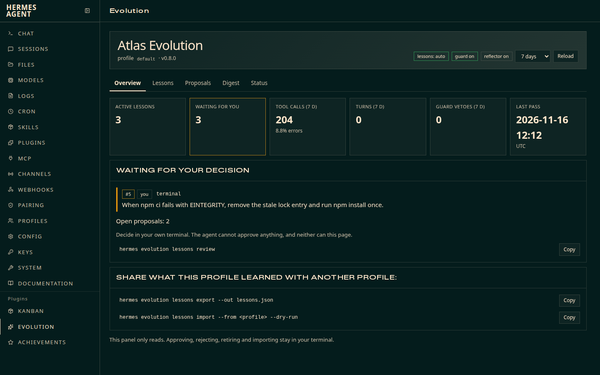

# Atlas Evolution

**English** | [Português (Brasil)](README.pt-BR.md)

Atlas Evolution (`hermes-atlas-evolution` in Hermes) helps Hermes Agent learn from its own mistakes. When the same tool error keeps coming back, it writes a one-sentence lesson for the agent, checks whether the lesson helped and drops it if it did not; lessons drafted by an AI model wait for your approval. It also stops the agent from restarting or deleting the Hermes it runs on. Its data stays on your machine, and it opens no network connection of its own.

[](LICENSE)
[](https://github.com/NousResearch/hermes-agent/releases/tag/v0.23.1)

## What's new in 0.8.3

- **It acts by itself, safely.** At the end of each learning pass the plugin takes exact repeats out of Hermes' memory and, with `auto_actions: full`, locks the skills Hermes' curator keeps rewriting (in one real profile, a skill was rewritten 75 times in a week, each time costing tokens). Every action goes to the history with its undo, and an automatic change you undo is never repeated.
- **Proposals in plain words.** Each one says what was seen, with its numbers, what applying it does and how to undo it, in English or Brazilian Portuguese. A change the plugin can make is applied with one click (**Apply now**), or all of them at once; an observation is dismissed with one.
- **A menu that tells you what to do next.** `hermes evolution` opens with what needs attention and lettered suggestions, such as "Apply 4 recommended changes" or "Turn on the complete automatic actions".
- 0.8.2 brought the terminal menu, the care of Hermes' memory and the dashboard panel deciding behind a real login. Every change: [CHANGELOG](CHANGELOG.md).

## Quick start

```bash
hermes plugins install sesantanajr/hermes-atlas-evolution --enable   # in each profile (-p <profile>)
hermes evolution                                                     # the menu, in your own terminal
```

```text
Atlas Evolution 0.8.3 · profile atlas-ai
Lessons: auto mode · 10 active · 0 waiting for you · 16 open proposals
Last pass: 2026-11-16 16:18 (ok) · runtime guard on · reflector on
Automatic actions: safe · 2 in 7 days

Suggestions:
   a  Apply 4 recommended change(s): lock a skill that keeps being rewritten
   b  Turn on the complete automatic actions (from now on the plugin applies these by itself)
   c  Read 11 observation(s) with their numbers

   1  Lessons waiting for you (0)        7  Who is you in chats
   2  Open proposals (16)                8  Hermes memory: repeats and room
   3  Active lessons (10)                9  Digest of the last 7 days
   4  Decision history and undo         10  Full status
   5  Automatic actions (safe)          11  Run a learning pass now
   6  Settings                           0  Quit
```

The same, with a login, in the **Evolution** tab of the Hermes dashboard.

## Install

Upgrading from 0.5.0 (installed as `hermes-evolution`)? Skip this and follow [Migrating from 0.5.0](#migrating-from-050): the old copy has to be removed first, or it keeps running and the new one stays inactive.

Requires Hermes Agent 0.23.1 or later. Hermes loads plugins per profile, even when one gateway serves them all, so install the plugin in every profile you use.

```sh
# The default profile
hermes plugins install sesantanajr/hermes-atlas-evolution --enable

# A named profile
hermes -p <profile> plugins install sesantanajr/hermes-atlas-evolution --enable

# Every named profile (the default profile is not in this folder: run the first command too)
for p in $(ls ~/.hermes/profiles); do hermes -p "$p" plugins install sesantanajr/hermes-atlas-evolution --enable; done

# Check
hermes evolution status
```

Installing loads the plugin into a running gateway; no restart is needed. The first `status` in a profile runs the first pass right away (a pass is one learning round: it reads what happened, creates or retires lessons and updates the report). It reads up to 14 days of that profile's history, so the plugin does not start from zero (`--no-learn` skips it). `status` also lists every profile of the same Hermes and gives the install command for each profile used in the last 7 days that does not have the plugin.

In Hermes' plugin list the plugin shows a generic card for now: Hermes shows a cover only for entries of its curated plugin catalog, reviewed by Nous Research ([details](docs/hermes-integration.md#cover-image-and-the-plugin-catalog)).

## Migrating from 0.5.0

Up to 0.5.0 the plugin was installed as `hermes-evolution`. The id changed, so `hermes plugins update` cannot replace that copy. In each profile that has it (add `-p <profile>` to the commands for a named profile):

1. Only if you changed the plugin's options in the Hermes settings form: open the profile's `config.yaml` and rename `plugins.entries.hermes-evolution` to `plugins.entries.hermes-atlas-evolution` (the next command deletes the old block).
2. Remove the old copy and install the new one:

   ```sh
   hermes plugins remove hermes-evolution
   hermes plugins install sesantanajr/hermes-atlas-evolution --enable
   ```

3. Restart the gateway once, from your own terminal: `hermes gateway restart`.
4. Check with `hermes evolution status`. It lists the other profiles that still have the old copy, with the exact command for each, and marks a profile that has both copies, where the old one is still the one running.

Notes:

- What was learned stays: the `hermes evolution` command, the data in `<HERMES_HOME>/evolution/` and `settings.json` keep their names. The first pass of 0.6.0 recounts the history that 0.5.0 replayed, because 0.5.0 counted messages that Hermes keeps more than one copy of.
- While the old copy is enabled, the new one stays inactive (the Hermes log says so), so no turn is counted twice. If the title of `hermes evolution status` in a profile still shows 0.5.0, the old copy is still there: remove it in that profile and restart the gateway.
- Two defaults changed: `lessons` is now `auto` (`lessons: suggest` keeps the behaviour of 0.5.0; lessons already waiting keep waiting), and `tool_hints` is now `false`.
- Only if you listed them by hand in `config.yaml`: replace `atlas-evolution`, `atlas_evolution_plan` and `atlas_evolution_lessons` with `hermes-atlas-evolution`, `hermes_atlas_evolution_plan` and `hermes_atlas_evolution_lessons` in a toolset list or in `auxiliary.background_review.extra_tools`.

## Update

```sh
hermes plugins update hermes-atlas-evolution                # the default profile
hermes -p <profile> plugins update hermes-atlas-evolution   # a named profile

# Every named profile
for p in $(ls ~/.hermes/profiles); do hermes -p "$p" plugins update hermes-atlas-evolution; done

hermes gateway restart
hermes evolution status
```

The command-line `plugins update` only replaces the files: it does not reload a gateway that is already running, so restart the gateway once at the end. The dashboard shows the **Evolution** tab once it rescans its plugins; if it does not appear, restart the dashboard. (Hermes does reload a running gateway on install, enable and disable, and when the update is applied from Hermes Desktop, the dashboard or `/plugins update` in a chat.) If something is still running (a turn, a cron job, a delegated task), the restart lists it and asks `Interrupt them and restart the gateway? [y/N]`: answer N and run it again in a few minutes, or y to interrupt them. `status` points out a gateway that still runs older code.

## What it does

- **A menu in your terminal.** `hermes evolution`, with no command, opens a numbered menu in your own terminal: the lessons that wait for you (one by one or **approve all**), proposals, active lessons, the history with **undo**, every setting (or **the recommended setup** in one step), who is you in chats, Hermes' memory, the digest, the full status and a learning pass now. It decides with the same rules as the dashboard panel and lands in the same history. In an agent's shell, or without a terminal to answer from, it prints the status instead.
- **Run it from the Hermes dashboard.** An **Evolution** tab in the dashboard and in Hermes Desktop shows what the profile learned and what waits for you, and, when your dashboard asks for a login, lets you decide there, for the dashboard's own profile and for every other profile selected in it (with the plugin enabled in the dashboard's own profile too): approve or reject each lesson, **approve all** after reading every sentence, decide proposals, change the settings, pick who is you in chats from suggestions, and **undo** any decision. A dashboard without a login stays read-only, because any program on the machine could act there ([details](docs/hermes-integration.md#the-dashboard-panel)).
- **Acts by itself where it is safe.** With `auto_actions` (`safe` by default) the end of each pass takes exact repeats out of Hermes' memory, and with `full` it also locks skills the curator keeps rewriting. Each action is in the history with its undo; an automatic change you undo is never repeated ([details](docs/evolution-loop.md#automatic-actions)).
- **Keeps Hermes' memory lean.** Hermes puts `MEMORY.md` and `USER.md` in every session's prompt. The menu shows how full each one is and what repeats in them (the same entry twice, one entry that says what another says, very similar entries); you choose which one stays, and the other is taken out under Hermes' own memory lock, with a copy of the file kept and an **undo**. Each repeat taken out saves its tokens on every turn ([details](docs/evolution-loop.md#hermes-memory)).
- **Carries lessons between profiles.** `lessons export` and `lessons import --from <profile>` bring what one profile learned to another, or to another machine, after showing you each sentence. Imported lessons wait until your own turns hit their failure there, and are measured there like any other ([details](docs/evolution-loop.md#lesson-packs)).
- **Learns from the history Hermes already keeps.** The first passes replay the last 14 days of the profile's sessions, so a failure that recurred last week can become a lesson on the first day.
- **Turns repeated tool failures into lessons.** A failure seen at least 3 times, in 2 sessions or on 2 days, becomes one sentence such as "When calling `example_search`, always pass the required argument `query`." Calls that Hermes ends at its own deadline count too. The agent reads the active lessons at the start of each session.
- **Tells your turns from everyone else's.** A lesson applies by itself only after your own turns hit the failure (your CLI, TUI or Desktop, your automations, a chat with a sender you list in `owner_sender_ids`, or any chat of a platform you list in `owner_platforms`, such as a private bot or your own interface). Failures that only other people caused in a chat wait for your approval, and a chat where someone else may read along gets only template lessons, never text you or a model wrote. `hermes evolution owner` shows each chat channel with its senders and prints the command that sets this up.
- **Finds the bottlenecks you can remove.** Approvals refused where nobody could approve (one-shot runs, automations, subagents), with the Hermes settings that decide them; the tools that take the most time, and a tool that is slow call after call.
- **Keeps the queue short.** Lessons nobody decided on yet are withdrawn when the evidence no longer supports them, when they repeat another lesson's sentence, or when they only give advice every failure would get.
- **Measures before and after.** Each lesson against its own failure, each skill rewrite by the turns that loaded the skill, each setting change by the week before and the week after. In `auto` mode a lesson that does not help is retired.
- **Asks an AI model when no template fits.** The reflector drafts a lesson through Hermes, at most 6 calls a day by default, and the draft waits for you.
- **Watches Hermes' health.** It points out sessions cut off instead of closing normally, conversations that send too much text to the model, compactions that free little room, and plugins that fail to load, clash with each other or break another plugin's commands (those failures never become lessons).
- **Protects the running Hermes.** It vetoes agent commands that would stop, restart or kill the gateway (as a systemd unit on Linux, a LaunchAgent on macOS or a Windows service or task) or delete the Python, the code or the profile that Hermes runs on, and it keeps the agent from changing this plugin's settings or switching it off. It reads the command the way the shell runs it: inside `if`/`for` blocks, `$(...)`, `python -m hermes_cli.main`, `kill $(pgrep ...)` and the other forms in [the guard's details](docs/hermes-integration.md#the-runtime-guard). The agent is told to leave those to you.
- **Runs by itself and asks before changing Hermes.** A background pass runs at most once an hour per profile. Changes to Hermes, such as locking a skill, are proposed with the exact command for you to run.
- **Speaks your language.** Every message, the digest and the lessons come in English or Brazilian Portuguese, following the profile.



## Commands

Subcommands of `hermes evolution`. `--lang en|pt` works with any of them.

| Command | What it does |
|---|---|
| *(none)*, `menu` | The interactive menu, in your own terminal. Without one (a script, a pipe, an agent's shell), the bare command prints `status`. |
| `status` | Shows whether the plugin observes, learns and protects this profile, and the state of every profile of this Hermes. |
| `report [--days N]` | The digest of the last N days (7 by default), compared with the period before. |
| `lessons list` | The lessons, with origin, evidence and measured effect. |
| `lessons review` | Goes through every lesson that waits for approval, with its exact text: `a` approves, `r` rejects, Enter skips. |
| `lessons approve <id>`, `lessons approve --all` | Activates one waiting lesson, or every one (except the agent's own proposals), after showing the exact text. |
| `decisions`, `decisions undo <id>` | Your decisions from the terminal and the dashboard, newest first, and the undo of one. |
| `proposals list`, `proposals approve <id>`, `proposals reject <id>` | The queue of proposals, and your decision on one. |
| `lessons export [--out FILE]` | The active lessons as a pack another profile or machine can import. |
| `lessons import FILE` or `lessons import --from <profile>` | Brings in the lessons of a pack or of another profile, after showing each one (`--dry-run` changes nothing). |
| `learn` | Runs a pass now instead of waiting for the background one. |
| `owner` | Lists each chat channel with its senders; `owner add <id>` or `owner add-platform <name>` prints the `hermes config set` command that marks one as you. In your own terminal only. |

Every command and option: [Commands](docs/evolution-loop.md#commands).

## Settings

Set them in the **Evolution** tab of the dashboard, in Hermes Desktop under Settings → Plugins, or in the profile's `config.yaml` under `plugins.entries.hermes-atlas-evolution.settings`. A change applies within a minute, without restarting the gateway; only `runtime_guard`, `tool_hints` and turning lessons on in a profile that loaded with them off wait for the next load of the plugin, and the panel says so. `owner_sender_ids`, `owner_platforms`, `agent_tools: true` and `runtime_guard: false` count only from there, never from the plugin's own `settings.json`, which the agent's file tools can write.

| Option | Default | What it does |
|---|---|---|
| `lessons` | `auto` | `auto`: template lessons apply at once (once your own turns hit the failure), are measured and are retired when they do not help; reflector drafts and agent proposals wait for approval. `suggest`: every lesson waits for approval. `off`: measure only. |
| `owner_sender_ids` | `[]` | Your sender ids on messaging platforms (text or numbers, such as your Telegram id). A chat turn from one of them counts as yours. Your CLI, TUI and Desktop always do. `hermes evolution owner` lists the senders. |
| `owner_platforms` | `[]` | Platforms where every chat is yours (a private bot, your own interface through the API server), such as `telegram` or `api_server`. Their chats count as yours from the first message. Only list a platform nobody else writes to. |
| `language` | `auto` | `en` or `pt`. `auto` follows the profile language. |
| `reflector` | `true` | Drafts lessons with an AI model, through Hermes, for failures in your own turns that have no template. |
| `autopilot_minutes` | `60` | Runs the background pass at most once per interval, from 15 to 1440 minutes. `0` turns the background pass off: passes then run only from `learn`, `ops tick`, the weekly digest recipe and the first `status`. |
| `runtime_guard` | `true` | Vetoes agent commands that would stop the gateway or delete what Hermes runs on. Off where Hermes runs plugins in a plugin host (`plugins.isolation: host`). |
| `auto_actions` | `safe` | What the plugin does by itself at the end of each pass, each action in the history with its undo. `safe`: takes exact repeats out of Hermes' memory (a copy of the file is kept). `full`: also locks skills the curator keeps rewriting, with `hermes curator lock`, at most 3 per pass. `off`: everything waits for you. Counts only from Hermes' configuration, like `runtime_guard`. |
| `agent_tools` | `false` | Offers the tools `hermes_atlas_evolution_plan` and `hermes_atlas_evolution_lessons` to the agent, in your own sessions only. |
| `tool_hints` | `false` | Also adds the matching lesson to a failing tool result. Off by default because Hermes keeps only the first plugin's change to a tool result. |
| `feedback_signals` | `true` | Counts your corrections, repeated questions and thanks, as numbers only. |

```yaml
plugins:
  entries:
    hermes-atlas-evolution:
      settings:
        lessons: suggest
        owner_sender_ids: ["123456789"]
```

Every option, `settings.json` and what happens with an invalid value: [Settings and language](docs/evolution-loop.md#settings-and-language).

## Privacy and safety

- **What it keeps.** Counters, failure classes, hashed session IDs, lesson sentences and proposals, under `<HERMES_HOME>/evolution/`. It keeps no conversation text, prompt, tool argument, tool output or memory content, except the copy of a memory file it keeps when you take an entry out (owner-only, in `evolution/memory-backups/`, the latest 100). While the reflector is on, it keeps a short excerpt of the error message, up to 300 characters with secrets, paths and addresses masked, per failure in your own turns that has no template, until the failure has a lesson or for 14 days.
- **What it reads**, always read-only: Hermes' own history, logs and skill records, for `status` the session counts of your other profiles and of each chat channel, and, for `hermes evolution owner` in your own terminal, the sender ids of each channel ([full list](docs/hermes-integration.md#what-the-plugin-reads)).
- **Runs in the background.** Only inside Hermes: a small timer checks every 10 minutes whether a learning round is due.
- **Model calls.** Only the reflector calls an AI model, through Hermes and its provider settings (auxiliary task `evolution_reflector`), at most 3 times per pass and 6 times a day by default. `reflector: false` stops it.
- **Network.** No connection of its own and no telemetry.
- **Gateway chats.** The plugin sends nothing to a chat. Its notices appear only in Hermes on your own machine (CLI, TUI, Desktop), never in a gateway chat. What the other side of a chat sees is what the agent writes.
- **Decisions.** Only you decide: in your own terminal (the menu or the commands, which refuse to run in the agent's terminal) or in a dashboard that asks for a login. The plugin changes its own data, its own settings through Hermes' `hermes config set`, Hermes' memory files only to take out a repeat (the one you chose, or an exact repeat with `auto_actions`), and skills only with `hermes curator lock` or `archive`, on your approval or with `auto_actions: full`, each with its undo; other changes to Hermes are printed as commands for you.

Details: [SECURITY.md](SECURITY.md).

## Documentation

- [The evolution loop](docs/evolution-loop.md): how lessons are made, delivered and measured, the reflector, the health radar, the digest with an example, `status`, and every command and setting.
- [Hermes integration](docs/hermes-integration.md): hooks, the runtime guard, what the plugin reads, permissions, installation notes, and compatibility and limits.
- [Operations](docs/operations.md): the operations supervisor (Linux pressure, usage and cost, Cron and Kanban).
- [CONTRIBUTING.md](CONTRIBUTING.md): development, tests and the rules for changes.
- [SECURITY.md](SECURITY.md): threat model, what the plugin stores and reads, and how to report a vulnerability.
- [CHANGELOG.md](CHANGELOG.md): what changed in each version.

## License

Atlas Evolution is free and open-source software, released under the [MIT License](LICENSE). You may use, copy, modify, merge, publish, distribute, sublicense and sell copies, including for commercial use, provided the copyright notice and the license text are kept in every copy. The software is provided as is, without warranty of any kind.

Contributions are welcome under the same license; see [CONTRIBUTING.md](CONTRIBUTING.md).

## Author

Created by **Sérgio Sant'Ana Júnior**. [LinkedIn](https://www.linkedin.com/in/sergiosantanacloud/)
