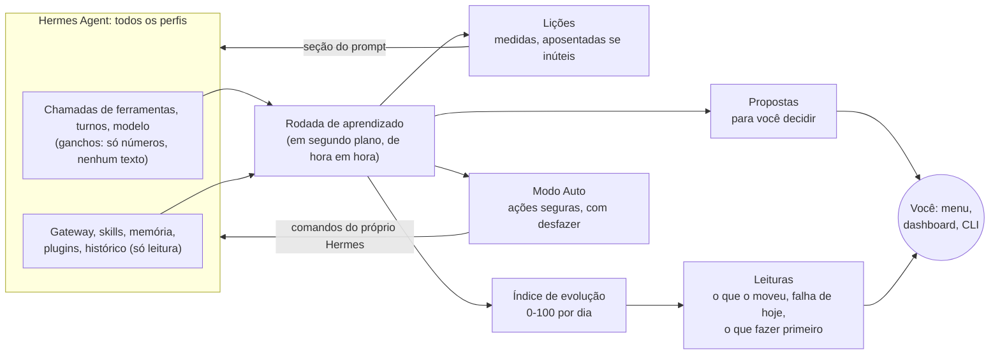
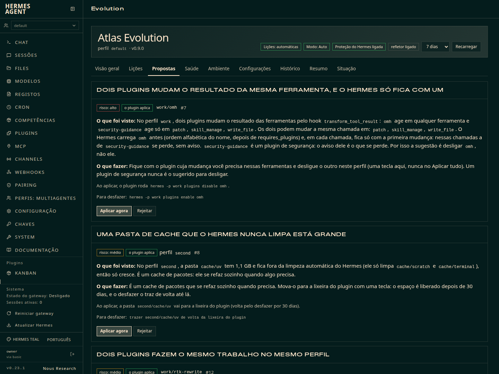
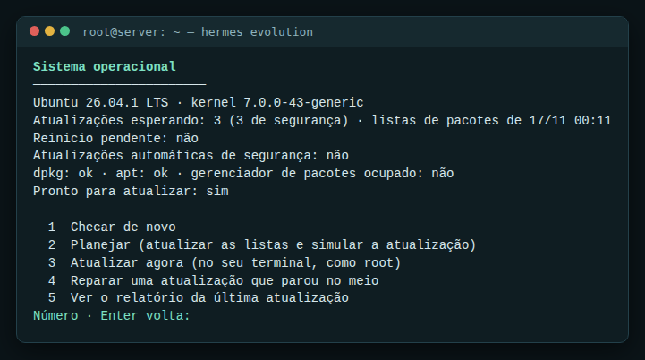
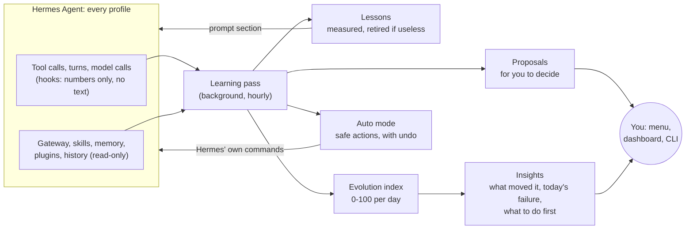
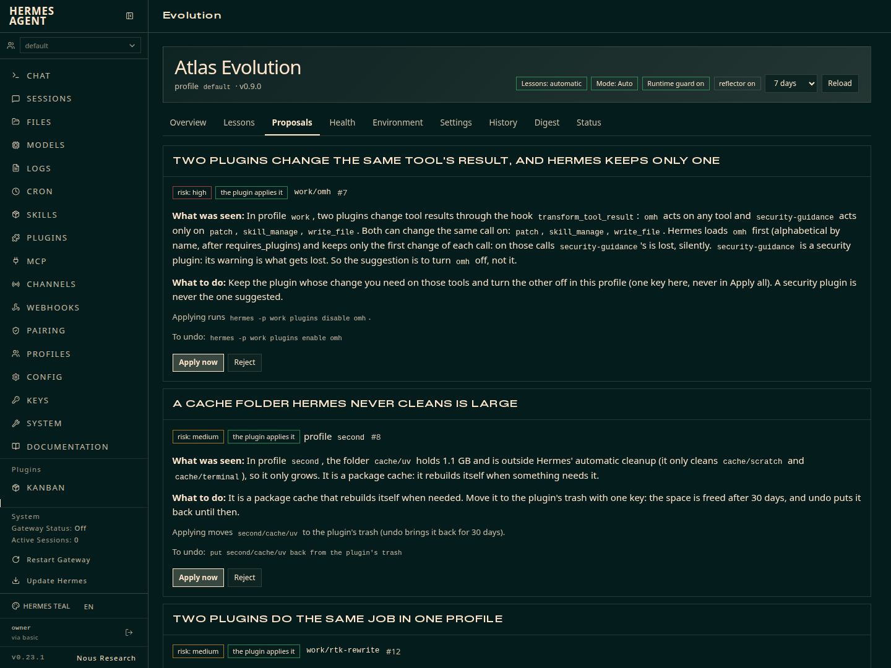
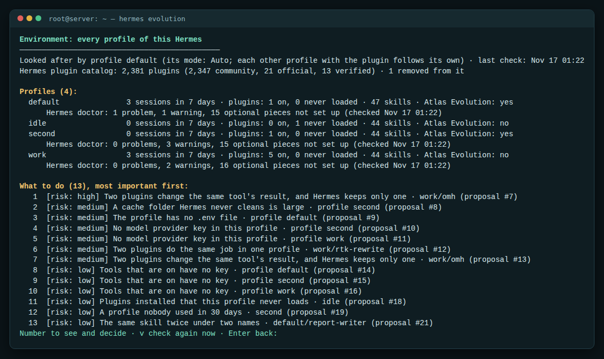

<p align="center">
  
</p>

<h1 align="center">Atlas Evolution</h1>

<p align="center">
  <b>A camada de automelhoria e cuidado do Hermes Agent.</b><br>
  Aprende com os erros do agente, mede se ele está melhorando, diz por quê e o que fazer primeiro, mantém todos os perfis saudáveis e se repara sozinho, sem gastar tokens.
</p>

<p align="center">
  <b>The self-improvement and care layer for Hermes Agent.</b><br>
  It learns from the agent's mistakes, measures whether it is getting better, says why and what to do first, keeps every profile healthy and repairs itself, without spending tokens.
</p>

<p align="center">
  <a href="#pt-br"></a>
  &nbsp;
  <a href="#en-us"></a>
</p>

<p align="center">
  <a href="https://github.com/sesantanajr/hermes-atlas-evolution/actions/workflows/checks.yml"></a>
  <a href="CHANGELOG.md"></a>
  <a href="https://github.com/NousResearch/hermes-agent"></a>
  
  
  
  <a href="LICENSE"></a>
</p>

---

<a id="pt-br"></a>

## 🇧🇷 Português (Brasil)

*[Read in English](#en-us) · [Documentação](docs/pt-BR/README.md) · [Mudanças](CHANGELOG.pt-BR.md)*

### Por quê

Um Hermes que roda há semanas acumula problemas que ninguém vê: o agente repete o mesmo erro, dois plugins brigam pelo mesmo trabalho, plugins instalados nunca carregam, skills ficam paradas ou duplicadas, a memória enche de repetições que vão em todo prompt, o gateway para depois de uma atualização, o disco enche, o servidor fica sem atualização.

O **Atlas Evolution** (`hermes-atlas-evolution`) acompanha tudo isso de dentro do Hermes, resolve sozinho o que é seguro e pode ser desfeito, e transforma o resto em propostas curtas, em português, com os números, uma recomendação e uma tecla para aplicar. Ele é feito para o Hermes, com a API de plugins e os comandos do próprio Hermes, em português e inglês.

### Destaques

| | |
|---|---|
| 🧠 **Aprende com os erros** | Um erro de ferramenta que volta vira uma lição de uma frase que o agente passa a ler. Cada lição é medida, e as que não ajudam são aposentadas. |
| 📈 **Mostra se o agente evolui, e por quê** | O **Índice de evolução**: uma nota de 0 a 100 por perfil e por dia, a partir das falhas de ferramentas, dos turnos que falharam ou foram lentos, das suas correções, das lições que funcionaram e da saúde do Hermes, com a tendência de 7 dias. Quando ele muda, diz qual parte e o que a moveu (`ferramentas 92 → 62 · terminal +147 erros`). |
| 🎯 **Diz o que fazer primeiro** | Até 3 passos em ordem dos pontos que cada um pode somar ao índice, cada um com o seu comando. Uma falha que dispara hoje (uma dependência, uma chave, um serviço ou uma cota que mudou) é avisada no mesmo dia, sem esperar os números da semana. |
| 🩺 **Mantém o Hermes saudável** | Roda as checagens do próprio `hermes doctor` em cada perfil uma vez por dia (sem rede), acompanha o gateway, o banco de sessões, disco, memória e versões antigas de ferramentas, e explica cada problema com o comando que resolve. |
| 🧹 **Arruma todos os perfis** | Plugins em conflito, duplicados ou que nunca carregam; skills sem uso, duplicadas ou quase iguais; restos de instalações que falharam; repetições na memória do Hermes. |
| 🔁 **Se repara, em todo lugar** | Um banco danificado é posto de lado e recomeçado; a cópia do plugin em cada perfil fica no mesmo código; um gateway que não sobe porque o Hermes trocou o Python é apontado para o novo, com desfazer; uma configuração gravada errado é corrigida; uma tarefa agendada que só falha é apontada, com o comando que a remove. |
| 🛡️ **Protege o Hermes do próprio agente** | A Proteção do Hermes barra comandos do agente que reiniciariam ou matariam o gateway, apagariam aquilo em que o Hermes roda ou desligariam este plugin. |
| 🐧 **Mantém o servidor atualizado** | Atualizações do Ubuntu e do Debian com checagens antes e depois, cópia de segurança e reparo se a energia cair no meio. |
| ⚡ **Não pesa** | Cada gancho é cronometrado onde roda e aparece no `status`: em geral bem menos de um milissegundo por chamada de ferramenta, com aviso se isso crescer. |

### Como funciona



- **Observa**: os ganchos contam o que acontece (resultado, duração, classe da falha), nunca texto de mensagem, argumentos ou saída de ferramentas.
- **Aprende**: uma rodada em segundo plano transforma falhas repetidas em lições, mede o efeito delas, lê todos os perfis e as checagens de saúde do próprio Hermes.
- **Explica**: o índice diz o que o moveu, uma falha que disparou hoje e o que fazer primeiro, com poucas consultas aos números que o plugin já guarda, sem chamar modelo.
- **Age**: no Modo Auto aplica o que é seguro e reversível com os comandos do próprio Hermes; o resto vira proposta com o seu desfazer.
- **Mostra**: o `status`, o resumo semanal, o menu do terminal e a aba **Evolution** do dashboard, com o Índice de evolução no topo.

### Começo rápido

Requer **Hermes Agent 0.23.1 ou superior**. O Hermes carrega plugins por perfil.

```bash
# Um perfil (o padrão), depois abra o menu
hermes plugins install sesantanajr/hermes-atlas-evolution --enable
hermes evolution

# Todos os perfis de uma vez (pergunta quais; --all --yes para não perguntar)
git clone https://github.com/sesantanajr/hermes-atlas-evolution.git && sh hermes-atlas-evolution/install.sh
```

Instalar carrega o plugin num gateway em execução, sem reiniciar. A primeira rodada repassa até 14 dias do histórico do perfil, então não começa do zero; no Modo Auto, ele depois se instala nos outros perfis que você usa. Próximos passos: **[Primeiros passos](docs/pt-BR/getting-started.md)**. Já usa uma versão anterior? Veja **[Atualizar para a 0.11.0](docs/pt-BR/upgrading.md#atualizar-para-a-0110)**.

### Modos

| Modo | Sozinho | Espera você |
|---|---|---|
| **Auto** (padrão) | Remove entradas repetidas da memória, trava skills que o curador reescreve sem parar, libera versões antigas de ferramentas, mantém o plugin no mesmo código em todos os perfis, instala-o onde um perfil em uso nunca o teve, repara o serviço do gateway, move instalações que falharam para a lixeira. Tudo com desfazer. | O que poderia quebrar algo: desligar um plugin, remover plugins, arquivar skills. |
| **Assistido** | Só remove entradas idênticas repetidas da memória. | Todo o resto. |
| **Manual** | Nada. Ele mede e propõe. | Tudo. |

Cada ação vai para o histórico com o seu desfazer, e uma ação que você desfaz nunca se repete. Troque o modo no menu (tela 5), no dashboard ou com `hermes config set plugins.entries.hermes-atlas-evolution.settings.mode manual`.

### Veja como é

**A aba Evolution do dashboard do Hermes** (e do Hermes Desktop): decida ali, por qualquer perfil, com login no dashboard.


**O menu do terminal**, `hermes evolution`, no seu próprio terminal: o que precisa de atenção, sugestões com letras que agem na hora, e 14 telas.


<details>
<summary><b>Mais telas</b></summary>






</details>

### Comandos

`hermes evolution <comando>`; `--lang en|pt` e `--format md|json` funcionam com todos.

| Comando | O que faz |
|---|---|
| *(nenhum)*, `menu` | O menu interativo (no shell de um agente ou num pipe, imprime o `status`). |
| `status` | O que precisa de atenção, o Índice de evolução e o que o moveu, o que fazer primeiro, quanto o plugin custa, a saúde do Hermes e do sistema, todos os perfis. |
| `report [--days N]` | O resumo dos últimos N dias (7 por padrão), contra o período anterior, com o que fazer primeiro. |
| `learn` | Uma rodada de aprendizado agora. |
| `lessons list \| review \| approve <id> \| export \| import` | As lições, as suas decisões, e levá-las para outro perfil. |
| `proposals list \| approve <id> \| reject <id>` | As propostas; aprovar uma que o plugin sabe aplicar roda o comando do próprio Hermes. |
| `decisions`, `decisions undo <id>` | Cada decisão e ação automática, e o desfazer de uma. |
| `care [check \| doctor \| fix \| gc \| fix-gateway \| undo-gateway]` | Saúde e reparos do Hermes, inclusive um serviço do gateway que ainda chama um Python removido. |
| `environment [show \| scan \| catalog]` | Todos os perfis: plugins, skills, conflitos e o que fazer. |
| `update [--all \| --profiles a,b] [--list]` | Este plugin atualizado em todos os perfis (um perfil fixado passa para o último commit). |
| `system [check \| plan \| upgrade \| repair \| report]` | A atualização do sistema operacional (Linux com apt). |
| `schedule-digest [--deliver <canal>]` | O resumo semanal como tarefa agendada do Hermes, sem agente e sem tokens. |
| `usage` | As chamadas de modelos e ferramentas medidas e o seu custo estimado. |
| `owner` | Quais remetentes e canais de chat contam como você. |

Referência completa: [Comandos](docs/pt-BR/evolution-loop.md#comandos). A 0.11.0 removeu `health`, `history`, `tick`, `feedback`, `memory`, `ops` e o comando de chat `/evolution`: use `care check` e `decisions`; a rodada de aprendizado roda sozinha. Detalhes: [Atualizar para a 0.11.0](docs/pt-BR/upgrading.md#atualizar-para-a-0110).

### Configurações

Na aba **Evolution** do dashboard, no menu (tela 6), no Hermes Desktop (Configurações → Plugins) ou no `config.yaml` em `plugins.entries.hermes-atlas-evolution.settings`. As mudanças valem em até um minuto; `runtime_guard`, `tool_hints` e ligar `agent_tools` valem depois de `hermes gateway restart`.

| Opção | Padrão | O que faz |
|---|---|---|
| `mode` | `auto` | O que o plugin faz sozinho: `auto`, `assist` ou `manual` (veja [Modos](#modos)). |
| `lessons` | `auto` | `auto`: lições de padrão fixo valem quando os seus próprios turnos encontram a falha; texto escrito por um modelo espera você. `suggest`: toda lição espera. `off`: só mede. |
| `owner_sender_ids`, `owner_platforms` | `[]` | Quem é você nos chats: os seus ids de remetente e os canais em que todo chat é seu. |
| `language` | `auto` | `en` ou `pt`; `auto` segue o perfil. |
| `reflector`, `reflector_daily_limit` | `true`, `6` | Rascunha lições com um modelo, pelo Hermes, para falhas sem padrão fixo; os rascunhos esperam você. |
| `autopilot_minutes` | `60` | A rodada de aprendizado em segundo plano (15 a 1440; `0` = só à mão). |
| `runtime_guard` | `true` | Barra comandos do agente que derrubariam o Hermes. |
| `agent_tools`, `tool_hints`, `feedback_signals`, `slow_turn_seconds` | | Veja [Configurações e idioma](docs/pt-BR/evolution-loop.md#configuração-e-idioma). |

Configurações que ampliam em quem o plugin confia só valem pela configuração do Hermes, nunca pelo `settings.json` do próprio plugin, que as ferramentas de arquivo do agente podem gravar.

### Compatibilidade

| | |
|---|---|
| **Hermes Agent** | 0.23.1 ou superior, conferido com o código da 0.23.2 e do ramo principal do Hermes; uma cópia do plugin por perfil; funciona com `plugins.isolation: host` (a Proteção do Hermes fica desligada nesse caso). A varredura de instalação do próprio Hermes diz `safe`. |
| **Python** | 3.11 a 3.14, só a biblioteca padrão. CI: Linux 3.11–3.14, macOS e Windows 3.13. |
| **Sistemas** | Linux: tudo. macOS e Windows: tudo, menos a atualização do sistema operacional (apt) e os reparos do systemd. |
| **Dashboard** | A aba **Evolution** do dashboard do Hermes e do Hermes Desktop. |
| **Idiomas** | Português do Brasil e inglês, de ponta a ponta. |

### Privacidade e segurança

- **Guarda** contadores, classes de falha, ids de sessão com hash, lições e propostas em `<HERMES_HOME>/evolution/`; nenhum texto de conversa, prompt, argumento ou saída de ferramenta.
- **Lê**, só para ler, o histórico, os logs, as skills, os plugins (analisados, nunca executados) e os arquivos de saúde do Hermes de cada perfil ([lista completa](docs/pt-BR/hermes-integration.md#o-que-o-plugin-lê)).
- **Sem rede própria, sem telemetria.** Só o refletor, opcional, chama um modelo, pelo Hermes.
- **Só você decide**, no seu próprio terminal ou num dashboard com login; o agente nunca aprova nem amplia nada. Cada mudança tem o seu desfazer ou a sua cópia.

Detalhes: [SECURITY.md](SECURITY.md).

### Documentação

📚 **[Início da documentação](docs/pt-BR/README.md)**: [Primeiros passos](docs/pt-BR/getting-started.md) · [O ciclo de evolução](docs/pt-BR/evolution-loop.md) · [Manutenção](docs/pt-BR/maintenance.md) · [Integração com o Hermes](docs/pt-BR/hermes-integration.md) · [Atualização](docs/pt-BR/upgrading.md) · [Solução de problemas](docs/pt-BR/troubleshooting.md) · [Mudanças](CHANGELOG.pt-BR.md)

### Novidades da 0.11.0

- **O índice se explica.** O `status`, o resumo e o painel dizem o que moveu o Índice de evolução, apontam uma falha que disparou hoje e listam o que **fazer primeiro**, em ordem dos pontos que cada passo pode somar.
- **Seguro para a varredura de instalação do Hermes.** A varredura de plugins do próprio Hermes agora diz `safe`, então o plugin se instala e se atualiza em cada perfil sem esperar uma confirmação.
- **Mais autorreparo.** Um `lessons: false` gravado pelo `hermes config set` é corrigido no carregamento; uma tarefa antiga do `tick` no agendador do Hermes é encontrada, com o comando que a remove; um host de plugins e um escopo hospedado não atrapalham mais o plugin.
- **Mais enxuto.** Os comandos obsoletos desde a 0.10.0 (`ops`, `health`, `tick`, `feedback`, `history`, `memory`, `/evolution`) saíram, cerca de 5.300 linhas: veja [Atualizar para a 0.11.0](docs/pt-BR/upgrading.md#atualizar-para-a-0110).

Cada mudança: [Mudanças](CHANGELOG.pt-BR.md).

### Contribuir

Issues e pull requests são bem-vindos; leia antes o [CONTRIBUTING.md](CONTRIBUTING.md). Problemas de segurança vão pelo [SECURITY.md](SECURITY.md).

### Licença

[MIT](LICENSE): livre e de código aberto, inclusive para uso comercial, mantendo o aviso de copyright.

### Autor

Criado por **Sérgio Sant'Ana Júnior** · [LinkedIn](https://www.linkedin.com/in/sergiosantanacloud/)

<p align="right"><a href="#pt-br">↑ Topo</a> · <a href="#en-us">English ↓</a></p>

---

<a id="en-us"></a>

## 🇺🇸 English

*[Leia em português](#pt-br) · [Documentation](docs/en-US/README.md) · [Changelog](CHANGELOG.md)*

### Why

A Hermes that runs for weeks piles up problems nobody sees: the agent repeats the same mistake, two plugins fight over one job, plugins are installed and never load, skills sit unused or duplicated, memory fills with repeats that go into every prompt, the gateway stops after an update, the disk fills, the server misses its updates.

**Atlas Evolution** (`hermes-atlas-evolution`) watches all of it from inside Hermes, fixes by itself what is safe and can be undone, and turns the rest into short proposals in plain words, with the numbers, a recommendation and one key to apply. It is written for Hermes, with Hermes' own plugin API and commands, in English and Brazilian Portuguese.

### Highlights

| | |
|---|---|
| 🧠 **Learns from mistakes** | A tool error that keeps coming back becomes a one-sentence lesson the agent reads. Each lesson is measured, and the ones that do not help are retired. |
| 📈 **Shows whether the agent evolves, and why** | The **Evolution index**: one 0–100 score per profile and day, from tool failures, failed or slow turns, your corrections, lessons that worked and Hermes' health, with its 7-day trend. When it moves, it says which part and what moved it (`tools 92 → 62 · terminal +147 errors`). |
| 🎯 **Says what to do first** | Up to 3 steps ranked by the points each could add to the index, each with its command. A failure that jumps today (a dependency, a key, a service or a quota that changed) is flagged the same day, without waiting for the weekly numbers. |
| 🩺 **Keeps Hermes healthy** | Runs Hermes' own `hermes doctor` checks on every profile once a day (offline), watches the gateway, the session database, disk, memory and old tool versions, and explains each problem with the command that fixes it. |
| 🧹 **Tidies every profile** | Plugins that conflict, duplicate or never load; skills unused, duplicated or near twins; leftovers of failed installs; repeats in Hermes' memory. |
| 🔁 **Repairs itself, everywhere** | A damaged database is set aside and started again; every profile's copy of the plugin is kept on the same code; a gateway that cannot start because Hermes replaced its Python is pointed at the new one, with undo; a setting stored wrong is fixed; a scheduled job that only fails is pointed out, with the command that removes it. |
| 🛡️ **Protects Hermes from its own agent** | The runtime guard vetoes agent commands that would restart or kill the gateway, delete what Hermes runs on, or switch this plugin off. |
| 🐧 **Keeps the server up to date** | Ubuntu and Debian updates with checks before and after, a safety copy and a repair if the power goes in the middle. |
| ⚡ **Costs nothing you can feel** | Every hook is timed where it runs and shown in `status`: typically well under a millisecond per tool call, with a warning if that ever grows. |

### How it works



- **Observe**: hooks count what happens (outcome, duration, failure class), never message text, tool arguments or output.
- **Learn**: a background pass turns recurring failures into lessons, measures their effect, reads every profile and Hermes' own health checks.
- **Explain**: the index says what moved it, a failure that jumped today and what to do first, from a few queries over the numbers the plugin already keeps, with no model call.
- **Act**: in Auto mode it applies what is safe and reversible with Hermes' own commands; the rest becomes a proposal with its undo.
- **Show**: `status`, the weekly digest, the terminal menu and the **Evolution** tab of the dashboard, with the Evolution index on top.

### Quick start

Requires **Hermes Agent 0.23.1 or later**. Hermes loads plugins per profile.

```bash
# One profile (the default one), then open the menu
hermes plugins install sesantanajr/hermes-atlas-evolution --enable
hermes evolution

# Every profile at once (asks which; --all --yes for no questions)
git clone https://github.com/sesantanajr/hermes-atlas-evolution.git && sh hermes-atlas-evolution/install.sh
```

Installing loads it into a running gateway, with no restart. The first pass replays up to 14 days of the profile's history, so it does not start from zero; in Auto mode it then installs itself in the other profiles you use. Next steps: **[Getting started](docs/en-US/getting-started.md)**. Already on an earlier version? See **[Updating to 0.11.0](docs/en-US/upgrading.md#updating-to-0110)**.

### Modes

| Mode | By itself | Waits for you |
|---|---|---|
| **Auto** (default) | Removes duplicate memory entries, locks skills the curator keeps rewriting, frees old tool versions, keeps the plugin on the same code in every profile, installs it where a profile in use never had it, repairs the gateway's service, moves failed installs to its trash. All with undo. | Anything that could break something: turning a plugin off, removing plugins, archiving skills. |
| **Assist** | Only removes identical duplicate memory entries. | Everything else. |
| **Manual** | Nothing. It measures and proposes. | Everything. |

Every action goes to the history with its undo, and an action you undo is never repeated. Change the mode in the menu (screen 5), the dashboard or `hermes config set plugins.entries.hermes-atlas-evolution.settings.mode manual`.

### See it

**The Evolution tab of the Hermes dashboard** (and of Hermes Desktop): decide there, for every profile, with a dashboard login.


**The terminal menu**, `hermes evolution`, in your own terminal: what needs attention, lettered suggestions that act at once, and 14 screens.


<details>
<summary><b>More screens</b></summary>







</details>

### Commands

`hermes evolution <command>`; `--lang en|pt` and `--format md|json` work with all of them.

| Command | What it does |
|---|---|
| *(none)*, `menu` | The interactive menu (in an agent's shell or a pipe, it prints `status`). |
| `status` | What needs attention, the Evolution index and what moved it, what to do first, what the plugin costs, Hermes' and the system's health, every profile. |
| `report [--days N]` | The digest of the last N days (7 by default), against the period before, with what to do first. |
| `learn` | A learning pass now. |
| `lessons list \| review \| approve <id> \| export \| import` | The lessons, your decisions, and sharing them with another profile. |
| `proposals list \| approve <id> \| reject <id>` | The proposals; approving one the plugin can apply runs Hermes' own command. |
| `decisions`, `decisions undo <id>` | Every decision and automatic action, and the undo of one. |
| `care [check \| doctor \| fix \| gc \| fix-gateway \| undo-gateway]` | Hermes' health and repairs, including a gateway service that still starts a removed Python. |
| `environment [show \| scan \| catalog]` | Every profile: plugins, skills, conflicts and what to do. |
| `update [--all \| --profiles a,b] [--list]` | This plugin updated in every profile (a pinned profile moves to the latest commit). |
| `system [check \| plan \| upgrade \| repair \| report]` | The operating system's update (Linux with apt). |
| `schedule-digest [--deliver <channel>]` | The weekly digest as a Hermes cron job with no agent and no tokens. |
| `usage` | The model and tool calls measured, and their estimated cost. |
| `owner` | Which chat senders and channels count as you. |

Full reference: [Commands](docs/en-US/evolution-loop.md#commands). 0.11.0 removed `health`, `history`, `tick`, `feedback`, `memory`, `ops` and the `/evolution` chat command: use `care check` and `decisions`; the learning pass runs by itself. Details: [Updating to 0.11.0](docs/en-US/upgrading.md#updating-to-0110).

### Settings

In the dashboard's **Evolution** tab, the menu (screen 6), Hermes Desktop (Settings → Plugins) or `config.yaml` under `plugins.entries.hermes-atlas-evolution.settings`. Changes apply within a minute; `runtime_guard`, `tool_hints` and turning `agent_tools` on apply after `hermes gateway restart`.

| Option | Default | What it does |
|---|---|---|
| `mode` | `auto` | What the plugin does by itself: `auto`, `assist` or `manual` (see [Modes](#modes)). |
| `lessons` | `auto` | `auto`: template lessons apply once your own turns hit the failure; text written by a model waits for you. `suggest`: every lesson waits. `off`: measure only. |
| `owner_sender_ids`, `owner_platforms` | `[]` | Who is you in chats: your sender ids, and channels where every chat is yours. |
| `language` | `auto` | `en` or `pt`; `auto` follows the profile. |
| `reflector`, `reflector_daily_limit` | `true`, `6` | Drafts lessons with a model, through Hermes, for failures with no template; drafts wait for you. |
| `autopilot_minutes` | `60` | The background learning pass (15 to 1440; `0` = by hand only). |
| `runtime_guard` | `true` | Vetoes agent commands that would take Hermes down. |
| `agent_tools`, `tool_hints`, `feedback_signals`, `slow_turn_seconds` | | See [Settings and language](docs/en-US/evolution-loop.md#settings-and-language). |

Settings that widen whom the plugin trusts count only from Hermes' configuration, never from the plugin's own `settings.json`, which the agent's file tools can write.

### Compatibility

| | |
|---|---|
| **Hermes Agent** | 0.23.1 or later, checked against the code of 0.23.2 and of Hermes' main branch; one plugin copy per profile; works with `plugins.isolation: host` (the runtime guard then stays off). Hermes' own install scan says `safe`. |
| **Python** | 3.11 to 3.14, standard library only. CI: Linux 3.11–3.14, macOS and Windows 3.13. |
| **Systems** | Linux: everything. macOS and Windows: everything except the operating system's update (apt) and systemd repairs. |
| **Dashboard** | The **Evolution** tab of the Hermes dashboard and Hermes Desktop. |
| **Languages** | English and Brazilian Portuguese, end to end. |

### Privacy and safety

- **Keeps** counters, failure classes, hashed session ids, lessons and proposals in `<HERMES_HOME>/evolution/`; no conversation text, prompt, tool argument or output.
- **Reads**, read-only, Hermes' history, logs, skills, plugins (parsed, never run) and health files of every profile ([full list](docs/en-US/hermes-integration.md#what-the-plugin-reads)).
- **No network of its own, no telemetry.** Only the optional reflector calls a model, through Hermes.
- **Only you decide**, in your own terminal or a dashboard with a login; the agent can never approve or widen anything. Each change has its undo or its copy.

Details: [SECURITY.md](SECURITY.md).

### Documentation

📚 **[Documentation home](docs/en-US/README.md)**: [Getting started](docs/en-US/getting-started.md) · [The evolution loop](docs/en-US/evolution-loop.md) · [Maintenance](docs/en-US/maintenance.md) · [Hermes integration](docs/en-US/hermes-integration.md) · [Updating](docs/en-US/upgrading.md) · [Troubleshooting](docs/en-US/troubleshooting.md) · [Changelog](CHANGELOG.md)

### What's new in 0.11.0

- **The index explains itself.** `status`, the digest and the panel say what moved the Evolution index, flag a failure that jumped today, and list what to **do first**, ranked by the points each step could add.
- **Safe for Hermes' install scan.** Hermes' own plugin scan now says `safe`, so the plugin installs and updates itself in every profile without waiting for a confirmation.
- **More self-repair.** A `lessons: false` written by `hermes config set` is fixed on load; an old `tick` job in Hermes' scheduler is found, with the command that removes it; a plugin host and a hosted scope no longer trip the plugin.
- **Leaner.** The commands deprecated in 0.10.0 (`ops`, `health`, `tick`, `feedback`, `history`, `memory`, `/evolution`) are gone, about 5,300 lines: see [Updating to 0.11.0](docs/en-US/upgrading.md#updating-to-0110).

Every change: [Changelog](CHANGELOG.md).

### Contributing

Issues and pull requests are welcome; read [CONTRIBUTING.md](CONTRIBUTING.md) first. Security problems go through [SECURITY.md](SECURITY.md).

### License

[MIT](LICENSE): free and open source, including commercial use, with the copyright notice kept.

### Author

Created by **Sérgio Sant'Ana Júnior** · [LinkedIn](https://www.linkedin.com/in/sergiosantanacloud/)

<p align="right"><a href="#en-us">↑ Top</a> · <a href="#pt-br">Português ↑</a></p>
