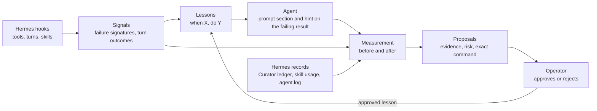

# Atlas Evolution

A measured self-improvement loop for Hermes Agent: recurring tool failures become short lessons, every lesson, skill rewrite and setting change is compared before and after, and nothing in Hermes changes without the operator.

[](https://github.com/sesantanajr/hermes-atlas-evolution/actions/workflows/tests.yml)
[](LICENSE)
[](https://github.com/NousResearch/hermes-agent/releases/tag/v0.23.1)
[](https://www.python.org/downloads/)

**English** | [Português (Brasil)](README.pt-BR.md)

Atlas Evolution is an independent, MIT-licensed community plugin (ID `hermes-evolution`). It uses only the public Hermes plugin API and the Python standard library. It calls no model and opens no network connection.

## Why

Hermes Agent already learns on its own: a background review rewrites skills and memory after conversations, and the Curator maintains the skill library. Three questions stay open.

- **Did the rewrite help?** No step compares how the profile behaved before and after.
- **Why does the same tool call keep failing?** A missing argument is worked around in one conversation and repeated in the next.
- **What does learning cost?** Background reviews spend tokens, and some of them produce nothing.

Atlas Evolution answers them with measurements from Hermes hooks and from Hermes' own records. It replaces nothing: memory, the Curator, skills and the model router work as before.

## What it does



1. **Signals.** Each failed tool call becomes a signature: tool, failure class and a short identifier such as the missing argument. Turns are timed and counted as completed, failed or interrupted, per surface (local, gateway, cron, subagent). Owner corrections, repeated questions and thanks are counted.
2. **Lessons.** A recurring failure becomes one sentence, "when X, do Y", from fixed English and Portuguese templates.
3. **Delivery.** Active lessons reach the agent in a per-session prompt section and as a hint on the failing tool result.
4. **Measurement.** Each derived lesson is measured against its own failure, before and after. Skill rewrites and setting changes get a week-before versus week-after verdict, stated as a correlation.
5. **Skill health.** Excessive rewriting, flip-flops and rewrites never used, from Hermes metadata only.
6. **Learning yield.** How many background reviews ran, how many produced nothing and their token cost.
7. **Proposals.** One queue with evidence, risk and the exact command. The plugin changes only its own playbook. Anything that touches Hermes is printed for you to run.
8. **Digest.** A summary in Markdown or JSON, in English or Portuguese.

The bundled skill `hermes-evolution:evolution-review` guides the owner through the digest and the proposals. Thresholds and windows are in [The evolution loop](docs/evolution-loop.md).

## Quick start

```sh
# 1. Install and enable in the current profile (hermes -p NAME selects another one)
hermes plugins install sesantanajr/hermes-atlas-evolution --enable

# 2. Check that it loaded
hermes plugins doctor --ci hermes-evolution

# 3. Use Hermes for a while, then run one pass and read the digest
hermes evolution learn
hermes evolution report --days 7

# 4. Review what the loop proposes
hermes evolution proposals list
```

The first digest is nearly empty, because signals are recorded from the moment the plugin loads. Restart a gateway that was already running.

**Turn lessons on.** In the default mode, `suggest`, a recurring failure becomes a candidate and nothing reaches the agent until you approve it.

```sh
hermes evolution lessons list --status candidate
hermes evolution lessons approve <id>
```

To activate lessons without approval, set `{"evolution": {"lessons": "auto"}}` in `<HERMES_HOME>/evolution/settings.json` and restart the gateway.

**Keep it running.** Lessons are derived and measured only when a pass runs: `hermes evolution learn`, by hand or on a schedule. `report --schedule-spec` prints a weekly no-agent cron recipe (a pass, then the digest), and `ops schedule-spec` prints one for the operations tick, which runs a pass at most once an hour. Both only print; you create the job.

## Example digest

Illustrative output. The numbers are made up: this excerpt was rendered from a throwaway profile seeded with fictitious data (`example_search`, `example-notes`). It is not a measurement of any real deployment.

```text
# Atlas Evolution · 7-day digest (2026-11-09 to 2026-11-15, UTC)

## Summary

- **Interactive turns:** 42 · 0 failed · 0 interrupted · 2 slow
- **Tool calls:** 168 · 3 errors (1.8%)

### Versus the previous 7 days

- `tool_error_pct`: 8.3 → 1.8 ▼
- **verdict:** improved

## Failures that repeat

- `example_search` · missing_argument (`query`): 3 times, 3 days · lesson: active

## Self-improvement loop

- 12 background reviews · 66.7% produced nothing
- 9 skill rewrites (9 by the automatic review) · 1 skills

## Playbook

- #1 When calling `example_search`, always pass the required argument `query`. · measured effect: effective (before 0.333 → after 0.071)

## Proposals awaiting a decision

- #1 [risk: medium] Lock a skill that keeps being rewritten · `example-notes` · apply with: `hermes curator lock example-notes`
```

## Commands

All are subcommands of `hermes evolution`. Output is JSON, except `report`, which prints Markdown by default.

| Command | What it does |
|---|---|
| `learn [--notify-only]` | Runs one pass: derives lessons, measures lessons and changes, refreshes proposals. |
| `report [--days 1..35] [--lang en\|pt] [--format md\|json]` | Prints the digest and compares it with the previous period. |
| `report --schedule-spec [--weekday 0..6] [--hour 0..23] [--deliver TARGET]` | Prints a weekly no-agent cron recipe. Creates nothing. |
| `lessons list [--status STATUS] [--lang en\|pt]` | Lists the playbook with status, evidence and measured effect. |
| `lessons approve <id>`, `lessons retire <id>` | Activates or retires a lesson. |
| `lessons add "<text>" [--tool NAME]` | Adds an operator lesson, active at once. |
| `proposals list [--all]` | Lists open proposals, highest risk first. |
| `proposals approve <id> [--note TEXT]`, `proposals reject <id> [--note TEXT]` | Decides a proposal. A lesson proposal takes effect; any other returns the command for you to run. |
| `skills [--days 1..35]` | Shows rewrites, flip-flops and unused rewrites per skill. |
| `experiments` | Lists tracked changes with their verdicts. |
| `usage [--days 1..35]` | Shows calls and tokens seen by the hooks next to Hermes' own accounting. |
| `ops ...` | Operations supervisor. See [Operations](docs/operations.md). |

`health`, `tick`, `feedback`, `history` and `memory` remain from earlier versions and are described in [Operations](docs/operations.md).

## Configuration

`<HERMES_HOME>/evolution/settings.json` is an optional JSON object. The plugin reads it when it loads, so restart the gateway after a change. The loop's commands reject an invalid `evolution` block, while the plugin falls back to the defaults.

Keys of the `evolution` block:

| Key | Type | Default | Effect |
|---|---|---|---|
| `lessons` | `"off"`, `"suggest"`, `"auto"` | `"suggest"` | `off`: no lesson is derived or shown; measurement continues. `suggest`: candidates wait for approval. `auto`: lessons are active at once, and one measured as ineffective is retired after 14 days. |
| `tool_hints` | boolean | `true` | Attaches the matching lesson to a failing tool result. |
| `feedback_signals` | boolean | `true` | Counts owner corrections, repeated questions and thanks. |
| `language` | `"auto"`, `"en"`, `"pt"` | `"auto"` | Language of lessons and the digest. `auto` follows `LC_ALL`, `LC_MESSAGES` or `LANG`. |
| `slow_turn_seconds` | integer, 5 to 3600 | `60` | A turn at least this long counts as slow. |
| `owner_sender_ids` | list of up to 20 strings | `[]` | Gateway sender IDs treated as the owner. Local sessions always count. |

Keys from earlier versions that still apply (formats in [Operations](docs/operations.md)):

| Key | Default | Effect |
|---|---|---|
| `agent_advice` | `false` | Exposes the agent tools `atlas_evolution_plan` and `atlas_evolution_lessons`. |
| `sensitivity` | `"balanced"` | Threshold of adaptive alerts: `low`, `balanced` or `high`. |
| `rates_usd_per_million` | none | Prices per provider and model for cost estimates. |
| `daily_estimated_budget_usd` | none | Daily (UTC) limit on the priced estimate. |
| `inspect_shared_kanban` | `false` | Includes shared Kanban boards in diagnostics. |
| `kanban_handoff` | disabled | Authorizes `ops handoff` to create a blocked card. |
| `linux_supervisor` | absent | Policy for reversible systemd trials. |
| `semantic_incident_model` | none | Local embedding model for `ops similar`. |
| `legacy_memory_commands`, `automatic_shared_recall` | `false` | Opt-in for the 0.1 note commands. |

## How a lesson reaches the agent

There are two paths, and neither rewrites a prompt that is already cached.

- **Session prompt section.** Hermes renders `atlas-evolution.playbook` when a session starts and freezes it into that session's system prompt, with at most 8 lessons and 1,200 characters. A lesson approved in the middle of a session appears in the next one, so the cached prefix of a running session never changes.
- **Hint on the failing result.** When a call fails with a signature that has an active lesson, the `transform_tool_result` hook adds the sentence to that result before it enters the context. That is new content at the end of the conversation, where nothing is cached yet. Each lesson is hinted once per session, with at most 6 hints per session, and never on a successful call.

Nothing is injected per turn. With `lessons: "off"` neither surface is registered.

## Safety and privacy

- **Observation by default.** Nothing reaches the agent until you approve a lesson. The agent tools stay hidden until `agent_advice` is enabled.
- **Only its own playbook changes.** The plugin never locks, archives or rolls back a skill and never edits Hermes configuration.
- **Hooks fail open.** A hook never raises into a turn. While the database is busy, updates wait in a bounded queue and overflow is reported as `dropped_events`.
- **No content is stored.** No conversation text, tool argument, tool output, memory content or raw log line is written. The database holds counters, allowlisted labels and short identifiers filtered against paths, URLs and credential-shaped values, plus the lesson sentences that you or the agent write on purpose.
- **Local only.** `<HERMES_HOME>/evolution/` holds `evolution.sqlite3`, `supervisor.sqlite3` and your `settings.json`. There is no network access and no telemetry.

What is read, written and executed is listed in [SECURITY.md](SECURITY.md).

## Operations supervisor

The supervisor of versions 0.2.0 and 0.3.0 is still included. It covers Linux memory, CPU and I/O pressure (PSI, cgroup v2, systemd), token usage and cost estimates, Cron and Kanban congestion, and bounded research and delegation plans. It observes by default. An explicit policy authorizes temporary, verified and reversible adjustments to one background systemd unit. See [Operations](docs/operations.md).

## Compatibility and limits

Atlas Evolution requires Hermes Agent 0.23.1 or later and Python 3.11 or later.

**Verified**

- 166 unit and end-to-end tests against a simulated Hermes, run by CI on Python 3.11, 3.12 and 3.13.
- `hermes plugins validate` and `hermes plugins doctor` of a real Hermes Agent 0.23.1 accept the plugin without warnings.

**Not verified**

- A production gateway. There are no field results, and nothing here claims how much lessons reduce failures in real use.
- Linux trials on a real systemd. The tests use a simulated adapter, so validate in staging before authorizing `apply`.
- Other Hermes versions, host isolation end to end, and Windows or macOS hosts, where the Linux code stays inert.

**Limits**

- Verdicts are correlations between two periods, not controlled experiments.
- Only lessons derived from a failure signature get a measured effect. Lessons added by hand or proposed by the agent do not.
- Upgrading migrates `evolution.sqlite3` to schema 4, which version 0.3.0 cannot open. To go back, restore a backup of the file or delete it.
- Under `plugins.isolation: host` Hermes skips `register_cli_command`, so `hermes evolution` does not exist. Use `python -m hermes_evolution --home <profile> ...`, which reads `config.yaml` only when PyYAML is installed. The printed cron recipes do not work in that mode.
- Review counts depend on a line that Hermes 0.23.1 writes to `agent.log`.
- Supervisor diagnostics are mostly in Portuguese. `language` applies to lessons and the digest.

Hooks, surfaces and what the plugin reads are in [Hermes integration](docs/hermes-integration.md).

## Development

```sh
git clone https://github.com/sesantanajr/hermes-atlas-evolution
cd hermes-atlas-evolution
python -m unittest discover -s tests -v     # no dependencies to install
hermes plugins validate .                   # needs a Hermes Agent 0.23.1 installation
```

Outside Hermes, point the standalone runner at an existing profile directory:

```sh
python -m hermes_evolution --home /path/to/profile --hermes-version 0.23.1 report
```

See [CONTRIBUTING.md](CONTRIBUTING.md) for the privacy rules every change must keep and [CHANGELOG.md](CHANGELOG.md) for the history.

## Roadmap

None of the following exists yet.

- A panel in the Hermes Desktop and Dashboard for the digest and the proposal queue.
- A settings form through the manifest's `config_schema`, in place of hand-edited JSON.
- An optional reflector that drafts lessons with a low-cost model through `ctx.llm`, with drafts held in quarantine.
- A bank of regression evaluations, to check a change against fixed tasks and not only against the following week.

## Author

Created by **Sérgio Sant'Ana Júnior**. [LinkedIn](https://www.linkedin.com/in/sergiosantanacloud/)

## License

[MIT](LICENSE)
