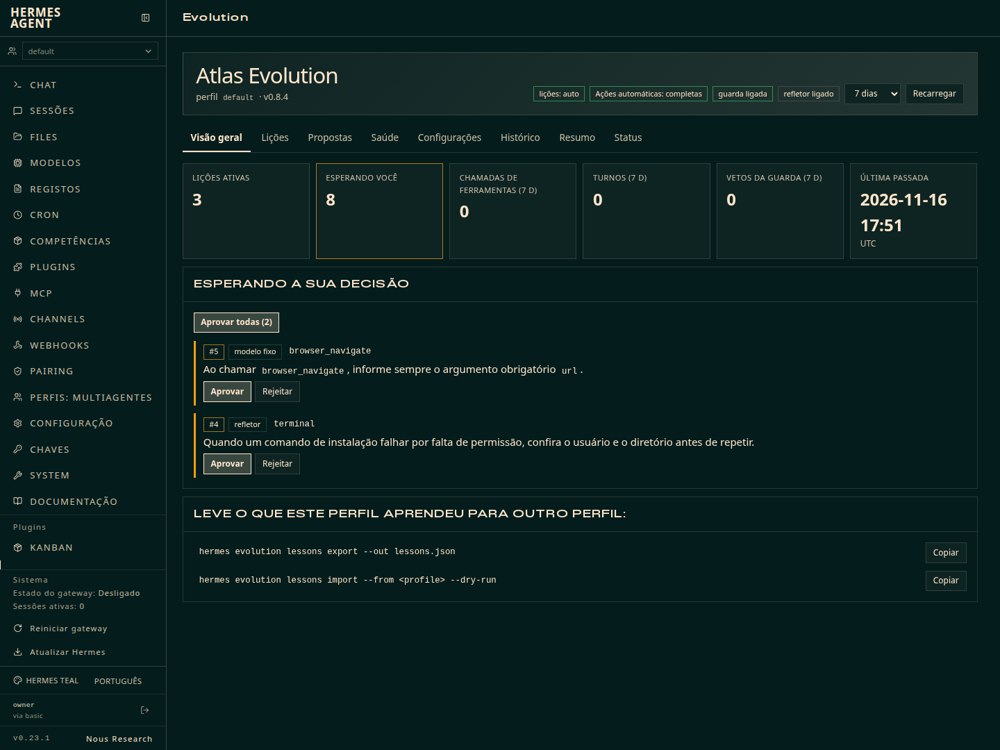
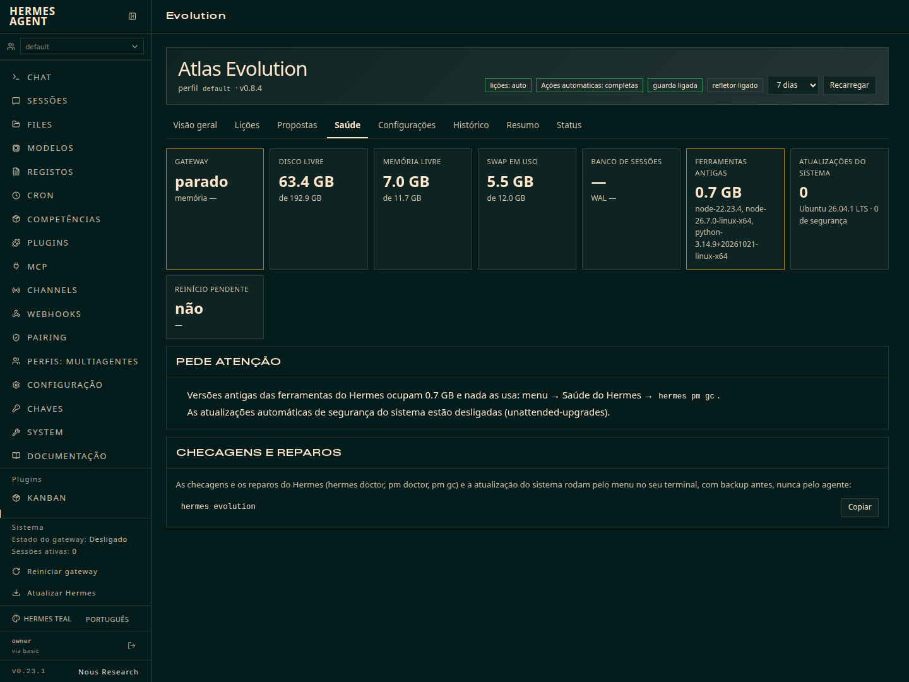
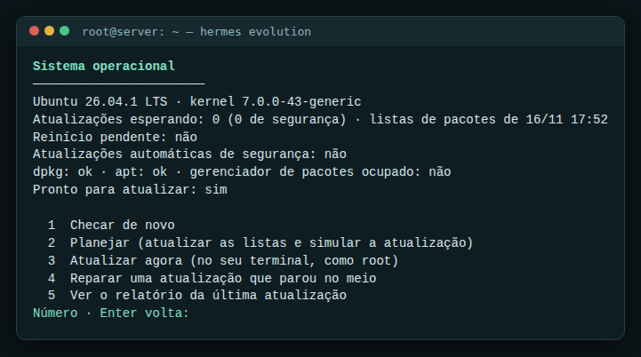

# Atlas Evolution

[English](README.md) | **Português (Brasil)**

**Um plugin que deixa o Hermes Agent melhor sozinho: aprende com os erros do Hermes, mantém o Hermes e o servidor em que ele roda saudáveis e atualizados, e não gasta nenhum token nessa manutenção.** Você decide em palavras simples, por um menu no seu terminal ou por uma aba no dashboard do Hermes, e tudo o que ele muda pode ser desfeito.

[](LICENSE)
[](https://github.com/NousResearch/hermes-agent/releases/tag/v0.23.1)
[](docs/pt-BR/maintenance.md)

## Para que serve

O Hermes Agent roda por dias, em muitos chats, com muitas ferramentas. Com o tempo, os mesmos erros voltam, skills são reescritas sem parar, a memória enche de repetições, o disco enche, o gateway cresce em memória e o servidor fica para trás nas atualizações. O Atlas Evolution (`hermes-atlas-evolution` no Hermes) acompanha tudo isso e age:

| | O que ele faz por você |
|---|---|
| **Aprende** | Transforma erros de ferramenta que se repetem em lições de uma frase que o agente lê, mede se cada lição ajudou e aposenta as que não ajudaram. |
| **Economiza tokens** | Trava skills que o curador reescreve sem parar, tira repetições da memória do Hermes (que vai em todo prompt) e aponta o que deixa cada chamada pesada. |
| **Mantém o Hermes saudável** | Lê os próprios arquivos do Hermes, sem agente, sem rede e sem token: o gateway vivo e a memória dele, o banco de sessões, o crescimento do disco por pasta e o dia em que ele encheria, memória, swap, CPU, versões antigas de ferramentas. Roda o `doctor` e os reparos do próprio Hermes com um clique seu, com backup antes. |
| **Mantém o servidor atualizado** | Checa, planeja e roda a atualização do Ubuntu ou do Debian com segurança: checagens antes, uma cópia da versão de cada pacote e do `/etc`, a atualização num serviço próprio para que uma conexão caída nunca a deixe pela metade, os seus arquivos de configuração mantidos, checagens depois, e um reparo para a atualização que uma queda de energia interrompeu. |
| **Age sozinho onde é seguro** | Com `auto_actions`, o fim de cada passada de aprendizado aplica sozinho as correções seguras, cada uma registrada com o desfazer. |
| **Protege o Hermes em execução** | Impede o agente de reiniciar, matar ou apagar o Hermes em que roda, e de mudar este plugin. |
| **Explica** | Cada proposta diz o que foi visto, com os números, o que aplicá-la faz e como desfazer, em português do Brasil ou inglês. |

Os dados ficam na sua máquina, ele não abre conexão de rede própria, e só você decide: nunca o agente.

## Veja como é

### No dashboard do Hermes

A aba **Evolution** do dashboard do Hermes (e do Hermes Desktop). Com login no dashboard, você decide ali, por qualquer perfil.






### No terminal

`hermes evolution` abre o mesmo, como um menu numerado, no seu próprio terminal (nunca no shell do agente): o que pede atenção, sugestões com letras que agem na hora e 13 telas.




## Começo rápido

Precisa do Hermes Agent 0.23.1 ou superior. O Hermes carrega os plugins por perfil, então instale em cada perfil que você usa.

```bash
hermes plugins install sesantanajr/hermes-atlas-evolution --enable              # o perfil padrão
hermes -p <perfil> plugins install sesantanajr/hermes-atlas-evolution --enable  # cada perfil com nome
hermes evolution                                                                # o menu
```

Instalar carrega o plugin num gateway em execução; não precisa reiniciar. A primeira olhada lê até 14 dias do histórico do perfil, então ele não começa do zero. Para atualizar, e para sair do antigo `hermes-evolution` (0.5.0): [Atualização](docs/pt-BR/upgrading.md).

## Novidades da 0.8.4

- **Saúde do Hermes, sem agente e sem tokens.** Uma tela nova no menu e uma aba nova no dashboard leem os próprios arquivos do Hermes: o gateway vivo (o sinal de vida dele) e a memória dele, o banco de sessões, o espaço em disco e quão rápido cada pasta cresce (com o dia em que o disco encheria), memória, swap, CPU e versões antigas de ferramentas que nada usa (cerca de 700 MB num servidor real). O `hermes pm doctor`, o `hermes doctor`, o `hermes doctor --fix` (depois de `hermes backup --quick`) e o `hermes pm gc` do próprio Hermes rodam com um clique seu.
- **A atualização do sistema operacional, feita com segurança.** Checar, planejar e atualizar o Ubuntu ou o Debian pelo menu ou pelo `hermes evolution system`, com checagens antes e depois e um reparo para uma atualização interrompida. Testado em containers com 67 pacotes de uma vez, um pacote deixado de fora, um arquivo de configuração editado mantido e uma queda de energia no meio do `libc6`.
- **O resumo semanal no seu chat, com uma tecla.** Agendado como um job de cron do Hermes que não roda agente nem gasta token, e desfeito pelo histórico.
- **Propostas e memória mais espertas.** Entradas da memória que diferem num número (uma porta, uma versão) são dois fatos, não uma repetição. Todas as mudanças: [CHANGELOG em português](CHANGELOG.pt-BR.md).

## Comandos

Subcomandos de `hermes evolution`. `--lang en|pt` funciona com qualquer um.

| Comando | O que faz |
|---|---|
| *(nenhum)*, `menu` | O menu interativo, no seu próprio terminal. Sem terminal (um script, um pipe, o shell do agente), o comando sozinho mostra o `status`. |
| `status` | Se o plugin observa, aprende e protege este perfil, o que pede atenção, a saúde do Hermes e a do sistema, e todos os perfis deste Hermes. |
| `report [--days N]` | O resumo dos últimos N dias (7 por padrão), comparado com o período anterior. |
| `lessons list`, `lessons review`, `lessons approve <id>`, `lessons approve --all` | As lições, e a sua decisão sobre as que esperam. |
| `proposals list`, `proposals approve <id>`, `proposals reject <id>` | As propostas; aprovar uma mudança que o plugin consegue fazer a aplica com o próprio comando do Hermes. |
| `decisions`, `decisions undo <id>` | As suas decisões e as ações automáticas, do terminal, do dashboard e do piloto automático, e o desfazer de uma. |
| `care [check \| pm-doctor \| doctor \| fix \| gc]` | A saúde do Hermes, lida dos próprios arquivos dele; e as checagens e reparos do próprio Hermes. |
| `system [check \| plan \| upgrade \| repair \| report] [--full] [--skip PACOTE...]` | A atualização do sistema operacional (Linux com apt). |
| `schedule-digest [--deliver local\|<canal>]` | O resumo semanal como um job de cron do Hermes sem agente. |
| `lessons export`, `lessons import` | Lições compartilhadas com outro perfil ou máquina, depois de mostrar cada uma. |
| `learn` | Uma passada de aprendizado na hora. |
| `owner` | Cada canal de chat com os remetentes, e o comando que marca um como você. |

Todos os comandos e opções: [Comandos](docs/pt-BR/evolution-loop.md#comandos).

## Configurações

Ajuste na aba **Evolution** do dashboard, no menu (tela 6), no Hermes Desktop em Settings → Plugins, ou no `config.yaml` do perfil em `plugins.entries.hermes-atlas-evolution.settings`. Uma mudança vale em até um minuto, sem reiniciar o gateway.

| Opção | Padrão | O que faz |
|---|---|---|
| `lessons` | `auto` | `auto`: lições de modelos fixos valem quando os seus turnos encontram a falha, são medidas e aposentadas quando não ajudam; texto escrito por um modelo ou pelo agente espera você. `suggest`: toda lição espera você. `off`: só mede. |
| `auto_actions` | `safe` | O que o plugin faz sozinho no fim de cada passada, cada ação no histórico com o desfazer. `safe`: tira cópias de uma entrada da memória que são exatamente o mesmo texto. `full`: também trava skills que o curador reescreve sem parar (até 3 por passada). `off`: tudo espera você. |
| `owner_sender_ids`, `owner_platforms` | `[]` | Quem é você nos chats: os seus ids de remetente, e plataformas em que todo chat é seu (um bot privado, a sua própria interface). |
| `language` | `auto` | `en` ou `pt`. `auto` segue o idioma do perfil. |
| `reflector` | `true` | Rascunha lições com um modelo de IA, pelo Hermes, para falhas sem modelo fixo (no máximo 6 chamadas por dia); os rascunhos esperam você. |
| `autopilot_minutes` | `60` | A passada de aprendizado em segundo plano, no máximo uma vez por intervalo (15 a 1440 minutos; `0` = só à mão). |
| `runtime_guard` | `true` | Barra comandos do agente que parariam o gateway ou apagariam aquilo em que o Hermes roda. |
| `agent_tools`, `tool_hints`, `feedback_signals`, `slow_turn_seconds` | | Veja [Configuração e idioma](docs/pt-BR/evolution-loop.md#configuração-e-idioma). |

`owner_sender_ids`, `owner_platforms`, `agent_tools: true`, `runtime_guard: false` e `auto_actions: full` só valem vindos da configuração do Hermes, nunca do `settings.json` do próprio plugin, que as ferramentas de arquivo do agente conseguem gravar.

## Privacidade e segurança

- **O que ele guarda.** Contadores, classes de falha, ids de sessão com hash, lições e propostas, em `<HERMES_HOME>/evolution/`; nenhum texto de conversa, prompt, argumento ou saída de ferramenta. Uma cópia de um arquivo de memória quando uma entrada sai, só do dono; antes de uma atualização do sistema, a lista de pacotes e uma cópia do `/etc` numa pasta só do root, fora de todo perfil (`/var/lib/hermes-atlas-evolution/system/`).
- **O que ele lê**, só para ler: o histórico, os logs e os registros de skills do Hermes, os arquivos do gateway e do banco; do sistema, o estado do gerenciador de pacotes ([lista completa](docs/pt-BR/hermes-integration.md#o-que-o-plugin-lê)).
- **Rede e modelo.** Nenhuma conexão própria e nenhuma telemetria. Só o refletor chama um modelo, pelo Hermes. O `hermes doctor`, rodado só com um clique seu, consulta as APIs dos provedores (e manda um ping de 1 token para um endpoint `/anthropic`); todo o resto aqui não gasta nada.
- **Decisões.** Só você decide, no seu próprio terminal ou num dashboard com login. O plugin muda os próprios dados; as próprias configurações com `hermes config set`; a memória do Hermes só para tirar uma repetição; skills só com `hermes curator lock`; o sistema só quando você roda a atualização dele. Cada mudança tem o desfazer ou a cópia.

Detalhes: [SECURITY.md](SECURITY.md).

## Documentação

- [O ciclo de evolução](docs/pt-BR/evolution-loop.md): lições, o refletor, ações automáticas, a memória do Hermes, o menu, todos os comandos e configurações.
- [Manutenção](docs/pt-BR/maintenance.md): a saúde do Hermes e a atualização do sistema operacional, passo a passo.
- [Integração com o Hermes](docs/pt-BR/hermes-integration.md): hooks, o painel do dashboard, a guarda de runtime, o que o plugin lê.
- [Atualização](docs/pt-BR/upgrading.md): atualizar o plugin, e sair da 0.5.0.
- [Operações](docs/pt-BR/operations.md), [CONTRIBUTING.md](CONTRIBUTING.md), [SECURITY.md](SECURITY.md), [Mudanças](CHANGELOG.pt-BR.md).

## Licença

O Atlas Evolution é software livre e de código aberto, publicado sob a [Licença MIT](LICENSE). Você pode usar, copiar, modificar, mesclar, publicar, distribuir, sublicenciar e vender cópias, inclusive para uso comercial, desde que o aviso de copyright e o texto da licença sejam mantidos em todas as cópias. O software é fornecido como está, sem garantia de qualquer tipo. Contribuições são bem-vindas sob a mesma licença; veja o [CONTRIBUTING.md](CONTRIBUTING.md).

## Autor

Criado por **Sérgio Sant'Ana Júnior**. [LinkedIn](https://www.linkedin.com/in/sergiosantanacloud/)
