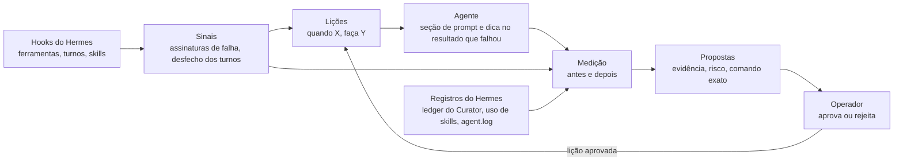

# Atlas Evolution

Um ciclo de auto-melhoria medido para o Hermes Agent: falhas de ferramenta que se repetem viram lições curtas, cada lição, reescrita de skill e mudança de configuração é comparada antes e depois, e nada muda no Hermes sem o operador.

[](https://github.com/sesantanajr/hermes-atlas-evolution/actions/workflows/tests.yml)
[](LICENSE)
[](https://github.com/NousResearch/hermes-agent/releases/tag/v0.23.1)
[](https://www.python.org/downloads/)

[English](README.md) | **Português (Brasil)**

O Atlas Evolution é um plugin independente da comunidade, sob licença MIT (ID `hermes-evolution`). Usa apenas a API pública de plugins do Hermes e a biblioteca padrão do Python. Não chama nenhum modelo e não abre conexões de rede.

## Por quê

O Hermes Agent já aprende sozinho: uma revisão em segundo plano reescreve skills e memória depois das conversas, e o Curator cuida da biblioteca de skills. Três perguntas ficam em aberto.

- **A reescrita ajudou?** Nenhuma etapa compara como o perfil se comportou antes e depois.
- **Por que a mesma chamada de ferramenta continua falhando?** Um argumento esquecido é contornado em uma conversa e repetido na seguinte.
- **Quanto custa aprender?** As revisões em segundo plano gastam tokens, e parte delas não produz nada.

O Atlas Evolution responde com medições tiradas dos hooks do Hermes e dos registros do próprio Hermes. Ele não substitui nada: memória, Curator, skills e roteador de modelos funcionam como antes.

## O que ele faz



1. **Sinais.** Cada chamada de ferramenta que falha vira uma assinatura: ferramenta, classe da falha e um identificador curto, como o argumento que faltou. Os turnos são cronometrados e contados como concluídos, falhos ou interrompidos, por superfície (local, gateway, cron, subagente). Correções, perguntas repetidas e agradecimentos do dono são contados.
2. **Lições.** Uma falha recorrente vira uma frase, "quando X, faça Y", montada a partir de modelos fixos em inglês e português.
3. **Entrega.** As lições ativas chegam ao agente em uma seção de prompt por sessão e como dica no resultado da ferramenta que falhou.
4. **Medição.** Cada lição derivada é medida contra a própria falha, antes e depois. Reescritas de skills e mudanças de configuração recebem um veredito da semana anterior contra a semana seguinte, apresentado como correlação.
5. **Saúde das skills.** Reescrita em excesso, vai-e-volta e reescritas nunca usadas, lidos apenas dos metadados do Hermes.
6. **Rendimento do aprendizado.** Quantas revisões em segundo plano rodaram, quantas não produziram nada e quanto custaram em tokens.
7. **Propostas.** Uma fila única com evidência, risco e o comando exato. O plugin só altera o próprio playbook. O que toca o Hermes é impresso para você executar.
8. **Resumo.** O relatório do período, em Markdown ou JSON, em inglês ou português.

A skill distribuída `hermes-evolution:evolution-review` conduz o dono pelo resumo e pelas propostas. Limiares e janelas estão em [O ciclo de evolução](docs/pt-BR/evolution-loop.md).

## Início rápido

```sh
# 1. Instale e habilite no perfil atual (hermes -p NOME escolhe outro perfil)
hermes plugins install sesantanajr/hermes-atlas-evolution --enable

# 2. Confira se carregou
hermes plugins doctor --ci hermes-evolution

# 3. Use o Hermes por um tempo, depois rode uma passada e leia o resumo
hermes evolution learn
hermes evolution report --days 7 --lang pt

# 4. Veja o que o ciclo propõe
hermes evolution proposals list
```

O primeiro resumo vem quase vazio, porque os sinais só começam a ser gravados quando o plugin é carregado. Reinicie o gateway se ele já estava em execução.

**Ligue as lições.** No modo padrão, `suggest`, uma falha recorrente vira candidata e nada chega ao agente até você aprovar.

```sh
hermes evolution lessons list --status candidate
hermes evolution lessons approve <id>
```

Para ativar as lições sem aprovação, defina `{"evolution": {"lessons": "auto"}}` em `<HERMES_HOME>/evolution/settings.json` e reinicie o gateway.

**Mantenha o ciclo rodando.** As lições só são derivadas e medidas quando uma passada roda: `hermes evolution learn`, à mão ou agendado. `report --schedule-spec` imprime uma receita semanal de cron sem agente (uma passada e, em seguida, o resumo), e `ops schedule-spec` imprime a do tick de operações, que roda uma passada no máximo uma vez por hora. Os dois apenas imprimem; quem cria a rotina é você.

## Exemplo de resumo

Saída ilustrativa. Os números são inventados: o trecho foi gerado em um perfil descartável, alimentado com dados fictícios (`example_search`, `example-notes`). Não é medição de nenhuma instalação real.

```text
# Atlas Evolution · resumo de 7 dias (2026-11-09 a 2026-11-15, UTC)

## Resumo

- **Turnos interativos:** 42 · 0 falharam · 0 interrompidos · 2 lentos
- **Chamadas de ferramentas:** 168 · 3 erros (1,8%)

### Comparado aos 7 dias anteriores

- `tool_error_pct`: 8,3 → 1,8 ▼
- **veredito:** melhorou

## Falhas que se repetem

- `example_search` · missing_argument (`query`): 3 vezes, 3 dias · lição: ativa

## Ciclo de auto-melhoria

- 12 revisões em segundo plano · 66,7% não produziram nada
- 9 reescritas de skills (9 pela revisão automática) · 1 skills

## Playbook

- #1 Ao chamar `example_search`, informe sempre o argumento obrigatório `query`. · efeito medido: funcionou (antes 0,333 → depois 0,071)

## Propostas aguardando decisão

- #1 [risco: médio] Travar skill reescrita em excesso · `example-notes` · aplique com: `hermes curator lock example-notes`
```

## Comandos

Todos são subcomandos de `hermes evolution`. A saída é JSON, exceto no `report`, que imprime Markdown por padrão.

| Comando | O que faz |
|---|---|
| `learn [--notify-only]` | Roda uma passada: deriva lições, mede lições e mudanças, atualiza as propostas. |
| `report [--days 1..35] [--lang en\|pt] [--format md\|json]` | Imprime o resumo e compara com o período anterior. |
| `report --schedule-spec [--weekday 0..6] [--hour 0..23] [--deliver DESTINO]` | Imprime uma receita semanal de cron sem agente. Não cria nada. |
| `lessons list [--status STATUS] [--lang en\|pt]` | Lista o playbook com status, evidência e efeito medido. |
| `lessons approve <id>`, `lessons retire <id>` | Ativa ou aposenta uma lição. |
| `lessons add "<texto>" [--tool NOME]` | Adiciona uma lição do operador, já ativa. |
| `proposals list [--all]` | Lista as propostas abertas, da mais arriscada para a menos. |
| `proposals approve <id> [--note TEXTO]`, `proposals reject <id> [--note TEXTO]` | Decide uma proposta. Proposta de lição entra em vigor; as demais devolvem o comando para você executar. |
| `skills [--days 1..35]` | Mostra reescritas, vai-e-volta e reescritas não usadas, por skill. |
| `experiments` | Lista as mudanças acompanhadas, com os vereditos. |
| `usage [--days 1..35]` | Mostra chamadas e tokens vistos pelos hooks ao lado da contabilidade do próprio Hermes. |
| `ops ...` | Supervisor de operações. Veja [Operações](docs/pt-BR/operations.md). |

`health`, `tick`, `feedback`, `history` e `memory` vêm de versões anteriores e estão descritos em [Operações](docs/pt-BR/operations.md).

## Configuração

`<HERMES_HOME>/evolution/settings.json` é um objeto JSON opcional. O plugin lê o arquivo ao ser carregado, então reinicie o gateway depois de alterar. Os comandos do ciclo recusam um bloco `evolution` inválido, enquanto o plugin volta aos padrões.

Chaves do bloco `evolution`:

| Chave | Tipo | Padrão | Efeito |
|---|---|---|---|
| `lessons` | `"off"`, `"suggest"`, `"auto"` | `"suggest"` | `off`: nenhuma lição é derivada nem mostrada; a medição continua. `suggest`: as candidatas aguardam aprovação. `auto`: as lições já nascem ativas, e a que for medida como ineficaz é aposentada depois de 14 dias. |
| `tool_hints` | booleano | `true` | Anexa a lição correspondente ao resultado da ferramenta que falhou. |
| `feedback_signals` | booleano | `true` | Conta correções, perguntas repetidas e agradecimentos do dono. |
| `language` | `"auto"`, `"en"`, `"pt"` | `"auto"` | Idioma das lições e do resumo. `auto` segue `LC_ALL`, `LC_MESSAGES` ou `LANG`. |
| `slow_turn_seconds` | inteiro, de 5 a 3600 | `60` | Turno com pelo menos essa duração conta como lento. |
| `owner_sender_ids` | lista de até 20 textos | `[]` | IDs de remetente do gateway tratados como o dono. Sessões locais sempre contam. |

Chaves de versões anteriores que continuam valendo (formatos em [Operações](docs/pt-BR/operations.md)):

| Chave | Padrão | Efeito |
|---|---|---|
| `agent_advice` | `false` | Libera para o agente as ferramentas `atlas_evolution_plan` e `atlas_evolution_lessons`. |
| `sensitivity` | `"balanced"` | Limiar dos alertas adaptativos: `low`, `balanced` ou `high`. |
| `rates_usd_per_million` | nenhum | Preços por provedor e modelo para estimar custos. |
| `daily_estimated_budget_usd` | nenhum | Limite diário (UTC) sobre a estimativa precificada. |
| `inspect_shared_kanban` | `false` | Inclui os quadros Kanban compartilhados no diagnóstico. |
| `kanban_handoff` | desligado | Autoriza o `ops handoff` a criar um cartão bloqueado. |
| `linux_supervisor` | ausente | Política dos ensaios reversíveis no systemd. |
| `semantic_incident_model` | nenhum | Modelo local de embeddings para o `ops similar`. |
| `legacy_memory_commands`, `automatic_shared_recall` | `false` | Adesão explícita aos comandos de notas da 0.1. |

## Como uma lição chega ao agente

São dois caminhos, e nenhum reescreve um prompt que já está em cache.

- **Seção de prompt da sessão.** O Hermes monta a seção `atlas-evolution.playbook` quando a sessão começa e a congela no prompt de sistema daquela sessão, com no máximo 8 lições e 1.200 caracteres. Uma lição aprovada no meio de uma sessão só aparece na próxima, então o prefixo em cache de uma sessão em andamento nunca muda.
- **Dica no resultado que falhou.** Quando uma chamada falha com uma assinatura que tem lição ativa, o hook `transform_tool_result` acrescenta a frase àquele resultado antes de ele entrar no contexto. É conteúdo novo no fim da conversa, onde ainda não há nada em cache. Cada lição vira dica uma vez por sessão, com no máximo 6 dicas por sessão, e nunca em chamada bem-sucedida.

Nada é injetado a cada turno. Com `lessons: "off"`, nenhuma das duas superfícies é registrada.

## Segurança e privacidade

- **Observação por padrão.** Nada chega ao agente até você aprovar uma lição. As ferramentas do agente ficam ocultas até `agent_advice` ser habilitado.
- **Só o próprio playbook muda.** O plugin nunca trava, arquiva ou reverte uma skill e nunca edita a configuração do Hermes.
- **Os hooks falham de forma aberta.** Um hook nunca levanta erro dentro de um turno. Enquanto o banco está ocupado, as atualizações esperam em uma fila limitada, e o que estoura a fila aparece como `dropped_events`.
- **Nenhum conteúdo é gravado.** Não se grava texto de conversa, argumento de ferramenta, saída de ferramenta, conteúdo de memória nem linha bruta de log. O banco guarda contadores, rótulos de uma lista de permissão e identificadores curtos filtrados contra caminhos, URLs e valores com cara de credencial, além das frases de lição que você ou o agente escrevem de propósito.
- **Tudo local.** `<HERMES_HOME>/evolution/` guarda `evolution.sqlite3`, `supervisor.sqlite3` e o seu `settings.json`. Não há acesso à rede nem telemetria.

O que é lido, gravado e executado está listado em [SECURITY.md](SECURITY.md) (em inglês).

## Supervisor de operações

O supervisor das versões 0.2.0 e 0.3.0 continua incluído. Ele cobre a pressão de memória, CPU e I/O do Linux (PSI, cgroup v2, systemd), o uso de tokens e as estimativas de custo, o congestionamento de Cron e Kanban, e planos delimitados de pesquisa e delegação. Por padrão, só observa. Uma política explícita autoriza ajustes temporários, verificados e reversíveis em uma unidade systemd de segundo plano. Veja [Operações](docs/pt-BR/operations.md).

## Compatibilidade e limites

O Atlas Evolution exige Hermes Agent 0.23.1 ou superior e Python 3.11 ou superior.

**Verificado**

- 166 testes, unitários e de ponta a ponta, contra um Hermes simulado, rodados pela integração contínua em Python 3.11, 3.12 e 3.13.
- `hermes plugins validate` e `hermes plugins doctor` de um Hermes Agent 0.23.1 real aprovam o plugin sem avisos.

**Não verificado**

- Um gateway de produção. Não há resultados de campo, e nada aqui afirma quanto as lições reduzem falhas em uso real.
- Os ensaios no Linux em um systemd real. Os testes usam um adaptador simulado, então valide em homologação antes de autorizar o modo `apply`.
- Outras versões do Hermes, o isolamento em host de ponta a ponta, e hosts Windows ou macOS, onde o código de Linux fica inerte.

**Limites**

- Os vereditos são correlações entre dois períodos, não experimentos controlados.
- Só as lições derivadas de uma assinatura de falha têm efeito medido. As adicionadas à mão ou propostas pelo agente não têm.
- A atualização migra o `evolution.sqlite3` para o esquema 4, que a versão 0.3.0 não abre. Para voltar, restaure um backup do arquivo ou apague-o.
- Com `plugins.isolation: host`, o Hermes ignora `register_cli_command`, então `hermes evolution` não existe. Use `python -m hermes_evolution --home <perfil> ...`, que só lê o `config.yaml` quando o PyYAML está instalado. As receitas de cron impressas não funcionam nesse modo.
- A contagem de revisões depende de uma linha que o Hermes 0.23.1 grava no `agent.log`.
- Os diagnósticos do supervisor saem quase todos em português. A chave `language` vale para as lições e para o resumo.

Hooks, superfícies e o que o plugin lê estão em [Integração com o Hermes](docs/pt-BR/hermes-integration.md).

## Desenvolvimento

```sh
git clone https://github.com/sesantanajr/hermes-atlas-evolution
cd hermes-atlas-evolution
python -m unittest discover -s tests -v     # sem dependências para instalar
hermes plugins validate .                   # exige uma instalação do Hermes Agent 0.23.1
```

Fora do Hermes, aponte o executor independente para a pasta de um perfil existente:

```sh
python -m hermes_evolution --home /caminho/do/perfil --hermes-version 0.23.1 report
```

O [CONTRIBUTING.md](CONTRIBUTING.md) (em inglês) traz as regras de privacidade que toda mudança precisa manter, e o [CHANGELOG.md](CHANGELOG.md), o histórico.

## Roteiro

Nada do que segue existe ainda.

- Um painel no Hermes Desktop e no Dashboard para o resumo e a fila de propostas.
- Um formulário de configurações pelo `config_schema` do manifesto, no lugar do JSON editado à mão.
- Um refletor opcional que rascunha lições com um modelo barato por meio de `ctx.llm`, com os rascunhos em quarentena.
- Um banco de avaliações de regressão, para conferir uma mudança contra tarefas fixas e não apenas contra a semana seguinte.

## Autor

Criado por **Sérgio Sant'Ana Júnior**. [LinkedIn](https://www.linkedin.com/in/sergiosantanacloud/)

## Licença

[MIT](LICENSE)
