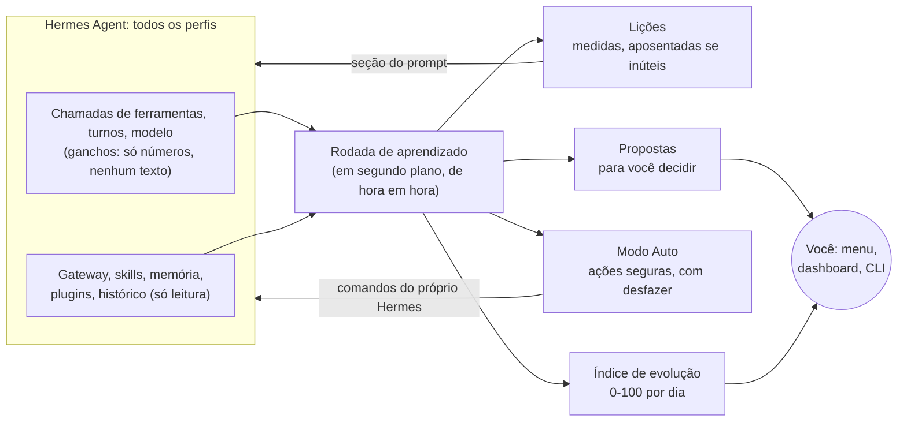
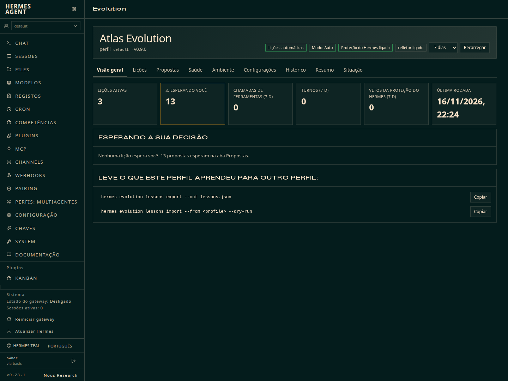
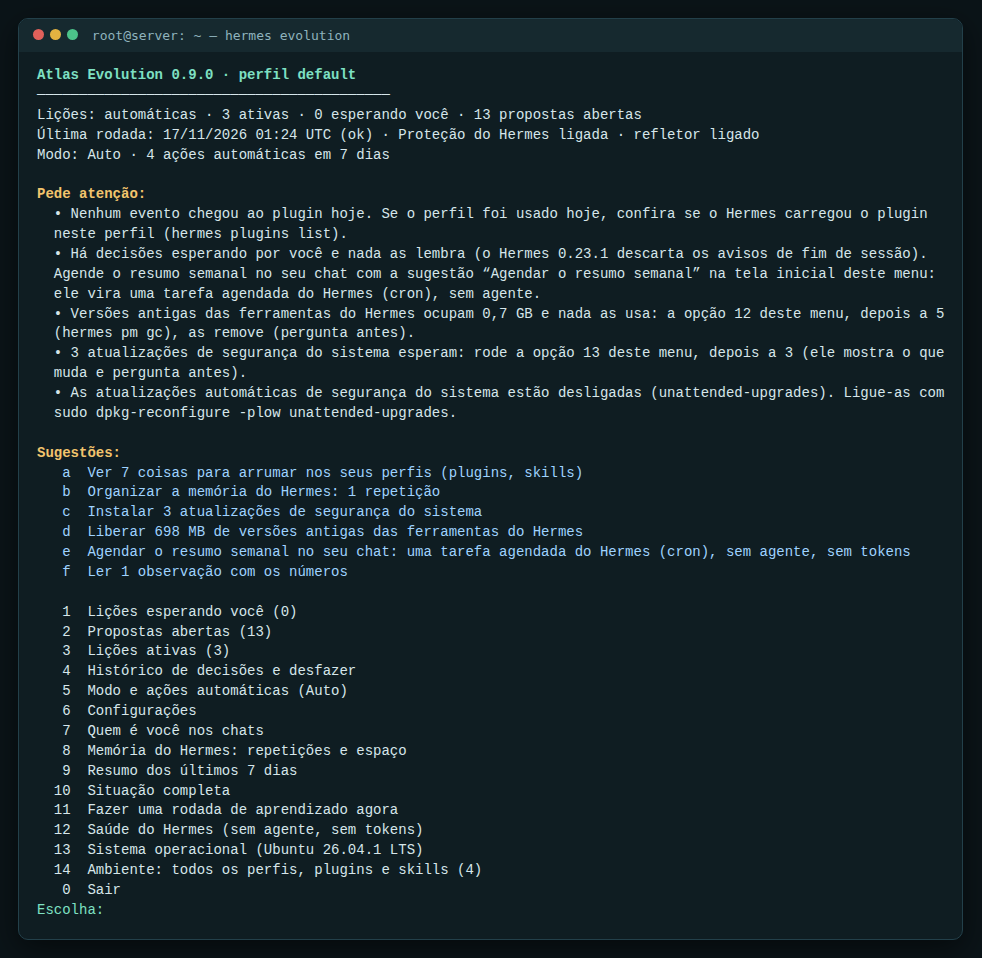
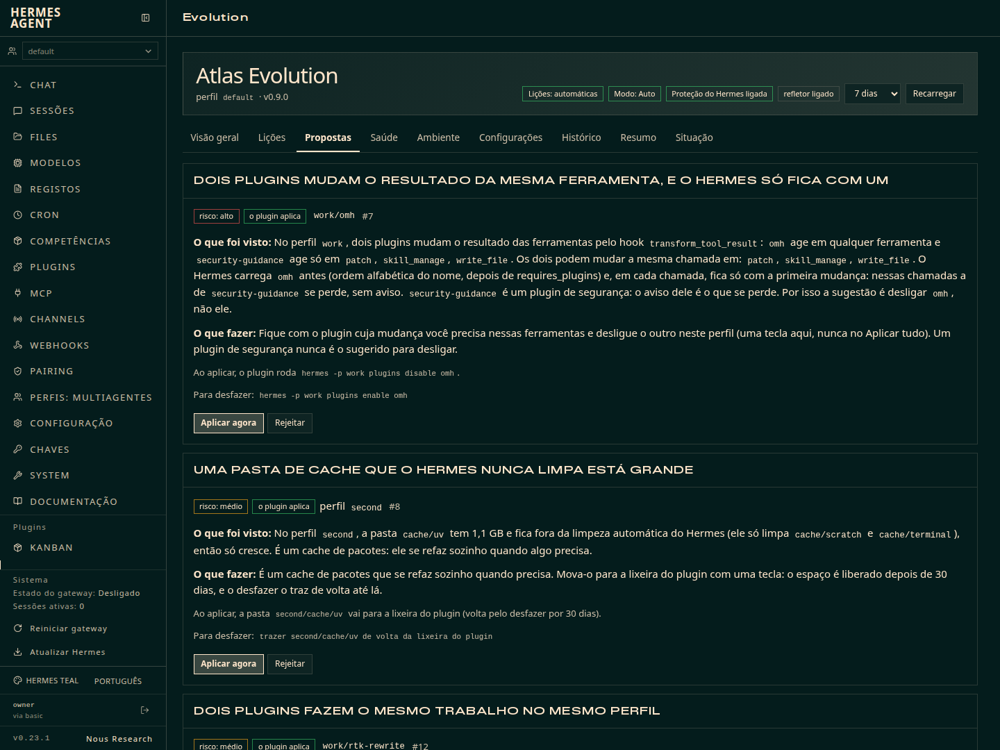
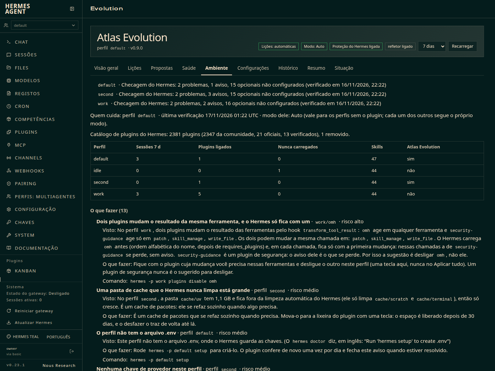
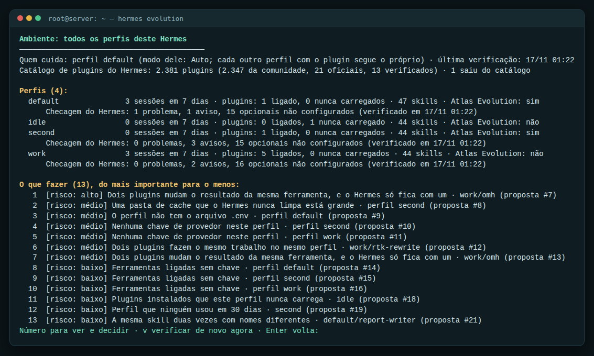
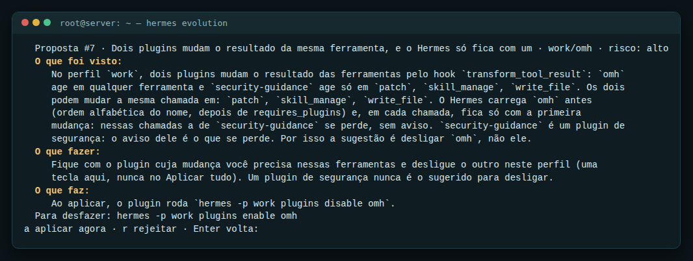
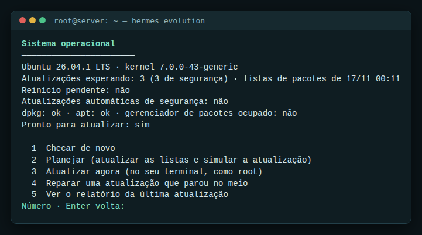

<p align="center">
  
</p>

<h1 align="center">Atlas Evolution</h1>

<p align="center">
  <b>A camada de automelhoria e cuidado do Hermes Agent.</b><br>
  Aprende com os erros do agente, mede se ele está melhorando, mantém todos os perfis saudáveis e se repara sozinho, sem gastar tokens.
</p>

<p align="center">
  🌐 <b>Português (Brasil)</b> · <a href="README.md">English</a>
</p>

<p align="center">
  <a href="https://github.com/sesantanajr/hermes-atlas-evolution/actions/workflows/checks.yml"></a>
  <a href="CHANGELOG.pt-BR.md"></a>
  <a href="https://github.com/NousResearch/hermes-agent"></a>
  
  
  <a href="LICENSE"></a>
</p>

---

## Por quê

Um Hermes que roda há semanas acumula problemas que ninguém vê: o agente repete o mesmo erro, dois plugins brigam pelo mesmo trabalho, plugins instalados nunca carregam, skills ficam paradas ou duplicadas, a memória enche de repetições que vão em todo prompt, o gateway para depois de uma atualização, o disco enche, o servidor fica sem atualização.

O **Atlas Evolution** (`hermes-atlas-evolution`) acompanha tudo isso de dentro do Hermes, resolve sozinho o que é seguro e pode ser desfeito, e transforma o resto em propostas curtas, em português, com os números, uma recomendação e uma tecla para aplicar. Ele é feito para o Hermes, com a API de plugins e os comandos do próprio Hermes, em português e inglês.

## Destaques

| | |
|---|---|
| 🧠 **Aprende com os erros** | Um erro de ferramenta que volta vira uma lição de uma frase que o agente passa a ler. Cada lição é medida, e as que não ajudam são aposentadas. |
| 📈 **Mostra se o agente evolui** | O **Índice de evolução**: uma nota de 0 a 100 por perfil e por dia, a partir das falhas de ferramentas, dos turnos que falharam ou foram lentos, das suas correções, das lições que funcionaram e da saúde do Hermes, com a tendência de 7 dias. |
| 🩺 **Mantém o Hermes saudável** | Roda as checagens do próprio `hermes doctor` em cada perfil uma vez por dia (sem rede), acompanha o gateway, o banco de sessões, disco, memória e versões antigas de ferramentas, e explica cada problema com o comando que resolve. |
| 🧹 **Arruma todos os perfis** | Plugins em conflito, duplicados ou que nunca carregam; skills sem uso, duplicadas ou quase iguais; restos de instalações que falharam; repetições na memória do Hermes. |
| 🔁 **Se repara, em todo lugar** | Um banco danificado é posto de lado e recomeçado; a cópia do plugin em cada perfil fica no mesmo código; um gateway que não sobe porque o Hermes trocou o Python é apontado para o novo, com desfazer. |
| 🛡️ **Protege o Hermes do próprio agente** | A Proteção do Hermes barra comandos do agente que reiniciariam ou matariam o gateway, apagariam aquilo em que o Hermes roda ou desligariam este plugin. |
| 🐧 **Mantém o servidor atualizado** | Atualizações do Ubuntu e do Debian com checagens antes e depois, cópia de segurança e reparo se a energia cair no meio. |
| ⚡ **Não pesa** | Cada gancho é cronometrado onde roda e aparece no `status`: em geral bem menos de um milissegundo por chamada de ferramenta, com aviso se isso crescer. |

## Como funciona



- **Observa**: os ganchos contam o que acontece (resultado, duração, classe da falha), nunca texto de mensagem, argumentos ou saída de ferramentas.
- **Aprende**: uma rodada em segundo plano transforma falhas repetidas em lições, mede o efeito delas, lê todos os perfis e as checagens de saúde do próprio Hermes.
- **Age**: no Modo Auto aplica o que é seguro e reversível com os comandos do próprio Hermes; o resto vira proposta com o seu desfazer.
- **Mostra**: o `status`, o resumo semanal, o menu do terminal e a aba **Evolution** do dashboard, com o Índice de evolução no topo.

## Começo rápido

Requer **Hermes Agent 0.23.1 ou superior**. O Hermes carrega plugins por perfil.

```bash
# Um perfil (o padrão), depois abra o menu
hermes plugins install sesantanajr/hermes-atlas-evolution --enable
hermes evolution

# Todos os perfis de uma vez (pergunta quais; --all --yes para não perguntar)
git clone https://github.com/sesantanajr/hermes-atlas-evolution.git && sh hermes-atlas-evolution/install.sh
```

Instalar carrega o plugin num gateway em execução, sem reiniciar. A primeira rodada repassa até 14 dias do histórico do perfil, então não começa do zero; no Modo Auto, ele depois se instala nos outros perfis que você usa. Próximos passos: **[Primeiros passos](docs/pt-BR/getting-started.md)**.

## Modos

| Modo | Sozinho | Espera você |
|---|---|---|
| **Auto** (padrão) | Remove entradas repetidas da memória, trava skills que o curador reescreve sem parar, libera versões antigas de ferramentas, mantém o plugin no mesmo código em todos os perfis, instala-o onde um perfil em uso nunca o teve, repara o serviço do gateway, move instalações que falharam para a lixeira. Tudo com desfazer. | O que poderia quebrar algo: desligar um plugin, remover plugins, arquivar skills. |
| **Assistido** | Só remove entradas idênticas repetidas da memória. | Todo o resto. |
| **Manual** | Nada. Ele mede e propõe. | Tudo. |

Cada ação vai para o histórico com o seu desfazer, e uma ação que você desfaz nunca se repete. Troque o modo no menu (tela 5), no dashboard ou com `hermes config set plugins.entries.hermes-atlas-evolution.settings.mode manual`.

## Veja como é

**A aba Evolution do dashboard do Hermes** (e do Hermes Desktop): decida ali, por qualquer perfil, com login no dashboard.



**O menu do terminal**, `hermes evolution`, no seu próprio terminal: o que precisa de atenção, sugestões com letras que agem na hora, e 14 telas.



<details>
<summary><b>Mais telas</b></summary>












</details>

## Comandos

`hermes evolution <comando>`; `--lang en|pt` e `--format md|json` funcionam com todos.

| Comando | O que faz |
|---|---|
| *(nenhum)*, `menu` | O menu interativo (no shell de um agente ou num pipe, imprime o `status`). |
| `status` | O que precisa de atenção, o Índice de evolução, quanto o plugin custa, a saúde do Hermes e do sistema, todos os perfis. |
| `report [--days N]` | O resumo dos últimos N dias (7 por padrão), contra o período anterior. |
| `learn` | Uma rodada de aprendizado agora. |
| `lessons list \| review \| approve <id> \| export \| import` | As lições, as suas decisões, e levá-las para outro perfil. |
| `proposals list \| approve <id> \| reject <id>` | As propostas; aprovar uma que o plugin sabe aplicar roda o comando do próprio Hermes. |
| `decisions`, `decisions undo <id>` | Cada decisão e ação automática, e o desfazer de uma. |
| `care [check \| doctor \| fix \| gc \| fix-gateway \| undo-gateway]` | Saúde e reparos do Hermes, inclusive um serviço do gateway que ainda chama um Python removido. |
| `environment [show \| scan \| catalog]` | Todos os perfis: plugins, skills, conflitos e o que fazer. |
| `update [--all \| --profiles a,b] [--list]` | Este plugin atualizado em todos os perfis (um perfil fixado passa para o último commit). |
| `system [check \| plan \| upgrade \| repair \| report]` | A atualização do sistema operacional (Linux com apt). |
| `schedule-digest [--deliver <canal>]` | O resumo semanal como tarefa agendada do Hermes, sem agente e sem tokens. |
| `owner` | Quais remetentes e canais de chat contam como você. |

Referência completa: [Comandos](docs/pt-BR/evolution-loop.md#comandos). Os comandos `health`, `history`, `tick`, `feedback`, `memory`, `ops` e o comando de chat `/evolution` foram removidos na 0.11.0: use `care check` no lugar de `health` e `decisions` no lugar de `history`; a rodada de aprendizado roda sozinha, e o `learn` roda uma agora. Quando o banco do plugin ainda guarda notas da versão 0.1, o `status` avisa, com um comando só de leitura que as mostra. Detalhes: [Atualizar para a 0.11.0](docs/pt-BR/upgrading.md#atualizar-para-a-0110).

## Configurações

Na aba **Evolution** do dashboard, no menu (tela 6), no Hermes Desktop (Configurações → Plugins) ou no `config.yaml` em `plugins.entries.hermes-atlas-evolution.settings`. As mudanças valem em até um minuto; `runtime_guard`, `tool_hints` e ligar `agent_tools` valem depois de `hermes gateway restart`.

| Opção | Padrão | O que faz |
|---|---|---|
| `mode` | `auto` | O que o plugin faz sozinho: `auto`, `assist` ou `manual` (veja [Modos](#modos)). |
| `lessons` | `auto` | `auto`: lições de padrão fixo valem quando os seus próprios turnos encontram a falha; texto escrito por um modelo espera você. `suggest`: toda lição espera. `off`: só mede. |
| `owner_sender_ids`, `owner_platforms` | `[]` | Quem é você nos chats: os seus ids de remetente e os canais em que todo chat é seu. |
| `language` | `auto` | `en` ou `pt`; `auto` segue o perfil. |
| `reflector`, `reflector_daily_limit` | `true`, `6` | Rascunha lições com um modelo, pelo Hermes, para falhas sem padrão fixo; os rascunhos esperam você. |
| `autopilot_minutes` | `60` | A rodada de aprendizado em segundo plano (15 a 1440; `0` = só à mão). |
| `runtime_guard` | `true` | Barra comandos do agente que derrubariam o Hermes. |
| `agent_tools`, `tool_hints`, `feedback_signals`, `slow_turn_seconds` | | Veja [Configurações e idioma](docs/pt-BR/evolution-loop.md#configuração-e-idioma). |

Configurações que ampliam em quem o plugin confia só valem pela configuração do Hermes, nunca pelo `settings.json` do próprio plugin, que as ferramentas de arquivo do agente podem gravar.

## Compatibilidade

| | |
|---|---|
| **Hermes Agent** | 0.23.1 ou superior; uma cópia do plugin por perfil; funciona com `plugins.isolation: host` (a Proteção do Hermes fica desligada nesse caso). |
| **Python** | 3.11 a 3.14, só a biblioteca padrão. CI: Linux 3.11–3.14, macOS e Windows 3.13. |
| **Sistemas** | Linux: tudo. macOS e Windows: tudo, menos a atualização do sistema operacional (apt) e os reparos do systemd. |
| **Dashboard** | A aba **Evolution** do dashboard do Hermes e do Hermes Desktop. |
| **Idiomas** | Português do Brasil e inglês, de ponta a ponta. |

## Privacidade e segurança

- **Guarda** contadores, classes de falha, ids de sessão com hash, lições e propostas em `<HERMES_HOME>/evolution/`; nenhum texto de conversa, prompt, argumento ou saída de ferramenta.
- **Lê**, só para ler, o histórico, os logs, as skills, os plugins (analisados, nunca executados) e os arquivos de saúde do Hermes de cada perfil ([lista completa](docs/pt-BR/hermes-integration.md#o-que-o-plugin-lê)).
- **Sem rede própria, sem telemetria.** Só o refletor, opcional, chama um modelo, pelo Hermes.
- **Só você decide**, no seu próprio terminal ou num dashboard com login; o agente nunca aprova nem amplia nada. Cada mudança tem o seu desfazer ou a sua cópia.

Detalhes: [SECURITY.md](SECURITY.md).

## Documentação

📚 **[Início da documentação](docs/pt-BR/README.md)**: [Primeiros passos](docs/pt-BR/getting-started.md) · [O ciclo de evolução](docs/pt-BR/evolution-loop.md) · [Manutenção](docs/pt-BR/maintenance.md) · [Integração com o Hermes](docs/pt-BR/hermes-integration.md) · [Atualização](docs/pt-BR/upgrading.md) · [Solução de problemas](docs/pt-BR/troubleshooting.md) · [Mudanças](CHANGELOG.pt-BR.md)

## Novidades da 0.11.0

- **O índice se explica.** O `status`, o resumo e o painel dizem o que moveu o Índice de evolução, apontam uma falha que disparou hoje e listam o que **fazer primeiro**, em ordem dos pontos que cada passo pode somar.
- **Seguro para a varredura de instalação do Hermes.** A varredura de plugins do próprio Hermes agora diz `safe`, então o plugin se instala e se atualiza em cada perfil sem esperar uma confirmação.
- **Mais autorreparo.** Um `lessons: false` gravado pelo `hermes config set` é corrigido no carregamento; uma tarefa antiga do `tick` no agendador do Hermes é encontrada, com o comando que a remove; um host de plugins e um escopo hospedado não atrapalham mais o plugin.
- **Mais enxuto.** Os comandos obsoletos desde a 0.10.0 (`ops`, `health`, `tick`, `feedback`, `history`, `memory`, `/evolution`) saíram, cerca de 5.300 linhas: veja [Atualizar para a 0.11.0](docs/pt-BR/upgrading.md#atualizar-para-a-0110).

Cada mudança: [Mudanças](CHANGELOG.pt-BR.md).

## Contribuir

Issues e pull requests são bem-vindos; leia antes o [CONTRIBUTING.md](CONTRIBUTING.md). Problemas de segurança vão pelo [SECURITY.md](SECURITY.md).

## Licença

[MIT](LICENSE): livre e de código aberto, inclusive para uso comercial, mantendo o aviso de copyright.

## Autor

Criado por **Sérgio Sant'Ana Júnior** · [LinkedIn](https://www.linkedin.com/in/sergiosantanacloud/)
