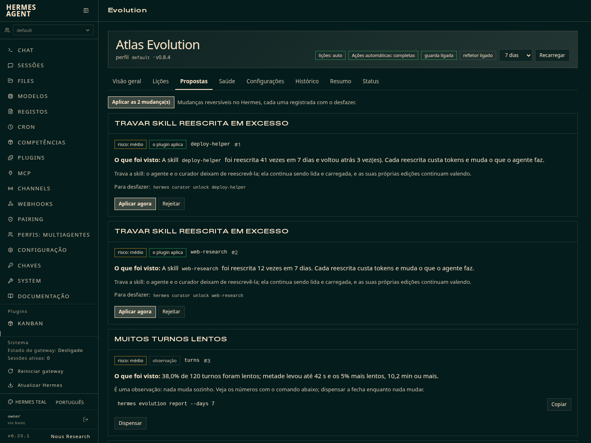
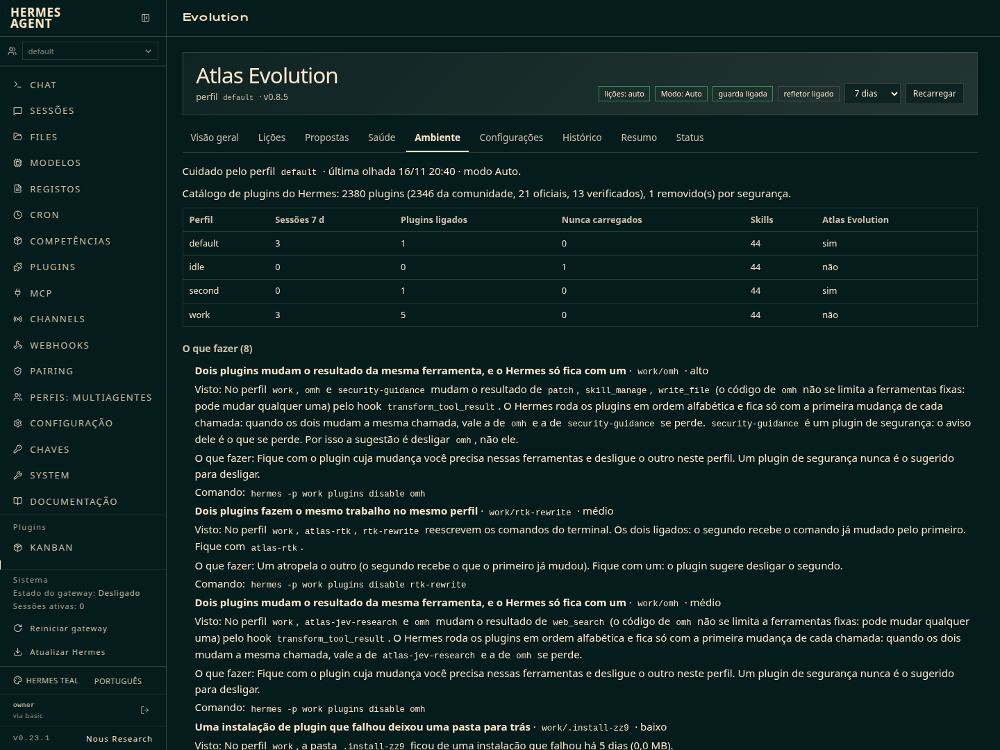
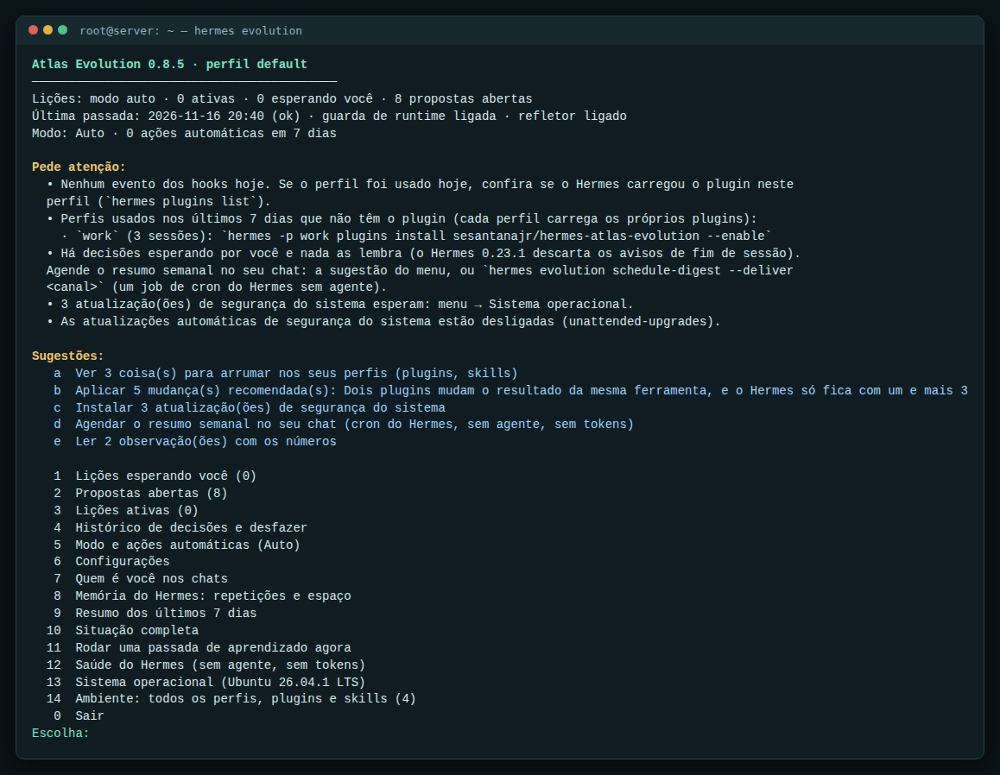
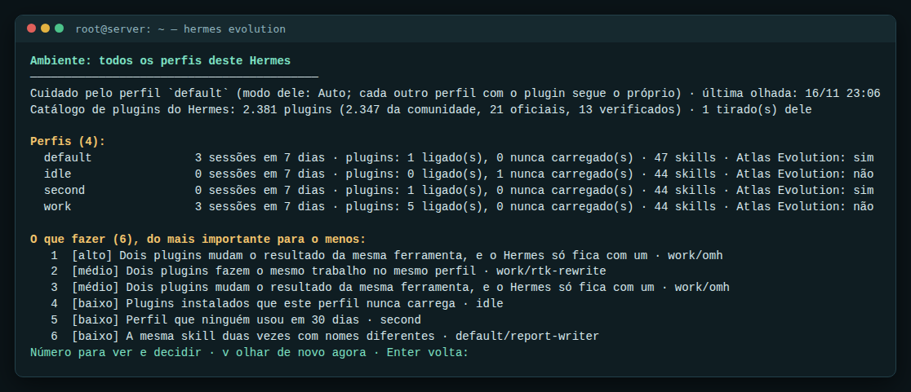
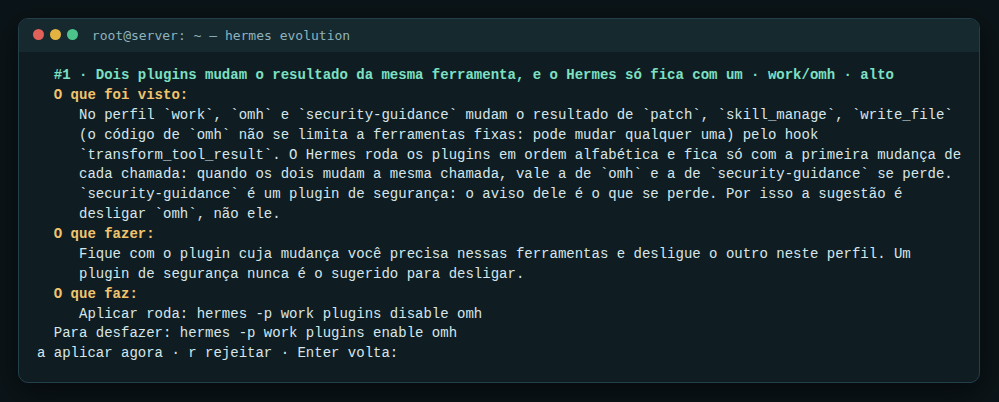

# Atlas Evolution

🌐 **Português (Brasil)** · [English](README.md)

**O Atlas Evolution cuida do seu Hermes Agent por você.** Ele olha todos os perfis do seu Hermes (os erros do agente, as skills, a memória, os plugins, o gateway e o servidor), conserta sozinho o que é seguro consertar, sem usar o agente e sem gastar tokens, e transforma o resto em sugestões curtas, em português, com os números, uma recomendação clara e uma tecla para aplicar. Tudo o que ele muda pode ser desfeito.

[](LICENSE)
[](https://github.com/NousResearch/hermes-agent/releases/tag/v0.23.1)
[](docs/pt-BR/maintenance.md)

## O que ele faz, na prática

Um Hermes que roda há semanas acumula problemas que ninguém vê: o agente repete o mesmo erro, dois plugins brigam pelo mesmo trabalho, plugins instalados nunca carregam, skills ficam paradas ou duplicadas, a memória enche de repetições (e ela vai em todo prompt), o disco enche, o servidor fica sem atualização. O Atlas Evolution (`hermes-atlas-evolution` no Hermes) encontra isso e resolve:

| | Na prática |
|---|---|
| **Para de repetir erros** | Um erro de ferramenta que volta vira uma lição de uma frase que o agente passa a ler. O plugin mede se a lição ajudou e tira as que não ajudaram. |
| **Arruma o ambiente inteiro** | Olha todos os perfis de uma vez e aponta plugins que mudam o resultado da mesma ferramenta (e qual deles se perde), dois plugins fazendo o mesmo trabalho, plugins removidos do catálogo do Hermes, arquivados ou sem manutenção, plugins instalados que nunca carregam, skills sem uso, duplicadas, parecidas ou copiadas em vários perfis, e restos de instalações que falharam. Conhece o catálogo oficial de plugins do Hermes (mais de 2.300) e quais plugins estão arquivados ou sem manutenção. |
| **Economiza tokens** | Tira repetições da memória do Hermes, trava skills que o curador reescreve sem parar e mostra o que deixa cada chamada pesada. |
| **Mantém o Hermes saudável** | Roda as checagens do próprio `hermes doctor` em cada perfil em uso, uma vez por dia, sem rede, e transforma o que elas encontram em passos simples: ferramentas ligadas sem chave, pasta de cache que o Hermes nunca limpa, pontos de restauração acima do limite, config para migrar, alerta de segurança. Também acompanha o gateway (vivo ou travado), o banco de sessões, o disco (e o dia em que ele enche), memória, swap, CPU e versões antigas de ferramentas. Repara com o `doctor --fix` do próprio Hermes, com backup antes. |
| **Mantém o servidor atualizado** | Atualiza o Ubuntu ou o Debian com checagens antes e depois, cópia de segurança, os seus arquivos de configuração mantidos e um reparo se a energia cair no meio. |
| **Protege o Hermes do próprio agente** | Barra comandos do agente que derrubariam ou apagariam aquilo em que o Hermes roda. |

### O Modo Auto (padrão)

No **Modo Auto** o Atlas Evolution pensa e age por você. Um perfil cuida do Hermes inteiro e enxerga todos os perfis, sem o plugin precisar estar instalado em cada um. Sozinho, ele só faz o que é seguro e pode ser desfeito.

Em cada perfil onde ele roda (com o modo daquele perfil):

- remove entradas repetidas da memória (guarda uma cópia do arquivo);
- trava skills que o curador reescreve sem parar;
- libera versões antigas de ferramentas, no máximo uma vez por semana.

Nos outros perfis, a partir do perfil que cuida do Hermes inteiro:

- se instala, na mesma versão, nos perfis em uso que nunca o tiveram (nunca onde você o desligou ou removeu); o Hermes o baixa do GitHub;
- move para a lixeira as pastas deixadas por instalações que falharam (guardadas 30 dias);
- roda a checagem do Hermes (`hermes doctor`) uma vez por dia e lista o que ela encontrar, com o que fazer e o comando (um cache de pacotes grande vai para a lixeira com uma tecla; pastas com dados das conversas ficam com você).

O que poderia quebrar algo (desligar um de dois plugins, remover plugins, arquivar skills) espera você, com o motivo e a tecla ou o comando para aplicar. Antes de mudar qualquer coisa num perfil, o plugin lê esse perfil de novo do disco: uma sugestão guardada nunca é tomada como verdade. Cada ação vai para o histórico com o desfazer, e uma ação que você desfaz nunca se repete. Prefere decidir tudo? Troque para **Assistido** ou **Manual** no menu (tela 5) ou no dashboard.

**A primeira rodada depois de instalar ou atualizar, com as configurações padrão, já age.** Ela olha todos os perfis e pode, sozinha: remover entradas repetidas da memória, travar skills que o curador reescreve sem parar, rodar `hermes pm gc` se versões antigas de ferramentas ocuparem 300 MB ou mais, instalar o plugin em perfis usados nos últimos 7 dias que nunca o tiveram e mover para a lixeira pastas de instalações que falharam. Para nada mudar sozinho, rode `hermes config set plugins.entries.hermes-atlas-evolution.settings.mode manual` antes de atualizar e decida tudo pela tela 14.

Os dados ficam na sua máquina, o plugin não abre conexão de rede própria e o agente nunca decide nada.

## Veja como é

### No dashboard do Hermes

A aba **Evolution** do dashboard do Hermes (e do Hermes Desktop). Com login no dashboard, você decide ali, por qualquer perfil.







### No terminal

`hermes evolution` abre o mesmo, como um menu numerado, no seu próprio terminal (nunca no shell do agente): o que pede atenção, sugestões com letras que agem na hora e 14 telas.








## Começo rápido

Precisa do Hermes Agent 0.23.1 ou superior. O Hermes carrega os plugins por perfil, então instale em cada perfil que você usa.

```bash
hermes plugins install sesantanajr/hermes-atlas-evolution --enable              # o perfil padrão
hermes -p <perfil> plugins install sesantanajr/hermes-atlas-evolution --enable  # cada perfil com nome
hermes evolution                                                                # o menu
```

Instalar carrega o plugin num gateway em execução; não precisa reiniciar. A primeira olhada lê até 14 dias do histórico do perfil, então ele não começa do zero. No Modo Auto o plugin depois se instala sozinho nos outros perfis que você usa. Para atualizar: [Atualização](docs/pt-BR/upgrading.md).

### Instalar ou atualizar em todos os perfis de uma vez

```bash
git clone https://github.com/sesantanajr/hermes-atlas-evolution.git && sh hermes-atlas-evolution/install.sh
```

Ele lista seus perfis e pergunta quais (Enter = todos). Sem perguntas: `sh install.sh --all --yes --install-missing --restart`. Depois de instalado, `hermes evolution update` faz o mesmo pelo Hermes (`--all`, `--profiles a,b`, `--list`). Se o gateway não voltar depois de o Hermes se atualizar: `hermes evolution care fix-gateway`.

## Novidades da 0.9.0

- **A checagem do próprio Hermes, todo dia, em todos os perfis.** O plugin roda as checagens do `hermes doctor` em cada perfil em uso uma vez por dia, sem rede e sem mudar nada, e transforma cada problema em palavras simples, com o que fazer e o comando: ferramentas ligadas sem chave, `.env` faltando, um cache grande que o Hermes nunca limpa, pontos de restauração acima do limite, config para migrar, provedor de memória desligado, alerta de segurança (sempre primeiro). Peças opcionais que você nunca configurou são só contadas. Um problema da máquina inteira aparece uma vez só.
- **`hermes doctor` sem aviso falso.** As ferramentas do plugin para o agente só são registradas quando você as liga, então o `hermes doctor` não aponta nada sobre o plugin.
- **O `hermes doctor` completo, explicado.** Pelo menu, ele mostra a própria lista do que fazer ("encontrou problemas" é uma resposta, não uma falha), e o `--fix` diz antes o que pode mudar e o que o backup devolve.
- **Ações mais seguras.** A lixeira guarda cada pasta 30 dias a partir do dia em que ela entra e se esvazia sozinha depois disso; o Modo Auto respeita um perfil de onde você removeu o plugin, instalações por link, forks e a regra de nomes de perfil do Hermes; o `hermes pm gc` roda uma vez para o Hermes inteiro; a proteção do Hermes barra quem tenta derrubar o gateway buscando o processo, sem barrar comandos comuns.
- **Bilíngue de ponta a ponta.** Painel, menu, a saída de cada comando e o formulário de configurações em inglês e em português do Brasil, no idioma do perfil. Todas as mudanças: [CHANGELOG em português](CHANGELOG.pt-BR.md).

## Comandos

Subcomandos de `hermes evolution`. `--lang en|pt` funciona com qualquer um.

| Comando | O que faz |
|---|---|
| *(nenhum)*, `menu` | O menu interativo, no seu próprio terminal. Sem terminal (um script, um pipe, o shell do agente), o comando sozinho mostra o `status`. |
| `status` | Se o plugin observa, aprende e protege este perfil, o que pede atenção, a saúde do Hermes e a do sistema, e todos os perfis deste Hermes. |
| `report [--days N]` | O resumo dos últimos N dias (7 por padrão), comparado com o período anterior. |
| `lessons list`, `lessons review`, `lessons approve <id>`, `lessons approve --all` | As lições, e a sua decisão sobre as que esperam. |
| `proposals list`, `proposals approve <id>`, `proposals reject <id>` | As propostas; aprovar uma mudança que o plugin consegue fazer a aplica com o próprio comando do Hermes. |
| `decisions`, `decisions undo <id>` | As suas decisões e as ações automáticas, do terminal, do dashboard e da rodada automática, e o desfazer de uma. |
| `care [check \| pm-doctor \| doctor \| fix \| gc]` | A saúde do Hermes, lida dos próprios arquivos dele; e as checagens e reparos do próprio Hermes. |
| `system [check \| plan \| upgrade \| repair \| report] [--full] [--skip PACOTE...]` | A atualização do sistema operacional (Linux com apt). |
| `environment [show \| scan \| catalog]` | Todos os perfis deste Hermes: plugins, skills, conflitos e o que fazer; `scan` olha de novo agora; `catalog` o catálogo de plugins do Hermes guardado no banco do plugin. |
| `schedule-digest [--deliver local\|<canal>]` | O resumo semanal como uma tarefa agendada do Hermes (cron), sem agente. |
| `lessons export`, `lessons import` | Lições compartilhadas com outro perfil ou máquina, depois de mostrar cada uma. |
| `learn` | Uma rodada de aprendizado na hora. |
| `owner` | Cada canal de chat com os remetentes, e o comando que marca um como você. |

Todos os comandos e opções: [Comandos](docs/pt-BR/evolution-loop.md#comandos).

## Configurações

Ajuste na aba **Evolution** do dashboard, no menu (tela 6), no Hermes Desktop em Settings → Plugins, ou no `config.yaml` do perfil em `plugins.entries.hermes-atlas-evolution.settings`. Uma mudança vale em até um minuto, sem reiniciar o gateway. Três valem depois de `hermes gateway restart` (no terminal, na próxima sessão): `runtime_guard`, `tool_hints` e ligar o `agent_tools`.

| Opção | Padrão | O que faz |
|---|---|---|
| `lessons` | `auto` | `auto`: lições de padrões fixos valem quando os seus turnos encontram a falha, são medidas e aposentadas quando não ajudam; texto escrito por um modelo ou pelo agente espera você. `suggest`: toda lição espera você. `off`: só mede. |
| `mode` | `auto` | O que o plugin faz sozinho. `auto`: pensa e age por você em todos os perfis, só o que é seguro e pode ser desfeito (veja [O Modo Auto](#o-modo-auto-padrão)). `assist`: sozinho, só remove entradas repetidas da memória; o resto espera uma tecla. `manual`: mede e propõe; nada muda sozinho. |
| `owner_sender_ids`, `owner_platforms` | `[]` | Quem é você nos chats: os seus ids de remetente, e plataformas em que todo chat é seu (um bot privado, a sua própria interface). |
| `language` | `auto` | `en` ou `pt`. `auto` segue o idioma do perfil. |
| `reflector` | `true` | Rascunha lições com um modelo de IA, pelo Hermes, para falhas sem padrão fixo (no máximo 6 chamadas por dia); os rascunhos esperam você. |
| `autopilot_minutes` | `60` | A rodada de aprendizado em segundo plano, no máximo uma vez por intervalo (15 a 1440 minutos; `0` = só à mão). |
| `runtime_guard` | `true` | Barra comandos do agente que parariam o gateway ou apagariam aquilo em que o Hermes roda. |
| `agent_tools`, `tool_hints`, `feedback_signals`, `slow_turn_seconds` | | Veja [Configuração e idioma](docs/pt-BR/evolution-loop.md#configuração-e-idioma). |

`owner_sender_ids`, `owner_platforms`, `agent_tools: true`, `runtime_guard: false` e qualquer `mode` que não seja `manual` só valem vindos da configuração do Hermes, nunca do `settings.json` do próprio plugin, que as ferramentas de arquivo do agente conseguem gravar.

## Privacidade e segurança

- **O que ele guarda.** Contadores, classes de falha, ids de sessão com hash, lições e propostas, em `<HERMES_HOME>/evolution/`; nenhum texto de conversa, prompt, argumento ou saída de ferramenta. Uma cópia de um arquivo de memória quando uma entrada sai, só do dono; antes de uma atualização do sistema, a lista de pacotes e uma cópia do `/etc` numa pasta só do root, fora de todo perfil (`/var/lib/hermes-atlas-evolution/system/`).
- **O que ele lê**, só para ler: o histórico, os logs e os registros de skills do Hermes, os arquivos do gateway e do banco; o `config.yaml`, os plugins (manifesto, checkout git e código Python, analisado e nunca executado) e as skills de cada perfil; o catálogo de plugins que o Hermes guarda em cache; do sistema, o estado do gerenciador de pacotes ([lista completa](docs/pt-BR/hermes-integration.md#o-que-o-plugin-lê)).
- **Rede e modelo.** Nenhuma conexão própria e nenhuma telemetria. Quando o Modo Auto instala o plugin em outro perfil, o Hermes o baixa do GitHub. Só o refletor chama um modelo, pelo Hermes. As checagens diárias do doctor rodam sem rede (ficam de fora as sondas dos provedores, o npm audit e a checagem do Skills Hub); o `hermes doctor` completo, rodado só com um clique seu, consulta as APIs dos provedores, o registro do npm e o GitHub. Todo o resto aqui não gasta nada.
- **Decisões.** Só você decide, no seu próprio terminal ou num dashboard com login. O plugin muda os próprios dados; as próprias configurações com `hermes config set`; a memória do Hermes só para tirar uma repetição; skills só com `hermes curator lock`; plugins de qualquer perfil só com os comandos do próprio Hermes (`hermes -p <perfil> plugins disable|enable|install`); pastas de instalações que falharam movendo-as para a lixeira dele; o sistema só quando você roda a atualização dele. Cada mudança tem o desfazer ou a cópia.

Detalhes: [SECURITY.md](SECURITY.md).

## Documentação

- [O ciclo de evolução](docs/pt-BR/evolution-loop.md): lições, o refletor, ações automáticas, a memória do Hermes, o menu, todos os comandos e configurações.
- [Manutenção](docs/pt-BR/maintenance.md): a saúde do Hermes e a atualização do sistema operacional, passo a passo.
- [Integração com o Hermes](docs/pt-BR/hermes-integration.md): hooks, o painel do dashboard, a proteção do Hermes, o que o plugin lê.
- [Atualização](docs/pt-BR/upgrading.md): atualizar o plugin.
- [Operações](docs/pt-BR/operations.md), [CONTRIBUTING.md](CONTRIBUTING.md), [SECURITY.md](SECURITY.md), [Mudanças](CHANGELOG.pt-BR.md).

## Licença

O Atlas Evolution é software livre e de código aberto, publicado sob a [Licença MIT](LICENSE). Você pode usar, copiar, modificar, mesclar, publicar, distribuir, sublicenciar e vender cópias, inclusive para uso comercial, desde que o aviso de copyright e o texto da licença sejam mantidos em todas as cópias. O software é fornecido como está, sem garantia de qualquer tipo. Contribuições são bem-vindas sob a mesma licença; veja o [CONTRIBUTING.md](CONTRIBUTING.md).

## Autor

Criado por **Sérgio Sant'Ana Júnior**. [LinkedIn](https://www.linkedin.com/in/sergiosantanacloud/)
