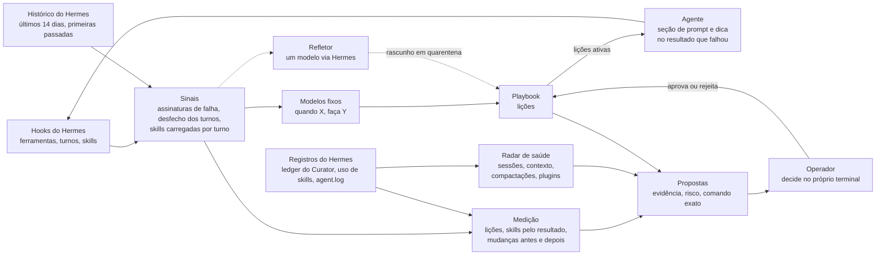

# Atlas Evolution

Um ciclo de auto-melhoria medido para o Hermes Agent: ele aprende com o histórico do próprio perfil já na primeira passada e depois roda sozinho, falhas de ferramenta que se repetem viram lições curtas, cada lição, skill e mudança de configuração é julgada pelo que aconteceu antes e depois dela, e uma guarda de runtime barra os comandos do agente que reiniciariam o gateway ou apagariam aquilo de que o Hermes precisa para rodar. Nenhuma lição chega ao agente e nada muda no Hermes sem o operador.

[](https://github.com/sesantanajr/hermes-atlas-evolution/actions/workflows/tests.yml)
[](LICENSE)
[](https://github.com/NousResearch/hermes-agent/releases/tag/v0.23.1)
[](https://www.python.org/downloads/)

[English](README.md) | **Português (Brasil)**

O Atlas Evolution é um plugin independente da comunidade para o Hermes Agent, sob licença MIT (ID `hermes-evolution`, versão 0.5.0). Qualquer pessoa pode instalá-lo em qualquer perfil do Hermes; ele não depende de nenhum outro sistema. Usa a API pública de plugins do Hermes e a biblioteca padrão do Python, e não abre conexão de rede própria. O refletor vem ligado: quando uma falha sem modelo de lição continua se repetindo, ele pede a um modelo, por meio do Hermes, o rascunho de uma lição, no máximo 3 vezes por passada e, no padrão, 6 vezes por dia, e todo rascunho aguarda a sua aprovação. Com `reflector: false`, nenhum modelo é chamado.

## Por quê

O Hermes Agent já aprende sozinho: uma revisão em segundo plano reescreve skills e memória, e o Curator cuida da biblioteca de skills. Cinco perguntas ficam em aberto.

- **A reescrita ajudou?** Nada compara o perfil antes e depois dela.
- **Por que a mesma chamada de ferramenta continua falhando?** Um argumento esquecido é contornado numa conversa e repetido na seguinte.
- **Quais skills pioram os turnos?** Nada liga uma skill carregada a um turno que falhou ou foi corrigido.
- **Quanto custa aprender?** As revisões em segundo plano gastam tokens, e parte delas não produz nada.
- **O próprio Hermes está saudável?** Sessões que terminam como órfãs, prompts pesados e plugins que disputam o mesmo hook passam despercebidos, e um agente com terminal consegue reiniciar ou apagar o Hermes em que ele mesmo roda.

O Atlas Evolution responde com medições tiradas dos hooks e dos registros do próprio Hermes. Não substitui nada: memória, Curator, skills e roteador de modelos funcionam como antes.

## O que ele faz



1. **Sinais.** Uma chamada de ferramenta que falha vira uma assinatura: ferramenta, uma de 20 classes de falha e um detalhe curto, como o argumento que faltou. Os turnos são cronometrados por superfície; correções e agradecimentos do dono são contados. As primeiras passadas reprocessam os últimos 14 dias do histórico do próprio perfil pelo mesmo código, então uma falha que se repetiu na semana passada pode virar lição já no primeiro dia.
2. **Lições.** Uma falha recorrente que tem modelo vira uma frase, "quando X, faça Y". Uma aprovação recusada pelo usuário nunca vira lição.
3. **Refletor (ligado por padrão).** Para falhas recorrentes sem modelo, um modelo rascunha uma lição por meio do Hermes, que fica em quarentena.
4. **Entrega.** As lições ativas chegam ao agente numa seção de prompt por sessão e como dica no resultado que falhou.
5. **Medição.** A lição é medida contra a própria falha; a reescrita de skill, pelos turnos que carregaram a skill; a mudança de configuração, pela semana anterior e pela seguinte.
6. **Skills pelo resultado.** Cada skill carregada num turno herda o desfecho do turno; uma skill claramente pior que o perfil vira proposta.
7. **Radar de saúde.** Sessões que terminam como órfãs, contexto pesado por chamada do agente, compactações que mantêm quase todo o contexto e plugins que falham ao carregar ou disputam o mesmo hook viram propostas consultivas com o comando para investigar.
8. **Propostas e resumo.** Uma fila com evidência, risco e o comando exato, e um resumo que inclui o custo das revisões em segundo plano e uma seção "Saúde do Hermes".

Tudo isso roda sozinho: por padrão, o autopilot faz uma passada em segundo plano no máximo uma vez por hora, e o `hermes evolution status` mostra se o plugin está observando, aprendendo e protegendo o perfil. A guarda de runtime, também ligada por padrão, barra os comandos de terminal do agente que reiniciariam ou derrubariam o gateway em que ele roda, ou que apagariam aquilo de que o Hermes em execução precisa (veja [Guarda de runtime](#guarda-de-runtime)).

O supervisor de operações das versões 0.2.0 e 0.3.0 continua: pressão no Linux, uso e custo, Cron e Kanban ([Operações](docs/pt-BR/operations.md)). A skill distribuída `hermes-evolution:evolution-review` conduz o dono pelo resumo. Os limiares estão em [O ciclo de evolução](docs/pt-BR/evolution-loop.md).

## Início rápido

```sh
# 1. Instale e habilite no perfil atual (hermes -p NOME escolhe outro perfil)
hermes plugins install sesantanajr/hermes-atlas-evolution --enable

# 2. Confira se carregou
hermes plugins doctor --ci hermes-evolution

# 3. Reinicie o gateway em execução, use o Hermes e confira se o plugin está observando, aprendendo e protegendo
hermes evolution status --lang pt

# 4. Leia o resumo
hermes evolution report --days 7 --lang pt
```

Depois do primeiro turno, o autopilot roda uma passada em segundo plano. As primeiras passadas reprocessam os últimos 14 dias do histórico do perfil (turnos, chamadas de ferramentas e suas falhas, sinais do dono e skills carregadas) e as revisões em segundo plano registradas no `agent.log`, então o primeiro resumo já vem com dados. Chamadas ao modelo e tokens só são contados a partir do momento em que o plugin carrega. O `hermes evolution learn` roda uma passada na hora e dá ao histórico 120 segundos por passada, em vez de 20.

**Instale em todo perfil que você usa.** O Hermes carrega os plugins por perfil, mesmo quando um único gateway atende vários perfis. Em cada perfil:

```sh
hermes -p <perfil> plugins install sesantanajr/hermes-atlas-evolution --enable
```

O `hermes evolution status` lista os outros perfis da mesma raiz do Hermes que tiveram sessões nos últimos 7 dias e não têm o plugin, já com esse comando.

**Escolha o modo das lições.** No modo padrão, `suggest`, nada chega ao agente até você aprovar:

```sh
hermes evolution lessons list --status candidate
hermes evolution lessons approve <id>      # mostra o texto exato e pergunta
```

`auto` ativa na hora as lições derivadas e aposenta as medidas como ineficazes; rascunhos do refletor e propostas do agente continuam esperando por você. `off` só mede. Defina no Hermes Desktop, em Settings → Plugins, ou veja [Configuração](#configuração).

**Receba o resumo toda semana.** O autopilot deriva e mede. Isto imprime uma receita de cron sem agente que roda uma passada e entrega o resumo:

```sh
hermes evolution report --schedule-spec --weekday 1 --hour 8 --deliver local --lang pt
```

Salve o `script_content` em `script_path`, leia, e então rode o `posix_command` (uma chamada `hermes cron create`). O plugin não grava nem agenda nada. O `ops schedule-spec` faz o mesmo para o tick de operações, que também roda uma passada no máximo uma vez por hora. O autopilot, o `learn` e o tick reservam a mesma passada, então duas passadas do mesmo perfil nunca rodam ao mesmo tempo. Para rodar passadas só quando você pedir, defina `autopilot_minutes` como 0.

## Exemplo de resumo

Saída ilustrativa, com números inventados: um trecho gerado pelo código atual a partir de dados fictícios. Não é medição de nenhuma instalação real.

```text
# Atlas Evolution · resumo de 7 dias (2026-11-09 a 2026-11-15, UTC)

## Resumo

- **Turnos interativos:** 42 · 0 falharam · 0 interrompidos · 2 lentos
- **Chamadas de ferramentas:** 168 · 3 erros (1,8%)

### Comparado aos 7 dias anteriores

- `turn_failed_pct`: 16,7 → 0,0 ▼
- `tool_error_pct`: 6,5 → 1,8 ▼
- `owner_corrections_per_100_turns`: 0,0 → 7,1 ▲
- **veredito:** misto

## Falhas que se repetem

- `example_search` · missing_argument (`query`): 3 vezes, 3 dias · lição: ativa
- `terminal` · approval_refused: 2 vezes, 2 dias · nunca vira lição: quem decide é a aprovação do usuário

## Ciclo de auto-melhoria

- 12 revisões em segundo plano · 66,7% não produziram nada
- 9 reescritas de skills (9 pela revisão automática) · 1 skills

### Skills pelo resultado

- perfil inteiro: 42 turnos · 0,0% falharam · 7,1% corrigidos
- `example-notes`: 12 turnos · 0,0% falharam · 25,0% corrigidos · 16,7% com erro de ferramenta · **pior que o perfil**

## Playbook

- #1 Ao chamar `example_search`, informe sempre o argumento obrigatório `query`. · efeito medido: funcionou (antes 0,333 → depois 0,071)

## Saúde do Hermes

- **Sessões:** 31 encerradas · 12 terminaram como órfãs (38,7%) · _recolhidas após desconexão ou reinício, sem o encerramento normal do Hermes_
- **Contexto por chamada do agente:** média de 41.200 tokens · 62,5% servido do cache · 318 chamadas
- **Plugins deste processo:** 6 ativos · disputam `transform_tool_result` (só o primeiro resultado vale): `example-filter` → `hermes-evolution`
- **Guarda de runtime:** 2 comandos barrados (reinício ou kill do gateway 2)

## Propostas aguardando decisão

- 2 lições aguardam aprovação (leia com `hermes evolution lessons list` e aprove com `hermes evolution lessons approve <id da lição>`): #2 `example_fetch`, #3 `example_upload`
- #1 [risco: médio] Travar skill reescrita em excesso · `example-notes` · aplique com: `hermes curator lock example-notes`
- #4 [risco: médio] Plugins disputam um hook em que só o primeiro vale · `transform_tool_result` · próximo passo: `hermes plugins list`
- #2 [risco: baixo] Revisar skill cujos turnos vão pior que o perfil · `example-notes` · próximo passo: `hermes curator ledger --skill example-notes`
- #5 [risco: baixo] Muitas sessões terminam como órfãs · `sessions` · próximo passo: `hermes sessions list`
```

## Comandos

Subcomandos de `hermes evolution`. A saída é JSON, exceto no `report` e no `status` (Markdown por padrão). `--lang en|pt` funciona antes ou depois de qualquer subcomando.

| Comando | O que faz |
|---|---|
| `status [--format md\|json]` | Se o plugin está observando, aprendendo e protegendo este perfil: eventos vistos pelos hooks hoje, a última passada do autopilot, a leitura do histórico, o refletor, as lições, as propostas abertas, os comandos barrados pela guarda em 7 dias e os perfis movimentados da mesma raiz do Hermes que não têm o plugin. |
| `learn [--notify-only]` | Uma passada agora: reprocessa o histórico enquanto a leitura não termina, deriva lições, consulta o refletor se ligado, mede, lê o radar, atualiza as propostas. Espera até 30 segundos por uma passada que já esteja rodando. |
| `report [--days 1..35] [--format md\|json]` | O resumo, comparado com o período anterior. |
| `report --schedule-spec [--weekday 0..6] [--hour 0..23] [--deliver DESTINO]` | Imprime a receita semanal de cron. Não cria nada. |
| `lessons list [--status STATUS]` | O playbook com origem, evidência e efeito medido. |
| `lessons approve <id> [--yes]`, `lessons retire <id>` | Ativa (depois de mostrar o texto) ou aposenta uma lição. Só o operador. |
| `lessons add "<texto>" [--tool NOME] [--activate] [--yes]` | Adiciona uma lição sua, em quarentena salvo `--activate`. Só o operador. |
| `proposals list [--all]` | Propostas abertas, da mais arriscada para a menos. |
| `proposals approve <id> [--note TEXTO] [--yes]`, `proposals reject <id> [--note TEXTO]` | Decide uma proposta. Só o operador. Lição entra em vigor; o resto devolve o comando para você executar. |
| `skills [--days 1..35]` | Reescritas, vai-e-volta e reescritas não usadas por skill, mais as skills pelo resultado. |
| `experiments` | Mudanças acompanhadas e seus vereditos. |
| `usage [--days 1..35]` | Chamadas e tokens vistos pelos hooks, ao lado da contabilidade do Hermes. |
| `ops ...` | Supervisor de operações ([Operações](docs/pt-BR/operations.md)). |

`health`, `tick`, `feedback`, `history` e `memory` vêm de versões anteriores.

## Configuração

As opções principais estão no `config_schema` do manifesto, então o Hermes Desktop as mostra em Settings → Plugins e as grava em `plugins.entries.hermes-evolution.settings`.

| Opção | Tipo | Padrão | Efeito |
|---|---|---|---|
| `lessons` | `off`, `suggest`, `auto` | `suggest` | `off` só mede; `suggest` espera aprovação; `auto` ativa as lições derivadas e aposenta as ineficazes depois de 14 dias. |
| `language` | `auto`, `en`, `pt` | `auto` | `auto` segue `HERMES_LANGUAGE`, `display.language`, o locale e, por fim, inglês. |
| `tool_hints` | booleano | `true` | Acrescenta a lição correspondente ao resultado que falhou. |
| `feedback_signals` | booleano | `true` | Conta correções, perguntas repetidas e agradecimentos do dono. |
| `agent_tools` | booleano | `false` | Oferece `atlas_evolution_plan` e `atlas_evolution_lessons` ao agente. |
| `slow_turn_seconds` | inteiro, de 5 a 3600 | `60` | Turno com pelo menos essa duração conta como lento. |
| `owner_sender_ids` | até 20 textos | `[]` | Remetentes do gateway contados como o dono. Sessões locais sempre contam. |
| `reflector` | booleano | `true` | Rascunha lições para falhas sem modelo pela tarefa auxiliar `evolution_reflector`. Os rascunhos sempre aguardam aprovação. |
| `reflector_daily_limit` | inteiro, de 1 a 50 | `6` | Chamadas de modelo do refletor por dia UTC. |
| `autopilot_minutes` | `0`, ou inteiro de 15 a 1440 | `60` | Roda a passada em segundo plano no máximo uma vez por intervalo. Com `0`, ela só roda quando você chama `hermes evolution learn`. |
| `runtime_guard` | booleano | `true` | Barra os comandos de terminal do agente que reiniciariam ou derrubariam o gateway, ou que apagariam aquilo de que o Hermes em execução precisa. |

Sem o Desktop, escreva as opções no `config.yaml` do perfil, com `"off"` entre aspas:

```yaml
plugins:
  entries:
    hermes-evolution:
      settings:
        lessons: auto
        language: pt
```

O `<HERMES_HOME>/evolution/settings.json` (opcional, até 64 KiB) aceita as mesmas opções num bloco `evolution` (`agent_tools` é o `agent_advice` de primeiro nível); os valores definidos pelo Hermes vencem chave a chave. Ele guarda também as opções avançadas do supervisor, das tarifas, do Kanban e das notas da 0.1, listadas em [Operações](docs/pt-BR/operations.md#chaves-de-configuração).

Os hooks, a seção de prompt, a guarda de runtime, o intervalo do autopilot e o acesso do refletor ao modelo são definidos quando o plugin carrega, então reinicie o gateway depois de mudá-los. Cada passada do autopilot lê as configurações de novo, então um novo modo de `lessons` ou um novo limite do refletor vale a partir da passada seguinte. No gateway, cada valor inválido volta por conta própria: um `lessons` inválido significa `off`, um `reflector` inválido desliga o refletor, um `autopilot_minutes` inválido significa 0, um `runtime_guard` inválido mantém a guarda ligada, e os demais ficam no padrão. Os comandos param com erro.

## Como uma lição chega ao agente

Dois caminhos, e nenhum reescreve um prompt em cache.

- **Seção de prompt da sessão.** O Hermes monta `atlas-evolution.playbook` quando a sessão começa e a congela naquela sessão: lições ativas, as eficazes primeiro, no máximo 8 e 1.200 caracteres. Uma lição ativada no meio da sessão aparece na próxima. Uma passada rodando em outro processo não deixa uma sessão nova sem as suas lições.
- **Dica no resultado que falhou.** Quando uma chamada falha com uma assinatura que tem lição ativa, o `transform_tool_result` acrescenta a frase àquele resultado, como conteúdo novo no fim da conversa. Uma vez por falha por sessão, no máximo 6 por sessão, nunca em sucesso, e não quando o resultado já traz um `hint` das ferramentas do próprio Hermes.

Nada é injetado a cada turno. Com `lessons` em `off`, nenhuma das duas superfícies é registrada.

## Guarda de runtime

Com `runtime_guard` ligado (o padrão), um hook `pre_tool_call` barra dois tipos de comando de terminal do agente:

- **Parar o gateway em que ele roda.** `systemctl` com `restart`, `stop`, `kill` ou uma ação parecida numa unidade `hermes-gateway`, `service` com `restart` ou `stop` nela, e `pkill` ou `killall` com um argumento que contenha hermes. O agente recebe a orientação de usar `hermes gateway restart`, que espera os turnos em andamento terminarem.
- **Remover aquilo de que o Hermes em execução precisa.** `rm`, `rmdir`, `unlink`, `shred`, `mv` ou `find` com `-delete` apontados para o Python em execução e o ambiente dele, o código do Hermes, a raiz do Hermes, este perfil, uma pasta que contenha um deles ou um glob que case com um deles.

Só conta a palavra do comando, depois de atribuições de variáveis e de invólucros como `sudo` ou `timeout`. O corpo de um here-document é ignorado, e qualquer dúvida deixa o comando passar: um caminho relativo, uma aspa sem par, um comando com mais de 20.000 caracteres. A checagem é uma função pura que nunca levanta erro, porque o Hermes bloqueia a ferramenta quando um `pre_tool_call` falha. Os bloqueios são contados só por tipo; o comando não é gravado. O seu próprio terminal não é afetado.

Por quê: num servidor real, o agente reiniciou o próprio gateway com `systemctl` 13 vezes numa semana, 12 delas a partir de um único chat num único dia, cortando os turnos em andamento, e uma vez apagou o runtime Python que a unidade do gateway usava, o que deixou o Hermes fora do ar por cerca de uma hora.

## Quem decide

O operador. O agente só propõe.

- `lessons approve`, `retire` e `add` e `proposals approve` e `reject` se recusam a rodar num terminal do agente. O Hermes marca esse terminal com `HERMES_SESSION_ID`, `HERMES_KANBAN_TASK` ou `HERMES_DELEGATED_CHILD_CONTEXT`, e o plugin acrescenta `ATLAS_EVOLUTION_AGENT` a todo subprocesso de uma sessão do agente.
- Ativar mostra o texto exato e pergunta. Sem terminal interativo, exige `--yes`.
- O risco de uma proposta de lição segue a autoria: modelo fixo ou operador, baixo; refletor, médio; agente, alto.
- Com `agent_tools` ligado, o agente pode propor até 5 lições por hora, todas em quarentena.
- Mudanças de skill e de configuração no Hermes são impressas como comandos nativos. O plugin não executa nenhum deles.
- A skill distribuída informa e recomenda; o dono executa as decisões.

## Segurança e privacidade

- **Gravado:** contadores diários, nomes de uma lista de permissão, classes de falha com um detalhe filtrado, hashes de IDs de sessão, frases de lição e notas de proposta, contagens de comandos barrados por tipo e a lista de plugins com problema feita pelo radar (chaves dos plugins e nomes de exceção), tudo em `<HERMES_HOME>/evolution/`. Sem telemetria.
- **Não gravado:** texto de conversa, prompts, respostas, argumentos ou saída de ferramenta, conteúdo de memória, linhas brutas de log, os comandos que a guarda barra.
- **Histórico.** A leitura do histórico abre o `state.db` do Hermes somente para leitura e classifica mensagens e resultados de ferramentas em memória, exatamente como os hooks fazem, e depois os descarta.
- **O texto de lição** é normalizado (NFKC); caracteres de controle, de direção de texto e de largura zero e valores com cara de segredo são recusados.
- **Recusas de aprovação** (negada, expirada, sem aprovador, contexto não interativo) formam a classe `approval_refused`, que nunca vira lição. A lição de `blocked_by_policy` diz para não procurar outro caminho e avisar o usuário.
- **Refletor** (ligado por padrão). Com `lessons` fora de `off`, guarda um trecho de erro limpo, de até 300 caracteres, por falha sem modelo. O Hermes faz a chamada pela tarefa auxiliar `evolution_reflector` (modelo escolhido em `auxiliary.evolution_reflector` ou, sem isso, o modelo da compressão), com limites por passada e por dia. Os rascunhos ficam em quarentena em todos os modos, inclusive no `auto`, porque uma mensagem de erro forjada poderia chegar ao prompt do agente. O trecho é apagado quando a falha ganha uma lição, quando um rascunho é recusado, após 14 dias ou na passada seguinte com o refletor desligado.
- **Aviso ao dono.** No máximo um aviso curto por dia UTC sobre decisões pendentes, só nas superfícies locais do dono (CLI, TUI, Desktop), nunca num chat do gateway, onde do outro lado pode estar outra pessoa.
- **Os hooks falham de forma aberta** e enfileiram as gravações (512 entradas) enquanto o banco está ocupado; o excedente aparece como `dropped_events`. O autopilot roda numa thread em segundo plano e não mantém transação aberta durante uma chamada ao modelo ou a leitura de um log.

Detalhes no [SECURITY.md](SECURITY.md) (em inglês).

## Compatibilidade e limites

Exige Hermes Agent 0.23.1 ou superior e Python 3.11 ou superior.

**Verificado na máquina de desenvolvimento** (medições, não garantias):

- 253 testes, unitários e de ponta a ponta contra um Hermes simulado, também com o Python do Hermes e o redator nativo dele; a integração contínua roda Python 3.11 a 3.13.
- `hermes plugins validate` do Hermes 0.23.1: sem avisos (2 ferramentas, 17 hooks), varredura de segurança `safe`, pronto para `plugins.isolation: host`.
- A leitura do histórico, numa cópia de um perfil real: 275 sessões, 436 turnos e 6.731 chamadas de ferramentas reprocessados em 1,2 s e 29 MB, gerando 7 lições na primeira passada.
- O autopilot (uma reserva por perfil, reserva que expira, nova tentativa, fixação do perfil, um `learn` manual esperando a passada em andamento): verificado nos testes e na CLI.
- Medido na 0.4.0 e não repetido na 0.5.0, cujas passadas também reprocessam o histórico e leem o radar: cerca de 0,1 ms por evento de hook (antes, cerca de 6 ms, com perda de eventos sob concorrência); com um `state.db` de cerca de 170 MB, `learn` cerca de 0,3 s e 25 MB, `report` cerca de 0,35 s, `ops tick` cerca de 0,5 s.

**Verificado em produção:** três chamadas reais do refletor pelo Hermes (provedor DeepSeek, cerca de 600 tokens e cerca de 2 segundos cada) geraram três rascunhos em português.

**Não verificado:** vereditos de lições e skills pelo resultado ao longo de semanas de uso real (ainda não há resultados de campo), o empurrão do Kanban no autopilot, que depende do despachante dentro do gateway (`kanban.dispatch_in_gateway`), o autopilot e o refletor com `plugins.isolation: host`, ensaios no Linux com systemd real, outras versões do Hermes, macOS, e Windows, que só foi simulado nos testes.

**Limites**

- Os vereditos comparam dois períodos; são correlações, não experimentos controlados.
- Só as lições ligadas a uma falha (derivadas e do refletor) têm efeito medido.
- O primeiro uso migra o banco para o esquema 8, que versões anteriores não abrem. Para voltar, restaure um backup ou apague o `evolution.sqlite3`.
- O autopilot precisa de um empurrão: uma passada vencida espera o próximo turno, ou o próximo tick do despachante do Kanban quando ele roda dentro do gateway.
- A leitura do histórico só pega o que o Hermes registrou antes de o plugin começar a observar o perfil, até 14 dias para trás. Ela não reprocessa chamadas ao modelo nem tokens.
- Com `plugins.isolation: host` não existe `hermes evolution`: use `python -m hermes_evolution --home <perfil> ...` (que só lê o `config.yaml` com o PyYAML). As receitas de cron dependem da CLI do Hermes; uma passada pelo executor independente não rascunha nada e mantém os trechos em espera para uma passada feita dentro do Hermes.
- A contagem de revisões depende de uma linha que o Hermes 0.23.1 grava no `agent.log`. Os sinais do dono são heurísticas sobre as primeiras palavras da mensagem.
- A guarda de runtime só olha a palavra do comando em cada parte de um comando de terminal. Um comando aninhado dentro de outro, como num `bash -c` ou num script, um comando que ela não consegue interpretar e um caminho relativo à pasta de trabalho passam; ela é uma rede de proteção, não uma sandbox.

Hooks, superfícies e leituras estão em [Integração com o Hermes](docs/pt-BR/hermes-integration.md).

## Desenvolvimento

```sh
git clone https://github.com/sesantanajr/hermes-atlas-evolution
cd hermes-atlas-evolution
python -m unittest discover -s tests -v     # só a biblioteca padrão
hermes plugins validate .                   # exige o Hermes Agent 0.23.1
python -m hermes_evolution --home /caminho/do/perfil --hermes-version 0.23.1 report
```

O [CONTRIBUTING.md](CONTRIBUTING.md) (em inglês) traz as regras de privacidade e de tradução, e o [CHANGELOG.md](CHANGELOG.md), o histórico.

## Roteiro

Nada disto existe ainda.

- Um painel no Hermes Desktop e no Dashboard para o resumo e as propostas.
- Um banco de avaliações de regressão, para testar uma mudança contra tarefas fixas e não só contra a semana seguinte.
- Enviar as skills que mais falham, pelo resultado, a um otimizador como o GEPA por meio do `hermes-agent-self-evolution` da NousResearch, com o resultado passando pela mesma fila de propostas.

## Autor

Criado por **Sérgio Sant'Ana Júnior**. [LinkedIn](https://www.linkedin.com/in/sergiosantanacloud/)

## Licença

[MIT](LICENSE)
