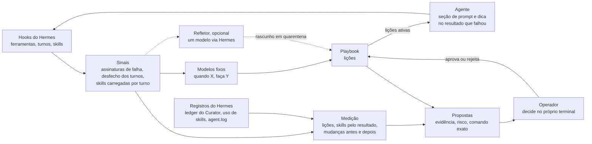

# Atlas Evolution

Um ciclo de auto-melhoria medido para o Hermes Agent: falhas de ferramenta que se repetem viram lições curtas, cada lição, skill e mudança de configuração é julgada pelo que aconteceu antes e depois dela, e nada chega ao agente nem muda no Hermes sem o operador.

[](https://github.com/sesantanajr/hermes-atlas-evolution/actions/workflows/tests.yml)
[](LICENSE)
[](https://github.com/NousResearch/hermes-agent/releases/tag/v0.23.1)
[](https://www.python.org/downloads/)

[English](README.md) | **Português (Brasil)**

O Atlas Evolution é um plugin independente da comunidade para o Hermes Agent, sob licença MIT (ID `hermes-evolution`, versão 0.4.0). Qualquer pessoa pode instalá-lo em qualquer perfil do Hermes; ele não depende de nenhum outro sistema. Usa a API pública de plugins do Hermes e a biblioteca padrão do Python, e não abre conexão de rede própria. Por padrão, nenhum modelo é chamado. Um refletor opcional, desligado por padrão, pede a um modelo, por meio do Hermes, rascunhos de lição, e todo rascunho aguarda a sua aprovação.

## Por quê

O Hermes Agent já aprende sozinho: uma revisão em segundo plano reescreve skills e memória, e o Curator cuida da biblioteca de skills. Quatro perguntas ficam em aberto.

- **A reescrita ajudou?** Nada compara o perfil antes e depois dela.
- **Por que a mesma chamada de ferramenta continua falhando?** Um argumento esquecido é contornado numa conversa e repetido na seguinte.
- **Quais skills pioram os turnos?** Nada liga uma skill carregada a um turno que falhou ou foi corrigido.
- **Quanto custa aprender?** As revisões em segundo plano gastam tokens, e parte delas não produz nada.

O Atlas Evolution responde com medições tiradas dos hooks e dos registros do próprio Hermes. Não substitui nada: memória, Curator, skills e roteador de modelos funcionam como antes.

## O que ele faz



1. **Sinais.** Uma chamada de ferramenta que falha vira uma assinatura: ferramenta, uma de 20 classes de falha e um detalhe curto, como o argumento que faltou. Os turnos são cronometrados por superfície; correções e agradecimentos do dono são contados.
2. **Lições.** Uma falha recorrente que tem modelo vira uma frase, "quando X, faça Y". Uma aprovação recusada pelo usuário nunca vira lição.
3. **Refletor (opcional).** Para falhas recorrentes sem modelo, um modelo rascunha uma lição por meio do Hermes, que fica em quarentena.
4. **Entrega.** As lições ativas chegam ao agente numa seção de prompt por sessão e como dica no resultado que falhou.
5. **Medição.** A lição é medida contra a própria falha; a reescrita de skill, pelos turnos que carregaram a skill; a mudança de configuração, pela semana anterior e pela seguinte.
6. **Skills pelo resultado.** Cada skill carregada num turno herda o desfecho do turno; uma skill claramente pior que o perfil vira proposta.
7. **Propostas e resumo.** Uma fila com evidência, risco e o comando exato, e um resumo que inclui o custo das revisões em segundo plano.

O supervisor de operações das versões 0.2.0 e 0.3.0 continua: pressão no Linux, uso e custo, Cron e Kanban ([Operações](docs/pt-BR/operations.md)). A skill distribuída `hermes-evolution:evolution-review` conduz o dono pelo resumo. Os limiares estão em [O ciclo de evolução](docs/pt-BR/evolution-loop.md).

## Início rápido

```sh
# 1. Instale e habilite no perfil atual (hermes -p NOME escolhe outro perfil)
hermes plugins install sesantanajr/hermes-atlas-evolution --enable

# 2. Confira se carregou
hermes plugins doctor --ci hermes-evolution

# 3. Reinicie o gateway em execução, use o Hermes por um tempo, rode uma passada e leia o resumo
hermes evolution learn
hermes evolution report --days 7 --lang pt
```

Os sinais começam quando o plugin carrega, então o primeiro resumo vem quase vazio.

**Escolha o modo das lições.** No modo padrão, `suggest`, nada chega ao agente até você aprovar:

```sh
hermes evolution lessons list --status candidate
hermes evolution lessons approve <id>      # mostra o texto exato e pergunta
```

`auto` ativa na hora as lições derivadas e aposenta as medidas como ineficazes; rascunhos do refletor e propostas do agente continuam esperando por você. `off` só mede. Defina no Hermes Desktop, em Settings → Plugins, ou veja [Configuração](#configuração).

**Receba o resumo toda semana.** As lições só são derivadas e medidas quando uma passada roda. Isto imprime uma receita de cron sem agente que roda uma passada e entrega o resumo:

```sh
hermes evolution report --schedule-spec --weekday 1 --hour 8 --deliver local --lang pt
```

Salve o `script_content` em `script_path`, leia, e então rode o `posix_command` (uma chamada `hermes cron create`). O plugin não grava nem agenda nada. O `ops schedule-spec` faz o mesmo para o tick de operações, que também roda uma passada no máximo uma vez por hora.

## Exemplo de resumo

Saída ilustrativa, com números inventados: um trecho gerado pelo código atual num perfil descartável alimentado com dados fictícios. Não é medição de nenhuma instalação real.

```text
# Atlas Evolution · resumo de 7 dias (2026-11-09 a 2026-11-15, UTC)

## Resumo

- **Turnos interativos:** 42 · 0 falharam · 0 interrompidos · 2 lentos
- **Chamadas de ferramentas:** 168 · 3 erros (1,8%)

### Comparado aos 7 dias anteriores

- `turn_failed_pct`: 16,7 → 0,0 ▼
- `tool_error_pct`: 6,5 → 1,8 ▼
- `owner_corrections_per_100_turns`: 0,0 → 7,1 ▲
- **veredito:** misto

## Falhas que se repetem

- `example_search` · missing_argument (`query`): 3 vezes, 3 dias · lição: ativa
- `terminal` · approval_refused: 2 vezes, 2 dias · nunca vira lição: quem decide é a aprovação do usuário

## Ciclo de auto-melhoria

- 12 revisões em segundo plano · 66,7% não produziram nada
- 9 reescritas de skills (9 pela revisão automática) · 1 skills

### Skills pelo resultado

- perfil inteiro: 42 turnos · 0,0% falharam · 7,1% corrigidos
- `example-notes`: 12 turnos · 0,0% falharam · 25,0% corrigidos · 16,7% com erro de ferramenta · **pior que o perfil**

## Playbook

- #1 Ao chamar `example_search`, informe sempre o argumento obrigatório `query`. · efeito medido: funcionou (antes 0,333 → depois 0,071)

## Propostas aguardando decisão

- #1 [risco: médio] Travar skill reescrita em excesso · `example-notes` · aplique com: `hermes curator lock example-notes`
- #2 [risco: baixo] Revisar skill cujos turnos vão pior que o perfil · `example-notes` · próximo passo: `hermes curator ledger --skill example-notes`
```

## Comandos

Subcomandos de `hermes evolution`. A saída é JSON, exceto no `report` (Markdown por padrão). `--lang en|pt` funciona antes ou depois de qualquer subcomando.

| Comando | O que faz |
|---|---|
| `learn [--notify-only]` | Uma passada: deriva lições, consulta o refletor se ligado, mede, atualiza as propostas. |
| `report [--days 1..35] [--format md\|json]` | O resumo, comparado com o período anterior. |
| `report --schedule-spec [--weekday 0..6] [--hour 0..23] [--deliver DESTINO]` | Imprime a receita semanal de cron. Não cria nada. |
| `lessons list [--status STATUS]` | O playbook com origem, evidência e efeito medido. |
| `lessons approve <id> [--yes]`, `lessons retire <id>` | Ativa (depois de mostrar o texto) ou aposenta uma lição. Só o operador. |
| `lessons add "<texto>" [--tool NOME] [--activate] [--yes]` | Adiciona uma lição sua, em quarentena salvo `--activate`. Só o operador. |
| `proposals list [--all]` | Propostas abertas, da mais arriscada para a menos. |
| `proposals approve <id> [--note TEXTO] [--yes]`, `proposals reject <id> [--note TEXTO]` | Decide uma proposta. Só o operador. Lição entra em vigor; o resto devolve o comando para você executar. |
| `skills [--days 1..35]` | Reescritas, vai-e-volta e reescritas não usadas por skill, mais as skills pelo resultado. |
| `experiments` | Mudanças acompanhadas e seus vereditos. |
| `usage [--days 1..35]` | Chamadas e tokens vistos pelos hooks, ao lado da contabilidade do Hermes. |
| `ops ...` | Supervisor de operações ([Operações](docs/pt-BR/operations.md)). |

`health`, `tick`, `feedback`, `history` e `memory` vêm de versões anteriores.

## Configuração

As opções principais estão no `config_schema` do manifesto, então o Hermes Desktop as mostra em Settings → Plugins e as grava em `plugins.entries.hermes-evolution.settings`.

| Opção | Tipo | Padrão | Efeito |
|---|---|---|---|
| `lessons` | `off`, `suggest`, `auto` | `suggest` | `off` só mede; `suggest` espera aprovação; `auto` ativa as lições derivadas e aposenta as ineficazes depois de 14 dias. |
| `language` | `auto`, `en`, `pt` | `auto` | `auto` segue `HERMES_LANGUAGE`, `display.language`, o locale e, por fim, inglês. |
| `tool_hints` | booleano | `true` | Acrescenta a lição correspondente ao resultado que falhou. |
| `feedback_signals` | booleano | `true` | Conta correções, perguntas repetidas e agradecimentos do dono. |
| `agent_tools` | booleano | `false` | Oferece `atlas_evolution_plan` e `atlas_evolution_lessons` ao agente. |
| `slow_turn_seconds` | inteiro, de 5 a 3600 | `60` | Turno com pelo menos essa duração conta como lento. |
| `owner_sender_ids` | até 20 textos | `[]` | Remetentes do gateway contados como o dono. Sessões locais sempre contam. |
| `reflector` | booleano | `false` | Rascunha lições para falhas sem modelo pela tarefa auxiliar `evolution_reflector`. |
| `reflector_daily_limit` | inteiro, de 1 a 50 | `6` | Chamadas de modelo do refletor por dia UTC. |

Sem o Desktop, escreva as opções no `config.yaml` do perfil, com `"off"` entre aspas:

```yaml
plugins:
  entries:
    hermes-evolution:
      settings:
        lessons: auto
        language: pt
```

O `<HERMES_HOME>/evolution/settings.json` (opcional, até 64 KiB) aceita as mesmas opções num bloco `evolution` (`agent_tools` é o `agent_advice` de primeiro nível); os valores definidos pelo Hermes vencem chave a chave. Ele guarda também as opções avançadas do supervisor, das tarifas, do Kanban e das notas da 0.1, listadas em [Operações](docs/pt-BR/operations.md#chaves-de-configuração).

As configurações são lidas quando o plugin carrega, então reinicie o gateway depois de mudar. No gateway, um valor inválido volta ao padrão, e `lessons` inválido significa `off`; os comandos param com erro.

## Como uma lição chega ao agente

Dois caminhos, e nenhum reescreve um prompt em cache.

- **Seção de prompt da sessão.** O Hermes monta `atlas-evolution.playbook` quando a sessão começa e a congela naquela sessão: lições ativas, as eficazes primeiro, no máximo 8 e 1.200 caracteres. Uma lição ativada no meio da sessão aparece na próxima. Uma passada rodando em outro processo não deixa uma sessão nova sem as suas lições.
- **Dica no resultado que falhou.** Quando uma chamada falha com uma assinatura que tem lição ativa, o `transform_tool_result` acrescenta a frase àquele resultado, como conteúdo novo no fim da conversa. Uma vez por falha por sessão, no máximo 6 por sessão, nunca em sucesso.

Nada é injetado a cada turno. Com `lessons` em `off`, nenhuma das duas superfícies é registrada.

## Quem decide

O operador. O agente só propõe.

- `lessons approve`, `retire` e `add` e `proposals approve` e `reject` se recusam a rodar num terminal do agente. O Hermes marca esse terminal com `HERMES_SESSION_ID`, `HERMES_KANBAN_TASK` ou `HERMES_DELEGATED_CHILD_CONTEXT`, e o plugin acrescenta `ATLAS_EVOLUTION_AGENT` a todo subprocesso de uma sessão do agente.
- Ativar mostra o texto exato e pergunta. Sem terminal interativo, exige `--yes`.
- O risco de uma proposta de lição segue a autoria: modelo fixo ou operador, baixo; refletor, médio; agente, alto.
- Com `agent_tools` ligado, o agente pode propor até 5 lições por hora, todas em quarentena.
- Mudanças de skill e de configuração no Hermes são impressas como comandos nativos. O plugin não executa nenhum deles.
- A skill distribuída informa e recomenda; o dono executa as decisões.

## Segurança e privacidade

- **Gravado:** contadores diários, nomes de uma lista de permissão, classes de falha com um detalhe filtrado, hashes de IDs de sessão, frases de lição e notas de proposta, tudo em `<HERMES_HOME>/evolution/`. Sem telemetria.
- **Não gravado:** texto de conversa, prompts, respostas, argumentos ou saída de ferramenta, conteúdo de memória, linhas brutas de log.
- **O texto de lição** é normalizado (NFKC); caracteres de controle, de direção de texto e de largura zero e valores com cara de segredo são recusados.
- **Recusas de aprovação** (negada, expirada, sem aprovador, contexto não interativo) formam a classe `approval_refused`, que nunca vira lição. A lição de `blocked_by_policy` diz para não procurar outro caminho e avisar o usuário.
- **Refletor.** Enquanto ligado, e com `lessons` fora de `off`, guarda um trecho de erro limpo, de até 300 caracteres, por falha sem modelo. O Hermes faz a chamada pela tarefa auxiliar `evolution_reflector` (modelo escolhido em `auxiliary.evolution_reflector`), com limites por passada e por dia. O trecho é apagado quando a falha ganha uma lição, quando um rascunho é recusado, após 14 dias ou na passada seguinte com o refletor desligado.
- **Os hooks falham de forma aberta** e enfileiram as gravações (512 entradas) enquanto o banco está ocupado; o excedente aparece como `dropped_events`.

Detalhes no [SECURITY.md](SECURITY.md) (em inglês).

## Compatibilidade e limites

Exige Hermes Agent 0.23.1 ou superior e Python 3.11 ou superior.

**Verificado na máquina de desenvolvimento** (medições, não garantias):

- 207 testes, unitários e de ponta a ponta contra um Hermes simulado, também com o Python do Hermes e o redator nativo dele; a integração contínua roda Python 3.11 a 3.13.
- `hermes plugins validate` e `doctor` do Hermes 0.23.1: sem avisos (2 ferramentas, 14 hooks), também com o refletor ligado e com `plugins.isolation: host`.
- Cerca de 0,1 ms por evento de hook (antes, cerca de 6 ms, com perda de eventos sob concorrência). Com um `state.db` de cerca de 170 MB: `learn` cerca de 0,3 s e 25 MB, `report` cerca de 0,35 s, `ops tick` cerca de 0,5 s.
- O refletor rodou contra um modelo simulado; a chamada foi conferida contra o código do Hermes 0.23.1.

**Não verificado:** um gateway de produção (não há resultados de campo), uma chamada real de modelo pelo refletor, ensaios no Linux com systemd real, outras versões do Hermes, Windows e macOS.

**Limites**

- Os vereditos comparam dois períodos; são correlações, não experimentos controlados.
- Só as lições ligadas a uma falha (derivadas e do refletor) têm efeito medido.
- O primeiro uso migra o banco para o esquema 7, que versões anteriores não abrem. Para voltar, restaure um backup ou apague o `evolution.sqlite3`.
- Com `plugins.isolation: host` não existe `hermes evolution`: use `python -m hermes_evolution --home <perfil> ...` (que só lê o `config.yaml` com o PyYAML). O refletor e as receitas de cron dependem da CLI do Hermes; uma passada pelo executor independente não rascunha nada e descarta os trechos em espera.
- A contagem de revisões depende de uma linha que o Hermes 0.23.1 grava no `agent.log`. Os sinais do dono são heurísticas sobre as primeiras palavras da mensagem.

Hooks, superfícies e leituras estão em [Integração com o Hermes](docs/pt-BR/hermes-integration.md).

## Desenvolvimento

```sh
git clone https://github.com/sesantanajr/hermes-atlas-evolution
cd hermes-atlas-evolution
python -m unittest discover -s tests -v     # só a biblioteca padrão
hermes plugins validate .                   # exige o Hermes Agent 0.23.1
python -m hermes_evolution --home /caminho/do/perfil --hermes-version 0.23.1 report
```

O [CONTRIBUTING.md](CONTRIBUTING.md) (em inglês) traz as regras de privacidade e de tradução, e o [CHANGELOG.md](CHANGELOG.md), o histórico.

## Roteiro

Nada disto existe ainda.

- Um painel no Hermes Desktop e no Dashboard para o resumo e as propostas.
- Um banco de avaliações de regressão, para testar uma mudança contra tarefas fixas e não só contra a semana seguinte.
- Enviar as skills que mais falham, pelo resultado, a um otimizador como o GEPA por meio do `hermes-agent-self-evolution` da NousResearch, com o resultado passando pela mesma fila de propostas.

## Autor

Criado por **Sérgio Sant'Ana Júnior**. [LinkedIn](https://www.linkedin.com/in/sergiosantanacloud/)

## Licença

[MIT](LICENSE)
