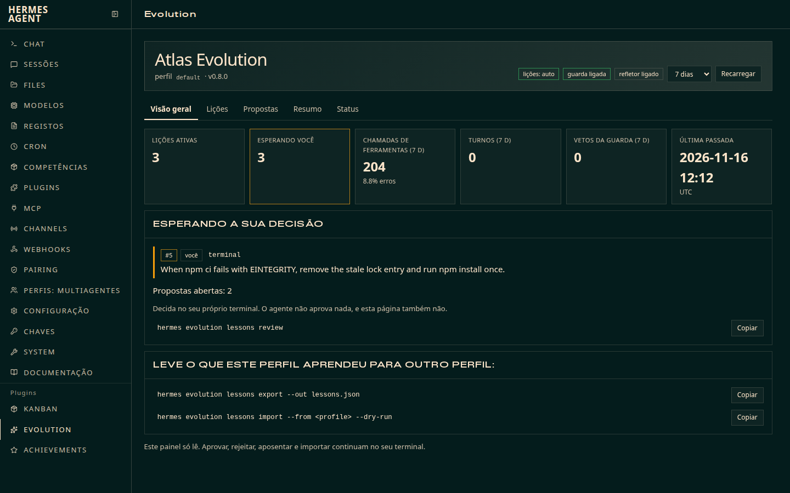

# Atlas Evolution

[English](README.md) | **Português (Brasil)**

O Atlas Evolution (`hermes-atlas-evolution` no Hermes) ajuda o Hermes Agent a aprender com os próprios erros. Quando o mesmo erro de ferramenta se repete, ele escreve uma lição de uma frase para o agente, mede se a lição ajudou e a retira se não ajudou; lições rascunhadas por um modelo de IA esperam a sua aprovação. Ele também impede que o agente reinicie ou apague o Hermes em que roda. Os dados ficam na sua máquina, e ele não abre conexão de rede própria.

[](LICENSE)
[](https://github.com/NousResearch/hermes-agent/releases/tag/v0.23.1)

## Novidades da 0.8.3

- **Age sozinho, com segurança.** No fim de cada passada de aprendizado, o plugin tira cópias idênticas de uma entrada da memória do Hermes e, com `auto_actions: full`, trava as skills que o curador do Hermes reescreve sem parar (num perfil real, uma skill foi reescrita 75 vezes numa semana, cada vez gastando tokens). Toda ação vai para o histórico com o desfazer, e uma mudança automática que você desfaz nunca se repete.
- **Propostas em palavras simples.** Cada uma diz o que foi visto, com os números, o que aplicá-la faz e como desfazer, em português do Brasil ou inglês. Uma mudança que o plugin consegue fazer é aplicada com um clique (**Aplicar agora**), ou todas de uma vez; uma observação é dispensada com um.
- **Um menu que diz o que fazer.** `hermes evolution` abre com o que pede atenção e sugestões com letras, como "Aplicar 4 mudanças recomendadas" ou "Ligar as ações automáticas completas".
- A 0.8.2 trouxe o menu do terminal, o cuidado com a memória do Hermes e o painel do dashboard decidindo com login de verdade. Todas as mudanças: [CHANGELOG em português](CHANGELOG.pt-BR.md).

## Começo rápido

```bash
hermes plugins install sesantanajr/hermes-atlas-evolution --enable   # em cada perfil (-p <perfil>)
hermes evolution                                                     # o menu, no seu próprio terminal
```

```text
Atlas Evolution 0.8.3 · perfil atlas-ai
Lições: modo auto · 10 ativas · 0 esperando você · 16 propostas abertas
Última passada: 2026-11-16 16:18 (ok) · guarda de runtime ligada · refletor ligado
Ações automáticas: seguras · 2 em 7 dias

Sugestões:
   a  Aplicar 4 mudança(s) recomendada(s): travar skill reescrita em excesso
   b  Ligar as ações automáticas completas (daqui em diante o plugin aplica isso sozinho)
   c  Ler 11 observação(ões) com os números

   1  Lições esperando você (0)          7  Quem é você nos chats
   2  Propostas abertas (16)             8  Memória do Hermes: repetições e espaço
   3  Lições ativas (10)                 9  Resumo dos últimos 7 dias
   4  Histórico de decisões e desfazer  10  Situação completa
   5  Ações automáticas (seguras)       11  Rodar uma passada de aprendizado agora
   6  Configurações                      0  Sair
```

O mesmo, com login, na aba **Evolution** do dashboard do Hermes.

## Instalação

Vindo da 0.5.0 (instalada como `hermes-evolution`)? Pule esta parte e siga a [Migração da 0.5.0](#migração-da-050): a cópia antiga precisa sair antes, senão ela continua rodando e a nova fica inativa.

Exige o Hermes Agent 0.23.1 ou superior. O Hermes carrega os plugins por perfil, mesmo quando um único gateway atende todos, então instale o plugin em cada perfil que você usa.

```sh
# O perfil padrão
hermes plugins install sesantanajr/hermes-atlas-evolution --enable

# Um perfil com nome
hermes -p <perfil> plugins install sesantanajr/hermes-atlas-evolution --enable

# Todos os perfis com nome (o perfil padrão não fica nesta pasta: rode também o primeiro comando)
for p in $(ls ~/.hermes/profiles); do hermes -p "$p" plugins install sesantanajr/hermes-atlas-evolution --enable; done

# Confira
hermes evolution status --lang pt
```

A instalação carrega o plugin no gateway em execução; não é preciso reiniciar. O primeiro `status` num perfil já faz a primeira passada (uma rodada de aprendizado: lê o que aconteceu, cria ou aposenta lições e atualiza o resumo). Ela lê até 14 dias do histórico daquele perfil, então o plugin não começa do zero (`--no-learn` pula essa passada). O `status` também lista todos os perfis do mesmo Hermes e dá o comando de instalação para cada perfil usado nos últimos 7 dias que não tem o plugin. O `--lang pt` mostra a saída em português quando o perfil não está configurado em português.

Na lista de plugins do Hermes, o plugin aparece por enquanto com um cartão genérico: o Hermes só mostra capa para os itens do catálogo curado de plugins dele, revisado pela Nous Research ([detalhes](docs/pt-BR/hermes-integration.md#capa-e-o-catálogo-de-plugins)).

## Migração da 0.5.0

Até a 0.5.0 o plugin era instalado como `hermes-evolution`. O nome mudou, então o `hermes plugins update` não consegue substituir essa cópia. Em cada perfil que a tem (acrescente `-p <perfil>` aos comandos num perfil com nome):

1. Só se você mudou as opções do plugin no formulário de configurações do Hermes: abra o `config.yaml` do perfil e renomeie `plugins.entries.hermes-evolution` para `plugins.entries.hermes-atlas-evolution` (o próximo comando apaga o bloco antigo).
2. Remova a cópia antiga e instale a nova:

   ```sh
   hermes plugins remove hermes-evolution
   hermes plugins install sesantanajr/hermes-atlas-evolution --enable
   ```

3. Reinicie o gateway uma vez, no seu próprio terminal: `hermes gateway restart`.
4. Confira com `hermes evolution status --lang pt`. Ele lista os outros perfis que ainda têm a cópia antiga, com o comando exato de cada um, e marca o perfil que tem as duas cópias, onde quem ainda roda é a antiga.

Observações:

- O que foi aprendido fica: o comando `hermes evolution`, os dados em `<HERMES_HOME>/evolution/` e o `settings.json` mantêm os nomes. A primeira passada da 0.6.0 reconta o histórico que a 0.5.0 leu, porque a 0.5.0 contava mensagens das quais o Hermes guarda mais de uma cópia.
- Enquanto a cópia antiga estiver ligada, a nova fica inativa (o log do Hermes avisa), então nenhum turno é contado duas vezes. Se o título do `hermes evolution status` num perfil ainda mostrar 0.5.0, a cópia antiga continua lá: remova-a nesse perfil e reinicie o gateway.
- Dois padrões mudaram: `lessons` agora é `auto` (`lessons: suggest` mantém o comportamento da 0.5.0; lições que já esperavam aprovação continuam esperando) e `tool_hints` agora é `false`.
- Só se você os listou à mão no `config.yaml`: troque `atlas-evolution`, `atlas_evolution_plan` e `atlas_evolution_lessons` por `hermes-atlas-evolution`, `hermes_atlas_evolution_plan` e `hermes_atlas_evolution_lessons` numa lista de toolsets ou no `auxiliary.background_review.extra_tools`.

## Atualização

```sh
hermes plugins update hermes-atlas-evolution                # o perfil padrão
hermes -p <perfil> plugins update hermes-atlas-evolution    # um perfil com nome

# Todos os perfis com nome
for p in $(ls ~/.hermes/profiles); do hermes -p "$p" plugins update hermes-atlas-evolution; done

hermes gateway restart
hermes evolution status --lang pt
```

O `plugins update` da linha de comando só troca os arquivos: ele não recarrega um gateway que já está rodando, então reinicie o gateway uma vez no final. O dashboard mostra a aba **Evolution** quando relê os plugins; se ela não aparecer, reinicie o dashboard. (O Hermes recarrega um gateway em execução na instalação, ao ligar e ao desligar um plugin, e quando a atualização é feita pelo Hermes Desktop, pelo dashboard ou pelo `/plugins update` num chat.) Se ainda houver algo rodando (um turno, uma rotina do cron, uma tarefa delegada), o reinício lista o que é e pergunta, em inglês, `Interrupt them and restart the gateway? [y/N]`: responda N e rode de novo em alguns minutos, ou y para interromper. O `status` aponta um gateway que ainda roda código antigo.

## O que ele faz

- **Um menu no seu terminal.** `hermes evolution`, sem comando, abre um menu numerado no seu próprio terminal: as lições que esperam você (uma a uma ou **aprovar todas**), as propostas, as lições ativas, o histórico com **desfazer**, cada configuração (ou **a configuração recomendada** de uma vez), quem é você nos chats, a memória do Hermes, o resumo, a situação completa e uma passada de aprendizado na hora. Ele decide com as mesmas regras do painel do dashboard e grava no mesmo histórico. No shell do agente, ou sem um terminal para responder, mostra a situação no lugar.
- **Administre pelo dashboard do Hermes.** Uma aba **Evolution** no dashboard e no Hermes Desktop mostra o que o perfil aprendeu e o que espera por você e, quando o seu dashboard pede login, deixa você decidir ali, no perfil do próprio dashboard e em todo outro perfil escolhido nele (com o plugin ativado também no perfil do dashboard): aprovar ou rejeitar cada lição, **aprovar todas** depois de ler cada frase, decidir propostas, mudar as configurações, escolher quem é você nos chats a partir de sugestões e **desfazer** qualquer decisão. Um dashboard sem login fica só leitura, porque qualquer programa da máquina poderia agir ali ([detalhes](docs/pt-BR/hermes-integration.md#o-painel-no-dashboard)).
- **Age sozinho onde é seguro.** Com `auto_actions` (`safe` por padrão), o fim de cada passada tira cópias idênticas de uma entrada da memória do Hermes e, com `full`, também trava skills que o curador reescreve sem parar. Cada ação fica no histórico com o desfazer; uma mudança automática que você desfaz nunca se repete ([detalhes](docs/pt-BR/evolution-loop.md#ações-automáticas)).
- **Mantém a memória do Hermes enxuta.** O Hermes põe o `MEMORY.md` e o `USER.md` no prompt de toda sessão. O menu mostra quanto cada um ocupa e o que se repete neles (a mesma entrada duas vezes, uma entrada que diz o que outra já diz, entradas muito parecidas); você escolhe qual fica, e a outra é retirada sob a própria trava de memória do Hermes, com uma cópia do arquivo guardada e **desfazer**. Cada repetição retirada economiza os seus tokens em todo turno ([detalhes](docs/pt-BR/evolution-loop.md#memória-do-hermes)).
- **Leva lições de um perfil para outro.** `lessons export` e `lessons import --from <perfil>` levam o que um perfil aprendeu para outro, ou para outra máquina, depois de mostrar cada frase. As lições importadas esperam até os seus turnos encontrarem a falha lá, e são medidas lá como qualquer outra ([detalhes](docs/pt-BR/evolution-loop.md#pacotes-de-lições)).
- **Aprende com o histórico que o Hermes já guarda.** As primeiras passadas releem os últimos 14 dias de sessões do perfil, então uma falha que se repetiu na semana passada pode virar lição já no primeiro dia.
- **Transforma falhas repetidas de ferramentas em lições.** Uma falha vista pelo menos 3 vezes, em 2 sessões ou em 2 dias, vira uma frase como "Ao chamar `example_search`, sempre passe o argumento obrigatório `query`." Chamadas que o Hermes encerra no próprio prazo também contam. O agente lê as lições ativas no começo de cada sessão.
- **Separa os seus turnos dos turnos dos outros.** Uma lição só entra em vigor sozinha depois que os seus próprios turnos encontram a falha (o seu CLI, TUI ou Desktop, as suas automações, um chat com um remetente que você lista em `owner_sender_ids` ou qualquer chat de uma plataforma que você lista em `owner_platforms`, como um bot privado ou a sua própria interface). Falhas que só outras pessoas causaram num chat esperam a sua aprovação, e um chat em que outra pessoa pode estar lendo recebe só lições de modelo fixo, nunca texto escrito por você ou por um modelo de IA. O `hermes evolution owner` mostra cada canal de chat com os remetentes e imprime o comando que configura isso.
- **Encontra os gargalos que você pode remover.** Aprovações recusadas onde ninguém podia aprovar (execuções avulsas, automações, subagentes), com as configurações do Hermes que decidem isso; as ferramentas que mais consomem tempo e uma ferramenta lenta chamada após chamada.
- **Mantém a fila curta.** Lições que ninguém decidiu ainda são retiradas quando as evidências deixam de sustentá-las, quando repetem a frase de outra lição ou quando só dão um conselho que serviria para qualquer falha.
- **Mede antes e depois.** Cada lição contra a própria falha, cada reescrita de skill pelos turnos que carregaram a skill, cada mudança de configuração pela semana anterior e pela seguinte. No modo `auto`, uma lição que não ajuda é aposentada.
- **Pede a um modelo de IA quando nenhum modelo fixo serve.** O refletor rascunha uma lição pelo Hermes, com no máximo 6 chamadas por dia, por padrão, e o rascunho espera por você.
- **Acompanha a saúde do Hermes.** Aponta sessões cortadas sem o encerramento normal, conversas que mandam texto demais ao modelo, compactações que liberam pouco espaço e plugins que falham ao carregar, brigam entre si ou quebram comandos de outro plugin (essas falhas nunca viram lição).
- **Protege o Hermes em execução.** Barra comandos do agente que parariam, reiniciariam ou matariam o gateway (como unidade systemd no Linux, LaunchAgent no macOS ou serviço ou tarefa do Windows) ou apagariam o Python, o código ou o perfil em que o Hermes roda, e impede o agente de mudar as configurações deste plugin ou desligá-lo. Ele lê o comando do jeito que o shell executa: dentro de blocos `if`/`for`, de `$(...)`, como `python -m hermes_cli.main`, `kill $(pgrep ...)` e as outras formas descritas [nos detalhes da guarda](docs/pt-BR/hermes-integration.md#a-guarda-de-runtime). O agente é orientado a deixar isso com você.
- **Roda sozinho e pergunta antes de mudar o Hermes.** Uma passada em segundo plano roda no máximo uma vez por hora em cada perfil. Mudanças no Hermes, como travar uma skill, são propostas com o comando exato para você rodar.
- **Fala a sua língua.** Todas as mensagens, o resumo e as lições saem em inglês ou em português do Brasil, conforme o perfil.




## Comandos

Subcomandos de `hermes evolution`. O `--lang en|pt` funciona com todos eles.

| Comando | O que faz |
|---|---|
| *(nenhum)*, `menu` | O menu interativo, no seu próprio terminal. Sem terminal (um script, um pipe, o shell do agente), o comando sozinho mostra o `status`. |
| `status` | Mostra se o plugin está observando, aprendendo e protegendo este perfil, e a situação de cada perfil deste Hermes. |
| `report [--days N]` | O resumo dos últimos N dias (7 por padrão), comparado com o período anterior. |
| `lessons list` | As lições, com origem, evidências e efeito medido. |
| `lessons review` | Passa por cada lição que espera aprovação, com o texto exato: `a` aprova, `r` rejeita, Enter pula. |
| `lessons approve <id>`, `lessons approve --all` | Ativa uma lição que está esperando, ou todas (menos as propostas do próprio agente), depois de mostrar o texto exato. |
| `decisions`, `decisions undo <id>` | As suas decisões no terminal e no dashboard, da mais recente para a mais antiga, e o desfazer de uma delas. |
| `proposals list`, `proposals approve <id>`, `proposals reject <id>` | A fila de propostas e a sua decisão sobre uma delas. |
| `lessons export [--out ARQUIVO]` | As lições ativas como um pacote que outro perfil ou outra máquina pode importar. |
| `lessons import ARQUIVO` ou `lessons import --from <perfil>` | Traz as lições de um pacote ou de outro perfil, depois de mostrar cada uma (`--dry-run` não muda nada). |
| `learn` | Faz uma passada agora, sem esperar a de segundo plano. |
| `owner` | Lista cada canal de chat com os remetentes; `owner add <id>` ou `owner add-platform <nome>` imprime o comando `hermes config set` que marca um deles como você. Só no seu próprio terminal. |

Todos os comandos e opções: [Comandos](docs/pt-BR/evolution-loop.md#comandos).

## Configurações

Ajuste na aba **Evolution** do dashboard, no Hermes Desktop, em Configurações → Plugins, ou no `config.yaml` do perfil, em `plugins.entries.hermes-atlas-evolution.settings`. Uma mudança vale em até um minuto, sem reiniciar o gateway; só `runtime_guard`, `tool_hints` e ligar as lições num perfil que carregou com elas desligadas esperam a próxima carga do plugin, e o painel avisa. `owner_sender_ids`, `owner_platforms`, `agent_tools: true` e `runtime_guard: false` só valem por ali, nunca pelo `settings.json` do plugin, que as ferramentas de arquivo do agente conseguem gravar.

| Opção | Padrão | O que faz |
|---|---|---|
| `lessons` | `auto` | `auto`: lições de modelo fixo entram em vigor na hora (assim que os seus próprios turnos encontram a falha), são medidas e são aposentadas quando não ajudam; rascunhos do refletor e propostas do agente esperam aprovação. `suggest`: toda lição espera aprovação. `off`: só mede. |
| `owner_sender_ids` | `[]` | Os seus ids de remetente nas plataformas de mensagem (texto ou número, como o seu id do Telegram). Um turno de chat vindo de um deles conta como seu. O seu CLI, TUI e Desktop sempre contam. O `hermes evolution owner` lista os remetentes. |
| `owner_platforms` | `[]` | Plataformas em que todo chat é seu (um bot privado, a sua própria interface pelo servidor de API), como `telegram` ou `api_server`. Os chats delas contam como seus desde a primeira mensagem. Só liste uma plataforma em que ninguém mais escreve. |
| `language` | `auto` | `en` ou `pt`. `auto` segue o idioma do perfil. |
| `reflector` | `true` | Rascunha lições com um modelo de IA, pelo Hermes, para falhas dos seus próprios turnos que não têm modelo fixo. |
| `autopilot_minutes` | `60` | Roda a passada em segundo plano no máximo uma vez por intervalo, de 15 a 1440 minutos. Com `0`, a passada em segundo plano fica desligada: as passadas só rodam pelo `learn`, pelo `ops tick`, pela receita semanal do resumo e pelo primeiro `status`. |
| `runtime_guard` | `true` | Barra comandos do agente que parariam o gateway ou apagariam aquilo em que o Hermes roda. Fica desligada onde o Hermes roda os plugins num host de plugins (`plugins.isolation: host`). |
| `auto_actions` | `safe` | O que o plugin faz sozinho no fim de cada passada, cada ação no histórico com o desfazer. `safe`: tira cópias de uma entrada da memória que são exatamente o mesmo texto (guarda uma cópia do arquivo); o que difere espera você. `full`: também trava skills que o curador reescreve sem parar, com `hermes curator lock`, até 3 por passada. `off`: tudo espera você. Só vale vindo da configuração do Hermes, como a `runtime_guard`. |
| `agent_tools` | `false` | Oferece ao agente as ferramentas `hermes_atlas_evolution_plan` e `hermes_atlas_evolution_lessons`, só nas suas próprias sessões. |
| `tool_hints` | `false` | Também acrescenta a lição correspondente ao resultado de uma ferramenta que falhou. Vem desligado porque o Hermes só mantém a alteração do primeiro plugin no resultado de uma ferramenta. |
| `feedback_signals` | `true` | Conta as suas correções, perguntas repetidas e agradecimentos, só como números. |

```yaml
plugins:
  entries:
    hermes-atlas-evolution:
      settings:
        lessons: suggest
        owner_sender_ids: ["123456789"]
        language: pt
```

Todas as opções, o `settings.json` e o que acontece com um valor inválido: [Configurações e idioma](docs/pt-BR/evolution-loop.md#configuração-e-idioma).

## Privacidade e segurança

- **O que ele guarda.** Contadores, classes de falha, ids de sessão com hash, frases das lições e propostas, em `<HERMES_HOME>/evolution/`. Não guarda texto de conversa, prompt, argumento de ferramenta, saída de ferramenta nem conteúdo de memória, fora a cópia de um arquivo de memória que guarda quando você retira uma entrada (só do dono, em `evolution/memory-backups/`, as 100 mais recentes). Com o refletor ligado, guarda um trecho da mensagem de erro, de até 300 caracteres e com segredos, caminhos e endereços mascarados, por falha dos seus próprios turnos que não tem modelo fixo, até a falha ganhar uma lição ou por 14 dias.
- **O que ele lê**, sempre só para leitura: o histórico, os logs e os registros de skills do próprio Hermes, para o `status` a contagem de sessões dos seus outros perfis e de cada canal de chat e, para o `hermes evolution owner` no seu próprio terminal, os ids de remetente de cada canal ([lista completa](docs/pt-BR/hermes-integration.md#o-que-o-plugin-lê)).
- **Roda em segundo plano.** Só dentro do Hermes: um temporizador confere a cada 10 minutos se está na hora de uma rodada de aprendizado.
- **Chamadas a modelo.** Só o refletor chama um modelo de IA, pelo Hermes e com as configurações de provedor dele (tarefa auxiliar `evolution_reflector`), no máximo 3 vezes por passada e 6 vezes por dia, por padrão. `reflector: false` desliga.
- **Rede.** Nenhuma conexão própria e nenhuma telemetria.
- **Chats do gateway.** O plugin não manda nada para um chat. Os avisos dele aparecem só no Hermes do seu computador (CLI, TUI, Desktop), nunca num chat do gateway. O que o outro lado de um chat vê é o que o agente escreve.
- **Decisões.** Só você decide: no seu próprio terminal (o menu ou os comandos, que se recusam a rodar no terminal do agente) ou num dashboard que pede login. O plugin muda os próprios dados, as próprias configurações pelo `hermes config set` do Hermes, os arquivos de memória do Hermes só para tirar uma repetição (a que você escolheu, ou uma repetição exata com `auto_actions`) e as skills só com `hermes curator lock` ou `archive`, com a sua aprovação ou com `auto_actions: full`, cada uma com o desfazer; outras mudanças no Hermes aparecem como comandos para você rodar.

Detalhes: [SECURITY.md](SECURITY.md).

## Documentação

- [O ciclo de evolução](docs/pt-BR/evolution-loop.md): como as lições são criadas, entregues e medidas, o refletor, o radar de saúde, o resumo com um exemplo, o `status` e todos os comandos e configurações.
- [Integração com o Hermes](docs/pt-BR/hermes-integration.md): hooks, a guarda de runtime, o que o plugin lê, permissões, notas de instalação, compatibilidade e limites.
- [Operações](docs/pt-BR/operations.md): o supervisor de operações (pressão no Linux, uso e custo, Cron e Kanban).
- [CONTRIBUTING.md](CONTRIBUTING.md): desenvolvimento, testes e as regras para mudanças (em inglês).
- [SECURITY.md](SECURITY.md): modelo de ameaças, o que o plugin guarda e lê e como relatar uma vulnerabilidade (em inglês).
- [CHANGELOG.md](CHANGELOG.md): o que mudou em cada versão (em inglês).

## Licença

O Atlas Evolution é software livre e de código aberto, distribuído sob a [Licença MIT](LICENSE). Você pode usar, copiar, modificar, mesclar, publicar, distribuir, sublicenciar e vender cópias, inclusive para uso comercial, desde que o aviso de direitos autorais e o texto da licença sejam mantidos em todas as cópias. O software é fornecido no estado em que se encontra, sem garantia de qualquer tipo.

Contribuições são bem-vindas sob a mesma licença; veja o [CONTRIBUTING.md](CONTRIBUTING.md).

## Autor

Criado por **Sérgio Sant'Ana Júnior**. [LinkedIn](https://www.linkedin.com/in/sergiosantanacloud/)
