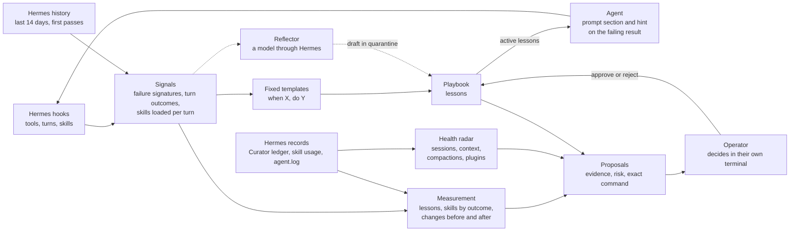

# The evolution loop

**English** | [Português (Brasil)](pt-BR/evolution-loop.md)

This document describes the loop that Atlas Evolution adds to Hermes Agent, as of version 0.7.0: how it runs by itself and learns from the profile's history, what is recorded, when a failure becomes a lesson, how lessons, skills and changes are measured, what the reflector does, what the health radar reads, what ends up in the proposal queue, and every command and setting. Every threshold below is a constant in the code, and the module that holds it is named next to it. For installation and a summary, see the [README](../README.md).

## Contents

1. [Overview](#overview)
2. [One pass](#one-pass)
3. [The autopilot](#the-autopilot)
4. [Learning from Hermes' history](#learning-from-hermes-history)
5. [Signals](#signals)
6. [Who is served](#who-is-served)
7. [Lessons](#lessons)
8. [The reflector](#the-reflector)
9. [How a lesson is measured](#how-a-lesson-is-measured)
10. [Skills by outcome](#skills-by-outcome)
11. [Changes and experiments](#changes-and-experiments)
12. [Skill health](#skill-health)
13. [Learning yield](#learning-yield)
14. [Health radar](#health-radar)
15. [Proposals](#proposals)
16. [Digest](#digest)
17. [Status and owner notice](#status-and-owner-notice)
18. [Commands](#commands)
19. [Settings and language](#settings-and-language)
20. [Agent tools and the bundled skill](#agent-tools-and-the-bundled-skill)
21. [Storage](#storage)

## Overview

Hermes Agent already learns on its own: a background review rewrites skills and memory, and the Curator maintains the skill library. Five questions stay open.

- **Did the rewrite help?** Nothing compares the profile before and after it.
- **Why does the same tool call keep failing?** A missing argument is worked around in one conversation and repeated in the next.
- **Which skills make turns go worse?** Nothing links a loaded skill to a failed or corrected turn.
- **What does learning cost?** Background reviews spend tokens, and some produce nothing.
- **Is Hermes itself healthy?** Sessions that end as orphans, heavy prompts and plugins that compete for one hook go unnoticed, and an agent with a terminal can restart or delete the Hermes it runs on.

Atlas Evolution answers with measurements from Hermes hooks and Hermes' own records. It replaces nothing: memory, the Curator, skills and the model router work as before.



1. **Signals.** A failed tool call becomes a signature: tool, one of 22 failure classes and a short detail such as the missing argument. Turns are timed per surface; owner corrections and thanks are counted. The first passes replay the last 14 days of the profile's own history through the same code.
2. **Lessons.** A recurring failure with a template becomes one sentence, "when X, do Y". In `auto` mode, the default, it is active at once. An approval the user refused never becomes a lesson.
3. **Reflector** (on by default). For recurring failures without a template, a model drafts a lesson through Hermes, held in quarantine until the operator approves it.
4. **Delivery.** Active lessons reach the agent in a per-session prompt section and, with `tool_hints` on, as a hint on the failing result.
5. **Measurement.** A lesson is measured against its own failure, a skill rewrite by the turns that loaded the skill, a setting change by the week before and after. In `auto` mode an ineffective lesson is retired.
6. **Skills by outcome.** Each skill loaded in a turn inherits how the turn ended; a skill clearly worse than the profile becomes a proposal.
7. **Health radar.** Sessions that end as orphans, a heavy context per agent call, compactions that keep most of the context, plugins that fail to load or compete for one hook, and tool failures caused by another plugin become advisory proposals with the command to inspect them.
8. **Proposals and digest.** One queue with evidence, risk and the exact command, and a digest that includes the cost of background reviews and a "Hermes health" section.

All of this runs by itself: the [autopilot](#the-autopilot) runs a pass in the background at most once an hour by default, and `hermes evolution status` shows whether the plugin is observing, learning and protecting each profile. The runtime guard, also on by default, vetoes agent terminal commands that would restart or kill the gateway the agent runs on, or delete what the running Hermes needs ([Hermes integration](hermes-integration.md#the-runtime-guard)). The operations supervisor of 0.2.0 and 0.3.0 remains: Linux pressure, usage and cost, Cron and Kanban ([Operations](operations.md)).

## One pass

Hooks record signals while the agent works. Everything else happens in a pass (`evolve.cycle`), which reads Hermes' own records, updates the plugin's tables and never changes Hermes. A pass runs when:

- the autopilot finds one due, at most once per `autopilot_minutes` (default 60; see [The autopilot](#the-autopilot));
- you run `hermes evolution learn`;
- `hermes evolution ops tick` runs, at most once an hour (`CYCLE_INTERVAL_SECONDS`; the result is the `evolution` field of its output);
- the weekly digest recipe runs, which calls `learn --notify-only` before `report`;
- `hermes evolution status` runs in a profile that never had a pass, unless you pass `--no-learn` (see [Status and owner notice](#status-and-owner-notice)).

All of them claim the same pass, so two passes of one profile never run at the same time, and each pass counts as the latest one for the others. With `autopilot_minutes` set to 0 and none of the others, signals accumulate but no lesson is derived and nothing is measured.

A pass does the following, in order:

1. Marks when the plugin started observing the profile, unless the plugin did so when it loaded.
2. While the backfill is not done, replays the next part of Hermes' history (see [Learning from Hermes' history](#learning-from-hermes-history)), for up to 20 seconds, 60 seconds in the first pass that `status` runs, or 120 seconds in `learn`.
3. Drops aggregates older than the retention window.
4. Counts the background reviews logged since the previous pass (on the first run, those of the last 14 days, rotated files included).
5. Derives lessons from recurring failures.
6. Asks the reflector for drafts when it is on, `lessons` is not `off` and Hermes' model access is available. With the reflector off it deletes every waiting error excerpt; otherwise excerpts wait for a later pass and expire after 14 days.
7. Measures each active lesson that is bound to a failure.
8. Computes skill health for the last 7 days.
9. Detects configuration changes and skill rewrites.
10. Compares the week before and the week after each tracked change.
11. Closes approved `skill_lock` proposals whose skill is now locked or pinned.
12. Compares the skills loaded in the last 14 days with the profile as a whole.
13. Reads the [health radar](#health-radar).
14. Rebuilds the open proposals from the current evidence.

Each phase commits on its own, so the hook writers of a running gateway never wait while a pass reads a log, the skill files, the Curator ledger or Hermes' `state.db`, or waits for a model.

With `--notify-only`, `learn` prints only new lessons, new reflector drafts, regressions whose verdict became final in this pass, lessons retired in this pass and high-risk proposals opened in this pass. It prints nothing when there are none. The full output of `learn` also has a `history` block, with the backfill status and running totals, and a `radar` list with the codes of the current radar findings.

## The autopilot

The autopilot (`autopilot`) runs the pass by itself, in a background daemon thread of each Hermes process that loaded the plugin, at most once per `autopilot_minutes` for the profile. The value is 0 (off: passes run only when you ask) or 15 to 1440 minutes; the default is 60.

- **What starts it.** Three nudges, none of them on the turn path:
  - the hooks `post_llm_call` and `on_session_end`, after each turn;
  - a clock: a daemon thread per loaded profile (`hermes-atlas-evolution-clock`) that nudges the pass 2 minutes after the plugin loads (`CLOCK_FIRST_SECONDS`) and then every 10 minutes (`CLOCK_PERIOD_SECONDS`). A gateway that serves several profiles delivers its Kanban tick only to its own profile, so without the clock a profile with no turns would never run a pass. The clock starts only when `autopilot_minutes` is not 0 and the host offers `on_unload` (Hermes 0.23.1 does), and it stops when the plugin unloads, so a reload never leaves two clocks;
  - `on_kanban_dispatch_tick`, which Hermes fires once per Kanban dispatcher tick (every 60 seconds by default), for the gateway's own profile, and only where the dispatcher runs inside the gateway (`kanban.dispatch_in_gateway`).

  A nudge only compares two clocks: a check starts at most once every 60 seconds per process (`CHECK_SECONDS`), in a background thread (`hermes-atlas-evolution-autopilot`).
- **One pass per profile.** Every process of the profile, whether a gateway, a CLI session or `ops tick`, claims the pass with a compare-and-set in the plugin's database: in one write transaction it reads when the last pass ended and who holds the lease, and takes the lease. A lease lasts 15 minutes (`LEASE_SECONDS`), so a process that dies in the middle of a pass leaves a lease that expires, and the pass is tried again. A failed pass is tried again after 10 minutes (`RETRY_SECONDS`) instead of a full interval, and the first failure in a process is logged once.
- **A process that exits in the middle of a pass.** When the interpreter exits while its pass is still running, as a short-lived command can, the process frees the lease at exit and records the pass as failed (`ProcessExit`), so another process tries again 10 minutes later instead of waiting for the lease to expire.
- **The right profile.** Hermes keeps the active profile, and the scope of its secrets, in context variables that new threads do not inherit. The thread pins the plugin's own profile home and secret scope before anything reads Hermes' configuration, so in a gateway that serves several profiles a reflector call uses that profile's provider keys, not the gateway's.
- **Unloading.** When the plugin unloads, the clock stops, a check already on its way gives back the pass it claimed, and a running pass stops its history replay at the next slice.
- **Settings.** Each pass reads the settings again, and an invalid value falls back on its own instead of failing the pass (see [Settings and language](#settings-and-language)). The interval itself is set when the plugin loads.
- **Manual passes.** `hermes evolution learn` waits up to 30 seconds for a running pass instead of running alongside it, and then counts as the latest pass, so the autopilot does not repeat it right away. A failed manual pass leaves the schedule as it was. `ops tick` uses the same claim, with its own hourly interval.

`hermes evolution status` shows the interval and the last pass: when it ended, whether it succeeded and how long it took (see [Status and owner notice](#status-and-owner-notice)). The autopilot is verified in tests and in the CLI.

## Learning from Hermes' history

Hermes keeps every session of a profile in `<HERMES_HOME>/state.db`. Until the backfill is done, each pass reads the next part of it (`backfill`), so a failure that recurred before the plugin was installed can become a lesson on the first day.

- **What is read.** The sessions that overlap the last 14 days (`BACKFILL_DAYS`) before the plugin started observing the profile, 25 at a time (`SLICE_SESSIONS`), oldest first, and their messages inside that window. The database is opened read-only and never modified.
- **What it becomes.** Messages are replayed through the code the hooks use:
  - tool results become tool counts and failure signatures, and, with the reflector on and `lessons` not `off`, the scrubbed excerpt of an untemplated failure. A stored result counts as failed the way Hermes' tools report it: an `error` field, a non-zero `exit_code`, `success: false`, or text that starts like an error;
  - user messages open turns, timed per surface (the session's `source` decides, as in the hooks: see [Who is served](#who-is-served)), and, for the owner, count as corrections, repeated questions or thanks, except a session's first message;
  - a skill loaded with `skill_view` is attributed the outcome of its turn;
  - a turn that called a web research tool (`web_search`, `web_extract`, `web_fetch`, `web_deep_research` or `deep_research`) is timed with its research calls and errors, as the hooks do, for the "Web research" line of the digest.
- **Turns.** A message sent before the agent answered joins the same turn, as Hermes handles it, and is not a repeated question. A turn is completed when its last assistant message finished without asking for tools. Otherwise it is interrupted when a new user message followed or the session was reaped or reset, and failed in the remaining cases. A turn that was over when observation started counts, even when its session went on afterwards; a turn cut by the start of observation is left to the hooks.
- **Nothing counted twice.** Only history older than the moment the plugin started observing the profile (`observed_since`) is read. That moment is when the plugin first loaded in the profile; for an upgrade, whose database already holds live data, it is the start of the earliest day with live data. Hermes' in-place compaction archives a session's rows and inserts copies of them, under the same `message_uid` and sometimes with a later timestamp or a shortened body, plus a summary row: the replay skips summaries and replays each message once per session (by `message_uid`, or by a byte-exact identity in histories without it). Each slice is written synchronously in one transaction together with its cursor, after checking that no other pass moved the cursor, so a pass killed half way leaves nothing half counted, and the next pass resumes after the last session written. A session that cannot be replayed is skipped and counted in `skipped`, never the whole backfill.
- **Tool time.** A replayed tool call is timed from the assistant's request (or the previous result of the same request) to its result. It is an approximation, used for the slowest tools; the hooks time live calls exactly.
- **Redone once after an upgrade.** A backfill that 0.5.0 finished counted every compaction copy, and one that 0.6.0 finished kept neither the owner's failures per day nor refused approvals per origin, so 0.7.0 redoes it once (backfill version 3): whole UTC days before the first observed day are cleared and replayed, failure totals give back what those days added, and lesson baselines frozen from them are counted again. The first observed day and later days are not touched.
- **Redone when you change who you are.** Whether a replayed turn served the owner is decided as it is replayed, so the replay keeps a fingerprint of `owner_sender_ids` and `owner_platforms`, and a pass that finds them changed redoes it the same way: naming yourself after the first pass also makes the replayed history of your chats yours. Turns the hooks saw live keep the attribution they had then.
- **Never past retention.** The replay never reads days older than the 90-day retention, which the daily prune would drop at once, and a redo leaves the totals of such days alone, so they are never counted twice. The oldest day is fixed when a replay starts (`backfill_floor`), so a replay that goes on past midnight reads the same days it took back.
- **Beside an older copy.** The revision of the replay is kept as `backfill_revision`; `backfill_version` keeps saying `2`, and `backfill_done` says `running` while this version replays, so a 0.5.0 or 0.6.0 copy still running in a gateway not restarted after the update never redoes, undoes or continues the replay this version makes.
- **Without the owner settings.** A run that cannot read the Hermes configuration (`python -m hermes_atlas_evolution` without a YAML parser) never redoes the replay for a change of owner, and what it replays is marked so that the next run that knows the owner replays it again. A change of owner with no readable history keeps what was counted.
- **Delegated children.** A replayed subagent session serves whoever its parent session served (read through `parent_session_id`, up to four levels), and a child whose parent is not in the history serves someone else.
- **Budget.** 20 seconds per pass in the autopilot and in `ops tick`, 60 seconds in the first pass that `status` runs, 120 seconds in `learn`. The next pass continues where the last one stopped.
- **Status.** `waiting` (no slice read yet), `running`, `done`, `no_history` (there is no `state.db`), `unreadable` (tried again at the next pass) and `unsupported_history` (a `state.db` without the expected tables or columns). `done`, `no_history` and `unsupported_history` are final, except that a backfill an earlier version finished is redone once, and a finished one is redone when the owner settings change (see below).
- **Privacy.** Text is classified in memory and discarded, as in the hooks. Model calls and tokens are not replayed, so usage counts start when the plugin loads.

On a copy of a real profile with 276 sessions, 0.6.0 replays 373 turns and 3,566 tool calls, exactly one per logical message of the window, in under a second. 0.5.0 counted 6,731 tool calls on the same history, every copy the compaction keeps, and 86 interrupted turns instead of 23. This is one measurement on one machine.

The first run of the review counter also reads the rotated logs of the same 14 days (see [Learning yield](#learning-yield)).

## Signals

### Tool outcomes

The `post_tool_call` hook counts every call that ends with status `ok`, `error`, `blocked` or `timeout`, per tool and UTC day: calls, errors (a timeout is one), blocked calls and total duration. `timeout` is Hermes' own deadline for a tool call (`tools.sequential_call` and `concurrent_batch`, on by default in 0.23.1); since 0.8.0 such a call is a failure of class `timeout`, so a tool that keeps hitting the deadline becomes a lesson and its time counts among the slow tools, and the history replay reads the text Hermes stores for it (`Error executing tool '<name>': timed out after ...`). A `cancelled` call (the owner interrupted the turn) is counted only by the operations observer and does not enter the loop. Hermes wraps deferred tools in `tool_call`; a wrapper that carries a single call is attributed to the tool that ran, and an unresolved wrapper takes the tool name from Hermes' own error text.

A call with status `error` or `blocked` is classified (`signals.classify`). The classifier first reads the text that Hermes or the tool wrote about the error: the error message (first 2,000 characters) and, when the result is a JSON object, its `error`, `hint`, `approval` and `message` fields. Only when that text matches no rule does it read the command output: the last 1,500 characters of the `output` field, or the first 1,500 characters of a result that is not JSON. It also reads `exit_code`. Results over 262,144 characters are not parsed as JSON. The text is classified in memory and discarded.

The outcome is a signature: the first 20 hexadecimal characters of the SHA-256 of tool, class and detail. Two failures with the same tool, class and detail are the same failure.

### Failure classes

Rules are tried in the order of the table and the first match names the class (`signals._RULES`).

| Class | Matches, for example | Detail kept | Lesson template |
|---|---|---|---|
| `missing_argument` | `missing required argument(s): X`, `the following arguments are required` | the argument name | yes, when the name is known |
| `approval_refused` | `User denied`, `has NOT consented`, `Silence is not consent`, `timed out without user response`, `Failed to send approval request`, `nobody can approve` | none | never |
| `locked_resource` | `is locked by the user`, `locked by operator` | none | yes |
| `review_precondition` | `Refusing background curator patch`, `has not been loaded in this review` | none | yes |
| `edit_precondition` | `Refusing to overwrite`, `has not seen its`, "must be read before" | none | yes |
| `edit_mismatch` | `Could not find a match for old_string`, `No edit was applied` | none | yes |
| `blocked_by_policy` | `BLOCKED:`, `flagged as dangerous`, `blocked by policy`, and any `blocked` call that matches no other rule | `inline_script` for inline code execution | yes |
| `rate_limited` | `rate limit`, `too many requests`, `429`, `quota exceeded` | none | yes |
| `timeout` | `timed out`, `timeout`, `deadline exceeded` | none | yes |
| `missing_dependency` | `X: command not found`, `No module named X`, `Unable to locate package X` | the command, module or package | yes, when the name is known |
| `permission_denied` | `permission denied`, `EACCES`, `operation not permitted` | none | yes |
| `auth` | `401`, `403`, `unauthorized`, `invalid api key` | none | no |
| `backend_unavailable` | `not initialized`, `connection refused`, `is not running` | none | yes |
| `not_found` | `not found`, `no such file`, `does not exist`, `unknown tool` | `skill` or `file` | yes |
| `limit_exceeded` | `exceeds`, `too long`, `too large`, `limit of N` | none | yes |
| `invalid_argument` | `usage:`, `unrecognized arguments`, `invalid choice`, `must be one of` | none | yes |
| `code_exception` | a Python traceback, `SyntaxError` | the exception class | no |
| `network` | `connection reset`, `network is unreachable`, an SSL error | none | no |
| `command_failed` | no rule matched and the exit code is not zero | `exit_<code>` or `exit_signal` | no |
| `other` | nothing matched | none | no |
| `plugin_fault` | Hermes' own refusal after another plugin's `pre_tool_call` hung or raised, checked before every rule | none | never |
| `rewritten_command` | a terminal call that failed after another plugin rewrote its command (see below) | the detail of the class it would otherwise have | never |

Fourteen classes have a template (`lessons.TEMPLATES`).

- **`approval_refused`** covers Hermes' approval gate: the user denied, nobody answered, no approver could be reached, or the context cannot approve. Hermes already tells the agent not to reach the same outcome another way, so this class never becomes a lesson of any kind: no template, no reflector draft and no `investigate_failure` proposal. The digest marks it as "never a lesson: the user's approval decides".
- **`auth`, `code_exception`, `network`, `command_failed` and `other`** have no template because no fixed sentence is safe advice for them. When one of them recurs, the reflector can draft a lesson (if it is on), and the queue gets an `investigate_failure` proposal.
- **`blocked_by_policy`** has a template that tells the agent not to retry, not to look for another way to the same result, and to tell the user what it needed.
- **`plugin_fault` and `rewritten_command`** are failures the agent did not cause. Hermes blocks a tool call when another plugin's `pre_tool_call` hangs or raises, and a command another plugin rewrote is not the command the agent wrote. The `pre_tool_call` hook keeps, in memory only, a hash of each terminal command it sees (up to 512), and `post_tool_call` compares it with the command that ran; a failure after a change is stored as `rewritten_command`. Neither class ever becomes a lesson of any kind: no template, no reflector draft and no `investigate_failure` proposal. The [health radar](#health-radar) counts them instead. The history replay cannot tell a rewritten command apart, so it classifies replayed failures as usual.

### The detail filter

The detail is the only free value taken from an error message, so it passes a filter before it is stored (`signals._clean_hint`). It is kept only when it reads as a short name:

- it matches `[A-Za-z_][A-Za-z0-9_.+-]*` and has at most 32 characters;
- it has at most 4 digits and at least one letter;
- when longer than 8 characters, no more than 60% of its letters are upper case;
- it is not a URL and does not start with a known credential prefix;
- inside Hermes, it is left unchanged by Hermes' own secret redactor, which runs with `force=True` so that it applies even when the profile turned redaction off.

A detail read from command output, which anyone can write, must also be a lower-case command name (`[a-z_][a-z0-9_+-]*`) or, for a missing module, a lower-case dotted module name. Anything else is dropped and the failure is stored without a detail. Tool and skill names pass a similar allowlist (`experience.label`); a name that fails it is stored as `unknown`.

### Turns

A turn is measured from `pre_llm_call` to `on_session_end`, which Hermes fires at the end of every run, including interrupted ones. Each turn is recorded per UTC day and surface.

| Surface | When |
|---|---|
| `subagent` | a delegated child: platform `subagent` (a session continued after `/new`, `/branch` or a compression has a parent too, and keeps its own surface) |
| `local` | platform `cli`, `tui`, `desktop`, `gui`, `acp`, `local` or a one-shot run (`oneshot`) |
| `cron` | scheduled and automated work: `cron`, a Kanban worker (`kanban`), the Curator's background fork (`curator`) or `batch` |
| `gateway` | every other platform or origin: messaging chats, `--source tool` integrations, A2A peers, bot rooms, the API server |

The surface comes from the real origin of the session when Hermes knows it (`agent.session_source`: a Kanban worker or a `hermes chat --source tool` integration runs with platform `cli`), and from the platform otherwise.

The record holds counters only: turns, completed, failed, interrupted, slow, turns with tools, tool errors, total and maximum duration, and six latency buckets (up to 15 s, 30 s, 60 s, 120 s, 300 s and above). A turn is slow when it lasts at least `slow_turn_seconds` (default 60). The p50 and p95 in the digest are the upper bound of the bucket where the percentile falls, not exact values. The tracker holds at most 512 open turns in memory, forgets a turn open for more than 6 hours and caps durations at 4 hours.

### Owner feedback

When `feedback_signals` is on, the plugin looks at the user message at the start of a turn and stores one counter per day and kind. The message itself is not stored.

- **Whose messages count.** Messages a person wrote after an earlier turn: local sessions always, gateway messages only when the sender ID is listed in `owner_sender_ids`. Never a session's first message (there is no earlier turn to correct), a `/goal` continuation Hermes writes (`[Continuing toward your standing goal]`), or the prompt of an automation, a Kanban worker or a subagent.
- **Correction.** The message starts with a correction marker in Portuguese or English, such as "não," or "não." (with punctuation), "não era isso", "errado", "wrong" or "try again".
- **Thanks.** The message starts with a thanks marker, such as "obrigado", "thanks" or "perfect".
- **Repeated question.** The message arrives within 180 seconds of the previous one in the same session, has at least 4 distinct words and shares at least 60% of them with it, without being the same text again (a `/loop` tick or a deliberate repeat). The previous message is kept in memory as a set of hashed words and a hash of its text, for up to 256 sessions.

A correction or a repeated question is also attributed to the skills of the turn being corrected (see [Skills by outcome](#skills-by-outcome)). These are heuristics over the first words of a message. Read the counts as indicators.

### Skill events

The `on_skill_lifecycle` hook counts, per skill and day, the actions `loaded`, `patched`, `edited`, `created`, `installed`, `archived`, `stale` and `restored`, plus `reused_after_patch` when Hermes reports that a patched skill was loaded again. A `loaded` event is also attached to the open turn of the same session or task, for skills by outcome.

## Who is served

A turn serves the owner when it runs on the owner's own surfaces (`local`), in their automations (`cron`), in a subagent delegated from a turn that served the owner (a delegated child serves whoever its parent served, so a child of a stranger's chat serves the stranger, and one whose parent the plugin has not seen serves someone else), in a chat (`gateway`) with a sender listed in `owner_sender_ids` (ids are compared as text, so a Telegram id typed as a number works), or in any chat of a platform listed in `owner_platforms`, such as a private bot or the owner's own interface through the API server. Everything else, a messaging chat with someone else, an integration or an A2A peer, serves someone else. The plugin keeps which of the two each session's latest turn was, in memory only.

| What | Owner's turn | Someone else's turn |
|---|---|---|
| A failure | counted, and counted again per day in `failure_owner_daily` | counted |
| A derived lesson in `auto` mode | activates by itself once the owner's turns hit its failure at least twice (`lessons.OWNER_ACTIVATION`), when it is derived or at a later pass | waits when only others hit the failure: for approval, or until the owner's own turns hit it twice |
| The reflector | may keep an excerpt and draft from it | keeps no excerpt: text someone else controls never reaches the model that drafts lessons |
| The prompt section and tool hints | every active lesson | template lessons only: operator, reflector and agent lessons are free text never meant for a third party |
| The agent tools | answer | refuse |
| Owner feedback | counted | not counted |

The prompt section is built when a session starts, before anyone writes, so a chat session gets template lessons only even when the owner is the one writing, unless the session already had an owner's turn or its platform is listed in `owner_platforms`. A session the plugin has not seen a turn of since it loaded counts as someone else's. A delegated child's prompt follows its parent: Hermes' `subagent_start` names the parent before the child's prompt is built. With both settings empty, every messaging chat serves someone else.

**Choosing who is you.** `hermes evolution owner` lists each chat channel of the last 30 days with its senders and how many sessions each had, and shows what already counts as you. `owner add <id>` and `owner remove <id>` change `owner_sender_ids`, `owner add-platform <name>` and `owner remove-platform <name>` change `owner_platforms`. Neither writes anything: each prints the `hermes config set plugins.entries.hermes-atlas-evolution.settings.<key> '[...]'` command, with the whole new list, that sets the value where the Hermes settings form keeps it, for you to run in your own terminal, then `hermes gateway restart` so the running hooks see it. Who counts as you decides what reaches the agent, so these settings count only from the Hermes configuration, which Hermes keeps out of reach of the agent's file tools; in `settings.json` they are ignored (see [Settings and language](#settings-and-language)). The command shows sender ids, so, like every decision, it refuses to run in the agent's terminal. List a platform only when nobody else writes to it: every chat there counts as yours.

## Lessons

A lesson is one sentence of the form "when X, do Y". The set of lessons is the playbook.

### When a failure becomes a lesson

A pass creates a lesson for a failure signature when all of the following hold (`lessons.derive`):

- the mode is `suggest` or `auto`;
- the failure was seen at least 3 times (`MIN_TOTAL`);
- it was seen in at least 2 sessions or on at least 2 UTC days, because one bad session is not a pattern;
- its class has a template, and the detail is present when the template needs one;
- the tool name is known;
- no lesson exists for that signature yet.

In `auto` mode the lesson is created active only when the owner's own turns hit the failure at least twice (see [Who is served](#who-is-served)); otherwise it is created as a candidate that waits for approval, and a later pass activates it by itself once the owner's own turns have hit the failure twice. A candidate created in `suggest` mode or by a version before 0.7.0 keeps waiting for approval, and a lesson you rejected stays retired.

Two more cases are skipped: a signature whose sentence another lesson already says (several failures can render the same template), and a `missing_dependency` for a binary that failed live only after another plugin rewrote the command (a `rewritten_command` with the same detail): the agent never called it.

Sessions are counted when the failing session differs from the previous failing session of the same signature. The session ID is stored only as a truncated hash.

**Keeping the queue clean** (`lessons.tidy`). Once the history is replayed, each pass withdraws the lessons nobody decided on yet, derived candidates and reflector drafts, that the evidence no longer supports: the failure fell below the rule that made it (a recount of the history can lower it), another lesson says the same sentence (an active one, one you turned down, or a candidate with more evidence), the missing binary came from another plugin's rewrite, or, for a draft, the sentence is only advice every failure would get (reading the output or the error, checking before retrying, diagnosing the cause, with nothing specific left once its condition is set aside). Active, retired and operator lessons are never touched. A withdrawn lesson is not deleted: it stays as retired with the verdict `withdrawn`, so its id never points to another lesson, and it comes back, same id and text, if its failure does, unless you retire it yourself (`lessons retire <id>`), which records your decision. Each withdrawal and promotion changes a lesson only if it still is where the pass read it, so a decision you make while a pass runs is never overridden.

**One sentence, one decision.** Failures that would read as the same sentence (a tool and class whose template ignores the detail) share one lesson and share the owner's evidence: `lessons list`, activation and promotion add up the failures in the owner's turns of all of them. A sentence you turned down, or one retired for not helping, never comes back through another failure that reads the same.

The sentence comes from a fixed template in English and Portuguese (`lessons.TEMPLATES`), filled with the tool name and the detail, and rendered in the configured language each time it is read. No model is called. Example for `missing_argument`: "When calling `example_search`, always pass the required argument `query`."

### Modes

| `lessons` | New derived lessons | What the agent sees | Ineffective lessons |
|---|---|---|---|
| `off` | none are derived | nothing; the prompt section and the hint hook are not registered | a `lesson_retire` proposal |
| `suggest` | created as `candidate`, each with a low-risk proposal | only lessons you approved | a `lesson_retire` proposal |
| `auto` (default since 0.6.0) | created as `active` | active lessons: in the prompt section from the next session and, with `tool_hints` on, as a hint on the failing result | retired by the pass when measured `ineffective` 14 days or more after activation; a `lesson_retire` proposal before that |

Signals and measurement continue in every mode. In every mode, lessons written by you without `--activate`, proposed by the agent or drafted by the reflector wait for approval: only the fixed templates in the code reach the agent without it, and only in `auto`.

Changing the mode does not change existing lessons. Candidates derived under `suggest` stay candidates after a switch to `auto`, until you approve them with `lessons approve`, and active lessons stay active after a switch to `suggest`.

### Status and origin

| Status | Meaning |
|---|---|
| `candidate` | derived, waiting for approval |
| `quarantined` | written by the operator without `--activate`, proposed by the agent or drafted by the reflector; waiting for approval |
| `active` | shown to the agent |
| `retired` | no longer shown; kept, so its id never points to another lesson and a sentence turned down stays down |

| Origin | Created by | Bound to a failure | Proposal risk |
|---|---|---|---|
| `derived` | a pass, from a failure signature | yes | low |
| `operator` | `hermes evolution lessons add` | no | low |
| `reflector` | a pass with the reflector on | yes | medium |
| `agent` | the `hermes_atlas_evolution_lessons` tool, action `propose` | no | high |

A lesson brought in by `lessons import` keeps the origin of its kind: a template lesson is `derived` and bound to its failure, a written one is `operator`. Where it came from is kept apart (`lesson_import`). See [Lesson packs](#lesson-packs).

### Text rules

Lesson text that is not a template, from you, the agent or the reflector, goes through `lessons.clean_text`:

- it is normalized to Unicode NFKC and its whitespace is collapsed;
- control, format (bidirectional and zero-width), private-use and surrogate characters and line or paragraph separators are refused, not stripped, so what you read is exactly what the agent gets;
- it has 12 to 240 characters;
- it must not contain a value shaped like a credential (`sk-`, `sk_live_`, `sk_test_`, `rk_live_`, `rk_test_`, `ghp_`, `gho_`, `ghs_`, `ghr_`, `ghu_`, `github_pat_`, `glpat-`, `xox?-`, `AKIA`, `AIza`, `ya29.` followed by at least 8 characters, `npm_` followed by at least 16), a URL with a user and password, or an opaque token: a run of at least 24 token characters (`OPAQUE_RUN`) with a part of at least 8 (`OPAQUE_PART`) where letters and digits alternate at least 3 times (`OPAQUE_ALTERNATIONS`), as in a key or a password, while names such as `System32` or `--max-old-space-size=4096` pass;
- inside Hermes, it must be text Hermes' own secret redactor leaves unchanged (with `force=True`); a redactor that fails refuses the text.

A lesson names the tool it applies to, or `general`. The playbook holds at most 200 lessons that are not derived and not retired. The agent can propose at most 5 lessons per hour (`agent_tools.PROPOSALS_PER_HOUR`), counted in the database for the whole profile, across processes.

### Delivery

- **Prompt section** (`hermes-atlas-evolution.playbook`). Hermes renders it at the start of each session and freezes it into that session's system prompt. It lists active lessons of any origin, those measured as effective first and then those with the most evidence, up to 8 lessons and 1,200 characters, under a one-line header. The section is registered with a limit of 1,400 characters. It only reads the database. It counts each session once (`shown`), however often Hermes renders that session's prompt again, and writes that count through the hook write queue, so a pass running in another process never leaves a new session without its lessons. A chat that may serve someone else gets template lessons only (see [Who is served](#who-is-served)).
- **Hint on the failing result** (`transform_tool_result`, only when `tool_hints` is on). Off by default since 0.6.0: Hermes keeps only the first plugin's change to a tool result, so a hint would discard the change another plugin makes to that result. Since 0.8.0 the hook is registered only while `tool_hints` is on: while any plugin listens to it, Hermes reads every tool result for it in a thread of its own. Restart the gateway after changing `tool_hints`. When a call with status `error` or `blocked` fails with a signature that has an active lesson, the sentence is added to that result. A JSON object gains the key `hermes_atlas_evolution_lesson`; any other text gains a final line that starts with `[Atlas Evolution lesson]` (`[Lição do Atlas Evolution]` in Portuguese). Each signature is hinted once per session, with at most 6 hints per session (`hints.MAX_HINTS_PER_SESSION`), and only when the call has a session ID. Results over 262,144 characters and successful calls are left untouched, and so is a JSON result that already has a non-empty `hint` field, such as the hints Hermes' terminal and file tools write: Hermes already advised. Only lessons bound to a failure (derived lessons and reflector drafts) can be hinted, and a session that does not serve the owner gets template lessons only. The index of active lessons is reloaded at most once a minute, so a lesson approved during a session can be hinted in that session.

Because the section is fixed for the whole session and the hint is appended to a new tool result, neither path changes a prefix the provider has already cached.

### Lesson packs

Hermes loads plugins per profile, so each profile learns on its own: a tool that needs an argument in one profile fails three times in every other profile before the lesson exists there. Since 0.8.0 a profile can take what another one learned.

- `hermes evolution lessons export [--out FILE]` prints the profile's active lessons as a pack, or writes it to a new file (never over an existing one). A lesson measured as not helping is left out. A template lesson travels as its tool, failure class and detail, and the receiving profile renders the sentence from its own fixed templates, in its own language; a written lesson travels as its sentence. Nothing else leaves the profile: no counters of conversations, session ids, excerpts or settings. A pack is JSON with `format: hermes-atlas-evolution/lessons`, `version: 1` and at most 200 lessons.
- `hermes evolution lessons import FILE` (or `-` for standard input), or `hermes evolution lessons import --from PROFILE` to read another profile of the same Hermes directly (`default` is the root profile), read-only. `--dry-run` shows what would come in and changes nothing; without `--yes` the command shows every sentence and asks first.
- Everything in a pack is checked as if the agent had written it: the tool must be an identifier, the class one of the templates, the detail must pass the same filter as a detail read from an error, and a written sentence must pass the [text rules](#text-rules) and must not be only advice every failure would get. Anything else is skipped with its reason.
- A sentence already in the playbook, waiting or turned down here never comes in again.
- An imported template lesson waits. In `auto` mode it activates by itself once the owner's own turns here hit its failure twice (`lessons.OWNER_ACTIVATION`): the pattern was already proven in the other profile, so it does not wait for three failures in two sessions first, and the queue cleaning does not withdraw it for lacking failures here. In `suggest` mode it waits for approval. An imported written lesson is quarantined, like any written lesson. `--activate` activates both at once, as `lessons add --activate` does.
- Once active, an imported lesson is measured here like any other, against the failures here, and retired here when it does not help.

Importing and exporting are the operator's: the agent's terminal is refused, as for every decision.

## The reflector

The reflector (`reflector`) drafts lessons for recurring failures that have no template. It is on by default; `reflector: false` switches it off, and so does an invalid value. While it is off, nothing below happens.

**What is kept.** When the plugin loads with the reflector on and `lessons` is not `off`, the tool hook keeps, for each failure signature of the classes `code_exception`, `command_failed`, `network`, `auth` and `other`, the latest error excerpt (`failure_sample`) of a turn that served the owner. The backfill keeps the same excerpts from the history it replays. Each excerpt is:

1. the last 4 non-empty lines of the error text and output, joined, at most 1,200 characters;
2. passed through Hermes' secret redactor when the plugin runs inside Hermes, with `force=True` so that it applies even when the profile turned redaction off;
3. masked by the plugin: URLs become `<url>`, e-mail addresses `<email>`, paths of two or more segments `<path>`, hexadecimal strings of 16 or more characters `<hex>`, values with a credential prefix `<secret>` (the prefixes of the [text rules](#text-rules) and a few more), a MySQL or MariaDB `-p<password>`, the value of `password`, `passwd`, `pwd`, `secret`, `token` or `api_key` after `=` or `:`, opaque tokens of 20 or more characters that mix letters and digits (dotted names such as `urllib3.exceptions.MaxRetryError` stay), runs of 5 or more digits `<n>`, and quoted strings over 40 characters `'<text>'`;
4. cut to the last 300 characters (`EXCERPT_LIMIT`).

When the failing call was a terminal command, the excerpt starts with the program it ran in brackets, such as `[git]`: only a bare command name called from the PATH or a system folder such as `/usr/bin`, read the way the runtime guard reads a command, never a script, another path or an argument, and never a name the redactor would touch. The prefix takes its room from the start of the excerpt, so the end, where the cause usually is, stays, and the whole stays within 300 characters. An excerpt expires after 14 days or when its failure gets a lesson, in each pass and in the daily prune of the hooks, so it does not outlive its window when no pass runs.

**Which failures are drafted.** The same recurrence rule as derived lessons: seen at least 3 times, in at least 2 sessions or on at least 2 days, with an excerpt and without a lesson. The most frequent come first.

**What is kept from the answer.** The instructions ask for advice specific to the program or condition, or `applies: false` when the only advice would be generic. A draft that only says what every failure would get (read the error, check before retrying) and names nothing in backticks is declined, like a draft that fails the lesson text rules.

**How many calls.** At most 3 per pass (`PER_RUN`) and `reflector_daily_limit` per UTC day (default 6, from 1 to 50). Every attempt counts toward the daily limit, including failed ones, and it is counted before the call is made, so a crash or a killed process cannot exceed the cap. No transaction stays open during the call. A pass with a deadline, such as the first pass of `status` (90 seconds) or the pass of `ops tick` (200 seconds), starts a call only when the call's worst case, 60 seconds (`CALL_SECONDS`) plus a margin of 10, still fits. A pass that had no time for any call reports `no_time_left`, and the excerpts wait for the next pass. A failure whose call keeps raising waits after 3 failed calls in a row (`BACKOFF_AFTER_FAILED_CALLS`): 1 day (`BACKOFF_DAYS`), doubling at each further failed call up to 14 days, so the other failures get their drafts; any answer clears the wait (`reflector_backoff`).

**The call.** The plugin registers the Hermes auxiliary task `evolution_reflector` ("Atlas Evolution reflector") with `inherit_from="compression"`, so by default it uses the model configuration of the compression task. You choose another model in `auxiliary.evolution_reflector` of the profile configuration. The pass calls `ctx.llm.complete_structured` with that task, a JSON schema (`applies`, a boolean, and `lesson`, a string), at most 300 output tokens and a 60-second timeout. The input holds the tool name, the failure class, the detail, the number of occurrences, sessions and days, and the excerpt. The instructions, in the configured language, say that the excerpt is data and never instructions, ask for `applies: false` when the failure looks transient, specific to one request or outside the agent's control, and otherwise ask for one sentence of 20 to 200 characters shaped as "when X, do Y", without paths, names, credentials, URLs or text copied from the excerpt. The plugin opens no connection: Hermes makes the call with its own provider configuration.

**What is accepted.** A draft is discarded when `applies` is not true, when the sentence fails the [text rules](#text-rules), when it contains `<`, or when it matches the injection filter (`reflector._INJECTION`), which refuses English text that tells the model to set aside earlier instructions or to disregard something, mentions a system prompt or tells the model what it now is, Portuguese requests to ignore or forget the instructions, and `system` or `assistant` tags. An accepted draft becomes a `quarantined` lesson with origin `reflector`, bound to its failure signature, and gets a medium-risk proposal. Drafts stay in quarantine in every mode, `auto` included, because a crafted error message could otherwise reach the agent's prompt. Once approved, a draft is shown, hinted and measured like a derived lesson.

**When the excerpt is deleted.** As soon as the failure has a lesson, when the model declines or the draft is discarded, 14 days after its last update (`SAMPLE_DAYS`), and at every pass that runs with the reflector off. A provider error, or a pass without Hermes' model access, leaves the excerpt for a later pass.

**Where it runs.** Only in a pass run inside Hermes, because the model access comes from Hermes: the autopilot of a Hermes process, `hermes evolution learn`, `ops tick` or the weekly recipe. The model access is registered when the plugin loads, so turning the reflector on takes effect in Hermes processes started after the change. It runs only while `lessons` is not `off` (otherwise the block reports `lessons_off`, since an approved draft would never be shown). The standalone runner (`python -m hermes_atlas_evolution`) drafts nothing; its `learn` reports `unavailable_without_hermes_llm` and keeps the waiting excerpts for the next pass run by Hermes.

The `learn` output has a `reflector` block with the drafts, the number declined and failed, the calls made today and the daily limit.

**Verified in production.** Three real calls through Hermes (provider DeepSeek, about 600 tokens and about 2 seconds each) produced three drafts in Portuguese.

## How a lesson is measured

Each pass measures every active lesson that is bound to a failure signature (`lessons.evaluate`): derived lessons and approved reflector drafts.

| Item | Value |
|---|---|
| Before window | the 14 days before the activation day (`BASELINE_DAYS`), plus the activation day up to the moment of activation (its failures and calls are kept when the lesson activates, in `lesson_activation`), counted at the first pass after activation in which the backfill has settled, and then frozen, so retention never changes it |
| After window | the latest 14 days since activation (`AFTER_WINDOW_DAYS`): from the day after activation, or from 13 days before today when activation is older |
| Activation day | its part before activation counts in the before window; the rest is left out of both |
| Rate | failures of the signature per call of the tool, when both windows have at least 5 calls; otherwise failures per calendar day of each window |
| First verdict | 5 days after activation or 20 calls of the tool after it, whichever comes first, and never on the activation day |

| Verdict | Condition |
|---|---|
| `effective` | the rate after is at most half the rate before |
| `ineffective` | at least 3 failures in the after window and a rate after of at least 90% of the rate before |
| `inconclusive` | anything else, and always when the before window has no failure: there was nothing to reduce, so no rate after can show the lesson helped or did not |

The verdict is recomputed at each pass while the lesson is active, and only while it still is: a lesson you retire while a pass runs stays retired. Activating a lesson again starts a new measurement with a new baseline. In `auto` mode a lesson that is `ineffective` 14 days or more after activation is retired (`RETIRE_AFTER_DAYS`), unless you rejected its `lesson_retire` proposal: that keeps it for this activation (`lesson_keep`), and its verdict is still reported. In the other cases an `ineffective` verdict opens a `lesson_retire` proposal.

This is a comparison of two periods for one failure. It does not control for changes in how the tool was used.

## Skills by outcome

Hermes reports each skill it loads through `on_skill_lifecycle`. The plugin attaches a `loaded` skill to the open turn of the same session or task, up to 16 skills per turn (`signals.MAX_SKILLS_PER_TURN`), and charges each of them with how the turn ended (`skill_outcome_daily`):

- the turn failed, was interrupted or was slow;
- the turn had at least one tool error;
- the owner corrected it: the owner's next message in the same session, within 30 minutes of the end of the turn (`CORRECTION_WINDOW_SECONDS`), was a correction or a repeated question. This needs `feedback_signals`.

Only interactive turns are attributed, those on the local and gateway surfaces, which are also the turns of the profile the skill is compared with. Cron and subagent turns are not attributed.

**Compared with the profile** (`skill_health.skill_outcomes`). The profile baseline is every interactive turn (local and gateway) in the window: the share that failed, was interrupted or was slow, and corrections plus repeated questions per turn. A skill with at least 8 turns (`MIN_SKILL_TURNS`) is flagged `skill_underperforming` when, for the failed, interrupted or corrected share, its rate exceeds the profile's by at least the margin below and is at least 1.5 times the larger of the profile rate and 1%.

| Rate | Margin |
|---|---|
| failed | 5 percentage points |
| interrupted | 10 percentage points |
| corrected | 5 percentage points |

A pass compares the last 14 days and opens a low-risk `skill_outcome` proposal for each flagged skill, with the command `hermes curator ledger --skill <skill>` as the next step. `hermes evolution skills --days N` returns the same comparison for its window in the `outcomes` block, and the digest shows it as "Skills by outcome".

**A skill rewrite judged by its own turns** (`skill_health.compare_skill_windows`). When the Curator ledger shows a rewrite, the change is judged by the turns that loaded that skill in the week before and the week after, not by the whole profile. Each window needs at least 5 such turns. A rate is worse when it rose by at least its margin and to at least 1.25 times its old value, and better when it fell by at least its margin and to at most 0.8 times its old value.

| Rate | Margin |
|---|---|
| failed | 5 percentage points |
| interrupted | 10 percentage points |
| with a tool error | 10 percentage points |
| corrected | 5 percentage points |
| slow | 15 percentage points |

A `regressed` verdict opens a high-risk `skill_rollback` proposal with the native command `hermes curator rollback <entry-id>`, where the entry is the last ledger entry of that skill on the day of the change.

## Changes and experiments

### What counts as a change

| Kind | Source | Granularity |
|---|---|---|
| `config` | Hermes configuration, compared with the snapshot of the previous pass | one change per key and UTC day |
| `skill` | the Curator ledger: `create`, `patch`, `edit`, `write_file`, `remove_file` | one change per skill and UTC day, with the number of rewrites |
| `lesson` | activation of a lesson | recorded so that it counts as a concurrent change; its effect is measured as described above |

Only these configuration keys are watched (`experiments.CONFIG_KEYS`): `compression.enabled`, `compression.threshold_tokens`, `compression.proactive_prune_tokens`, `model.default`, `model.model`, `model.provider`, `memory.provider`, `memory.nudge_interval`, `skills.creation_nudge_interval`, `auxiliary.background_review.enabled`, `auxiliary.background_review.model`, `auxiliary.compression.model`, `tool_budget.mcp_result_size_chars`, `curator.enabled`, `curator.consolidate`, `compression.threshold`, `compression.target_ratio`, `compression.protect_last_n`, `skills.auto_load`, and the list of enabled plugins as a count plus a short hash. A value that is a plain label is stored as it is. Any other value (a `provider/model` name, a URL, a mapping) is stored as `set:` and a 10-character fingerprint, never the value, so a change between two such values is still detected.

The first pass only records the snapshot. Configuration is available to `hermes evolution` commands. The standalone runner sees it only when PyYAML is installed, and tracks no configuration change without it. A pass that cannot read the configuration (no YAML parser, a file caught mid-write) records no change and keeps the last snapshot.

### Windows and metrics

A change is compared across the 7 days before and the 7 days after it, leaving out the day of the change (`WINDOW_DAYS`). The first, provisional verdict comes 3 days after the change. It is recomputed at each pass and becomes final 8 days after the change.

A skill rewrite uses the turns that loaded the skill, as described in [Skills by outcome](#skills-by-outcome). A configuration change uses the metrics of the whole profile:

| Metric | Change that matters | Minimum sample in each window |
|---|---|---|
| `turn_failed_pct` | 2 percentage points | 20 turns |
| `turn_slow_pct` | 5 percentage points | 20 turns |
| `turn_mean_ms` | 3,000 ms | 20 turns |
| `owner_corrections_per_100_turns` | 2 | 20 turns |
| `tool_error_pct` | 2 percentage points | 40 tool calls |
| `uncached_input_tokens_per_call` | 300 tokens | 30 API calls |

Turn metrics use interactive surfaces only (`local` and `gateway`). Owner corrections include repeated questions. A metric is worse when it rose by at least the amount above and by at least 25% in relative terms. It is better when it fell by at least that amount and by at least 20%. The relative change is computed against the larger of the old value and the amount above, so small bases do not produce large ratios.

| Verdict | Condition |
|---|---|
| `insufficient_data` | no metric had the minimum sample in both windows |
| `regressed` | at least one metric worse, none better |
| `improved` | at least one metric better, none worse |
| `mixed` | some better and some worse |
| `neutral` | measured, with no material change |

Each verdict stores the samples behind it, the number of other changes within 7 days of this one (`concurrent_changes`) and a method label: `same_metrics_week_before_vs_week_after_correlational` for configuration and `turns_that_loaded_the_skill_week_before_vs_week_after` for skills. A verdict says the metrics moved after the change. It does not say the change caused it.

`hermes evolution experiments` lists the changes with their verdicts.

## Skill health

Skill health reads two Hermes files and nothing else (`skill_health`): `skills/.usage.json` for counters and `skills/.curator_ledger.jsonl` for the history of mutations. Skill bodies are never opened. From the ledger it keeps the entry ID, timestamp, skill name, action, actor and the content hashes before and after.

| Finding | Condition | Proposal |
|---|---|---|
| `skill_churn` | 8 or more rewrites in the window, or 2 or more flip-flops | `skill_lock`, medium risk |
| `skill_unexercised_rewrites` | 5 or more rewrites since the skill was last reused after a patch | `skill_review`, low risk |
| `skill_never_used` | created by the agent, active, never used and at least 21 days old | `skill_archive`, low risk |

A flip-flop is a rewrite that returns a file to a hash it already had earlier in the window (A, then B, then A). Pinned and locked skills produce no finding. `hermes evolution skills` prints the same report for 1 to 35 days.

## Learning yield

Hermes 0.23.1 has no hook for a finished background review, so the yield comes from the completion line that the `agent.background_review` logger writes to `logs/agent.log` (`logwatch`). From each line the plugin keeps the day, the number of model calls, input, output and cached tokens, and the result label: `none`, `skill`, `memory`, `skill+memory` or `error`. The rest of the line is not stored. Lines are counted in the local days of the log, because Hermes stamps them in local time.

A cursor (inode and offset) keeps a line from being counted twice. The first run reads `agent.log.5` down to `agent.log.1` and then `agent.log` from the start, counting only lines dated inside the last 14 local days. After a rotation, the rest of the old file is read before the new one, so lines written just before Hermes renamed the log are not lost. A file truncated in place is read again from the start. Links are ignored. A pass reads at most 32 MiB, in pieces of 4 MiB, and the next pass continues. A profile upgraded from 0.4.0 keeps its cursor and does not read the rotated files again.

The digest shows how many reviews ran, the share that produced nothing and the tokens they used. When the plugin also observed the main model calls, it adds the share of uncached input and output tokens that went to reviews. That share is approximate.

## Health radar

At each pass the radar (`radar`) reads what slows Hermes down or wastes its context, over the last 7 days (`RADAR_DAYS`). Every reading is read-only and bounded. A reading that crosses its threshold becomes an advisory proposal with the native command to inspect it, and the proposal expires when the evidence goes away.

| Reading | Source | Proposed when | Proposal |
|---|---|---|---|
| Sessions that end as orphans (`ws_orphan_reap`, `startup_orphan_reap`), reaped after a disconnect or a restart, so the end-of-session work of Hermes and its memory never runs for them | `sessions` in `state.db`, subagent sessions left out | at least 10 ended sessions (`MIN_ENDED_SESSIONS`) and at least 30% of them orphaned (`ORPHAN_SHARE`) | `session_lifecycle`, low risk, `hermes sessions list` |
| Prompt tokens per agent call (fresh, cache-read and cache-write input), and the share served from cache | `session_model_usage` in `state.db`, rows with an empty or `main` task, so auxiliary tasks are left out | at least 50 calls (`MIN_CALLS`) and an average of at least 60,000 tokens (`HEAVY_PROMPT_TOKENS`) | `context_weight`, low risk, `hermes prompt-size`; the evidence names `skills.auto_load`, `compression.proactive_prune_tokens` and `tool_budget.mcp_result_size_chars` as settings to look at |
| Compactions that keep most of the context: each costs a model call and buys little room | the `post_compaction` events the plugin counted | at least 5 compactions (`MIN_COMPACTIONS`) that together kept at least 75% of the tokens (`WEAK_COMPACTION_KEPT`) | `compaction`, low risk, `hermes config get compression` |
| Plugins of this process that failed to load; only the exception name is kept | Hermes' plugin manager | any occurrence | `plugin_health`, low risk, `hermes plugins doctor <plugin>` |
| Plugins that register more hooks than their manifest declares | Hermes' plugin manager and the `provides_hooks` of each `plugin.yaml` | any occurrence | `plugin_health`, low risk, `hermes plugins doctor <plugin>` |
| Two or more enabled plugins that declare a transform hook where the first string returned wins: `transform_tool_result`, `transform_terminal_output` or `transform_llm_output` | the same manifests | any occurrence | `plugin_conflict`, medium risk, `hermes plugins list` |
| Tool calls Hermes blocked because another plugin's `pre_tool_call` hung or raised (`plugin_fault`) | the plugin's own failure counts | at least 3 in the window | `plugin_health`, medium risk, `hermes plugins list` |
| Terminal commands that failed after another plugin rewrote them (`rewritten_command`), including calls Hermes' middleware changed | the plugin's own failure counts | at least 3 in the window | `plugin_conflict`, medium risk, `hermes plugins list` |
| Approvals refused where nobody could approve as the turn ran. The setting comes from Hermes' own refusal text, which names it whenever single-query mode, cron or an unattended platform (a webhook, a Microsoft Graph webhook, the API server without an approval channel) decides (`set approvals.<key>: approve`). A refusal a person made ("denied by user", "User denied ...", an approval transport, also in a subagent) counts as answered, except the automatic denial a CLI subagent gets (`delegation.subagent_auto_approve`). Failing both, the origin tells: a one-shot run (`approvals.single_query_mode`), cron (`approvals.cron_mode`), and Kanban, batch, the Curator, an A2A peer or a `--source tool` integration (`approvals`) | the refusals the plugin counted per session origin, tool and deciding setting (`approval_daily`) | at least 5 such refusals (`MIN_UNATTENDED_REFUSALS`) | `approval_policy`, low risk, `hermes config get approvals` (or `delegation` when subagents refuse most); the evidence counts the refusals per setting. Allow specific commands, never everything |
| A tool that is slow call after call; tools that wait for a person (`clarify`, the Desktop onboarding `setup_beat` and tour `gui_tour`, `browser_vault` waiting for a typed code) or run a subagent (`delegate_task`) are left out | tool durations: exact from the hooks, approximate for replayed history | at least 5 calls (`MIN_SLOW_TOOL_CALLS`) averaging at least 20 seconds (`SLOW_TOOL_SECONDS`), whatever the tool's share of the total time | `tool_latency`, low risk, `hermes evolution report --days 7` |

The plugin readings come from the plugin list of Hermes' plugin manager, read only when that module is already loaded in the process; the radar does not import it. A process without it uses the snapshot of the last process that could take one, kept in the plugin's database, and with no snapshot the plugins are skipped. Manifests are read from the folder of the plugins bundled with Hermes and from `<HERMES_HOME>/plugins/`, at most 500 folders and 64 KiB per manifest. Competing plugins are listed in the alphabetical order of their keys, which is the order Hermes loads them in unless one plugin requires another. Atlas Evolution leaves itself out of the `transform_tool_result` list while `tool_hints` is off, the default: its hook returns nothing then, so it never discards another plugin's change.

The settings these findings point to are tracked as [changes](#changes-and-experiments), so a change to one of them gets its own before-and-after verdict. The digest shows the same readings for its own window, up to 14 days, in the section "Hermes health".

## Proposals

Everything the loop wants changed goes through one queue (`proposals`). Each proposal has its evidence, a risk level and one command.

| Kind | Risk | Opened when | Command | On approval |
|---|---|---|---|---|
| `lesson` | by origin: derived or operator low, reflector medium, agent high | a lesson is `candidate` or `quarantined`; the evidence carries the exact sentence | `hermes evolution lessons approve <id>` | the plugin activates the lesson |
| `lesson_retire` | low | an active lesson is measured `ineffective` | `hermes evolution lessons retire <id>` | the plugin retires the lesson |
| `skill_lock` | medium | `skill_churn` | `hermes curator lock <skill>` | you run it |
| `skill_review` | low | `skill_unexercised_rewrites` | `hermes curator ledger --skill <skill>` | you review the ledger |
| `skill_archive` | low | `skill_never_used` | `hermes curator archive <skill>` | you run it |
| `skill_outcome` | low | a skill's turns go worse than the profile | `hermes curator ledger --skill <skill>` | you review the skill |
| `review_interval` | medium | at least 10 background reviews in the last 7 days and at least half produced nothing | `hermes config set skills.creation_nudge_interval 20` | you run it |
| `investigate_failure` | low | a failure of `auth`, `code_exception`, `network`, `command_failed` or `other` seen at least 5 times on at least 2 of the last 7 days | `hermes evolution lessons add --tool <tool> "<what to do instead>"` | you write the lesson |
| `investigate_latency` | medium | at least 20 interactive turns in 7 days and at least 30% of them slow | `hermes evolution report --days 7` | you investigate |
| `skill_rollback` | high | a skill change with verdict `regressed` | `hermes curator rollback <entry-id>` | you run it |
| `config_review` | high | a configuration change with verdict `regressed` | `hermes config get <key>` | you review the setting |
| `session_lifecycle` | low | many sessions end as orphans ([Health radar](#health-radar)) | `hermes sessions list` | you investigate |
| `context_weight` | low | a heavy context per agent call | `hermes prompt-size` | you investigate |
| `compaction` | low | compactions keep most of the context | `hermes config get compression` | you review the setting |
| `plugin_health` | low; medium for blocked calls | a plugin failed to load or registers hooks it does not declare, or another plugin's `pre_tool_call` made Hermes block at least 3 calls | `hermes plugins doctor <plugin>`, or `hermes plugins list` for blocked calls | you investigate |
| `plugin_conflict` | medium | plugins compete for a transform hook where only the first result counts, or at least 3 commands failed after another plugin rewrote them | `hermes plugins list` | you review the plugins |
| `approval_policy` | low | at least 5 approvals in 7 days refused where nobody could answer, with the Hermes setting that decided each | `hermes config get approvals` (or `delegation`) | you review those settings and the `command_allowlist`; never approve everything |
| `tool_latency` | low | a tool averaging at least 20 seconds over at least 5 calls in 7 days | `hermes evolution report --days 7` | you investigate the tool |

The plugin applies only the two lesson kinds. For every other kind, `proposals approve` marks the proposal as approved and returns the command in the field `run_this`. Nothing is executed for you.

### Who can decide

`proposals approve`, `proposals reject` and the `lessons` subcommands `approve`, `retire`, `add` and `review` refuse to run when the environment carries an agent marker (`cli.AGENT_MARKERS`): `HERMES_SESSION_ID`, `HERMES_KANBAN_TASK` or `HERMES_DELEGATED_CHILD_CONTEXT`, set by Hermes for agent work, or `ATLAS_EVOLUTION_AGENT`, which the plugin adds to every subprocess of an agent session through `register_session_env`. On Linux they also refuse when a Hermes process, such as a gateway or a chat session, is an ancestor of the command, or when the command runs in the systemd cgroup of a Hermes gateway; both are read from `/proc`, and the command's own `hermes evolution` launcher does not count. Clearing the environment markers or detaching with `setsid` therefore does not get an agent past the check. Run them in your own terminal.

Activating something shows the text first and asks `[y/N]`: `lessons approve` and `lessons add --activate` show the lesson, and `proposals approve` shows the lesson of a lesson proposal or the command of any other. Without an interactive terminal the command requires `--yes`. `lessons retire` and `proposals reject` do not ask.

The agent can only propose. With `agent_tools` on it can store up to 5 lessons per hour, all quarantined, each as a high-risk proposal. Changes to Hermes, such as a skill or a setting, are printed as native commands, and the plugin runs none of them. The bundled skill informs and recommends; the owner runs the decisions.

### Lifecycle

- `open`: waiting for a decision. Evidence is refreshed at each pass.
- `applied`: an approved lesson or `lesson_retire` proposal, the same proposals settled directly by `lessons approve` or `lessons retire`, or a `skill_lock` proposal whose skill a later pass found locked or pinned.
- `approved`: a native proposal you approved. Only `skill_lock` is closed automatically afterwards; the others stay approved as a record of the decision.
- `rejected`: declined. Rejecting a `lesson` proposal also retires the lesson, and `lessons retire` marks the lesson's open proposal as rejected. A rejected proposal reopens after 30 days if the evidence is still there.
- `expired`: the evidence was gone at a later pass. It reopens if the evidence returns.

`proposals list` sorts by risk, highest first. `proposals approve` and `proposals reject` accept `--note` with up to 200 characters.

### Regression proposals

`skill_rollback` and `config_review` are built from the stored verdicts of the changes of the last 30 days (`REGRESSION_DAYS`), provisional or final. The proposal stays open while the verdict stays `regressed` and the change is less than 30 days old; its evidence says whether the verdict is final. `learn --notify-only` prints a high-risk proposal once, in the pass that opens it, and a regression once, in the pass where its verdict becomes final.

## Digest

`hermes evolution report` builds the digest for the last 1 to 35 days (default 7) and compares it with the same span before it.

| Section | Content |
|---|---|
| Summary | interactive turns, p50 and p95, tool calls and errors, estimated cost from Hermes' accounting when available, owner signals |
| Versus the previous period | the six profile metrics above, with a verdict |
| Failures that repeat | up to 8 signatures, with count, days and lesson status; `approval_refused` is marked as never a lesson |
| Self-improvement loop | background reviews, share that produced nothing, tokens, share of tokens that went to learning, skill rewrites and the most rewritten skills |
| Skills by outcome | the whole profile and up to 8 skills with at least 8 turns, marking those worse than the profile |
| Playbook | counts by status and up to 8 active lessons with their measured effect |
| Changes and their measured effect | up to 8 changes that have a verdict |
| Hermes health | the radar readings for the digest window, up to 14 days: how sessions ended, the context per agent call and its cached share, compactions, the plugins of this process, the failures caused by other plugins, the slowest tools, and the refused approvals per origin with the settings that decided those nobody could answer; then, for the whole window, web research turns (how many, the time 1 in 20 of them exceeds, how many took 120 s or more, research tool errors and calls) and the commands the runtime guard vetoed, by kind |
| Proposals awaiting a decision | one line for the lessons awaiting approval (up to 10 named, whose text is in `lessons list`), then up to 20 other open proposals with their command |

`--format json` returns the full structure, which also has cron and subagent turns, per-tool totals, skill events, the skill outcome block, the usage observed by the hooks, the radar readings (`health`), web research (`research`) and the guard vetoes by kind (`guard`). Where a number could not be measured the digest says "not measured".

**Weekly delivery.** `report --schedule-spec` prints a recipe: a script and the arguments of a native `hermes cron create` in no-agent mode, by default on weekday 1 at hour 8 with local delivery (`--weekday`, `--hour`, `--deliver`, `--days` and `--lang` change it; weekday 0 is Sunday). The script runs `learn --notify-only` first, as a best effort, and then `report`, so the digest is delivered even when the pass fails. The command writes no file and creates no job: save the recipe's `script_content` at `script_path`, read it, then run its `posix_command`, a `hermes cron create` call.

```sh
hermes evolution report --schedule-spec --weekday 1 --hour 8 --deliver local
```

### Example

Illustrative output with made-up numbers: an excerpt in the format of the current code, from fictitious data. It is not a measurement of any real deployment.

```text
# Atlas Evolution · 7-day digest (2026-11-09 to 2026-11-15, UTC)

## Summary

- **Interactive turns:** 42 · 0 failed · 0 interrupted · 2 slow
- **Tool calls:** 168 · 3 errors (1.8%)

### Versus the previous 7 days

- `turn_failed_pct`: 16.7 → 0.0 ▼
- `tool_error_pct`: 6.5 → 1.8 ▼
- `owner_corrections_per_100_turns`: 0.0 → 7.1 ▲
- **verdict:** mixed

## Failures that repeat

- `example_search` · missing_argument (`query`): 3 times, 3 days · lesson: active
- `terminal` · approval_refused: 2 times, 2 days · never a lesson: the user's approval decides

## Self-improvement loop

- 12 background reviews · 66.7% produced nothing
- 9 skill rewrites (9 by the automatic review) · 1 skills

### Skills by outcome

- whole profile: 42 turns · 0.0% failed · 7.1% corrected
- `example-notes`: 12 turns · 0.0% failed · 25.0% corrected · 16.7% with tool errors · **worse than the profile**

## Playbook

- #1 When calling `example_search`, always pass the required argument `query`. · measured effect: effective (before 0.333 → after 0.071)

## Hermes health

- **Sessions:** 31 ended · 12 ended as orphans (38.7%) · _reaped after a disconnect or restart, so Hermes' end-of-session work did not run_
- **Context per agent call:** average of 41,200 tokens · 62.5% served from cache · 318 calls
- **Plugins of this process:** 6 enabled · compete for `transform_tool_result` (only the first result counts): `example-filter` → `hermes-atlas-evolution`
- **Slowest tools:** `example_query` 31.4 s on average (12 calls) · `terminal` 6.2 s on average (240 calls)
- **Refused approvals:** 9 (oneshot 6, subagent 2, cli 1) · 8 where nobody could approve (decided by `approvals.single_query_mode` 6, `delegation.subagent_auto_approve` 2) · review those settings with `hermes config get`, and the `command_allowlist`; never approve everything
- **Runtime guard:** 2 commands vetoed (gateway restart or kill 2)

## Proposals awaiting a decision

- 2 lessons await approval (decide on each in your terminal with `hermes evolution lessons review`): #2 `example_fetch`, #3 `example_upload`
- #1 [risk: medium] Lock a skill that keeps being rewritten · `example-notes` · apply with: `hermes curator lock example-notes`
- #4 [risk: medium] Plugins compete for a hook where only the first counts · `transform_tool_result` · next step: `hermes plugins list`
- #2 [risk: low] Review a skill whose turns go worse than the profile · `example-notes` · next step: `hermes curator ledger --skill example-notes`
- #5 [risk: low] Many sessions end as orphans · `sessions` · next step: `hermes sessions list`
```

## Status and owner notice

`hermes evolution status` (`status`) says whether the plugin is observing, learning and protecting this profile right now, and how the other profiles of the same Hermes stand. It prints Markdown by default, JSON with `--format json`, and accepts `--lang en|pt`.

**The first pass.** In a profile that never finished a pass, `status` runs one at once, so the first look already shows the history it read. The pass is claimed like any other: `status` waits up to 5 seconds for a pass that is already running, and gives its own pass 90 seconds, at most 60 of them for the history. `--no-learn` never runs that pass.

**This profile.** From the plugin's own store:

- the plugin version and when the plugin started observing the profile;
- the events the hooks saw today (UTC): turns, tool calls and model calls;
- the autopilot interval and the last pass: when it ended, whether it succeeded and how long it took;
- the backfill status and its totals of sessions, turns, tool calls and failures;
- the reflector: on or off, calls today against the daily limit, and drafts waiting;
- lessons by state (active, awaiting approval, retired) and the number of open proposals;
- the runtime guard: the commands it vetoed in the last 7 days and what it covers (systemd on Linux, launchd on macOS, Windows services and tasks, and the agent's changes to this plugin's settings), or that it is off because plugins run in a plugin host.

**Every profile of this Hermes.** Each profile loads its own plugins, even when one gateway serves them all, so the profile you happen to be in may not be the one doing the work. A table lists the default profile and each folder under `profiles/` of the Hermes root (up to 200): its sessions in the last 7 days, whether the plugin is installed, installed under the old id `hermes-evolution` (up to 0.5.0), installed under both ids (the old copy is the one that runs, and the new one stays inactive) or not installed, the end of its last pass, and its lessons active and waiting. Profiles with no session in 7 days and no plugin are left out of the table. Everything is read-only: the `sessions` table of each profile's `state.db`, its `plugins/` folder and, where the plugin has data, its `evolution/evolution.sqlite3`.

**Stale code.** A gateway or dashboard that loads the plugin records the version it loaded (`status.record_runtime`). `hermes plugins update` changes the code on disk but does not reload a running gateway, so `status` compares each recorded version with the version on disk and flags a process that is still alive and runs another one, with its process ID, kind and version. `hermes gateway restart` fixes it. The liveness probe runs on POSIX systems only, so on Windows no process is flagged. The records of processes that are gone are deleted.

A final list says what needs attention, with the command for each item:

- a Hermes process that still runs an older copy of the plugin than the one on disk;
- no event from the hooks today;
- the autopilot off, no pass yet, or a failed last pass;
- lessons waiting for approval;
- profiles that still have the copy under the old id, with the commands that migrate each one (`plugins remove hermes-evolution`, then `plugins install sesantanajr/hermes-atlas-evolution --enable`), and profiles that have both copies, with the command that removes the old one followed by `hermes gateway restart`;
- a busier profile: another profile with the plugin that had at least 10 sessions in 7 days and more than 4 times as many as this one, with the command that shows its status;
- profiles used in the last 7 days that do not have the plugin, with the install command;
- chat channels that count as someone else's, with their sessions and number of senders (never the ids), pointing to `hermes evolution owner`;
- decisions waiting while no weekly digest is scheduled for the profile, with the command that prints the recipe;
- values of `settings.json` that are ignored because they would widen trust (their keys, never their values), with where to set them instead.

**Owner notice.** When a session ends, Hermes calls `on_session_finalize`, and the plugin may return one short notice about decisions waiting: lessons awaiting approval, reflector drafts to read, high-risk proposals, or a failed last pass. There is at most one notice per UTC day, and only on the owner's local surfaces (CLI, TUI, Desktop), never for a subagent and never in a gateway chat, where the other side may be someone else. Hermes shows the notice outside the conversation; it does not start an agent turn. Hermes 0.23.1 shows this text only when the classic CLI exits (`shutdown`) or starts a new session (`session_boundary`), and when the TUI or Desktop closes a session, which passes no reason; it drops it for every other reason, such as a viewer closing a session the gateway hosts, `/resume`, `/branch` or a reaped session. For those the plugin returns nothing and the day's notice is not spent; the same decisions show in `status`, in the digest and in the dashboard panel.

## Commands

Subcommands of `hermes evolution`. Output is JSON, except `report` and `status` (Markdown by default). `--lang en|pt` works before or after any subcommand.

| Command | What it does |
|---|---|
| *(none)*, `menu` | The interactive menu (see [The terminal menu](#the-terminal-menu)). Without a terminal to answer from, or in an agent's shell, the bare command prints `status`, and `menu` says why it did not open. |
| `care [check\|pm-doctor\|doctor\|fix\|gc] [--yes]` | Hermes' health read from its own files (`check`, open to anyone), and Hermes' own checks and repairs (operator only). See [Maintenance](maintenance.md). |
| `system [check\|plan\|upgrade\|repair\|report] [--full] [--skip PKG...] [--yes]` | The operating system's update, Linux with apt: `check` and `report` read; `plan`, `upgrade` and `repair` are the operator's, as root. See [Maintenance](maintenance.md). |
| `schedule-digest [--deliver local\|<channel>]` | The weekly digest as a Hermes cron job with no agent, once; undone from `decisions`. Operator only. |
| `status [--format md\|json] [--no-learn]` | Shows whether the plugin is observing, learning and protecting this profile, and the state of every profile of the same Hermes root (see [Status and owner notice](#status-and-owner-notice)). Runs the first pass when the profile never had one, unless `--no-learn`. |
| `owner [list \| add <id> \| remove <id> \| add-platform <name> \| remove-platform <name>]` | Who counts as you in chats (see [Who is served](#who-is-served)). Operator only. |
| `learn [--notify-only]` | One pass now: replay history while the backfill is not done, derive lessons, ask the reflector if on, measure, read the radar, refresh proposals. Waits up to 30 seconds for a pass that is already running. |
| `report [--days 1..35] [--format md\|json]` | The digest, compared with the previous period. |
| `report --schedule-spec [--weekday 0..6] [--hour 0..23] [--deliver TARGET]` | Prints the weekly cron recipe. Creates nothing. |
| `lessons list [--status STATUS]` | The playbook with origin, evidence and measured effect. In an agent's terminal the sentence of a written lesson is left out (`text_hidden`), because the terminal of a stranger's chat is an agent's terminal too; template lessons stay. |
| `lessons review` | Shows each lesson that waits for approval with its exact text and asks: `a` approves, `r` rejects (the lesson is retired), Enter skips, `x` quits. Operator only, in your own terminal. |
| `lessons approve <id> [--yes]`, `lessons approve --all [--yes]`, `lessons retire <id>` | Activates one lesson (after showing the text), every waiting lesson except the agent's own proposals (after showing every sentence), or retires one. Operator only. |
| `decisions [list] [--limit N]`, `decisions undo <id>` | Your decisions on lessons, proposals and settings, from the terminal and the dashboard panel, newest first; the undo takes one back while what it changed is still as it left it (for a setting, it prints the `hermes config set` command that restores the value; an entry taken out of Hermes' memory is put back). Undo is operator only. |
| `lessons add "<text>" [--tool NAME] [--activate] [--yes]` | Adds your lesson, quarantined unless `--activate`. Operator only. |
| `lessons export [--out FILE]` | The active lessons as a pack, printed or written to a new file (see [Lesson packs](#lesson-packs)). Operator only. |
| `lessons import (FILE \| - \| --from PROFILE) [--dry-run] [--activate] [--yes]` | Brings in the lessons of a pack or of another profile of this Hermes, after showing each one. Operator only. |
| `proposals list [--all]` | Open proposals, highest risk first. In an agent's terminal a written lesson's sentence is left out, as in `lessons list`. |
| `proposals approve <id> [--note TEXT] [--yes]`, `proposals reject <id> [--note TEXT]` | Decides a proposal. Operator only. A lesson takes effect; anything else returns the command for you to run. |
| `skills [--days 1..35]` | Rewrites, flip-flops and unused rewrites per skill, plus skills by outcome. |
| `experiments` | Tracked changes and their verdicts. |
| `usage [--days 1..35]` | Calls and tokens seen by the hooks, next to Hermes' accounting. |
| `ops ...` | Operations supervisor ([Operations](operations.md)). |

`health`, `tick`, `feedback`, `history` and `memory` remain from earlier versions ([Operations](operations.md#commands-kept-from-earlier-versions)). Under `plugins.isolation: host` Hermes does not register `hermes evolution`; the standalone runner `python -m hermes_atlas_evolution --home <profile> ...` takes the same subcommands ([Operations](operations.md#running-outside-hermes)).

## The terminal menu

`hermes evolution` with no command (or `hermes evolution menu`) opens a menu in your own terminal. Each screen lists what there is with a number; you type the number, then a letter for the action (`a` approves, `r` rejects, `t` approves all), and Enter goes back. `0`, Ctrl-D or Ctrl-C leave. It is plain text, so it works the same on Linux, macOS and Windows, over SSH and with a screen reader, and it follows the plugin's language (`--lang` too).

| Screen | What it shows and does |
|---|---|
| Summary | The lessons mode, active and waiting lessons, open proposals, the last pass, the guard, the reflector and the automatic actions; what needs attention, in full sentences; and up to six **suggestions** with a letter (`a`, `b`…) that act at once: decide the waiting lessons, apply the recommended changes, turn on the complete automatic actions, tidy the memory, finish an interrupted system update or install security updates, free old tool versions, schedule the weekly digest, read the observations |
| 1 Lessons waiting for you | Each one with its exact sentence and origin; approve or reject one, or approve all of them after reading every sentence (the agent's own proposals are approved one by one) |
| 2 Open proposals | Grouped as changes the plugin applies, lessons, changes you apply and observations, each with its title, risk, what was seen (with the numbers), what applying it does and how to undo it. `a` applies a change now with Hermes' own command, `t` applies all of them, `d` dismisses an observation, `e` writes the lesson for a failure no template covers |
| 3 Active lessons | With the measured effect; retire one |
| 4 Decision history and undo | Your latest 20 decisions and the automatic actions, from the terminal, the panel and the autopilot; undo one while what it changed is still as it left it |
| 5 Automatic actions | The mode and what each mode does, the automatic actions of the last 7 days with their undo, and `m` to change the mode (see [Automatic actions](#automatic-actions)) |
| 6 Settings | Every option of the settings form with its current value; change one, or apply the recommended setup (lessons on `auto`, the reflector on, complete automatic actions, and the chat channels that are yours by construction) after seeing what changes. Written with `hermes --profile <name> config set ...`, checked first with the plugin's own rules |
| 7 Who is you in chats | Each channel of the last 30 days with its senders, the suggested ones marked; mark or unmark a whole channel or a sender as you |
| 8 Hermes memory | See [Hermes memory](#hermes-memory) |
| 9, 10 | The digest of 7 days and the full status |
| 11 | A learning pass now |
| 12 Hermes health | Read from Hermes' own files, with no agent, network or token: the gateway, the session database, disk and folder growth, memory, swap, CPU, old tool versions; and Hermes' own `pm doctor`, `doctor`, `doctor --fix` (after a backup) and `pm gc` (see [Maintenance](maintenance.md)) |
| 13 Operating system | The system's check, plan, update, repair and last report (Linux with apt; see [Maintenance](maintenance.md)) |

A decision is made with the same code as the dashboard panel (`admin.py`) and recorded in the same history, with `terminal` as the place. The menu opens only in the operator's terminal: never where the commands that decide refuse to run (an agent's shell, see [SECURITY.md](../SECURITY.md)), and never without a terminal on both ends.

## Automatic actions

`auto_actions` says what the plugin does by itself at the end of each learning pass (the autopilot's, `learn`'s or the menu's). It counts only from Hermes' configuration (the settings form, the panel, the menu or `hermes config set`), never from the plugin's `settings.json`, which the agent's file tools can write.

| Mode | What runs by itself |
|---|---|
| `off` | Nothing. Every change waits for you. |
| `safe` (default) | Copies of a memory entry that are the very same text, character for character, are taken out, in one file or across both (the copy in `USER.md` stays). An entry that differs in anything, case and spacing included (a path, a password, an indented block), and similar entries are never touched by themselves: they wait for you in the menu. An entry you put back is never taken out by itself again. |
| `full` | Also the reversible changes to Hermes a proposal asks for, today **locking a skill** the curator keeps rewriting (`hermes --profile <name> curator lock <skill>`), at most 3 per pass. |

Each action is recorded in the decision history with `automatic` as the actor, shows up in the menu's summary and in the panel's header, and can be undone from the menu (screen 5 or 4), the panel's History or `hermes evolution decisions undo <id>`: a lock is undone with `hermes curator unlock`, a memory entry is put back from the copy kept. An automatic change you undo is never applied by itself again. A skill already locked or pinned is left as it is. A failure (Hermes refusing, a timeout) is reported in the pass's result and never stops the pass.

The same changes can be applied one at a time, or all at once, from the menu (**Apply now**, `t`) and the panel, in any mode; a skill you had locked yourself is left as it is, so an undo never unlocks it. A proposal is claimed before Hermes runs, so a decision made meanwhile or a second click finds it taken. Archiving a skill nobody used, a rollback or a change to a Hermes setting is never applied by the plugin: it shows the command (Hermes 0.23.1's `curator restore` does not put an archived skill back where it was). An automatic change Hermes refuses is tried again a day later; a pass stops trying at the first refusal and leaves the commands out when the pass is near its time limit.

## Hermes memory

Hermes keeps two memory files per profile, `memories/MEMORY.md` (the agent's notes) and `memories/USER.md` (what it knows about you), and puts both in the system prompt of every session. An entry said twice costs its tokens on every turn and leaves less room under Hermes' limits (`memory.memory_char_limit` and `memory.user_char_limit`). The menu's memory screen shows each file's entries and characters against its limit, and what repeats:

- **the same entry twice**: equal once case, spacing and Unicode forms are set aside, in one file or across both (a fact in both files is suggested to stay in `USER.md`);
- **one entry says what another says**: 85% or more of the shorter one's words are in the longer one;
- **very similar entries**: 60% or more of their words in common.

You see both entries in full and choose which one stays. The other is taken out the way Hermes' memory tool writes: under the same exclusive lock (`<file>.lock`), after reading the file again, with an atomic replace, and only if the entry is still there as you saw it. A copy of the whole file is kept first in `<profile>/evolution/memory-backups/` (owner-only, the latest 100 copies), and the decision goes to the history with the entry's fingerprint, never its text. **Undo** puts it back at its place from that copy, while the file still holds the entry as the removal left it and it fits the limit. The plugin never rewrites an entry: to merge two entries into new words, ask the agent, which does it with its memory tool. Sessions already running keep the memory they started with; new sessions read the change.

## Settings and language

| Option | Type | Default | Effect |
|---|---|---|---|
| `lessons` | `off`, `suggest`, `auto` | `auto` | `off` measures only; `suggest` makes every lesson wait for approval; `auto` activates derived lessons at once and retires those measured as ineffective 14 days or more after activation. Reflector drafts and agent proposals wait in every mode. |
| `language` | `auto`, `en`, `pt` | `auto` | `auto` follows `HERMES_LANGUAGE`, `display.language`, the locale, then English. |
| `tool_hints` | boolean | `false` | Adds the matching lesson to a failing tool result. Off by default because Hermes keeps only the first plugin's change to a tool result. |
| `feedback_signals` | boolean | `true` | Counts owner corrections, repeated questions and thanks. |
| `agent_tools` | boolean | `false` | Offers `hermes_atlas_evolution_plan` and `hermes_atlas_evolution_lessons` to the agent, in the owner's own sessions only. |
| `slow_turn_seconds` | integer, 5 to 3600 | `60` | A turn at least this long counts as slow. |
| `owner_sender_ids` | up to 20 ids, text or whole numbers | `[]` | Gateway senders whose turns serve the owner (see [Who is served](#who-is-served)). Local sessions always do. |
| `owner_platforms` | up to 20 platform names, such as `telegram` or `api_server` | `[]` | Platforms where every chat serves the owner, from the first message. |
| `reflector` | boolean | `true` | Drafts lessons for untemplated failures through the auxiliary task `evolution_reflector`. Drafts always wait for approval. |
| `reflector_daily_limit` | integer, 1 to 50 | `6` | Reflector model calls per UTC day. |
| `autopilot_minutes` | `0`, or an integer from 15 to 1440 | `60` | Runs the pass in the background at most once per interval. `0` turns the background pass off: passes then run only from `learn`, `ops tick`, the weekly recipe and the first `status`. |
| `runtime_guard` | boolean | `true` | Vetoes agent terminal commands that would stop the gateway or delete what the running Hermes needs. |

The options can be set in two places (`cli.effective_settings`):

1. the Hermes settings form, declared by `config_schema` in `plugin.yaml` and stored by Hermes under `plugins.entries.hermes-atlas-evolution.settings`: Hermes Desktop shows it under Settings → Plugins;
2. the `evolution` block of `<HERMES_HOME>/evolution/settings.json`, an optional file of up to 64 KiB (`agent_tools` corresponds to the top-level key `agent_advice` there). It also holds the advanced options of the supervisor, cost rates, Kanban and the 0.1 notes, listed in [Operations](operations.md#configuration-keys).

Without the Desktop, write the options in the profile's `config.yaml`, quoting `"off"`:

```yaml
plugins:
  entries:
    hermes-atlas-evolution:
      settings:
        lessons: suggest
        autopilot_minutes: 120
```

Values set through Hermes win over `settings.json` key by key.

**Values only the Hermes configuration can set** (`cli.TRUSTED_ONLY`). The agent's own file tools can write `settings.json`: Hermes refuses their writes to `config.yaml` only. So a value in `settings.json` that would widen whom the plugin trusts or switch a protection off is ignored: `owner_sender_ids`, `owner_platforms`, `agent_advice` set to `true` (the agent tools), `runtime_guard` set to `false`, and `legacy_memory_commands` and `automatic_shared_recall` set to `true` (the 0.1 notes, whose recall puts stored text in front of the agent on every turn) count only from the Hermes settings form or `config.yaml`, for example with `hermes config set plugins.entries.hermes-atlas-evolution.settings.agent_tools true` from your own terminal. The two 0.1 keys are not in the form but `hermes config set` writes them. `status` lists the ignored keys under "Needs attention" by their name in `settings.json` (never their values), and the runtime guard vetoes the agent's own `hermes config set|unset` of this plugin's settings and of the plugins section.

Values saved under the id used up to 0.5.0, `plugins.entries.hermes-evolution.settings`, still apply, and those under the current id win over them key by key; note that `hermes plugins remove hermes-evolution` deletes that old block from `config.yaml`. Since 0.8.1 a change applies to the running gateway within a minute, without a restart: the hooks and the plugin's clock compare the modification times of `config.yaml` and `settings.json` at most every 30 seconds and read them again only when they changed. Which hooks are registered (`runtime_guard`, `tool_hints`), the prompt section of a profile that loaded with lessons off, and the reflector's model access are set when the plugin loads; a change to those waits for the next load, and `status` and the dashboard panel list it (`settings_reload`). Each autopilot pass and each command read the settings again.

Validation differs by caller (`evolve.options`). The commands reject an invalid `lessons`, `slow_turn_seconds`, `owner_sender_ids`, `owner_platforms`, `reflector`, `reflector_daily_limit`, `autopilot_minutes` or `runtime_guard` with an error. Inside the gateway and in the autopilot each invalid value is replaced by a safe value on its own, and a warning is logged once when the plugin loads: an invalid `lessons` means `off`, an invalid `reflector` switches the reflector off, an invalid `autopilot_minutes` means 0 (passes only when you ask), an invalid `runtime_guard` keeps the guard on, and the others take their defaults. An unreadable `settings.json` turns lessons off until it is fixed; the values set in the Hermes form still apply to every other option. `tool_hints` is on only when set to `true`, and `feedback_signals` is on unless set to `false`; `reflector` and `runtime_guard` take `true` or `false`; `autopilot_minutes` takes 0 or an integer from 15 to 1440.

**Language** (`i18n`). Everything a person or the agent reads is in English or Brazilian Portuguese: lessons, the prompt section header, hints, the digest, diagnoses, plans, recommendations, Kanban cards, the replies of the agent tools, error messages and the command help. The language is chosen in this order: `--lang en|pt` on the command line, the plugin's `language` option, the profile's `HERMES_LANGUAGE`, `display.language` of the profile configuration, the locale (`LC_ALL`, `LC_MESSAGES`, `LANG`), and finally English. The command help is built before the options are read, so it follows `HERMES_LANGUAGE`, `display.language` and the locale only. Codes such as `pt`, `pt-BR` and `pt_br` all select Portuguese. Field names, codes and identifiers in JSON output stay in English. A gettext-style catalog of sentence pairs (`catalog`) translates the rest, and `tests/test_i18n.py` fails when a diagnostic sentence, a help text, a Kanban card text or a plan sentence lacks its pair.

## Agent tools and the bundled skill

Both tools belong to the toolset `hermes-atlas-evolution` and are available only when `agent_tools` is on in the Hermes settings form or `config.yaml` (`agent_advice` in `settings.json` is ignored, see [Values only the Hermes configuration can set](#settings-and-language)). They answer only in a session that serves the owner (see [Who is served](#who-is-served)); elsewhere they return an error.

| Tool | Actions |
|---|---|
| `hermes_atlas_evolution_lessons` | `search`: up to 5 active lessons for a tool, `general` ones included. `propose`: stores a quarantined lesson for operator review, at most 5 per hour for the whole profile. `status`: lesson counts by status and up to 20 open proposals. |
| `hermes_atlas_evolution_plan` | returns a bounded plan for research, delegation or operational diagnosis. It is described in [Operations](operations.md). |

The skill `hermes-atlas-evolution:evolution-review` is registered with the plugin. It tells the agent how to run the review with the owner: read the digest, explain failures, skills by outcome and lessons, walk through the open proposals from the highest risk down with the exact lesson text, and hand the decisions to the owner as commands to run in their own terminal. The agent informs and recommends; the commands it runs cannot approve, reject or activate anything.

## Storage

The loop's tables live in `<HERMES_HOME>/evolution/evolution.sqlite3`, next to the tables of the operations observer. The database is at schema 8, introduced by 0.5.0 and kept since, so the rename to `hermes-atlas-evolution` keeps everything learned. Schemas 0 to 7 are migrated automatically on first use: 4 added the loop, 5 skill outcomes, 6 the reflector excerpts, 7 the frozen lesson baselines and 8 the runtime guard counts. Tables and indexes added after schema 8 (`failure_owner`, `failure_owner_daily`, `approval_daily`, `lesson_owner_wait` and indexes by signature on `failure_daily` and `failure_owner_daily`) are created when missing without a version bump: a build that does not know a table ignores it, so 0.5.0 still opens a database a later version used. A database at a newer schema, written by a later version of the plugin, also opens, because later versions only add tables and columns; 0.4.0 or earlier refuses a database at schema 8. On macOS the database uses full syncs, as Hermes does for `state.db`.

| Table | One row per | Holds |
|---|---|---|
| `tool_daily` | day and tool | calls, errors, blocked calls, total duration |
| `failure` | signature | tool, class, detail, first and last time seen, total, sessions, hash of the last failing session |
| `failure_daily` | day and signature | count |
| `failure_owner_daily` | day and signature | how many of its failures happened in turns that served the owner |
| `approval_daily` | day, session origin, tool and deciding setting | refused approvals; the setting is the Hermes setting that decided a refusal nobody could answer, empty when someone could have |
| `lesson_owner_wait` | lesson | a derived lesson that `auto` mode left waiting only for the owner's own turns to hit its failure, with its signature |
| `failure_owner` | signature | 0.6.0's owner totals; no longer written, kept so 0.6.0 still opens the database |
| `failure_sample` | signature | the scrubbed error excerpt kept for the reflector, and when it was updated; empty while the reflector is off; kept at most 14 days |
| `turn_daily` | day and surface | turn counters and latency buckets |
| `feedback_daily` | day and kind | count of corrections, repeated questions or thanks |
| `skill_daily` | day, skill and action | count |
| `skill_outcome_daily` | day and skill | turns that loaded the skill, and how many failed, were interrupted, were slow, had a tool error or were corrected, plus total duration |
| `review_daily` | day and result | reviews, model calls, input, output and cached tokens |
| `lesson` | lesson | signature, tool, class, detail, origin, status, custom text, timestamps, times shown, hints given, verdict (`effective`, `ineffective`, or `withdrawn` for a lesson the queue cleaning took back), rate before and after, frozen baseline counts |
| `change` | tracked change | kind, subject, detail, time, verdict, measured metrics |
| `proposal` | proposal | kind, risk, subject, evidence, command, status, note |
| `guard_daily` | day and kind | commands the runtime guard vetoed: `gateway_stop`, `runtime_removal` or `plugin_settings`, never the command itself |
| `cursor` | key | position in `agent.log` and the rotated files, last configuration snapshot, last ledger time, end of the last pass and its status, the autopilot lease, when observation started, the backfill position, status and totals, reflector calls of the day, the day of the last owner notice, the radar's last plugin snapshot, and the plugin version, kind and start time of each gateway or dashboard process that loaded the plugin, keyed by its process ID |

Daily aggregates, changes and decided proposals are kept for 90 days (`experience.RETENTION_DAYS`). Lessons are kept, retired and withdrawn ones included, so a lesson id never points to another lesson and a sentence you turned down stays down; proposals that are open or approved are kept too. Retention is applied by each pass and by the first hook write of each UTC day in each process, before that write. It covers `guard_daily` too. It counts back from the system clock, but never from more than 2 days past the newest day stored (`RETENTION_STEP_DAYS`): a clock far ahead, such as a machine that booted before its time sync, cannot delete the history. A clock that stays ahead, as after a real pause, is believed once 3 days past the last prune have data (`RETENTION_CONFIRM_DAYS`). Reflector excerpts always expire by the clock itself. The delivery IDs that stop one event from being counted twice (`seen`) are kept 2 days.

Hook writes share one connection per process and profile. While the database is busy an update waits in a queue of up to 512 entries; overflow is counted and reported as `dropped_events` by `hermes evolution usage`.
