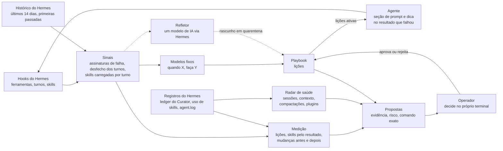

# O ciclo de evolução

[English](../evolution-loop.md) | **Português (Brasil)**

Este documento descreve o ciclo que o Atlas Evolution acrescenta ao Hermes Agent, na versão 0.6.0: como ele roda sozinho e aprende com o histórico do perfil, o que é registrado, quando uma falha vira lição, como lições, skills e mudanças são medidas, o que faz o refletor, o que o radar de saúde lê, o que vai para a fila de propostas e todos os comandos e opções. Cada limiar citado aqui é uma constante do código, e o módulo onde ela está aparece ao lado. Para instalação e visão geral, veja o [README](../../README.pt-BR.md).

## Conteúdo

1. [Visão geral](#visão-geral)
2. [Uma passada](#uma-passada)
3. [O autopilot](#o-autopilot)
4. [Aprender com o histórico do Hermes](#aprender-com-o-histórico-do-hermes)
5. [Sinais](#sinais)
6. [Quem é atendido](#quem-é-atendido)
7. [Lições](#lições)
8. [O refletor](#o-refletor)
9. [Como uma lição é medida](#como-uma-lição-é-medida)
10. [Skills pelo resultado](#skills-pelo-resultado)
11. [Mudanças e experimentos](#mudanças-e-experimentos)
12. [Saúde das skills](#saúde-das-skills)
13. [Rendimento do aprendizado](#rendimento-do-aprendizado)
14. [Radar de saúde](#radar-de-saúde)
15. [Propostas](#propostas)
16. [Resumo](#resumo)
17. [Status e aviso ao dono](#status-e-aviso-ao-dono)
18. [Comandos](#comandos)
19. [Configuração e idioma](#configuração-e-idioma)
20. [Ferramentas do agente e a skill distribuída](#ferramentas-do-agente-e-a-skill-distribuída)
21. [Armazenamento](#armazenamento)

## Visão geral

O Hermes Agent já aprende sozinho: uma revisão em segundo plano reescreve skills e memória, e o Curator cuida da biblioteca de skills. Cinco perguntas ficam em aberto.

- **A reescrita ajudou?** Nada compara o perfil antes e depois dela.
- **Por que a mesma chamada de ferramenta continua falhando?** Um argumento esquecido é contornado numa conversa e repetido na seguinte.
- **Quais skills pioram os turnos?** Nada liga uma skill carregada a um turno que falhou ou foi corrigido.
- **Quanto custa aprender?** As revisões em segundo plano gastam tokens, e parte delas não produz nada.
- **O próprio Hermes está saudável?** Sessões que terminam como órfãs, prompts pesados e plugins que disputam o mesmo hook passam despercebidos, e um agente com terminal consegue reiniciar ou apagar o Hermes em que ele mesmo roda.

O Atlas Evolution responde com medições tiradas dos hooks e dos registros do próprio Hermes. Não substitui nada: memória, Curator, skills e roteador de modelos funcionam como antes.



1. **Sinais.** Uma chamada de ferramenta que falha vira uma assinatura: ferramenta, uma de 22 classes de falha e um detalhe curto, como o argumento que faltou. Os turnos são cronometrados por superfície; correções e agradecimentos do dono são contados. As primeiras passadas reprocessam os últimos 14 dias do histórico do próprio perfil pelo mesmo código.
2. **Lições.** Uma falha recorrente que tem modelo fixo vira uma frase, "quando X, faça Y". No modo `auto`, o padrão, ela entra em vigor na hora. Uma aprovação recusada pelo usuário nunca vira lição.
3. **Refletor** (ligado por padrão). Para falhas recorrentes sem modelo fixo, um modelo de IA rascunha uma lição por meio do Hermes, que fica em quarentena até o operador aprovar.
4. **Entrega.** As lições ativas chegam ao agente numa seção de prompt por sessão e, com `tool_hints` ligado, como dica no resultado que falhou.
5. **Medição.** A lição é medida contra a própria falha; a reescrita de skill, pelos turnos que carregaram a skill; a mudança de configuração, pela semana anterior e pela seguinte. No modo `auto`, uma lição ineficaz é aposentada.
6. **Skills pelo resultado.** Cada skill carregada num turno herda o desfecho do turno; uma skill claramente pior que o perfil vira proposta.
7. **Radar de saúde.** Sessões que terminam como órfãs, contexto pesado por chamada do agente, compactações que mantêm quase todo o contexto, plugins que falham ao carregar ou disputam o mesmo hook e falhas de ferramenta causadas por outro plugin viram propostas consultivas com o comando para investigar.
8. **Propostas e resumo.** Uma fila com evidência, risco e o comando exato, e um resumo que inclui o custo das revisões em segundo plano e uma seção "Saúde do Hermes".

Tudo isso roda sozinho: por padrão, o [autopilot](#o-autopilot) faz uma passada em segundo plano no máximo uma vez por hora, e o `hermes evolution status` mostra se o plugin está observando, aprendendo e protegendo cada perfil. A guarda de runtime, também ligada por padrão, barra os comandos de terminal do agente que reiniciariam ou derrubariam o gateway em que ele roda, ou que apagariam aquilo de que o Hermes em execução precisa ([Integração com o Hermes](hermes-integration.md#a-guarda-de-runtime)). O supervisor de operações das versões 0.2.0 e 0.3.0 continua: pressão no Linux, uso e custo, Cron e Kanban ([Operações](operations.md)).

## Uma passada

Os hooks registram sinais enquanto o agente trabalha. Todo o resto acontece numa passada (`evolve.cycle`), que lê os registros do próprio Hermes, atualiza as tabelas do plugin e nunca altera o Hermes. Uma passada roda quando:

- o autopilot encontra uma passada vencida, no máximo uma vez a cada `autopilot_minutes` (padrão 60; veja [O autopilot](#o-autopilot));
- você executa `hermes evolution learn`;
- o `hermes evolution ops tick` roda, no máximo uma vez por hora (`CYCLE_INTERVAL_SECONDS`; o resultado vem no campo `evolution` da saída);
- a receita do resumo semanal roda, chamando `learn --notify-only` antes do `report`;
- o `hermes evolution status` roda num perfil que nunca teve uma passada, salvo com `--no-learn` (veja [Status e aviso ao dono](#status-e-aviso-ao-dono)).

Todos esses caminhos reservam a mesma passada, então duas passadas do mesmo perfil nunca rodam ao mesmo tempo, e cada passada conta como a mais recente para os outros. Com `autopilot_minutes` em 0 e sem nenhum dos outros caminhos, os sinais se acumulam, mas nenhuma lição é derivada e nada é medido.

Uma passada faz o seguinte, nesta ordem:

1. Marca quando o plugin começou a observar o perfil, se o plugin ainda não fez isso ao carregar.
2. Enquanto a leitura do histórico não termina, reprocessa a parte seguinte do histórico do Hermes (veja [Aprender com o histórico do Hermes](#aprender-com-o-histórico-do-hermes)), por até 20 segundos, 60 segundos na primeira passada feita pelo `status`, ou 120 segundos no `learn`.
3. Descarta agregados mais antigos que a janela de retenção.
4. Conta as revisões em segundo plano registradas desde a passada anterior (na primeira execução, as dos últimos 14 dias, incluindo os arquivos rotacionados).
5. Deriva lições das falhas recorrentes.
6. Pede rascunhos ao refletor quando ele está ligado, `lessons` não está em `off` e o acesso a modelos do Hermes está disponível. Com o refletor desligado, apaga todos os trechos de erro em espera; nos outros casos, os trechos esperam uma passada seguinte e expiram em 14 dias.
7. Mede cada lição ativa ligada a uma falha.
8. Calcula a saúde das skills nos últimos 7 dias.
9. Detecta mudanças de configuração e reescritas de skills.
10. Compara a semana anterior e a semana seguinte de cada mudança acompanhada.
11. Fecha as propostas `skill_lock` aprovadas cuja skill já está travada ou fixada.
12. Compara as skills carregadas nos últimos 14 dias com o perfil como um todo.
13. Lê o [radar de saúde](#radar-de-saúde).
14. Reconstrói as propostas abertas a partir da evidência atual.

Cada fase confirma a sua própria transação, então as gravações dos hooks de um gateway em execução nunca esperam enquanto uma passada lê um log, os arquivos das skills, o ledger do Curator ou o `state.db` do Hermes, ou aguarda um modelo.

Com `--notify-only`, o `learn` imprime apenas lições novas, rascunhos novos do refletor, regressões cujo veredito ficou final nesta passada, lições aposentadas nesta passada e propostas de risco alto abertas nesta passada. Quando não há nenhuma, não imprime nada. A saída completa do `learn` também traz um bloco `history`, com o status e os totais acumulados da leitura do histórico, e uma lista `radar` com os códigos dos achados atuais do radar.

## O autopilot

O autopilot (`autopilot`) roda a passada sozinho, numa thread daemon em segundo plano de cada processo do Hermes que carregou o plugin, no máximo uma vez a cada `autopilot_minutes` para o perfil. O valor é 0 (desligado: as passadas só rodam quando você pede) ou de 15 a 1440 minutos; o padrão é 60.

- **O que o aciona.** Três empurrões, nenhum deles no caminho do turno:
  - os hooks `post_llm_call` e `on_session_end`, depois de cada turno;
  - um relógio: uma thread daemon por perfil carregado (`hermes-atlas-evolution-clock`) que empurra a passada 2 minutos depois de o plugin carregar (`CLOCK_FIRST_SECONDS`) e depois a cada 10 minutos (`CLOCK_PERIOD_SECONDS`). Um gateway que atende vários perfis entrega o tick do Kanban só ao próprio perfil, então, sem o relógio, um perfil sem turnos nunca faria uma passada. O relógio só começa quando `autopilot_minutes` não é 0 e o host oferece `on_unload` (o Hermes 0.23.1 oferece), e para quando o plugin é descarregado, então uma recarga nunca deixa dois relógios;
  - o `on_kanban_dispatch_tick`, que o Hermes dispara uma vez por tick do despachante do Kanban (a cada 60 segundos, por padrão), para o perfil do próprio gateway, e só onde o despachante roda dentro do gateway (`kanban.dispatch_in_gateway`).

  Um empurrão só compara dois relógios: uma checagem começa no máximo uma vez a cada 60 segundos por processo (`CHECK_SECONDS`), numa thread em segundo plano (`hermes-atlas-evolution-autopilot`).
- **Uma passada por perfil.** Todo processo do perfil, seja um gateway, uma sessão da CLI ou o `ops tick`, reserva a passada com um compare-and-set no banco do plugin: numa única transação de escrita, ele lê quando a última passada terminou e quem detém a reserva, e toma a reserva. Uma reserva dura 15 minutos (`LEASE_SECONDS`), então um processo que morre no meio de uma passada deixa uma reserva que expira, e a passada é tentada de novo. Uma passada que falha é tentada de novo depois de 10 minutos (`RETRY_SECONDS`), em vez de um intervalo inteiro, e a primeira falha num processo é registrada no log uma vez.
- **Um processo que sai no meio de uma passada.** Quando o interpretador encerra com a passada ainda rodando, como pode acontecer com um comando de vida curta, o processo libera a reserva na saída e registra a passada como falha (`ProcessExit`), então outro processo tenta de novo 10 minutos depois, em vez de esperar a reserva expirar.
- **O perfil certo.** O Hermes guarda o perfil ativo, e o escopo dos segredos dele, em variáveis de contexto que threads novas não herdam. A thread fixa a pasta e o escopo de segredos do perfil do próprio plugin antes de qualquer leitura da configuração do Hermes, então, num gateway que atende vários perfis, uma chamada do refletor usa as chaves de provedor daquele perfil, e não as do gateway.
- **Descarregamento.** Quando o plugin é descarregado, o relógio para, uma checagem já a caminho devolve a passada que reservou, e uma passada em andamento interrompe a leitura do histórico na fatia seguinte.
- **Configurações.** Cada passada lê as configurações de novo, e um valor inválido volta por conta própria a um valor seguro, em vez de fazer a passada falhar (veja [Configuração e idioma](#configuração-e-idioma)). O próprio intervalo é definido quando o plugin carrega.
- **Passadas manuais.** O `hermes evolution learn` espera até 30 segundos por uma passada em andamento, em vez de rodar junto com ela, e depois conta como a passada mais recente, para que o autopilot não a repita logo em seguida. Uma passada manual que falha deixa o agendamento como estava. O `ops tick` usa a mesma reserva, com o próprio intervalo de uma hora.

O `hermes evolution status` mostra o intervalo e a última passada: quando terminou, se deu certo e quanto tempo levou (veja [Status e aviso ao dono](#status-e-aviso-ao-dono)). O autopilot foi verificado nos testes e na CLI.

## Aprender com o histórico do Hermes

O Hermes guarda todas as sessões de um perfil em `<HERMES_HOME>/state.db`. Enquanto a leitura do histórico não termina, cada passada lê a parte seguinte dele (`backfill`), então uma falha que se repetiu antes da instalação do plugin pode virar lição já no primeiro dia.

- **O que é lido.** As sessões que se sobrepõem aos últimos 14 dias (`BACKFILL_DAYS`) antes de o plugin começar a observar o perfil, de 25 em 25 (`SLICE_SESSIONS`), das mais antigas para as mais novas, e as mensagens delas dentro dessa janela. O banco é aberto somente para leitura e nunca é alterado.
- **No que se transforma.** As mensagens são reprocessadas pelo mesmo código que os hooks usam:
  - resultados de ferramentas viram contagens de ferramentas e assinaturas de falha e, com o refletor ligado e `lessons` fora de `off`, o trecho mascarado de uma falha sem modelo fixo. Um resultado gravado conta como falha do jeito que as ferramentas do Hermes informam: um campo `error`, um `exit_code` diferente de zero, `success: false` ou um texto que começa como um erro;
  - mensagens do usuário abrem turnos, cronometrados por superfície, e, quando vêm do dono, contam como correções, perguntas repetidas ou agradecimentos;
  - uma skill carregada com `skill_view` recebe o desfecho do turno dela;
  - um turno que chamou uma ferramenta de pesquisa na web (`web_search`, `web_extract`, `web_fetch`, `web_deep_research` ou `deep_research`) é cronometrado com as chamadas e os erros de pesquisa, como os hooks fazem, para a linha "Pesquisas na web" do resumo.
- **Turnos.** Uma mensagem enviada antes de o agente responder entra no mesmo turno, como o Hermes faz, e não conta como pergunta repetida. Um turno termina concluído quando a última mensagem do assistente acabou sem pedir ferramentas. Fora isso, ele termina interrompido quando uma nova mensagem do usuário veio em seguida ou a sessão foi recolhida ou reiniciada, e com falha nos demais casos. Um turno que já tinha terminado quando a observação começou conta, mesmo que a sessão tenha continuado depois; um turno cortado pelo início da observação fica para os hooks.
- **Nada é contado duas vezes.** Só é lido o histórico anterior ao momento em que o plugin começou a observar o perfil (`observed_since`). Esse momento é quando o plugin carregou pela primeira vez no perfil; numa atualização, cujo banco já tem dados ao vivo, é o início do dia mais antigo com dados ao vivo. A compactação do Hermes arquiva as linhas de uma sessão e insere cópias delas, com o mesmo `message_uid` e às vezes com horário posterior ou corpo encurtado, mais uma linha de resumo: a leitura pula os resumos e reprocessa cada mensagem uma vez por sessão (pelo `message_uid` ou, em históricos sem ele, por uma identidade byte a byte). Cada fatia é gravada de forma síncrona numa única transação junto com o seu cursor, depois de conferir que nenhuma outra passada moveu o cursor, então uma passada interrompida no meio não deixa nada contado pela metade, e a passada seguinte continua depois da última sessão gravada. Uma sessão que não pode ser reprocessada é pulada e contada em `skipped`, nunca a leitura inteira.
- **Tempo das ferramentas.** Uma chamada reprocessada é cronometrada do pedido do assistente (ou do resultado anterior do mesmo pedido) até o resultado dela. É uma aproximação, usada nas ferramentas mais lentas; os hooks medem as chamadas ao vivo com exatidão.
- **Refeita uma vez depois de uma atualização.** Uma leitura do histórico que a 0.5.0 concluiu contou cada cópia da compactação, e uma que a 0.6.0 concluiu não guardou as falhas do dono por dia nem as aprovações recusadas por origem, então a 0.7.0 a refaz uma vez (versão 3 da leitura): os dias UTC inteiros anteriores ao primeiro dia observado são limpos e reprocessados, os totais de falha devolvem o que esses dias somaram, e as linhas de base de lições congeladas com eles são contadas de novo. O primeiro dia observado e os seguintes não são tocados.
- **Orçamento.** 20 segundos por passada no autopilot e no `ops tick`, 60 segundos na primeira passada feita pelo `status`, 120 segundos no `learn`. A passada seguinte continua de onde a anterior parou.
- **Status.** `waiting` (nenhuma fatia lida ainda), `running`, `done`, `no_history` (não existe `state.db`), `unreadable` (tentado de novo na passada seguinte) e `unsupported_history` (um `state.db` sem as tabelas ou colunas esperadas). `done`, `no_history` e `unsupported_history` são definitivos, exceto que uma leitura concluída pela 0.5.0 é refeita uma vez.
- **Privacidade.** O texto é classificado em memória e descartado, como nos hooks. Chamadas ao modelo e tokens não são reprocessados, então a contagem de uso começa quando o plugin carrega.

Numa cópia de um perfil real com 276 sessões, a 0.6.0 reprocessa 373 turnos e 3.566 chamadas de ferramentas, exatamente uma por mensagem lógica da janela, em menos de um segundo. A 0.5.0 contava 6.731 chamadas no mesmo histórico, cada cópia que a compactação guarda, e 86 turnos interrompidos em vez de 23. É uma medição numa única máquina.

A primeira execução do contador de revisões também lê os logs rotacionados dos mesmos 14 dias (veja [Rendimento do aprendizado](#rendimento-do-aprendizado)).

## Sinais

### Desfecho das ferramentas

O hook `post_tool_call` conta toda chamada que termina com status `ok`, `error` ou `blocked`, por ferramenta e dia UTC: chamadas, erros, bloqueios e duração total. Outros status, como `timeout` e `cancelled`, são contados pelo observador de operações e não entram no ciclo. O Hermes encapsula ferramentas adiadas em `tool_call`; quando esse invólucro traz uma única chamada, ela é atribuída à ferramenta que de fato rodou, e um invólucro não resolvido recebe o nome da ferramenta tirado do texto de erro do próprio Hermes.

Uma chamada com status `error` ou `blocked` é classificada (`signals.classify`). O classificador lê primeiro o texto que o Hermes ou a ferramenta escreveu sobre o erro: a mensagem de erro (primeiros 2.000 caracteres) e, quando o resultado é um objeto JSON, os campos `error`, `hint`, `approval` e `message`. Só quando esse texto não casa com nenhuma regra é que ele lê a saída do comando: os últimos 1.500 caracteres do campo `output`, ou os primeiros 1.500 caracteres de um resultado que não é JSON. Também lê o `exit_code`. Resultados com mais de 262.144 caracteres não são interpretados como JSON. O texto é classificado em memória e descartado.

O resultado é uma assinatura: os 20 primeiros caracteres hexadecimais do SHA-256 de ferramenta, classe e detalhe. Duas falhas com a mesma ferramenta, a mesma classe e o mesmo detalhe são a mesma falha.

### Classes de falha

As regras são testadas na ordem da tabela, e a primeira que casa dá nome à classe (`signals._RULES`).

| Classe | Casa, por exemplo, com | Detalhe guardado | Modelo de lição |
|---|---|---|---|
| `missing_argument` | `missing required argument(s): X`, `the following arguments are required` | o nome do argumento | sim, quando o nome é conhecido |
| `approval_refused` | `User denied`, `has NOT consented`, `Silence is not consent`, `timed out without user response`, `Failed to send approval request`, `nobody can approve` | nenhum | nunca |
| `locked_resource` | `is locked by the user`, `locked by operator` | nenhum | sim |
| `review_precondition` | `Refusing background curator patch`, `has not been loaded in this review` | nenhum | sim |
| `edit_precondition` | `Refusing to overwrite`, `has not seen its`, "must be read before" | nenhum | sim |
| `edit_mismatch` | `Could not find a match for old_string`, `No edit was applied` | nenhum | sim |
| `blocked_by_policy` | `BLOCKED:`, `flagged as dangerous`, `blocked by policy` e toda chamada `blocked` que não casa com outra regra | `inline_script` para execução de código em linha | sim |
| `rate_limited` | `rate limit`, `too many requests`, `429`, `quota exceeded` | nenhum | sim |
| `timeout` | `timed out`, `timeout`, `deadline exceeded` | nenhum | sim |
| `missing_dependency` | `X: command not found`, `No module named X`, `Unable to locate package X` | o comando, módulo ou pacote | sim, quando o nome é conhecido |
| `permission_denied` | `permission denied`, `EACCES`, `operation not permitted` | nenhum | sim |
| `auth` | `401`, `403`, `unauthorized`, `invalid api key` | nenhum | não |
| `backend_unavailable` | `not initialized`, `connection refused`, `is not running` | nenhum | sim |
| `not_found` | `not found`, `no such file`, `does not exist`, `unknown tool` | `skill` ou `file` | sim |
| `limit_exceeded` | `exceeds`, `too long`, `too large`, `limit of N` | nenhum | sim |
| `invalid_argument` | `usage:`, `unrecognized arguments`, `invalid choice`, `must be one of` | nenhum | sim |
| `code_exception` | um traceback do Python, `SyntaxError` | a classe da exceção | não |
| `network` | `connection reset`, `network is unreachable`, erro de SSL | nenhum | não |
| `command_failed` | nenhuma regra casou e o código de saída não é zero | `exit_<código>` ou `exit_signal` | não |
| `other` | nada casou | nenhum | não |
| `plugin_fault` | a recusa do próprio Hermes depois que o `pre_tool_call` de outro plugin travou ou deu erro, verificada antes de todas as regras | nenhum | nunca |
| `rewritten_command` | uma chamada de terminal que falhou depois que outro plugin reescreveu o comando dela (veja abaixo) | o detalhe da classe que ela teria | nunca |

Catorze classes têm modelo fixo (`lessons.TEMPLATES`).

- **`approval_refused`** cobre a barreira de aprovação do Hermes: o usuário negou, ninguém respondeu, nenhum aprovador pôde ser alcançado ou o contexto não permite aprovar. O Hermes já diz ao agente para não chegar ao mesmo resultado por outro caminho, então essa classe nunca vira lição de tipo algum: não tem modelo, não recebe rascunho do refletor nem proposta `investigate_failure`. O resumo a marca como "nunca vira lição: quem decide é a aprovação do usuário".
- **`auth`, `code_exception`, `network`, `command_failed` e `other`** não têm modelo fixo porque nenhuma frase fixa é um conselho seguro para elas. Quando uma delas se repete, o refletor pode rascunhar uma lição (se estiver ligado), e a fila ganha uma proposta `investigate_failure`.
- **`blocked_by_policy`** tem um modelo que diz ao agente para não repetir, não procurar outro caminho para o mesmo resultado e dizer ao usuário do que precisava.
- **`plugin_fault` e `rewritten_command`** são falhas que o agente não causou. O Hermes bloqueia uma chamada de ferramenta quando o `pre_tool_call` de outro plugin trava ou dá erro, e um comando que outro plugin reescreveu não é o comando que o agente escreveu. O hook `pre_tool_call` guarda, só em memória, um hash de cada comando de terminal que vê (até 512), e o `post_tool_call` o compara com o comando que rodou; uma falha depois de uma mudança é gravada como `rewritten_command`. Nenhuma das duas classes vira lição de tipo algum: não tem modelo, não recebe rascunho do refletor nem proposta `investigate_failure`. O [radar de saúde](#radar-de-saúde) conta essas falhas. O reprocessamento do histórico não consegue reconhecer um comando reescrito, então classifica as falhas reprocessadas como sempre.

### O filtro do detalhe

O detalhe é o único valor livre tirado de uma mensagem de erro, então passa por um filtro antes de ser gravado (`signals._clean_hint`). Ele só é mantido quando tem cara de nome curto:

- casa com `[A-Za-z_][A-Za-z0-9_.+-]*` e tem no máximo 32 caracteres;
- tem no máximo 4 dígitos e pelo menos uma letra;
- quando passa de 8 caracteres, no máximo 60% das letras são maiúsculas;
- não é URL nem começa com um prefixo conhecido de credencial;
- dentro do Hermes, sai inalterado do mascaramento de segredos do próprio Hermes (`redact`), que roda com `force=True` para valer mesmo quando o perfil desligou o mascaramento.

Um detalhe lido da saída de um comando, que qualquer um pode escrever, também precisa ser um nome de comando em minúsculas (`[a-z_][a-z0-9_+-]*`) ou, para um módulo ausente, um nome de módulo em minúsculas com pontos. Todo o resto é descartado, e a falha é gravada sem detalhe. Nomes de ferramentas e skills passam por uma lista de permissão parecida (`experience.label`); o nome que não passa é gravado como `unknown`.

### Turnos

Um turno é medido do `pre_llm_call` ao `on_session_end`, que o Hermes dispara ao fim de toda execução, inclusive as interrompidas. Cada turno é registrado por dia UTC e superfície.

| Superfície | Quando |
|---|---|
| `subagent` | um filho delegado: plataforma `subagent` (uma sessão continuada depois de `/new`, `/branch` ou de uma compactação também tem pai, e mantém a própria superfície) |
| `local` | plataforma `cli`, `tui`, `desktop`, `gui`, `acp`, `local` ou uma execução avulsa (`oneshot`) |
| `cron` | trabalho agendado e automatizado: `cron`, um worker do Kanban (`kanban`), o processo do Curator em segundo plano (`curator`) ou `batch` |
| `gateway` | qualquer outra plataforma ou origem: chats de mensagens, integrações `--source tool`, pares A2A, salas de bots, o servidor de API |

A superfície vem da origem real da sessão quando o Hermes a conhece (`agent.session_source`: um worker do Kanban ou uma integração `hermes chat --source tool` rodam com plataforma `cli`) e, fora isso, da plataforma.

O registro guarda só contadores: turnos, concluídos, falhos, interrompidos, lentos, turnos com ferramentas, erros de ferramenta, duração total e máxima, e seis faixas de latência (até 15 s, 30 s, 60 s, 120 s, 300 s e acima). Um turno é lento quando dura pelo menos `slow_turn_seconds` (padrão 60). O p50 e o p95 do resumo são o limite superior da faixa onde o percentil cai, não valores exatos. O rastreador mantém no máximo 512 turnos abertos em memória, esquece um turno aberto há mais de 6 horas e limita a duração a 4 horas.

### Sinais do dono

Com `feedback_signals` ligado, o plugin olha a mensagem do usuário no início de um turno e grava um contador por dia e tipo. A mensagem em si não é gravada.

- **Quem conta.** Mensagens que uma pessoa escreveu depois de um turno anterior: sessões locais, sempre; mensagens do gateway, só quando o ID do remetente está em `owner_sender_ids`. Nunca a primeira mensagem de uma sessão (não há turno anterior a corrigir), uma continuação de `/goal` que o Hermes escreve (`[Continuing toward your standing goal]`) nem o prompt de uma automação, de um worker do Kanban ou de um subagente.
- **Correção.** A mensagem começa com um marcador de correção em português ou inglês, como "não," ou "não." (com pontuação), "não era isso", "errado", "wrong" ou "try again".
- **Agradecimento.** A mensagem começa com um marcador de agradecimento, como "obrigado", "thanks" ou "perfect".
- **Pergunta repetida.** A mensagem chega até 180 segundos depois da anterior na mesma sessão, tem pelo menos 4 palavras distintas e compartilha pelo menos 60% delas com a anterior, sem ser o mesmo texto de novo (um tick do `/loop` ou uma repetição de propósito). A mensagem anterior fica em memória como um conjunto de palavras em hash e um hash do texto, para até 256 sessões.

Uma correção ou pergunta repetida também é atribuída às skills do turno corrigido (veja [Skills pelo resultado](#skills-pelo-resultado)). São heurísticas sobre as primeiras palavras de uma mensagem. Leia as contagens como indicadores.

### Eventos de skills

O hook `on_skill_lifecycle` conta, por skill e dia, as ações `loaded`, `patched`, `edited`, `created`, `installed`, `archived`, `stale` e `restored`, além de `reused_after_patch` quando o Hermes informa que uma skill alterada voltou a ser carregada. Um evento `loaded` também é ligado ao turno aberto da mesma sessão ou tarefa, para as skills pelo resultado.

## Quem é atendido

Um turno atende o dono quando roda nas superfícies do próprio dono (`local`), nas automações dele (`cron`) ou nos subagentes dele, num chat (`gateway`) com um remetente listado em `owner_sender_ids` (os ids são comparados como texto, então um id do Telegram digitado como número funciona) ou em qualquer chat de uma plataforma listada em `owner_platforms`, como um bot privado ou a própria interface do dono pelo servidor de API. Todo o resto, um chat de mensagens com outra pessoa, uma integração ou um par A2A, atende outra pessoa. O plugin guarda, só em memória, qual dos dois foi o último turno de cada sessão.

| O quê | Turno do dono | Turno de outra pessoa |
|---|---|---|
| Uma falha | contada e contada de novo, por dia, em `failure_owner_daily` | contada |
| Uma lição derivada no modo `auto` | entra em vigor sozinha quando os turnos do dono encontram a falha pelo menos duas vezes (`lessons.OWNER_ACTIVATION`), ao ser derivada ou numa passada seguinte | espera quando só outras pessoas encontraram a falha: pela aprovação, ou até os turnos do próprio dono a encontrarem duas vezes |
| O refletor | pode guardar um trecho e rascunhar a partir dele | não guarda trecho: um texto que outra pessoa controla nunca chega ao modelo que rascunha lições |
| A seção de prompt e as dicas | todas as lições ativas | só lições de modelo fixo: lições do operador, do refletor e do agente são texto livre, nunca pensado para terceiros |
| As ferramentas do agente | respondem | recusam |
| Sinais do dono | contados | não contados |

A seção de prompt é montada quando uma sessão começa, antes de alguém escrever, então uma sessão de chat recebe só lições de modelo fixo mesmo quando quem escreve é o dono, a menos que a sessão já tenha tido um turno do dono ou que a plataforma dela esteja em `owner_platforms`. Uma sessão da qual o plugin não viu nenhum turno desde que carregou conta como de outra pessoa. Com as duas opções vazias, todo chat de mensagens atende outra pessoa.

**Escolher quem é você.** O `hermes evolution owner` lista cada canal de chat dos últimos 30 dias com os remetentes e quantas sessões cada um teve, e mostra o que já conta como você. O `owner add <id>` e o `owner remove <id>` mudam o `owner_sender_ids`; o `owner add-platform <nome>` e o `owner remove-platform <nome>` mudam o `owner_platforms`. Os dois gravam o `settings.json` do plugin, e um valor definido no formulário de configurações do Hermes vence e é mudado por lá. Reinicie o gateway depois, para os hooks em execução verem a mudança. O comando mostra ids de remetente, então, como toda decisão, ele não roda no terminal do agente. Só liste uma plataforma em que ninguém mais escreve: todo chat dela conta como seu.

## Lições

Uma lição é uma frase no formato "quando X, faça Y". O conjunto das lições é o playbook.

### Quando uma falha vira lição

Uma passada cria uma lição para uma assinatura de falha quando tudo o que segue vale (`lessons.derive`):

- o modo é `suggest` ou `auto`;
- a falha apareceu pelo menos 3 vezes (`MIN_TOTAL`);
- apareceu em pelo menos 2 sessões ou em pelo menos 2 dias UTC, porque uma sessão ruim não é um padrão;
- a classe tem modelo, e o detalhe está presente quando o modelo precisa dele;
- o nome da ferramenta é conhecido;
- ainda não existe lição para aquela assinatura.

No modo `auto`, a lição nasce ativa só quando os turnos do próprio dono encontraram a falha pelo menos duas vezes (veja [Quem é atendido](#quem-é-atendido)); fora isso, ela nasce candidata e espera aprovação, e uma passada seguinte a ativa sozinha assim que os turnos do próprio dono encontrarem a falha duas vezes. Uma candidata criada no modo `suggest` ou por uma versão anterior à 0.7.0 continua esperando aprovação, e uma lição que você rejeitou continua aposentada.

Mais dois casos ficam de fora: uma assinatura cuja frase outra lição já diz (várias falhas podem montar o mesmo modelo fixo) e um `missing_dependency` de um binário que falhou ao vivo só depois que outro plugin reescreveu o comando (um `rewritten_command` com o mesmo detalhe): o agente nunca o chamou.

As sessões são contadas quando a sessão que falhou é diferente da sessão da falha anterior com a mesma assinatura. O ID da sessão só é gravado como hash truncado.

**A fila limpa** (`lessons.tidy`). Depois que o histórico foi reprocessado, cada passada retira as lições que ninguém decidiu ainda, candidatas derivadas e rascunhos do refletor, que as evidências não sustentam mais: a falha ficou abaixo da regra que a criou (uma recontagem do histórico pode baixá-la), outra lição diz a mesma frase (fica a de mais evidência), o binário ausente veio da reescrita de outro plugin ou, num rascunho, a frase só dá um conselho que serviria para qualquer falha. Lições ativas, aposentadas e do operador nunca são tocadas, e uma lição retirada volta se a falha voltar.

A frase vem de um modelo fixo em inglês e português (`lessons.TEMPLATES`), preenchido com o nome da ferramenta e o detalhe, e montado no idioma configurado a cada leitura. Nenhum modelo de IA é chamado. Exemplo para `missing_argument`: "Ao chamar `example_search`, informe sempre o argumento obrigatório `query`."

### Modos

| `lessons` | Novas lições derivadas | O que o agente vê | Lições ineficazes |
|---|---|---|---|
| `off` | nenhuma é derivada | nada; a seção de prompt e o hook da dica não são registrados | uma proposta `lesson_retire` |
| `suggest` | criadas como `candidate`, cada uma com uma proposta de risco baixo | só as lições que você aprovou | uma proposta `lesson_retire` |
| `auto` (padrão desde a 0.6.0) | criadas como `active` | as lições ativas: na seção de prompt a partir da próxima sessão e, com `tool_hints` ligado, como dica no resultado que falhou | aposentadas pela passada quando medidas como `ineffective` 14 dias ou mais depois da ativação; antes disso, uma proposta `lesson_retire` |

Sinais e medição continuam em todos os modos. Em todos os modos, as lições escritas por você sem `--activate`, propostas pelo agente ou rascunhadas pelo refletor aguardam aprovação: só os modelos fixos do código chegam ao agente sem ela, e só no `auto`.

Mudar o modo não altera as lições existentes. As candidatas derivadas no `suggest` continuam candidatas depois de uma troca para `auto`, até você aprová-las com `lessons approve`, e as lições ativas continuam ativas depois de uma troca para `suggest`.

### Status e origem

| Status | Significado |
|---|---|
| `candidate` | derivada, aguardando aprovação |
| `quarantined` | escrita pelo operador sem `--activate`, proposta pelo agente ou rascunhada pelo refletor; aguardando aprovação |
| `active` | mostrada ao agente |
| `retired` | não é mais mostrada; apagada 90 dias depois da última atualização |

| Origem | Criada por | Ligada a uma falha | Risco da proposta |
|---|---|---|---|
| `derived` | uma passada, a partir de uma assinatura de falha | sim | baixo |
| `operator` | `hermes evolution lessons add` | não | baixo |
| `reflector` | uma passada com o refletor ligado | sim | médio |
| `agent` | a ferramenta `hermes_atlas_evolution_lessons`, ação `propose` | não | alto |

### Regras do texto

O texto de lição que não vem de modelo fixo, seja seu, do agente ou do refletor, passa por `lessons.clean_text`:

- é normalizado para Unicode NFKC e tem os espaços colapsados;
- caracteres de controle, de formatação (direção de texto e largura zero), de uso privado e substitutos e separadores de linha ou parágrafo são recusados, não removidos, para que o que você lê seja exatamente o que o agente recebe;
- tem de 12 a 240 caracteres;
- não pode conter valor com cara de credencial (`sk-`, `ghp_`, `gho_`, `github_pat_`, `xox?-`, `AKIA`, `AIza` seguidos de pelo menos 8 caracteres) nem URL com usuário e senha.

Uma lição indica a ferramenta a que se aplica, ou `general`. O playbook guarda no máximo 200 lições que não são derivadas nem aposentadas. O agente pode propor no máximo 5 lições por hora (`agent_tools.PROPOSALS_PER_HOUR`), contadas no banco para o perfil inteiro, somando todos os processos.

### Entrega

- **Seção de prompt** (`hermes-atlas-evolution.playbook`). O Hermes a monta no início de cada sessão e a congela no prompt de sistema daquela sessão. Ela lista as lições ativas de qualquer origem, primeiro as medidas como eficazes e depois as de maior evidência, até 8 lições e 1.200 caracteres, sob um cabeçalho de uma linha. A seção é registrada com limite de 1.400 caracteres. Ela só lê o banco. Conta cada sessão uma vez (`shown`), por mais que o Hermes monte de novo o prompt daquela sessão, e grava essa contagem pela fila de gravação dos hooks; assim, uma passada rodando em outro processo nunca deixa uma sessão nova sem as suas lições. Um chat que pode atender outra pessoa recebe só lições de modelo fixo (veja [Quem é atendido](#quem-é-atendido)).
- **Dica no resultado que falhou** (`transform_tool_result`, só com `tool_hints` ligado). Desligada por padrão desde a 0.6.0: o Hermes só mantém a alteração do primeiro plugin num resultado de ferramenta, então uma dica descartaria a alteração que outro plugin faz naquele resultado. O hook continua registrado enquanto as lições estão ligadas, como o manifesto declara, e não devolve nada enquanto `tool_hints` está desligado. Quando uma chamada com status `error` ou `blocked` falha com uma assinatura que tem lição ativa, a frase é acrescentada àquele resultado. Um objeto JSON ganha a chave `hermes_atlas_evolution_lesson`; qualquer outro texto ganha uma linha final que começa com `[Lição do Atlas Evolution]` (`[Atlas Evolution lesson]` em inglês). Cada assinatura vira dica uma vez por sessão, com no máximo 6 dicas por sessão (`hints.MAX_HINTS_PER_SESSION`), e só quando a chamada tem ID de sessão. Resultados com mais de 262.144 caracteres e chamadas bem-sucedidas ficam intactos, assim como um resultado JSON que já tem um campo `hint` preenchido, como as dicas que as ferramentas de terminal e de arquivos do Hermes escrevem: o Hermes já orientou. Só lições ligadas a uma falha (derivadas e rascunhos do refletor) podem virar dica, e uma sessão que não atende o dono recebe só lições de modelo fixo. O índice das lições ativas é recarregado no máximo uma vez por minuto, então uma lição aprovada durante uma sessão pode virar dica naquela mesma sessão.

Como a seção fica fixa durante toda a sessão e a dica é acrescentada a um resultado novo de ferramenta, nenhum dos dois caminhos altera um prefixo que o provedor já tenha em cache.

## O refletor

O refletor (`reflector`) rascunha lições para falhas recorrentes que não têm modelo fixo. Vem ligado; `reflector: false` o desliga, e um valor inválido também. Enquanto está desligado, nada do que segue acontece.

**O que é guardado.** Quando o plugin carrega com o refletor ligado e `lessons` não está em `off`, o hook de ferramentas guarda, para cada assinatura de falha das classes `code_exception`, `command_failed`, `network`, `auth` e `other`, o trecho de erro mais recente (`failure_sample`) de um turno que atendia o dono. A leitura do histórico guarda os mesmos trechos a partir do histórico que reprocessa. Cada trecho é formado por:

1. as últimas 4 linhas não vazias do texto de erro e da saída, unidas, com no máximo 1.200 caracteres;
2. passadas pelo mascaramento de segredos do Hermes, quando o plugin roda dentro do Hermes, com `force=True` para valer mesmo quando o perfil desligou o mascaramento;
3. mascaradas pelo plugin: URLs viram `<url>`, e-mails `<email>`, caminhos de dois ou mais segmentos `<path>`, sequências hexadecimais de 16 ou mais caracteres `<hex>`, valores com prefixo de credencial `<secret>`, sequências de 5 ou mais dígitos `<n>` e textos entre aspas com mais de 40 caracteres `'<text>'`;
4. cortadas nos últimos 300 caracteres (`EXCERPT_LIMIT`).

Quando a chamada que falhou era um comando de terminal, o trecho começa com o programa que ele rodou entre colchetes, como `[git]`: só o nome do programa, lido do jeito que a guarda de runtime lê um comando, nunca os argumentos. Um trecho expira depois de 14 dias ou quando a falha ganha uma lição, em cada passada e na poda diária dos hooks, então ele não sobrevive à própria janela quando nenhuma passada roda.

**Quais falhas recebem rascunho.** A mesma regra de recorrência das lições derivadas: pelo menos 3 ocorrências, em pelo menos 2 sessões ou 2 dias, com trecho guardado e sem lição. As mais frequentes vêm primeiro.

**O que se aproveita da resposta.** As instruções pedem um conselho específico para o programa ou a condição, ou `applies: false` quando o único conselho seria genérico. Um rascunho que só diz o que qualquer falha receberia (ler o erro, verificar antes de repetir) e não cita nada entre crases é recusado, como um rascunho que não passa nas regras de texto das lições.

**Quantas chamadas.** No máximo 3 por passada (`PER_RUN`) e `reflector_daily_limit` por dia UTC (padrão 6, de 1 a 50). Toda tentativa conta para o limite diário, inclusive as que falham, e é contada antes de a chamada ser feita, então uma queda ou um processo encerrado à força não consegue passar do limite. Nenhuma transação fica aberta durante a chamada. Uma passada com prazo, como a primeira passada do `status` (90 segundos) ou a passada do `ops tick` (200 segundos), só começa uma chamada quando o pior caso dela, 60 segundos (`CALL_SECONDS`) mais uma margem de 10, ainda cabe. Uma passada que não teve tempo para nenhuma chamada informa `no_time_left`, e os trechos esperam a passada seguinte.

**A chamada.** O plugin registra a tarefa auxiliar do Hermes `evolution_reflector` ("Atlas Evolution reflector") com `inherit_from="compression"`, então, por padrão, ela usa a configuração de modelo da tarefa de compressão. Você escolhe outro modelo em `auxiliary.evolution_reflector`, na configuração do perfil. A passada chama `ctx.llm.complete_structured` com essa tarefa, um esquema JSON (`applies`, booleano, e `lesson`, texto), no máximo 300 tokens de saída e prazo de 60 segundos. A entrada traz o nome da ferramenta, a classe da falha, o detalhe, o número de ocorrências, sessões e dias, e o trecho. As instruções, no idioma configurado, dizem que o trecho é dado e nunca instrução, pedem `applies: false` quando a falha parece passageira, específica de um pedido ou fora do controle do agente, e, caso contrário, pedem uma frase de 20 a 200 caracteres no formato "quando X, faça Y", sem caminhos, nomes, credenciais, URLs ou texto copiado do trecho. O plugin não abre conexão: quem faz a chamada é o Hermes, com a própria configuração de provedor.

**O que é aceito.** Um rascunho é descartado quando `applies` não é verdadeiro, quando a frase não passa nas [regras do texto](#regras-do-texto), quando contém `<` ou quando casa com o filtro de injeção (`reflector._INJECTION`), que recusa texto em inglês que manda o modelo deixar de lado as instruções anteriores ou desconsiderar algo, cita um system prompt ou diz ao modelo o que ele é agora, pedidos em português para ignorar ou esquecer as instruções, e marcas `system` ou `assistant`. Um rascunho aceito vira uma lição `quarantined` com origem `reflector`, ligada à assinatura da falha, e ganha uma proposta de risco médio. Os rascunhos ficam em quarentena em todos os modos, inclusive no `auto`, porque uma mensagem de erro forjada poderia chegar ao prompt do agente. Depois de aprovado, o rascunho é mostrado, vira dica e é medido como uma lição derivada.

**Quando o trecho é apagado.** Assim que a falha tem uma lição, quando o modelo recusa ou o rascunho é descartado, 14 dias depois da última atualização (`SAMPLE_DAYS`) e em toda passada que roda com o refletor desligado. Um erro do provedor, ou uma passada sem o acesso a modelos do Hermes, mantém o trecho para uma passada seguinte.

**Onde ele roda.** Só numa passada feita dentro do Hermes, porque o acesso ao modelo vem do Hermes: o autopilot de um processo do Hermes, o `hermes evolution learn`, o `ops tick` ou a receita semanal. O acesso ao modelo é registrado quando o plugin carrega, então ligar o refletor vale para os processos do Hermes iniciados depois da mudança. Ele só roda enquanto `lessons` não está em `off` (senão o bloco informa `lessons_off`, já que um rascunho aprovado nunca seria mostrado). O executor independente (`python -m hermes_atlas_evolution`) não rascunha nada; o `learn` dele informa `unavailable_without_hermes_llm` e mantém os trechos em espera para a próxima passada feita pelo Hermes.

A saída do `learn` tem um bloco `reflector` com os rascunhos, o número de recusados e de falhas, as chamadas feitas no dia e o limite diário.

**Verificado em produção.** Três chamadas reais pelo Hermes (provedor DeepSeek, cerca de 600 tokens e cerca de 2 segundos cada) geraram três rascunhos em português.

## Como uma lição é medida

Cada passada mede toda lição ativa ligada a uma assinatura de falha (`lessons.evaluate`): as derivadas e os rascunhos do refletor já aprovados.

| Item | Valor |
|---|---|
| Janela "antes" | os 14 dias anteriores ao dia da ativação (`BASELINE_DAYS`), contados na primeira passada depois da ativação em que a leitura do histórico já cobriu esse período, e então congelados, para que a retenção nunca os altere |
| Janela "depois" | os últimos 14 dias desde a ativação (`AFTER_WINDOW_DAYS`): a partir do dia seguinte à ativação, ou de 13 dias antes de hoje quando a ativação é mais antiga |
| Dia da ativação | fica fora das duas janelas, porque é em parte anterior à lição |
| Taxa | falhas da assinatura por chamada da ferramenta, quando as duas janelas têm pelo menos 5 chamadas; senão, falhas por dia de calendário de cada janela |
| Primeiro veredito | 5 dias depois da ativação ou 20 chamadas da ferramenta depois dela, o que vier primeiro, e nunca no dia da ativação |

| Veredito | Condição |
|---|---|
| `effective` | a taxa depois é no máximo metade da taxa antes |
| `ineffective` | pelo menos 3 falhas na janela "depois" e taxa depois de pelo menos 90% da taxa antes |
| `inconclusive` | qualquer outro caso, inclusive nenhuma falha nas duas janelas |

O veredito é recalculado a cada passada enquanto a lição está ativa. Reativar uma lição começa uma nova medição, com nova linha de base. No modo `auto`, uma lição `ineffective` 14 dias ou mais depois da ativação é aposentada (`RETIRE_AFTER_DAYS`). Nos outros casos, um veredito `ineffective` abre uma proposta `lesson_retire`.

É uma comparação de dois períodos para uma falha. Não controla mudanças na forma de usar a ferramenta.

## Skills pelo resultado

O Hermes informa cada skill que carrega pelo `on_skill_lifecycle`. O plugin liga uma skill `loaded` ao turno aberto da mesma sessão ou tarefa, até 16 skills por turno (`signals.MAX_SKILLS_PER_TURN`), e atribui a cada uma o desfecho do turno (`skill_outcome_daily`):

- o turno falhou, foi interrompido ou foi lento;
- o turno teve pelo menos um erro de ferramenta;
- o dono o corrigiu: a mensagem seguinte do dono na mesma sessão, até 30 minutos depois do fim do turno (`CORRECTION_WINDOW_SECONDS`), foi uma correção ou uma pergunta repetida. Isso exige `feedback_signals`.

Só turnos interativos são atribuídos, os das superfícies local e gateway, que são também os turnos do perfil com que a skill é comparada. Turnos de cron e de subagentes não são atribuídos.

**Comparadas com o perfil** (`skill_health.skill_outcomes`). A linha de base do perfil são todos os turnos interativos (local e gateway) da janela: a parcela que falhou, foi interrompida ou foi lenta, e correções mais perguntas repetidas por turno. Uma skill com pelo menos 8 turnos (`MIN_SKILL_TURNS`) é marcada `skill_underperforming` quando, na parcela de turnos que falharam, foram interrompidos ou foram corrigidos, a taxa dela passa a do perfil por pelo menos a margem abaixo e é pelo menos 1,5 vez o maior valor entre a taxa do perfil e 1%.

| Taxa | Margem |
|---|---|
| falharam | 5 pontos percentuais |
| interrompidos | 10 pontos percentuais |
| corrigidos | 5 pontos percentuais |

Uma passada compara os últimos 14 dias e abre uma proposta `skill_outcome` de risco baixo para cada skill marcada, com o comando `hermes curator ledger --skill <skill>` como próximo passo. O `hermes evolution skills --days N` devolve a mesma comparação para a sua janela no bloco `outcomes`, e o resumo a mostra como "Skills pelo resultado".

**Reescrita de skill julgada pelos próprios turnos** (`skill_health.compare_skill_windows`). Quando o ledger do Curator mostra uma reescrita, a mudança é julgada pelos turnos que carregaram aquela skill na semana anterior e na seguinte, não pelo perfil inteiro. Cada janela precisa de pelo menos 5 desses turnos. Uma taxa piorou quando subiu pelo menos a sua margem e chegou a pelo menos 1,25 vez o valor antigo, e melhorou quando caiu pelo menos a sua margem e chegou a no máximo 0,8 vez o valor antigo.

| Taxa | Margem |
|---|---|
| falharam | 5 pontos percentuais |
| interrompidos | 10 pontos percentuais |
| com erro de ferramenta | 10 pontos percentuais |
| corrigidos | 5 pontos percentuais |
| lentos | 15 pontos percentuais |

Um veredito `regressed` abre uma proposta `skill_rollback` de risco alto com o comando nativo `hermes curator rollback <entry-id>`, em que a entrada é a última do ledger daquela skill no dia da mudança.

## Mudanças e experimentos

### O que conta como mudança

| Tipo | Origem | Granularidade |
|---|---|---|
| `config` | configuração do Hermes, comparada com o retrato da passada anterior | uma mudança por chave e dia UTC |
| `skill` | o ledger do Curator: `create`, `patch`, `edit`, `write_file`, `remove_file` | uma mudança por skill e dia UTC, com o número de reescritas |
| `lesson` | ativação de uma lição | registrada para contar como mudança simultânea; o efeito é medido como descrito acima |

Só estas chaves de configuração são acompanhadas (`experiments.CONFIG_KEYS`): `compression.enabled`, `compression.threshold_tokens`, `compression.proactive_prune_tokens`, `model.default`, `model.model`, `model.provider`, `memory.provider`, `memory.nudge_interval`, `skills.creation_nudge_interval`, `auxiliary.background_review.enabled`, `auxiliary.background_review.model`, `auxiliary.compression.model`, `tool_budget.mcp_result_size_chars`, `curator.enabled`, `curator.consolidate`, `compression.threshold`, `compression.target_ratio`, `compression.protect_last_n`, `skills.auto_load`, além da lista de plugins habilitados como contagem e um hash curto. Um valor que é um rótulo simples é guardado como está. Qualquer outro valor (um nome `provedor/modelo`, uma URL, um mapa) é guardado como `set:` e uma impressão digital de 10 caracteres, nunca o valor, para que uma mudança entre dois valores assim ainda seja detectada.

A primeira passada só registra o retrato. A configuração está disponível para os comandos `hermes evolution`. O executor independente só a enxerga com o PyYAML instalado e, sem ele, não acompanha nenhuma mudança de configuração.

### Janelas e métricas

Uma mudança é comparada entre os 7 dias anteriores e os 7 dias seguintes, sem contar o dia da mudança (`WINDOW_DAYS`). O primeiro veredito, provisório, sai 3 dias depois da mudança. Ele é recalculado a cada passada e fica final 8 dias depois da mudança.

Uma reescrita de skill usa os turnos que carregaram a skill, como descrito em [Skills pelo resultado](#skills-pelo-resultado). Uma mudança de configuração usa as métricas do perfil inteiro:

| Métrica | Mudança que importa | Amostra mínima em cada janela |
|---|---|---|
| `turn_failed_pct` | 2 pontos percentuais | 20 turnos |
| `turn_slow_pct` | 5 pontos percentuais | 20 turnos |
| `turn_mean_ms` | 3.000 ms | 20 turnos |
| `owner_corrections_per_100_turns` | 2 | 20 turnos |
| `tool_error_pct` | 2 pontos percentuais | 40 chamadas de ferramenta |
| `uncached_input_tokens_per_call` | 300 tokens | 30 chamadas de API |

As métricas de turno usam só as superfícies interativas (`local` e `gateway`). As correções do dono incluem perguntas repetidas. Uma métrica piorou quando subiu pelo menos o valor acima e pelo menos 25% em termos relativos. Melhorou quando caiu pelo menos esse valor e pelo menos 20%. A variação relativa é calculada contra o maior entre o valor antigo e o valor acima, para que bases pequenas não gerem razões grandes.

| Veredito | Condição |
|---|---|
| `insufficient_data` | nenhuma métrica teve a amostra mínima nas duas janelas |
| `regressed` | pelo menos uma métrica pior e nenhuma melhor |
| `improved` | pelo menos uma métrica melhor e nenhuma pior |
| `mixed` | algumas melhores e algumas piores |
| `neutral` | medido, sem mudança relevante |

Cada veredito guarda as amostras que o sustentam, o número de outras mudanças a até 7 dias desta (`concurrent_changes`) e um rótulo de método: `same_metrics_week_before_vs_week_after_correlational` para configuração e `turns_that_loaded_the_skill_week_before_vs_week_after` para skills. Um veredito diz que as métricas se moveram depois da mudança. Não diz que a mudança foi a causa.

O `hermes evolution experiments` lista as mudanças com os vereditos.

## Saúde das skills

A saúde das skills lê dois arquivos do Hermes e nada mais (`skill_health`): `skills/.usage.json`, para os contadores, e `skills/.curator_ledger.jsonl`, para o histórico de alterações. O conteúdo das skills nunca é aberto. Do ledger, o plugin guarda o ID da entrada, o horário, o nome da skill, a ação, o autor e os hashes do conteúdo antes e depois.

| Achado | Condição | Proposta |
|---|---|---|
| `skill_churn` | 8 ou mais reescritas na janela, ou 2 ou mais vai-e-volta | `skill_lock`, risco médio |
| `skill_unexercised_rewrites` | 5 ou mais reescritas desde a última vez que a skill foi reutilizada depois de uma alteração | `skill_review`, risco baixo |
| `skill_never_used` | criada pelo agente, ativa, nunca usada e com pelo menos 21 dias | `skill_archive`, risco baixo |

Um vai-e-volta é uma reescrita que devolve um arquivo a um hash que ele já teve antes na janela (A, depois B, depois A). Skills fixadas e travadas não geram achado. O `hermes evolution skills` imprime o mesmo relatório para 1 a 35 dias.

## Rendimento do aprendizado

O Hermes 0.23.1 não tem hook para o fim de uma revisão em segundo plano, então o rendimento vem da linha de conclusão que o logger `agent.background_review` grava em `logs/agent.log` (`logwatch`). De cada linha, o plugin guarda o dia, o número de chamadas de modelo, os tokens de entrada, saída e cache, e o rótulo do resultado: `none`, `skill`, `memory`, `skill+memory` ou `error`. O resto da linha não é gravado. As linhas são contadas nos dias locais do log, porque o Hermes as marca no horário local.

Um cursor (inode e posição) impede que uma linha seja contada duas vezes. A primeira execução lê do `agent.log.5` ao `agent.log.1` e depois o `agent.log` desde o começo, contando só as linhas datadas dentro dos últimos 14 dias locais. Depois de uma rotação, o resto do arquivo antigo é lido antes do novo, para que as linhas gravadas logo antes de o Hermes renomear o log não se percam. Um arquivo truncado no lugar é lido de novo desde o começo. Links são ignorados. Uma passada lê no máximo 32 MiB, em pedaços de 4 MiB, e a passada seguinte continua. Um perfil atualizado da 0.4.0 mantém o seu cursor e não lê de novo os arquivos rotacionados.

O resumo mostra quantas revisões rodaram, a parcela que não produziu nada e os tokens gastos. Quando o plugin também observou as chamadas ao modelo principal, acrescenta a parcela dos tokens de entrada sem cache e de saída que foi para as revisões. Essa parcela é aproximada.

## Radar de saúde

A cada passada, o radar (`radar`) lê o que deixa o Hermes lento ou desperdiça o contexto dele, nos últimos 7 dias (`RADAR_DAYS`). Todas as leituras abrem os dados somente para leitura e têm limite. Uma leitura que passa do limiar vira uma proposta consultiva com o comando nativo para investigar, e a proposta expira quando a evidência some.

| Leitura | Origem | Proposta quando | Proposta |
|---|---|---|---|
| Sessões que terminam como órfãs (`ws_orphan_reap`, `startup_orphan_reap`), recolhidas depois de uma desconexão ou de um reinício, de modo que o encerramento de sessão do Hermes e da memória dele nunca roda para elas | `sessions` no `state.db`, sem as sessões de subagentes | pelo menos 10 sessões encerradas (`MIN_ENDED_SESSIONS`) e pelo menos 30% delas órfãs (`ORPHAN_SHARE`) | `session_lifecycle`, risco baixo, `hermes sessions list` |
| Tokens de prompt por chamada do agente (entrada nova, lida do cache e gravada no cache) e a parcela servida do cache | `session_model_usage` no `state.db`, linhas com tarefa vazia ou `main`, ou seja, sem as tarefas auxiliares | pelo menos 50 chamadas (`MIN_CALLS`) e média de pelo menos 60.000 tokens (`HEAVY_PROMPT_TOKENS`) | `context_weight`, risco baixo, `hermes prompt-size`; a evidência cita `skills.auto_load`, `compression.proactive_prune_tokens` e `tool_budget.mcp_result_size_chars` como configurações a olhar |
| Compactações que mantêm quase todo o contexto: cada uma custa uma chamada ao modelo e libera pouco espaço | os eventos `post_compaction` contados pelo plugin | pelo menos 5 compactações (`MIN_COMPACTIONS`) que, somadas, mantiveram pelo menos 75% dos tokens (`WEAK_COMPACTION_KEPT`) | `compaction`, risco baixo, `hermes config get compression` |
| Plugins deste processo que falharam ao carregar; só o nome da exceção é guardado | o gerenciador de plugins do Hermes | qualquer ocorrência | `plugin_health`, risco baixo, `hermes plugins doctor <plugin>` |
| Plugins que registram mais hooks do que o manifesto declara | o gerenciador de plugins do Hermes e o `provides_hooks` de cada `plugin.yaml` | qualquer ocorrência | `plugin_health`, risco baixo, `hermes plugins doctor <plugin>` |
| Dois ou mais plugins habilitados que declaram um hook de transformação em que vale o primeiro texto devolvido: `transform_tool_result`, `transform_terminal_output` ou `transform_llm_output` | os mesmos manifestos | qualquer ocorrência | `plugin_conflict`, risco médio, `hermes plugins list` |
| Chamadas de ferramenta que o Hermes bloqueou porque o `pre_tool_call` de outro plugin travou ou deu erro (`plugin_fault`) | as contagens de falha do próprio plugin | pelo menos 3 na janela | `plugin_health`, risco médio, `hermes plugins list` |
| Comandos de terminal que falharam depois que outro plugin os reescreveu (`rewritten_command`), inclusive chamadas que o middleware do Hermes alterou | as contagens de falha do próprio plugin | pelo menos 3 na janela | `plugin_conflict`, risco médio, `hermes plugins list` |
| Aprovações recusadas onde ninguém podia aprovar enquanto o turno rodava: uma execução avulsa (`oneshot`), cron, Kanban, o Curator, um subagente, o servidor de API, um webhook, um par A2A ou uma integração `--source tool` | as recusas que o plugin contou por origem da sessão e ferramenta (`approval_daily`) | pelo menos 5 recusas assim (`MIN_UNATTENDED_REFUSALS`) | `approval_policy`, risco baixo, `hermes config get approvals`; a evidência cita `approvals.single_query_mode`, `approvals.cron_mode`, `approvals.unattended_mode` e `command_allowlist`. Libere comandos específicos, nunca tudo |
| Uma ferramenta lenta chamada após chamada; ferramentas que esperam uma pessoa (`clarify`) ou rodam um subagente (`delegate_task`) ficam de fora | a duração das ferramentas: exata pelos hooks, aproximada no histórico reprocessado | pelo menos 5 chamadas (`MIN_SLOW_TOOL_CALLS`) com média de pelo menos 20 segundos (`SLOW_TOOL_SECONDS`) | `tool_latency`, risco baixo, `hermes evolution report --days 7` |

As leituras de plugins vêm da lista do gerenciador de plugins do Hermes, lida só quando esse módulo já está carregado no processo; o radar não o importa. Um processo sem ele usa o retrato do último processo que conseguiu tirar um, guardado no banco do plugin, e, sem retrato, os plugins ficam de fora. Os manifestos são lidos da pasta de plugins distribuídos com o Hermes e de `<HERMES_HOME>/plugins/`, no máximo 500 pastas e 64 KiB por manifesto. Os plugins que disputam um hook aparecem na ordem alfabética das chaves, que é a ordem em que o Hermes os carrega, a menos que um plugin dependa de outro. O Atlas Evolution deixa a si mesmo fora da lista de `transform_tool_result` enquanto `tool_hints` está desligado, o padrão: o hook dele não devolve nada nesse caso, então nunca descarta a alteração de outro plugin.

As configurações que esses achados apontam são acompanhadas como [mudanças](#mudanças-e-experimentos), então uma mudança numa delas ganha o próprio veredito de antes e depois. O resumo mostra as mesmas leituras na janela dele, de até 14 dias, na seção "Saúde do Hermes".

## Propostas

Tudo o que o ciclo quer mudar passa por uma fila única (`proposals`). Cada proposta tem a evidência, um nível de risco e um comando.

| Tipo | Risco | Abre quando | Comando | Na aprovação |
|---|---|---|---|---|
| `lesson` | pela origem: derivada ou do operador, baixo; do refletor, médio; do agente, alto | uma lição está `candidate` ou `quarantined`; a evidência traz a frase exata | `hermes evolution lessons approve <id>` | o plugin ativa a lição |
| `lesson_retire` | baixo | uma lição ativa é medida como `ineffective` | `hermes evolution lessons retire <id>` | o plugin aposenta a lição |
| `skill_lock` | médio | `skill_churn` | `hermes curator lock <skill>` | você executa |
| `skill_review` | baixo | `skill_unexercised_rewrites` | `hermes curator ledger --skill <skill>` | você revisa o ledger |
| `skill_archive` | baixo | `skill_never_used` | `hermes curator archive <skill>` | você executa |
| `skill_outcome` | baixo | os turnos de uma skill vão pior que o perfil | `hermes curator ledger --skill <skill>` | você revisa a skill |
| `review_interval` | médio | pelo menos 10 revisões em segundo plano nos últimos 7 dias e pelo menos metade sem produzir nada | `hermes config set skills.creation_nudge_interval 20` | você executa |
| `investigate_failure` | baixo | uma falha de `auth`, `code_exception`, `network`, `command_failed` ou `other` vista pelo menos 5 vezes em pelo menos 2 dos últimos 7 dias | `hermes evolution lessons add --tool <ferramenta> "<o que fazer no lugar>"` | você escreve a lição |
| `investigate_latency` | médio | pelo menos 20 turnos interativos em 7 dias e pelo menos 30% deles lentos | `hermes evolution report --days 7` | você investiga |
| `skill_rollback` | alto | uma mudança de skill com veredito `regressed` | `hermes curator rollback <entry-id>` | você executa |
| `config_review` | alto | uma mudança de configuração com veredito `regressed` | `hermes config get <chave>` | você revisa a configuração |
| `session_lifecycle` | baixo | muitas sessões terminam como órfãs ([Radar de saúde](#radar-de-saúde)) | `hermes sessions list` | você investiga |
| `context_weight` | baixo | contexto pesado por chamada do agente | `hermes prompt-size` | você investiga |
| `compaction` | baixo | compactações mantêm quase todo o contexto | `hermes config get compression` | você revisa a configuração |
| `plugin_health` | baixo; médio para chamadas bloqueadas | um plugin falhou ao carregar ou registra hooks que não declara, ou o `pre_tool_call` de outro plugin fez o Hermes bloquear pelo menos 3 chamadas | `hermes plugins doctor <plugin>`, ou `hermes plugins list` para chamadas bloqueadas | você investiga |
| `plugin_conflict` | médio | plugins disputam um hook de transformação em que só o primeiro resultado vale, ou pelo menos 3 comandos falharam depois que outro plugin os reescreveu | `hermes plugins list` | você revisa os plugins |

O plugin só aplica os dois tipos de lição. Para todos os outros, o `proposals approve` marca a proposta como aprovada e devolve o comando no campo `run_this`. O plugin não executa nada no seu lugar.

### Quem pode decidir

O `proposals approve`, o `proposals reject` e os subcomandos `approve`, `retire`, `add` e `review` de `lessons` se recusam a rodar quando o ambiente traz um marcador de agente (`cli.AGENT_MARKERS`): `HERMES_SESSION_ID`, `HERMES_KANBAN_TASK` ou `HERMES_DELEGATED_CHILD_CONTEXT`, definidos pelo Hermes para trabalho do agente, ou `ATLAS_EVOLUTION_AGENT`, que o plugin acrescenta a todo subprocesso de uma sessão do agente por meio de `register_session_env`. No Linux, eles também se recusam quando um processo do Hermes, como um gateway ou uma sessão de chat, é ancestral do comando, ou quando o comando roda no cgroup do systemd de um gateway do Hermes; as duas coisas são lidas em `/proc`, e o próprio lançador do `hermes evolution` não conta. Por isso, limpar os marcadores do ambiente ou se desvincular do processo pai com `setsid` não basta para um agente passar pela checagem. Rode-os no seu próprio terminal.

Ativar algo mostra o texto antes e pergunta `[s/N]`: `lessons approve` e `lessons add --activate` mostram a lição, e `proposals approve` mostra a lição de uma proposta de lição ou o comando de qualquer outra. Sem terminal interativo, o comando exige `--yes`. `lessons retire` e `proposals reject` não perguntam.

O agente só propõe. Com `agent_tools` ligado, ele pode guardar até 5 lições por hora, todas em quarentena, cada uma como proposta de risco alto. Mudanças no Hermes, como numa skill ou numa configuração, são impressas como comandos nativos, e o plugin não executa nenhum deles. A skill distribuída informa e recomenda; o dono executa as decisões.

### Ciclo de vida

- `open`: aguardando decisão. A evidência é atualizada a cada passada.
- `applied`: uma proposta de lição ou `lesson_retire` aprovada, as mesmas propostas resolvidas direto por `lessons approve` ou `lessons retire`, ou uma proposta `skill_lock` cuja skill uma passada posterior encontrou travada ou fixada.
- `approved`: uma proposta nativa que você aprovou. Só a `skill_lock` é fechada automaticamente depois; as demais ficam aprovadas como registro da decisão.
- `rejected`: recusada. Rejeitar uma proposta `lesson` também aposenta a lição, e o `lessons retire` marca a proposta aberta da lição como rejeitada. Uma proposta rejeitada reabre depois de 30 dias se a evidência continuar lá.
- `expired`: a evidência sumiu numa passada posterior. Reabre se a evidência voltar.

O `proposals list` ordena por risco, do maior para o menor. O `proposals approve` e o `proposals reject` aceitam `--note` com até 200 caracteres.

### Propostas de regressão

`skill_rollback` e `config_review` são montadas a partir dos vereditos gravados das mudanças dos últimos 30 dias (`REGRESSION_DAYS`), provisórios ou finais. A proposta fica aberta enquanto o veredito continua `regressed` e a mudança tem menos de 30 dias; a evidência diz se o veredito é final. O `learn --notify-only` imprime uma proposta de risco alto uma vez, na passada que a abre, e uma regressão uma vez, na passada em que o veredito fica final.

## Resumo

O `hermes evolution report` monta o resumo dos últimos 1 a 35 dias (padrão 7) e o compara com o mesmo intervalo anterior.

| Seção | Conteúdo |
|---|---|
| Resumo | turnos interativos, p50 e p95, chamadas e erros de ferramentas, custo estimado pela contabilidade do Hermes quando disponível, sinais do dono |
| Comparação com o período anterior | as seis métricas do perfil acima, com um veredito |
| Falhas que se repetem | até 8 assinaturas, com contagem, dias e status da lição; `approval_refused` aparece como "nunca vira lição" |
| Ciclo de automelhoria | revisões em segundo plano, parcela que não produziu nada, tokens, parcela dos tokens que foi para o aprendizado, reescritas de skills e as skills mais reescritas |
| Skills pelo resultado | o perfil inteiro e até 8 skills com pelo menos 8 turnos, marcando as que vão pior que o perfil |
| Playbook | contagem por status e até 8 lições ativas com o efeito medido |
| Mudanças e o efeito medido | até 8 mudanças que já têm veredito |
| Saúde do Hermes | as leituras do radar na janela do resumo, de até 14 dias: como as sessões terminaram, o contexto por chamada do agente e a parcela em cache, as compactações, os plugins deste processo e as falhas causadas por outros plugins; depois, para a janela inteira, os turnos de pesquisa na web (quantos, o tempo que 1 em cada 20 deles passa, quantos levaram 120 s ou mais, os erros e as chamadas das ferramentas de pesquisa) e os comandos barrados pela guarda de runtime, por tipo |
| Propostas aguardando decisão | uma linha para as lições que aguardam aprovação (até 10 citadas; o texto delas está no `lessons list`) e, depois, até 20 outras propostas abertas com o comando |

O `--format json` devolve a estrutura completa, que traz também os turnos de cron e de subagentes, os totais por ferramenta, os eventos de skills, o bloco de skills pelo resultado, o uso observado pelos hooks, as leituras do radar (`health`), as pesquisas na web (`research`) e os bloqueios da guarda por tipo (`guard`). Onde um número não pôde ser medido, o resumo diz "não medido".

**Entrega semanal.** O `report --schedule-spec` imprime uma receita: um script e os argumentos de um `hermes cron create` nativo no modo sem agente, por padrão no dia da semana 1, às 8 horas, com entrega local (`--weekday`, `--hour`, `--deliver`, `--days` e `--lang` mudam isso; o dia 0 é domingo). O script roda primeiro o `learn --notify-only`, como tentativa (se falhar, o `report` roda assim mesmo), e depois o `report`, então o resumo é entregue mesmo quando a passada falha. O comando não grava arquivo nem cria rotina: salve o `script_content` da receita em `script_path`, leia, e então rode o `posix_command` dela, uma chamada `hermes cron create`.

```sh
hermes evolution report --schedule-spec --weekday 1 --hour 8 --deliver local --lang pt
```

### Exemplo

Saída ilustrativa, com números inventados: um trecho no formato do código atual, a partir de dados fictícios. Não é medição de nenhuma instalação real.

```text
# Atlas Evolution · resumo de 7 dias (2026-11-09 a 2026-11-15, UTC)

## Resumo

- **Turnos interativos:** 42 · 0 falharam · 0 interrompidos · 2 lentos
- **Chamadas de ferramentas:** 168 · 3 erros (1,8%)

### Comparado aos 7 dias anteriores

- `turn_failed_pct`: 16,7 → 0,0 ▼
- `tool_error_pct`: 6,5 → 1,8 ▼
- `owner_corrections_per_100_turns`: 0,0 → 7,1 ▲
- **veredito:** misto

## Falhas que se repetem

- `example_search` · missing_argument (`query`): 3 vezes, 3 dias · lição: ativa
- `terminal` · approval_refused: 2 vezes, 2 dias · nunca vira lição: quem decide é a aprovação do usuário

## Ciclo de automelhoria

- 12 revisões em segundo plano · 66,7% não produziram nada
- 9 reescritas de skills (9 pela revisão automática) · 1 skills

### Skills pelo resultado

- perfil inteiro: 42 turnos · 0,0% falharam · 7,1% corrigidos
- `example-notes`: 12 turnos · 0,0% falharam · 25,0% corrigidos · 16,7% com erro de ferramenta · **pior que o perfil**

## Playbook

- #1 Ao chamar `example_search`, informe sempre o argumento obrigatório `query`. · efeito medido: funcionou (antes 0,333 → depois 0,071)

## Saúde do Hermes

- **Sessões:** 31 encerradas · 12 terminaram como órfãs (38,7%) · _recolhidas após desconexão ou reinício, sem o encerramento normal do Hermes_
- **Contexto por chamada do agente:** média de 41.200 tokens · 62,5% servido do cache · 318 chamadas
- **Plugins deste processo:** 6 ativos · disputam `transform_tool_result` (só o primeiro resultado vale): `example-filter` → `hermes-atlas-evolution`
- **Guarda de runtime:** 2 comandos barrados (reinício ou kill do gateway 2)

## Propostas aguardando decisão

- 2 lições aguardam aprovação (leia com `hermes evolution lessons list` e aprove com `hermes evolution lessons approve <id da lição>`): #2 `example_fetch`, #3 `example_upload`
- #1 [risco: médio] Travar skill reescrita em excesso · `example-notes` · aplique com: `hermes curator lock example-notes`
- #4 [risco: médio] Plugins disputam um hook em que só o primeiro vale · `transform_tool_result` · próximo passo: `hermes plugins list`
- #2 [risco: baixo] Revisar skill cujos turnos vão pior que o perfil · `example-notes` · próximo passo: `hermes curator ledger --skill example-notes`
- #5 [risco: baixo] Muitas sessões terminam como órfãs · `sessions` · próximo passo: `hermes sessions list`
```

## Status e aviso ao dono

O `hermes evolution status` (`status`) diz se o plugin está observando, aprendendo e protegendo este perfil agora, e como estão os outros perfis do mesmo Hermes. Ele imprime Markdown por padrão, JSON com `--format json`, e aceita `--lang en|pt`.

**A primeira passada.** Num perfil que nunca terminou uma passada, o `status` faz uma na hora, então a primeira olhada já mostra o histórico que ele leu. A passada é reservada como qualquer outra: o `status` espera até 5 segundos por uma passada que já esteja rodando e dá à sua própria passada 90 segundos, no máximo 60 deles para o histórico. Com `--no-learn`, ele nunca faz essa passada.

**Este perfil.** A partir do banco do próprio plugin:

- a versão do plugin e quando ele começou a observar o perfil;
- os eventos que os hooks viram hoje (UTC): turnos, chamadas de ferramentas e chamadas ao modelo;
- o intervalo do autopilot e a última passada: quando terminou, se deu certo e quanto tempo levou;
- o status da leitura do histórico e os totais de sessões, turnos, chamadas de ferramentas e falhas;
- o refletor: ligado ou desligado, as chamadas de hoje diante do limite diário e os rascunhos aguardando;
- as lições por estado (ativas, aguardando aprovação, aposentadas) e o número de propostas abertas;
- a guarda de runtime: os comandos que ela barrou nos últimos 7 dias e o que ela cobre (systemd no Linux, launchd no macOS, serviços e tarefas do Windows), ou que está desligada porque os plugins rodam num host de plugins.

**Todos os perfis deste Hermes.** Cada perfil carrega os próprios plugins, mesmo quando um único gateway atende todos, então o perfil em que você está pode não ser o que faz o trabalho. Uma tabela lista o perfil padrão e cada pasta em `profiles/` da raiz do Hermes (até 200): as sessões dele nos últimos 7 dias, se o plugin está instalado, instalado com o nome antigo `hermes-evolution` (até a 0.5.0), instalado com os dois nomes (quem roda é a cópia antiga, e a nova fica inativa) ou não instalado, o fim da última passada e as lições ativas e aguardando. Perfis sem sessão em 7 dias e sem o plugin ficam fora da tabela. Tudo é só leitura: a tabela `sessions` do `state.db` de cada perfil, a pasta `plugins/` dele e, onde o plugin tem dados, o `evolution/evolution.sqlite3`.

**Código antigo.** Um gateway ou dashboard que carrega o plugin registra a versão que carregou (`status.record_runtime`). O `hermes plugins update` troca o código no disco, mas não recarrega um gateway em execução, então o `status` compara cada versão registrada com a versão do disco e aponta um processo que continua vivo e roda outra versão, com o ID do processo, o tipo e a versão. O `hermes gateway restart` resolve. A checagem de processo vivo só roda em sistemas POSIX, então no Windows nenhum processo é apontado. Os registros de processos que já terminaram são apagados.

Uma lista final diz o que precisa de atenção, com o comando de cada item:

- um processo do Hermes que ainda roda uma cópia do plugin mais antiga que a do disco;
- nenhum evento dos hooks hoje;
- o autopilot desligado, nenhuma passada ainda ou a última passada com falha;
- lições aguardando aprovação;
- perfis que ainda têm a cópia com o nome antigo, com os comandos que migram cada um (`plugins remove hermes-evolution` e depois `plugins install sesantanajr/hermes-atlas-evolution --enable`), e perfis que têm as duas cópias, com o comando que remove a antiga seguido de `hermes gateway restart`;
- um perfil mais movimentado: outro perfil com o plugin que teve pelo menos 10 sessões em 7 dias e mais de 4 vezes as deste, com o comando que mostra o status dele;
- perfis usados nos últimos 7 dias que não têm o plugin, com o comando de instalação;
- canais de chat que contam como de outra pessoa, com as sessões e o número de remetentes (nunca os ids), apontando para o `hermes evolution owner`;
- decisões esperando enquanto nenhum resumo semanal está agendado para o perfil, com o comando que imprime a receita.

**Aviso ao dono.** Quando uma sessão termina, o Hermes chama o `on_session_finalize`, e o plugin pode devolver um aviso curto sobre decisões pendentes: lições aguardando aprovação, rascunhos do refletor para ler, propostas de risco alto ou uma última passada que falhou. Há no máximo um aviso por dia UTC, e só nas superfícies locais do dono (CLI, TUI, Desktop), nunca para um subagente e nunca num chat do gateway, onde do outro lado pode estar outra pessoa. O Hermes mostra o aviso fora da conversa; ele não inicia um turno do agente. O Hermes 0.23.1 descarta esse texto nas sessões locais que ele hospeda quando o visualizador fecha ou a sessão é recolhida (`cli_close`, `tui_close`, `new_session`, `ws_orphan_reap`, `startup_orphan_reap` e parecidos), então, nesses casos, o plugin não devolve nada e o aviso do dia não é gasto; as mesmas decisões aparecem no `status` e no resumo.

## Comandos

Subcomandos de `hermes evolution`. A saída é JSON, exceto no `report` e no `status` (Markdown por padrão). O `--lang en|pt` funciona antes ou depois de qualquer subcomando.

| Comando | O que faz |
|---|---|
| `status [--format md\|json] [--no-learn]` | Mostra se o plugin está observando, aprendendo e protegendo este perfil, e a situação de cada perfil da mesma raiz do Hermes (veja [Status e aviso ao dono](#status-e-aviso-ao-dono)). Faz a primeira passada quando o perfil nunca teve uma, salvo com `--no-learn`. |
| `owner [list \| add <id> \| remove <id> \| add-platform <nome> \| remove-platform <nome>]` | Quem conta como você nos chats (veja [Quem é atendido](#quem-é-atendido)). Só o operador. |
| `learn [--notify-only]` | Uma passada agora: reprocessa o histórico enquanto a leitura não termina, deriva lições, consulta o refletor se ligado, mede, lê o radar, atualiza as propostas. Espera até 30 segundos por uma passada que já esteja rodando. |
| `report [--days 1..35] [--format md\|json]` | O resumo, comparado com o período anterior. |
| `report --schedule-spec [--weekday 0..6] [--hour 0..23] [--deliver DESTINO]` | Imprime a receita semanal de cron. Não cria nada. |
| `lessons list [--status STATUS]` | O playbook com origem, evidência e efeito medido. |
| `lessons review` | Mostra cada lição que aguarda aprovação com o texto exato e pergunta: `a` aprova, `r` rejeita (a lição é aposentada), Enter pula, `x` sai. Só o operador, no próprio terminal. |
| `lessons approve <id> [--yes]`, `lessons retire <id>` | Ativa (depois de mostrar o texto) ou aposenta uma lição. Só o operador. |
| `lessons add "<texto>" [--tool NOME] [--activate] [--yes]` | Adiciona uma lição sua, em quarentena salvo `--activate`. Só o operador. |
| `proposals list [--all]` | Propostas abertas, da mais arriscada para a menos. |
| `proposals approve <id> [--note TEXTO] [--yes]`, `proposals reject <id> [--note TEXTO]` | Decide uma proposta. Só o operador. Uma lição entra em vigor na hora; nos outros casos, o comando volta para você executar. |
| `skills [--days 1..35]` | Reescritas, vai-e-volta e reescritas não usadas por skill, mais as skills pelo resultado. |
| `experiments` | Mudanças acompanhadas e seus vereditos. |
| `usage [--days 1..35]` | Chamadas e tokens vistos pelos hooks, ao lado da contabilidade do Hermes. |
| `ops ...` | Supervisor de operações ([Operações](operations.md)). |

`health`, `tick`, `feedback`, `history` e `memory` vêm de versões anteriores ([Operações](operations.md#comandos-mantidos-de-versões-anteriores)). Com `plugins.isolation: host`, o Hermes não registra o `hermes evolution`; o executor independente `python -m hermes_atlas_evolution --home <perfil> ...` aceita os mesmos subcomandos ([Operações](operations.md#fora-do-hermes)).

## Configuração e idioma

| Opção | Tipo | Padrão | Efeito |
|---|---|---|---|
| `lessons` | `off`, `suggest`, `auto` | `auto` | `off` só mede; `suggest` faz toda lição aguardar aprovação; `auto` ativa na hora as lições derivadas e aposenta as medidas como ineficazes 14 dias ou mais depois da ativação. Rascunhos do refletor e propostas do agente aguardam em todos os modos. |
| `language` | `auto`, `en`, `pt` | `auto` | `auto` segue `HERMES_LANGUAGE`, `display.language`, o locale e, por fim, inglês. |
| `tool_hints` | booleano | `false` | Acrescenta a lição correspondente ao resultado de ferramenta que falhou. Vem desligado porque o Hermes só mantém a alteração do primeiro plugin num resultado de ferramenta. |
| `feedback_signals` | booleano | `true` | Conta correções, perguntas repetidas e agradecimentos do dono. |
| `agent_tools` | booleano | `false` | Oferece `hermes_atlas_evolution_plan` e `hermes_atlas_evolution_lessons` ao agente, só nas sessões do próprio dono. |
| `slow_turn_seconds` | inteiro, de 5 a 3600 | `60` | Turno com pelo menos essa duração conta como lento. |
| `owner_sender_ids` | até 20 ids, em texto ou números inteiros | `[]` | Remetentes do gateway cujos turnos atendem o dono (veja [Quem é atendido](#quem-é-atendido)). Sessões locais sempre atendem. |
| `owner_platforms` | até 20 nomes de plataforma, como `telegram` ou `api_server` | `[]` | Plataformas em que todo chat atende o dono, desde a primeira mensagem. |
| `reflector` | booleano | `true` | Rascunha lições para falhas sem modelo fixo dos turnos do dono pela tarefa auxiliar `evolution_reflector`. Os rascunhos sempre aguardam aprovação. |
| `reflector_daily_limit` | inteiro, de 1 a 50 | `6` | Chamadas de modelo do refletor por dia UTC. |
| `autopilot_minutes` | `0`, ou inteiro de 15 a 1440 | `60` | Roda a passada em segundo plano no máximo uma vez por intervalo. Com `0`, a passada em segundo plano fica desligada: as passadas só rodam pelo `learn`, pelo `ops tick`, pela receita semanal e pelo primeiro `status`. |
| `runtime_guard` | booleano | `true` | Barra os comandos de terminal do agente que parariam o gateway ou apagariam aquilo de que o Hermes em execução precisa. |

As opções podem ser definidas em dois lugares (`cli.effective_settings`):

1. o formulário de configurações do Hermes, declarado pelo `config_schema` do `plugin.yaml` e gravado pelo Hermes em `plugins.entries.hermes-atlas-evolution.settings`: o Hermes Desktop o mostra em Settings → Plugins;
2. o bloco `evolution` do `<HERMES_HOME>/evolution/settings.json`, um arquivo opcional de até 64 KiB (lá, `agent_tools` corresponde à chave de primeiro nível `agent_advice`). Ele guarda também as opções avançadas do supervisor, das tarifas, do Kanban e das notas da 0.1, listadas em [Operações](operations.md#chaves-de-configuração).

Sem o Desktop, escreva as opções no `config.yaml` do perfil, com `"off"` entre aspas:

```yaml
plugins:
  entries:
    hermes-atlas-evolution:
      settings:
        lessons: suggest
        autopilot_minutes: 120
        language: pt
```

Os valores definidos pelo Hermes vencem o `settings.json` chave a chave. Os valores gravados com o nome usado até a 0.5.0, `plugins.entries.hermes-evolution.settings`, continuam valendo, e os do nome atual vencem chave a chave; note que o `hermes plugins remove hermes-evolution` apaga esse bloco antigo do `config.yaml`. O plugin lê as configurações quando carrega, e isso define os hooks, a seção de prompt, a guarda de runtime, o intervalo do autopilot e o acesso do refletor ao modelo, então reinicie o gateway depois de mudá-los. Cada passada do autopilot e cada comando leem as configurações de novo, então um novo modo de `lessons` ou um novo limite do refletor vale a partir da passada seguinte.

A validação muda conforme quem chama (`evolve.options`). Os comandos recusam com erro um `lessons`, `slow_turn_seconds`, `owner_sender_ids`, `reflector`, `reflector_daily_limit`, `autopilot_minutes` ou `runtime_guard` inválido. Dentro do gateway e no autopilot, cada valor inválido é trocado sozinho por um valor seguro, e um aviso é registrado uma vez quando o plugin carrega: um `lessons` inválido significa `off`, um `reflector` inválido desliga o refletor, um `autopilot_minutes` inválido significa 0 (passadas só quando você pede), um `runtime_guard` inválido mantém a guarda ligada, e os demais ficam no padrão. Um `settings.json` ilegível desliga as lições até ser corrigido; os valores definidos no formulário do Hermes continuam valendo para as demais opções. `tool_hints` só fica ligado quando é `true`, e `feedback_signals` fica ligado a menos que seja `false`; `reflector` e `runtime_guard` aceitam `true` ou `false`; `autopilot_minutes` aceita 0 ou um inteiro de 15 a 1440.

**Idioma** (`i18n`). Tudo o que uma pessoa ou o agente lê sai em inglês ou português do Brasil: lições, o cabeçalho da seção de prompt, dicas, o resumo, diagnósticos, planos, recomendações, cartões Kanban, as respostas das ferramentas do agente, mensagens de erro e a ajuda dos comandos. O idioma é escolhido nesta ordem: `--lang en|pt` na linha de comando, a opção `language` do plugin, o `HERMES_LANGUAGE` do perfil, o `display.language` da configuração do perfil, o locale (`LC_ALL`, `LC_MESSAGES`, `LANG`) e, por fim, inglês. A ajuda dos comandos é montada antes da leitura das opções, então segue só o `HERMES_LANGUAGE`, o `display.language` e o locale. Códigos como `pt`, `pt-BR` e `pt_br` selecionam português. Nomes de campo, códigos e identificadores da saída JSON continuam em inglês. Um catálogo de pares de frases no estilo gettext (`catalog`) traduz o resto, e o `tests/test_i18n.py` falha quando falta o par de uma frase de diagnóstico, de um texto de ajuda, de um cartão Kanban ou de um plano.

## Ferramentas do agente e a skill distribuída

As duas ferramentas pertencem ao toolset `hermes-atlas-evolution` e só ficam disponíveis com `agent_tools` (`agent_advice` no `settings.json`) ligado. Elas só respondem numa sessão que atende o dono (veja [Quem é atendido](#quem-é-atendido)); fora disso, devolvem um erro.

| Ferramenta | Ações |
|---|---|
| `hermes_atlas_evolution_lessons` | `search`: até 5 lições ativas de uma ferramenta, incluindo as `general`. `propose`: guarda em quarentena uma lição para revisão do operador, no máximo 5 por hora para o perfil inteiro. `status`: contagem de lições por status e até 20 propostas abertas. |
| `hermes_atlas_evolution_plan` | devolve um plano delimitado de pesquisa, delegação ou diagnóstico operacional. Está descrita em [Operações](operations.md). |

A skill `hermes-atlas-evolution:evolution-review` é registrada junto com o plugin. Ela orienta o agente a conduzir a revisão com o dono: ler o resumo, explicar falhas, skills pelo resultado e lições, percorrer as propostas abertas do maior risco para o menor com o texto exato de cada lição, e entregar as decisões ao dono como comandos para rodar no próprio terminal. O agente informa e recomenda; os comandos que ele executa não conseguem aprovar, rejeitar nem ativar nada.

## Armazenamento

As tabelas do ciclo ficam em `<HERMES_HOME>/evolution/evolution.sqlite3`, ao lado das tabelas do observador de operações. O banco está no esquema 8, criado na 0.5.0 e mantido desde então, então a troca do nome para `hermes-atlas-evolution` preserva tudo o que foi aprendido. Os esquemas 0 a 7 são migrados automaticamente no primeiro uso: o 4 trouxe o ciclo, o 5 as skills pelo resultado, o 6 os trechos do refletor, o 7 as linhas de base congeladas das lições e o 8 as contagens da guarda de runtime. Tabelas acrescentadas depois do esquema 8 (`failure_owner`, `failure_owner_daily`, `approval_daily`, `lesson_owner_wait`) são criadas quando faltam, sem mudar a versão: uma versão que não conhece uma tabela a ignora, então a 0.5.0 ainda abre um banco usado por uma versão posterior. Um banco num esquema mais novo, gravado por uma versão posterior do plugin, também abre, porque as versões seguintes só acrescentam tabelas e colunas; a 0.4.0 ou anterior recusa um banco no esquema 8. No macOS, o banco usa sincronização completa, como o Hermes faz com o `state.db`.

| Tabela | Uma linha por | Guarda |
|---|---|---|
| `tool_daily` | dia e ferramenta | chamadas, erros, bloqueios, duração total |
| `failure` | assinatura | ferramenta, classe, detalhe, primeira e última ocorrência, total, sessões, hash da última sessão com falha |
| `failure_daily` | dia e assinatura | contagem |
| `failure_owner_daily` | dia e assinatura | quantas falhas dela aconteceram em turnos que atendiam o dono |
| `approval_daily` | dia, origem da sessão e ferramenta | aprovações recusadas |
| `lesson_owner_wait` | lição | uma lição derivada que o modo `auto` deixou esperando só os turnos do próprio dono encontrarem a falha, com a assinatura dela |
| `failure_owner` | assinatura | os totais do dono da 0.6.0; não é mais gravada, fica para a 0.6.0 ainda abrir o banco |
| `failure_sample` | assinatura | o trecho de erro mascarado guardado para o refletor e quando foi atualizado; vazia com o refletor desligado; guardado por no máximo 14 dias |
| `turn_daily` | dia e superfície | contadores de turnos e faixas de latência |
| `feedback_daily` | dia e tipo | contagem de correções, perguntas repetidas ou agradecimentos |
| `skill_daily` | dia, skill e ação | contagem |
| `skill_outcome_daily` | dia e skill | turnos que carregaram a skill e quantos falharam, foram interrompidos, foram lentos, tiveram erro de ferramenta ou foram corrigidos, mais a duração total |
| `review_daily` | dia e resultado | revisões, chamadas de modelo, tokens de entrada, saída e cache |
| `lesson` | lição | assinatura, ferramenta, classe, detalhe, origem, status, texto próprio, horários, vezes exibida, dicas dadas, veredito, taxa antes e depois, contagens congeladas da linha de base |
| `change` | mudança acompanhada | tipo, assunto, detalhe, horário, veredito, métricas medidas |
| `proposal` | proposta | tipo, risco, assunto, evidência, comando, status, nota |
| `guard_daily` | dia e tipo | comandos barrados pela guarda de runtime: `gateway_stop` ou `runtime_removal`, nunca o comando em si |
| `cursor` | chave | posição no `agent.log` e nos arquivos rotacionados, último retrato da configuração, último horário do ledger, fim da última passada e o status dela, a reserva do autopilot, quando a observação começou, a posição, o status e os totais da leitura do histórico, chamadas do refletor no dia, o dia do último aviso ao dono, o último retrato de plugins do radar e, para cada processo de gateway ou dashboard que carregou o plugin, identificado pelo ID do processo, a versão do plugin, o tipo e o início |

Agregados diários, mudanças, propostas decididas e lições aposentadas ficam por 90 dias (`experience.RETENTION_DAYS`). Lições não aposentadas e propostas abertas ou aprovadas são mantidas. A retenção é aplicada por cada passada e pela primeira gravação de hook de cada dia UTC em cada processo. Ela cobre também a `guard_daily`. Os ids de entrega que evitam contar um evento duas vezes (`seen`) ficam 2 dias.

As gravações dos hooks compartilham uma conexão por processo e perfil. Enquanto o banco está ocupado, uma atualização espera numa fila de até 512 entradas; o que estoura é contado e informado como `dropped_events` pelo `hermes evolution usage`.
